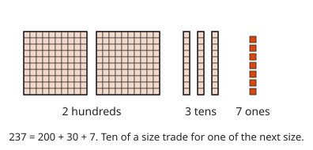
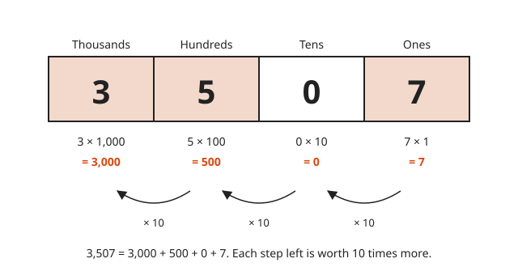
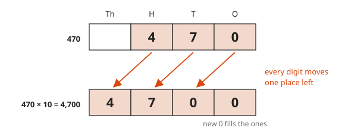
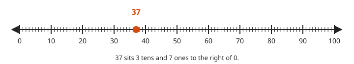
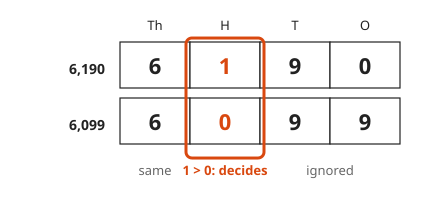
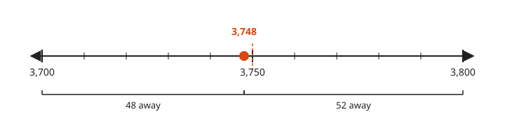
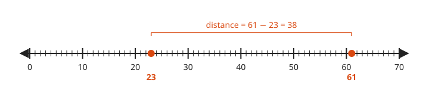
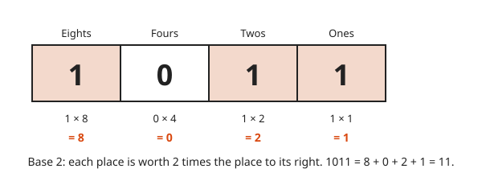

# Place Value and the Number Line

**Level:** 101 · **Unit:** 1 · **Time:** 30 to 45 minutes
**Prerequisites:** None. Start here.

## The Big Idea

A number like `3,507` is a short code. Each digit counts bundles. The position of the digit says how big the bundle is. The **number line** shows the same numbers as places on a ruler. Hold on to two pictures: a number is a count of bundles, and a number is a point on a line. Everything after this lesson uses both.

## Picture It

<!-- diagram: type=base-ten-blocks value=237 caption="237 = 200 + 30 + 7" -->


Ten single cubes make a rod of ten. Ten rods make a flat of one hundred. `237` is two flats, three rods and seven cubes. That is all a numeral is: a count of each size.

<!-- diagram: type=place-value-columns digits=3,5,0,7 places=1000,100,10,1 caption="3,507 = 3,000 + 500 + 0 + 7" -->


The same idea in columns. Each column holds one digit. Each column is worth ten times the column on its right.

## Step by Step

### 1. Digits and Places

There are ten digits: `0` to `9`. A digit alone has a face value. Its **place**, the column it sits in, multiplies that value by `1`, `10`, `100`, `1,000`, and onward.

### 2. Expanded Form

Write the number as the sum of its pieces. This is called **expanded form**.

$$3507 = 3 \times 1000 + 5 \times 100 + 0 \times 10 + 7 \times 1$$

### 3. The Zero Holds the Place

The `0` in `3,507` says: no tens here. It does no other work. Remove it and the `5` slides into the tens column. The number shrinks to `357`. Zero is small but not optional.

### 4. Times Ten Shifts Every Digit Left

<!-- diagram: type=digit-shift from=470 to=4700 caption="470 × 10 = 4,700" -->


Multiply by `10` and every digit moves one column left. A new `0` fills the ones column. Divide by `10` and every digit moves one column right.

### 5. Numbers on a Line

<!-- diagram: type=number-line range=0..100 major=10 minor=1 marks=37 caption="37 sits 3 tens and 7 ones to the right of 0" -->


The number line is a ruler that never ends. Start at `0`. Bigger numbers sit further right. `37` is three big steps of ten and seven small steps of one.

### 6. Comparing Numbers

<!-- diagram: type=compare-columns a=6190 b=6099 decides=hundreds caption="The first column that differs decides" -->


Line the numbers up by place. Read from the left. The first column where the digits differ decides. `6,190 > 6,099` because `1` hundred beats `0` hundreds. The `9`s to the right cannot make up a whole hundred. On the number line, the larger number sits further right.

### 7. Rounding

<!-- diagram: type=number-line range=3700..3800 marks=3748 brackets=3700..3748,3748..3800 caption="3,748 is closer to 3,700" -->


To **round** is to replace a number with the nearest round one. Find the two candidates on either side. Pick the closer. `3,748` is `48` from `3,700` and `52` from `3,800`. It rounds to `3,700`. A number exactly halfway rounds up. That is a convention, not a law of nature.

### 8. Distance

<!-- diagram: type=number-line range=0..70 marks=23,61 bracket=23..61 caption="Distance = larger − smaller" -->


The distance between two numbers is the larger minus the smaller. From `23` to `61` is `38`.

### 9. Other Bases

<!-- diagram: type=place-value-columns base=2 digits=1,0,1,1 caption="1011 in base 2 = 11" -->


Nothing forces bundles of ten. Computers use bundles of two. This is **binary**, or base 2. The columns are worth `1`, `2`, `4`, `8`, and onward. `1011` in binary is `8 + 0 + 2 + 1 = 11`.

### Why It Is True

Every whole number has exactly one way to be written in bundles, using at most nine of each size. The rule that forces this is the trade: ten of any bundle trade up for one of the next size. After all trades are done, each column holds a single digit. One number, one way to write it. The same rule with two instead of ten gives binary.

## Worked Examples

### Example 1: Expanded Form

```txt
  40,926
= 4 × 10,000 + 0 × 1,000 + 9 × 100 + 2 × 10 + 6 × 1    one term per digit
= 40,000     + 0         + 900     + 20     + 6        multiply each digit by its place
```

### Example 2: Rounding 3,748 to the Nearest Hundred

```txt
  3,748 sits between 3,700 and 3,800     the two candidates
  midpoint is 3,750                       halfway between them
  3,748 < 3,750                           it is on the lower half
  answer: 3,700                           take the closer candidate
```

### Example 3: How Many Tens in 3,507

```txt
  3,507 = 350 × 10 + 7      each hundred is 10 tens, each thousand is 100 tens
  answer: 350 tens          with 7 ones left over
```

In code this is `3507 / 10` and `3507 % 10` on integers.

## Common Mistakes

* Skipping the zero: `3,507` is not `357`. The zero holds the tens place.
* Comparing first digits only: `95` is not bigger than `120`. Line up the ones columns, then compare from the left.
* Rounding in a chain: `3,748` does not become `3,750` and then `3,800`. Look only at the digit right after the rounding place. The tens digit is `4`. Round down.

## Try It

1. Write `4,062` in expanded form.
2. What is the digit `8` worth in `58,301`?
3. Which is larger, `6,099` or `6,190`? Name the column that decides.
4. Round `3,748` to the nearest ten.
5. What is the distance between `23` and `61`?
6. What number sits halfway between `30` and `50`?
7. Compute `470 × 10` and `470 ÷ 10`. Describe what the digits do.
8. Convert binary `1101` to an ordinary number.

<details>
<summary>Answers</summary>

1. `4 × 1,000 + 0 × 100 + 6 × 10 + 2 × 1 = 4,000 + 0 + 60 + 2`.
2. `8,000`. It sits in the thousands place.
3. `6,190`. The thousands match. The hundreds digit `1` beats `0`.
4. `3,750`. The ones digit is `8`, which is `5` or more. The tens round up from `4` to `5`.
5. `38`. `61 - 23 = 38`.
6. `40`. It is `10` from each end.
7. `4,700` and `47`. The digits shift one place left, then one place right.
8. `13`. `1 × 8 + 1 × 4 + 0 × 2 + 1 × 1 = 13`.

</details>

## Code Corner

Integer division `/` and remainder `%` peel off the last digit. Repeat, and the places fall out. The program is in [code/main.go](code/main.go). Run it with `go run .` from the `code` folder.

<!-- GO:BEGIN -->
```go
// Place value: peel digits off a number with / and %.
package main

import (
	"fmt"
	"strconv"
)

// expand returns [digit, place] pairs, biggest place first.
func expand(n, base int) [][2]int {
	var parts [][2]int
	place := 1
	for n > 0 {
		parts = append([][2]int{{n % base, place}}, parts...)
		n /= base
		place *= base
	}
	return parts
}

// roundTo rounds n to the nearest multiple of unit. Halfway rounds up.
func roundTo(n, unit int) int {
	return (n + unit/2) / unit * unit
}

func main() {
	fmt.Println("3507 in base 10:", expand(3507, 10))
	fmt.Println("13 in base 2:   ", expand(13, 2))
	fmt.Println("3748 to nearest 100:", roundTo(3748, 100))
	fmt.Println("3748 to nearest 10: ", roundTo(3748, 10))
	fmt.Println("tens in 3507:", 3507/10, "remainder", 3507%10)
	fmt.Println("470 * 10 =", 470*10, " 470 / 10 =", 470/10)

	v, _ := strconv.ParseInt("1011", 2, 64)
	fmt.Println("binary 1011 =", v)
	fmt.Println("255 in base 2 =", strconv.FormatInt(255, 2), " in base 16 =", strconv.FormatInt(255, 16))
}
```

Output of `go run .`:

```txt
3507 in base 10: [[3 1000] [5 100] [0 10] [7 1]]
13 in base 2:    [[1 8] [1 4] [0 2] [1 1]]
3748 to nearest 100: 3700
3748 to nearest 10:  3750
tens in 3507: 350 remainder 7
470 * 10 = 4700  470 / 10 = 47
binary 1011 = 11
255 in base 2 = 11111111  in base 16 = ff
```
<!-- GO:END -->

Change the base to `16` and the same loop explains hexadecimal.

## Flashcards

Import [cards.tsv](cards.tsv) into Anki. The tags are `math::101::place-value`.

## Go Deeper

* [Math Is Fun: Place Value](https://www.mathsisfun.com/place-value.html): short, picture-heavy refresher.
* [Math Is Fun: Number Line](https://www.mathsisfun.com/number-line.html): simple examples on the line.
* [MacTutor: A History of Zero](https://mathshistory.st-andrews.ac.uk/HistTopics/Zero/): how the placeholder zero came to be.
* [Arithmetic and Number Sense track](../../../tracks/arithmetic-and-number-sense/README.md): more practice at this level.

**Next:** [The Four Operations](../02-the-four-operations/README.md)
