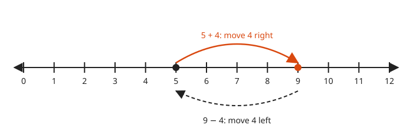
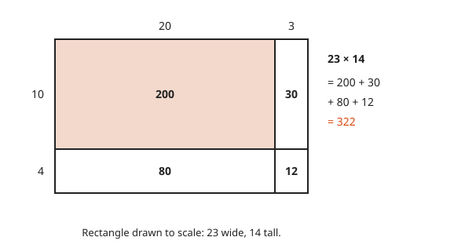
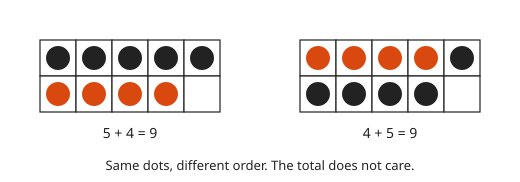
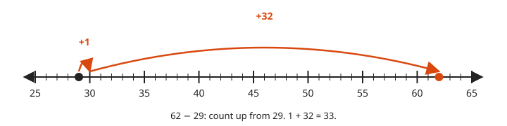
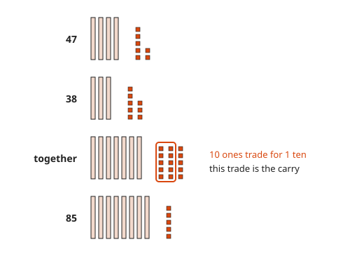
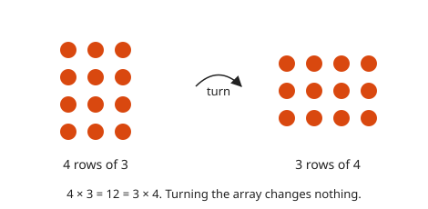
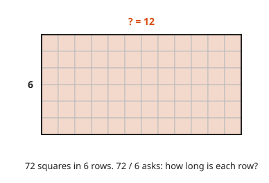
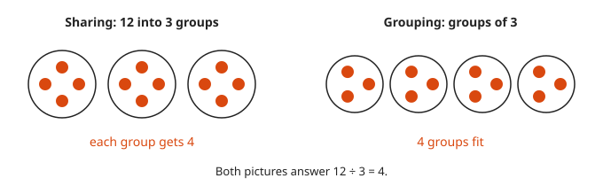
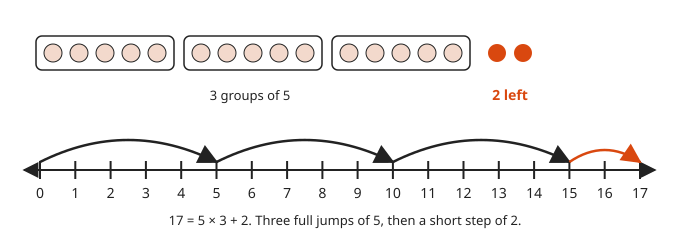

# The Four Operations

**Level:** 101 · **Unit:** 2 · **Time:** 45 to 60 minutes
**Prerequisites:** [Place Value and the Number Line](../01-place-value-and-the-number-line/README.md)

## The Big Idea

Addition and subtraction are moves along the number line. Multiplication and division are about rectangles. Multiplication finds the area from two sides. Division finds a missing side from the area and the other side. With these two pictures, carrying, borrowing and long multiplication stop being tricks. They become bookkeeping.

## Picture It

<!-- diagram: type=number-line range=0..12 jumps=5+4,9-4 caption="Addition moves right, subtraction moves left" -->


Start at `5`. Move `4` right. You land on `9`. That is `5 + 4 = 9`. Move `4` left from `9` and you are back at `5`. Subtraction undoes addition.

<!-- diagram: type=area-model a=20+3 b=10+4 scale=14px caption="23 × 14 = 200 + 30 + 80 + 12 = 322" -->


A rectangle `23` wide and `14` tall. Split each side by place value. Four easy rectangles appear. Add their areas. Long multiplication on paper does exactly this, with the rectangles hidden.

## Step by Step

### 1. Addition Combines

<!-- diagram: type=ten-frames a=5 b=4 caption="5 + 4 = 4 + 5 = 9" -->


`a + b` puts two amounts together. On the line, start at `a` and move `b` steps right. Order does not matter: `5 + 4 = 4 + 5`. This is the **commutative property**: swapping the order leaves the answer alone.

### 2. Subtraction Finds a Difference

<!-- diagram: type=number-line range=25..65 jumps=29+1,30+32 caption="62 − 29 by counting up" -->


`a - b` is the distance from `b` up to `a`. You can count up instead of taking away. For `62 - 29`: one step reaches `30`, then `32` more reach `62`. The answer is `33`. Cashiers did this for centuries.

### 3. Carrying Is Trading Bundles

<!-- diagram: type=base-ten-blocks a=47 b=38 trade=10ones caption="47 + 38 = 85" -->


When the ones pass `9`, trade ten ones for one ten. That trade is the **carry**. Borrowing is the reverse trade: break one ten into ten ones.

### 4. Multiplication Counts Equal Groups

<!-- diagram: type=array rows=4 cols=3 rotated=3x4 caption="4 × 3 = 3 × 4" -->


`4 × 3` is four groups of three. Lay them out in rows and you get a rectangle of dots, called an **array**. Turn it sideways and it is `3 × 4`. Same dots. Multiplication is commutative too.

### 5. The Distributive Property

Look again at the `23 × 14` rectangle in Picture It. Splitting a side splits the area:

$$a \times (b + c) = a \times b + a \times c$$

This is the **distributive property**. It powers mental math, long multiplication and most of algebra.

### 6. Division Undoes Multiplication

<!-- diagram: type=grid rows=6 cols=12 caption="72 ÷ 6 = 12: the missing side" -->


`72 ÷ 6` asks: what times `6` gives `72`? In the rectangle picture, you know the area, `72`, and one side, `6`. Find the other side: `12`.

<!-- diagram: type=groups n=12 share=3 group=3 caption="Sharing and grouping both give 12 ÷ 3 = 4" -->


Division has two everyday readings. **Sharing:** split `12` into `3` equal groups. How big is each group? **Grouping:** how many groups of `3` fit in `12`? Both answers are `4`.

### 7. Remainders

<!-- diagram: type=groups n=17 group=5 leftover=2 numberline=0..17 caption="17 = 5 × 3 + 2" -->


Not every division comes out even. `17 ÷ 5` gives `3` groups with `2` left over. Write it as `17 = 5 × 3 + 2`. The leftover is the **remainder**. It is always smaller than the number you divide by.

### 8. Never Divide by Zero

`6 ÷ 0` asks for a number that times `0` gives `6`. Anything times `0` is `0`. No such number exists. Division by zero is **undefined**: it has no answer. On the other hand, `0 ÷ 6 = 0` is fine, because `6 × 0 = 0`. Go agrees. It panics at runtime on integer division by zero.

### Why It Is True

The distributive property is visible in the area model. A rectangle of width `b + c` and height `a` is two rectangles side by side. One is `a` by `b`. The other is `a` by `c`. Areas add. Cut the paper, and the pieces still cover the same space.

## Worked Examples

### Example 1: Addition with a Carry

```txt
  47 + 38
= (40 + 7) + (30 + 8)       split by place value
= (40 + 30) + (7 + 8)       tens with tens, ones with ones
= 70 + 15                   add each group
= 70 + 10 + 5               15 ones is 1 ten and 5 ones
= 85                        the trade is the carry
```

### Example 2: Multiplication with the Area Model

```txt
  23 × 14
= (20 + 3) × (10 + 4)              split both sides by place value
= 20×10 + 3×10 + 20×4 + 3×4        one product per rectangle
= 200   + 30   + 80   + 12         each small area
= 322                              add the areas
```

### Example 3: Division by Splitting

```txt
  96 ÷ 4
  96 = 80 + 16          pieces that 4 divides cleanly
  80 ÷ 4 = 20           first piece
  16 ÷ 4 = 4            second piece
  96 ÷ 4 = 20 + 4 = 24  the pieces add, by the distributive property
  check: 24 × 4 = 96    multiply back
```

### Example 4: Division with a Remainder

```txt
  100 ÷ 7
  7 × 14 = 98       largest multiple of 7 that fits in 100
  100 - 98 = 2      what is left
  100 = 7 × 14 + 2  quotient 14, remainder 2
```

## Common Mistakes

* Subtracting the smaller digit from the larger in each column: `62 - 29` is not `47`. In the ones column, `2 - 9` needs a borrow. Trade one ten for ten ones first.
* Forgetting the cross terms: `23 × 14` is not `20 × 10 + 3 × 4 = 212`. The area model has four rectangles, not two. Draw it.
* Swapping in subtraction or division: `8 - 3` is not `3 - 8`. `12 ÷ 4` is not `4 ÷ 12`. Only addition and multiplication allow swapping.
* Writing `5 ÷ 0 = 0`: it is undefined. Only `0 ÷ 5 = 0`.

## Try It

1. Compute `38 + 47`. Say where the carry happens.
2. Compute `62 - 29` by counting up from `29`.
3. Draw the area model for `34 × 12` and compute the product.
4. Compute `125 × 8` in your head. Hint: `8 = 2 × 2 × 2`.
5. Compute `84 ÷ 7`.
6. Compute `100 ÷ 7` with a remainder. Write the check `100 = 7 × q + r`.
7. In one sentence, why is `0 ÷ 5 = 0` but `5 ÷ 0` undefined?
8. A service runs `12` pods. Each handles `45` requests per second. What is the total?

<details>
<summary>Answers</summary>

1. `85`. The ones give `15`, which carries one ten.
2. `33`. One step to `30`, then `32` to `62`.
3. `408`. The rectangles are `300`, `40`, `60` and `8`.
4. `1,000`. `125 → 250 → 500 → 1,000`.
5. `12`. `7 × 12 = 84`.
6. Quotient `14`, remainder `2`. `100 = 7 × 14 + 2`.
7. `5 × 0 = 0` makes `0 ÷ 5 = 0` work, but no number times `0` gives `5`.
8. `540` requests per second. `12 × 40 + 12 × 5 = 480 + 60`.

</details>

## Code Corner

The program splits two-digit products into area-model rectangles, checks the remainder identity `a == b*q + r`, and shows Go refusing to divide by zero. The source is in [code/main.go](code/main.go). Run it with `go run .` from the `code` folder.

<!-- GO:BEGIN -->
```go
// The four operations: the area model, and division with a remainder.
package main

import "fmt"

// areaModel splits two 2-digit numbers by place value and adds the four rectangles.
func areaModel(a, b int) {
	aT, aO := a/10*10, a%10
	bT, bO := b/10*10, b%10
	parts := []int{aT * bT, aO * bT, aT * bO, aO * bO}
	sum := 0
	for _, p := range parts {
		sum += p
	}
	fmt.Printf("%d × %d: rectangles %v, total %d (check %d)\n", a, b, parts, sum, a*b)
}

// safeDiv recovers from the panic Go raises on integer division by zero.
func safeDiv(a, b int) (q int, err error) {
	defer func() {
		if r := recover(); r != nil {
			err = fmt.Errorf("%v", r)
		}
	}()
	return a / b, nil
}

func main() {
	areaModel(23, 14)
	areaModel(34, 12)

	for _, p := range [][2]int{{17, 5}, {100, 7}, {96, 4}} {
		a, b := p[0], p[1]
		q, r := a/b, a%b
		fmt.Printf("%d = %d × %d + %d   (identity holds: %v)\n", a, b, q, r, a == b*q+r)
	}

	if _, err := safeDiv(5, 0); err != nil {
		fmt.Println("5 / 0:", err)
	}
	q, _ := safeDiv(0, 5)
	fmt.Println("0 / 5:", q)
}
```

Output of `go run .`:

```txt
23 × 14: rectangles [200 30 80 12], total 322 (check 322)
34 × 12: rectangles [300 40 60 8], total 408 (check 408)
17 = 5 × 3 + 2   (identity holds: true)
100 = 7 × 14 + 2   (identity holds: true)
96 = 4 × 24 + 0   (identity holds: true)
5 / 0: runtime error: integer divide by zero
0 / 5: 0
```
<!-- GO:END -->

## Flashcards

Import [cards.tsv](cards.tsv) into Anki. The tags are `math::101::operations`.

## Go Deeper

* [Better Explained: Rethinking Arithmetic, a Visual Guide](https://betterexplained.com/articles/rethinking-arithmetic-a-visual-guide/): the operations as geometric moves.
* [Khan Academy: Arithmetic](https://www.khanacademy.org/math/arithmetic): drills with instant feedback.
* [OpenStax Prealgebra 2e](https://openstax.org/details/books/prealgebra-2e): free textbook. Chapter one covers whole-number operations.

**Next:** [Negative Numbers](../03-negative-numbers/README.md)
