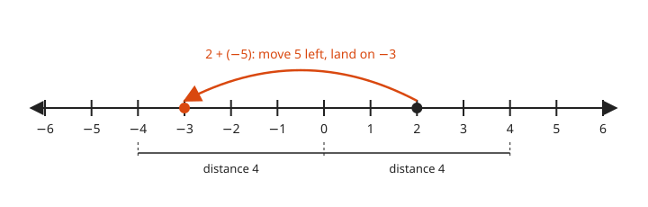
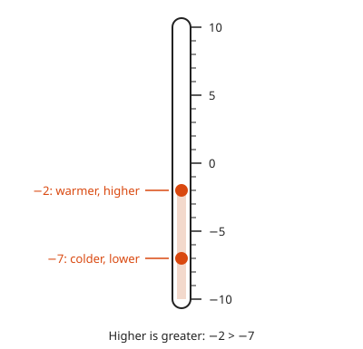
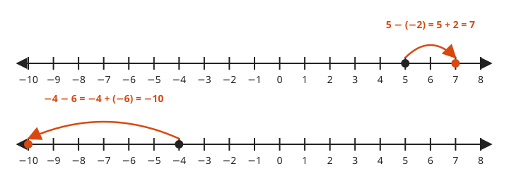
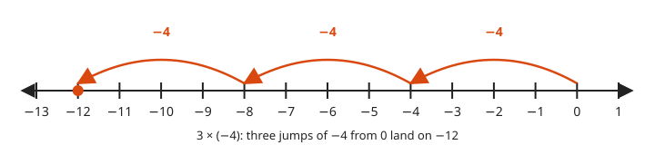
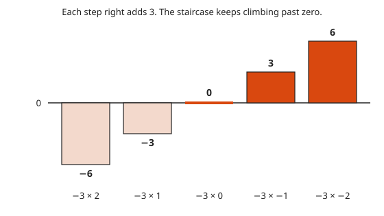
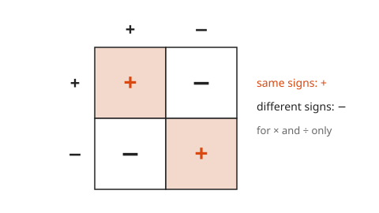
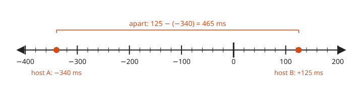

# Negative Numbers

**Level:** 101 · **Unit:** 3 · **Time:** 45 minutes
**Prerequisites:** [The Four Operations](../02-the-four-operations/README.md)

## The Big Idea

Extend the number line to the left of zero. You get the **negative numbers**. They measure things below a reference point: degrees below freezing, money owed, seconds before a deploy, a clock running behind. Every rule for negatives comes from one picture: the number line with zero in the middle.

## Picture It

<!-- diagram: type=number-line range=-6..6 jumps=2+(-5) brackets=-4..0,0..4 caption="2 + (−5) = −3; −4 and 4 are opposites" -->


Adding a negative moves left. Start at `2`, add `−5`, move five steps left, land on `−3`. Below the line, `−4` and `4` sit the same distance from zero on opposite sides.

## Step by Step

### 1. Order

<!-- diagram: type=thermometer range=-10..10 marks=-2,-7 caption="Higher is greater" -->


On a number line, right is greater. On a thermometer, up is greater. `−2 > −7`. Minus seven degrees is colder than minus two. After a minus sign, a bigger digit means a smaller number.

### 2. Opposites and Absolute Value

Look at the brackets in Picture It. The **opposite** of a number is its mirror image across zero. The opposite of `4` is `−4`. The opposite of `−3` is `3`. A number plus its opposite is `0`.

The **absolute value** $|a|$ is the distance from `a` to `0`. Distance is never negative: $|-4| = 4$ and $|4| = 4$.

### 3. Adding

Adding a positive moves right. Adding a negative moves left. `−8 + 3`: start at `−8`, move three right, land on `−5`.

### 4. Subtracting Is Adding the Opposite

<!-- diagram: type=number-line range=-10..8 jumps=5-(-2),(-4)-6 caption="a − b = a + (−b)" -->


One rule covers every case:

$$a - b = a + (-b)$$

Subtracting `−2` is adding `2`: move right. Subtracting `6` is adding `−6`: move left.

### 5. Multiplying a Positive by a Negative

<!-- diagram: type=number-line range=-13..1 jumps=0-4,-4-4,-8-4 caption="3 × (−4) = −12" -->


`3 × (−4)` is three jumps of `−4`. Start at `0`. Land on `−12`. Positive times negative is negative.

### 6. Multiplying Two Negatives

<!-- diagram: type=bar-chart values=-6,-3,0,3,6 labels="−3×2..−3×−2" caption="Each step adds 3" -->


Watch `−3 × n` as `n` counts down: `−6`, `−3`, `0`. Each step adds `3`. The pattern does not stop at zero. Next come `3` and `6`. A negative times a negative is positive.

### 7. The Sign Rules

<!-- diagram: type=table rows=+,− cols=+,− caption="Same signs +, different signs −" -->


Same signs give a positive result. Different signs give a negative result. Division follows the same rules, because division undoes multiplication. `−24 ÷ 3 = −8` because `3 × (−8) = −24`. These rules are for `×` and `÷` only. Two negatives added together stay negative.

### Why a Negative Times a Negative Is Positive

```txt
  −3 ×  2 = −6
  −3 ×  1 = −3      up by 3
  −3 ×  0 =  0      up by 3
  −3 × −1 =  3      the pattern continues
  −3 × −2 =  6      and again
```

Each time the second number drops by one, you remove one copy of `−3`. Removing a debt raises the total by `3`. Any other answer breaks the distributive property. Arithmetic falls apart. Mathematicians prefer that it does not.

## Worked Examples

### Example 1: Adding a Negative

```txt
  2 + (−5)
  start at 2               the first number is the start
  move 5 left              adding a negative moves left
  = −3                     two steps reach 0, three more reach −3
```

### Example 2: Subtracting a Negative

```txt
  −4 - (−9)
= −4 + 9                   subtracting is adding the opposite
= 5                        from −4, move 9 right: 4 steps to 0, 5 more
```

### Example 3: Multiplying and Dividing

```txt
  (−6) × (−7) = 42         same signs: positive; 6 × 7 = 42
  (−36) ÷ 4   = −9         different signs: negative; 36 ÷ 4 = 9
  (−36) ÷ (−4) = 9         same signs: positive
```

### Example 4: Clock Skew

<!-- diagram: type=number-line range=-400..200 unit=ms marks=-340,125 bracket=-340..125 caption="465 ms apart" -->


Host A reads `−340 ms` against the reference clock. Host B reads `+125 ms`. How far apart are they?

```txt
  125 - (−340)
= 125 + 340                subtracting is adding the opposite
= 465 ms                   the distance between the two points
```

## Common Mistakes

* Writing `−7 > −2` because `7 > 2`: further left is smaller. Picture the thermometer.
* Treating `5 - (−2)` as `3`: it is `5 + 2 = 7`.
* Using the multiplication rule for addition: `−3 + (−4)` is `−7`, not `7`.
* Dropping the sign inside absolute value: $|3 - 8|$ is $|-5| = 5$. Compute inside first.

## Try It

1. `−8 + 3`
2. `−4 - 6`
3. `5 - (−2)`
4. `−3 - (−3)`
5. `(−5) × 6`
6. `(−9) × (−4)`
7. `(−36) ÷ (−4)`
8. Order from least to greatest: `−7`, `−2`, `0`, `3`, `−10`.
9. Find $|-12|$ and the distance between `−3` and `5`.
10. It is `−4` degrees. The temperature rises `11` degrees. What is it now?

<details>
<summary>Answers</summary>

1. `−5`.
2. `−10`.
3. `7`.
4. `0`.
5. `−30`. Different signs.
6. `36`. Same signs.
7. `9`. Same signs.
8. `−10, −7, −2, 0, 3`.
9. `12` and `8`. `5 - (−3) = 8`.
10. `7` degrees. `−4 + 11 = 7`.

</details>

## Code Corner

The program checks the sign rules on every pair from `−5` to `5`, then runs the worked examples. Note the last line. Go integer division rounds toward zero: `−7 / 2` is `−3`. Python rounds down and gets `−4`. Check before you port code. The source is in [code/main.go](code/main.go). Run it with `go run .` from the `code` folder.

<!-- GO:BEGIN -->
```go
// Negative numbers: check the sign rules instead of trusting them.
package main

import "fmt"

func abs(x int) int {
	if x < 0 {
		return -x
	}
	return x
}

func main() {
	checks := 0
	for a := -5; a <= 5; a++ {
		for b := -5; b <= 5; b++ {
			if a-b != a+(-b) {
				panic("subtract is not add-the-opposite")
			}
			positive := a*b > 0
			sameSign := a != 0 && b != 0 && (a > 0) == (b > 0)
			if positive != sameSign {
				panic("sign rule broken")
			}
			if abs(a-b) != abs(b-a) {
				panic("distance is not symmetric")
			}
			checks++
		}
	}
	fmt.Println("sign rules hold for", checks, "pairs")

	fmt.Println("2 + (-5) =", 2+(-5))
	fmt.Println("-4 - (-9) =", -4-(-9))
	fmt.Println("(-6) * (-7) =", (-6)*(-7))
	fmt.Println("clock skew 125 - (-340) =", 125-(-340), "ms")

	// Go integer division rounds toward zero.
	fmt.Println("-7 / 2 =", -7/2, "  -7 % 2 =", -7%2)
}
```

Output of `go run .`:

```txt
sign rules hold for 121 pairs
2 + (-5) = -3
-4 - (-9) = 5
(-6) * (-7) = 42
clock skew 125 - (-340) = 465 ms
-7 / 2 = -3   -7 % 2 = -1
```
<!-- GO:END -->

## Flashcards

Import [cards.tsv](cards.tsv) into Anki. The tags are `math::101::negatives`.

## Go Deeper

* [Math Is Fun: Positive and Negative Numbers](https://www.mathsisfun.com/positive-negative-integers.html): the number line rules with a simple game.
* [MacTutor: Brahmagupta](https://mathshistory.st-andrews.ac.uk/Biographies/Brahmagupta/): the seventh-century mathematician who wrote down rules for negatives and zero.

**Next:** [Factors, Multiples and Primes](../04-factors-multiples-and-primes/README.md)
