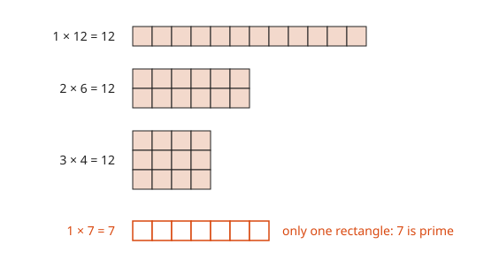
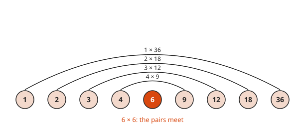
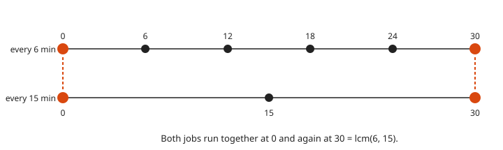
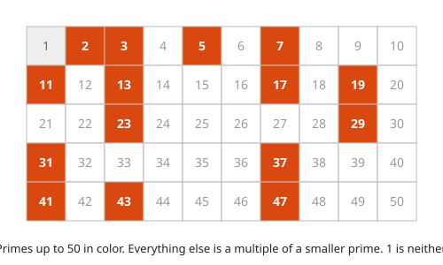
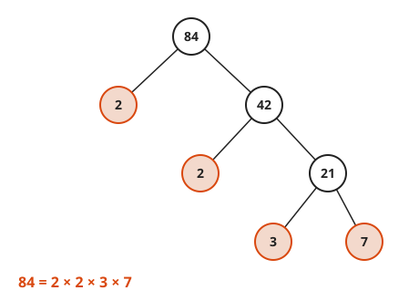
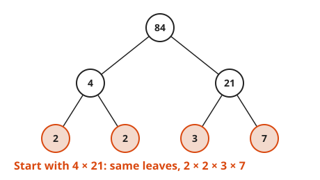
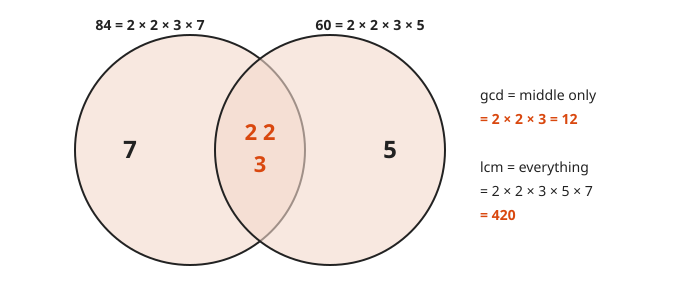
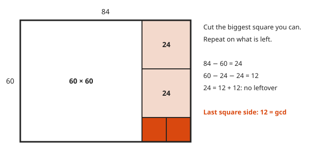

# Factors, Multiples and Primes

**Level:** 101 · **Unit:** 4 · **Time:** 45 to 60 minutes
**Prerequisites:** [The Four Operations](../02-the-four-operations/README.md)

## The Big Idea

A **factor** of a number divides it with no remainder. A **multiple** of a number is that number times a whole number. A **prime** is a number greater than `1` whose only factors are `1` and itself. Primes are the atoms of multiplication. Every whole number above `1` breaks into primes in exactly one way. Fractions, cryptography and job scheduling all rest on that fact.

## Picture It

<!-- diagram: type=factor-rectangles n=12 shapes=1x12,2x6,3x4 prime=7 caption="12 makes three rectangles; 7 makes only one" -->


Arrange `12` tiles into a solid rectangle. You can make `1 × 12`, `2 × 6` and `3 × 4`. The side lengths are the factors of `12`: `1, 2, 3, 4, 6, 12`. Try `7` tiles. Only the thin strip works. That is what prime looks like: no rectangle except the trivial one.

## Step by Step

### 1. Factors Come in Pairs

<!-- diagram: type=pairs n=36 factors=1,2,3,4,6,9,12,18,36 caption="Pairs meet at 6 × 6" -->


Factors pair up to multiply to the number. For `36`: `1 × 36`, `2 × 18`, `3 × 12`, `4 × 9`, `6 × 6`. When the pairs meet in the middle, you have them all.

### 2. Only Check Up to the Square Root

In each pair, one factor is at most the **square root** of the number: the value that times itself gives the number. To test whether `91` is prime, try divisors up to `9` only, because `10 × 10 = 100 > 91`. `7` works: `91 = 7 × 13`. It is not prime. It only looks prime. Many odd numbers do.

### 3. Multiples

<!-- diagram: type=timeline step=6,15 range=0..30 meet=0,30 caption="Multiples of 6 and 15 meet at 30" -->


The multiples of `6` are `6, 12, 18, 24, 30, ...`, the skip-count. A job that runs every `6` minutes runs at the multiples of `6`.

### 4. Prime or Composite

<!-- diagram: type=grid range=1..50 highlight=primes caption="Sieve of Eratosthenes" -->


A number above `1` is **prime** if it has exactly two factors. It is **composite** if it has more. The number `1` has only one factor. It is neither. To find primes, use the **Sieve of Eratosthenes**: cross out every multiple of `2`, then of `3`, then of `5`, and onward. What survives is prime.

### 5. Prime Factorization

<!-- diagram: type=tree root=84 children=2,42;2,21;3,7 primes=2,2,3,7 caption="84 = 2 × 2 × 3 × 7" -->


A **factor tree** keeps splitting until every leaf is prime. Write the leaves smallest first, with exponents for repeats: $84 = 2^2 \times 3 \times 7$. (The small raised `2` is an exponent: two copies of `2` multiplied. [Lesson 9](../09-exponents-roots-and-order-of-operations/README.md) covers it.)

<!-- diagram: type=tree root=84 children=4,21;2,2;3,7 caption="Different start, same leaves" -->


Start the tree another way. The leaves come out the same. The **Fundamental Theorem of Arithmetic** says this always happens: each number has one prime factorization.

### 6. GCD and LCM

<!-- diagram: type=venn a=84:2,2,3,7 b=60:2,2,3,5 caption="gcd = overlap, lcm = everything" -->


The **greatest common divisor (GCD)** is the largest number that divides both. Take the shared primes: the overlap. The **least common multiple (LCM)** is the smallest number both divide. Take every prime in the picture, shared ones once. A check: $\gcd(a,b) \times \operatorname{lcm}(a,b) = a \times b$.

### 7. Euclid's Shortcut for the GCD

<!-- diagram: type=squares w=84 h=60 cuts=60,24,24,12,12 caption="The last square side is the gcd" -->


Factoring big numbers is slow. Euclid found a faster way about 2,300 years ago. Cut the largest square you can from the rectangle. Repeat on what is left. When the squares fit exactly, the side of the last square is the GCD. In numbers: replace the larger number with the remainder, and repeat until the remainder is `0`.

### 8. Quick Divisibility Tests

* By `2`: the last digit is even.
* By `5`: the last digit is `0` or `5`.
* By `10`: the last digit is `0`.
* By `3`: the digit sum divides by `3`.
* By `9`: the digit sum divides by `9`.

### Why There Is No Largest Prime

Suppose you have a list of all the primes. Multiply them together and add `1`. Call the result `N`. Divide `N` by any prime on the list. The remainder is `1`. Every number above `1` has a prime factor, and `N` has none on the list. The list was incomplete. Euclid wrote this argument down, and no list has ever beaten it.

## Worked Examples

### Example 1: GCD and LCM from Factorizations

```txt
  84 = 2² × 3 × 7               factor tree
  60 = 2² × 3 × 5               factor tree: 60 = 6 × 10 = 2 × 3 × 2 × 5
  gcd = 2² × 3      = 12        shared primes only
  lcm = 2² × 3 × 5 × 7 = 420    every prime, shared ones once
  check: 12 × 420 = 5,040       gcd × lcm
         84 × 60  = 5,040       equals a × b
```

### Example 2: Euclid's Algorithm

```txt
  gcd(84, 60)
  84 = 1 × 60 + 24      cut one 60-square; 24 left over
  60 = 2 × 24 + 12      cut two 24-squares; 12 left over
  24 = 2 × 12 + 0       two 12-squares fit exactly: stop
  gcd = 12              the last nonzero remainder
```

### Example 3: Cron Jobs That Collide

A backup runs every `6` minutes. Log rotation runs every `15` minutes. Both run at `00:00`. When do they next run together? See the timeline in step 3.

```txt
  6  = 2 × 3            prime factorization
  15 = 3 × 5            prime factorization
  lcm = 2 × 3 × 5 = 30  every prime, shared ones once
  answer: 00:30         the first shared multiple
```

## Common Mistakes

* Calling `1` prime: a prime needs exactly two different factors. `1` has one.
* Calling every odd number prime: `9`, `15`, `21` and `91` are odd and composite.
* Mixing up GCD and LCM: the GCD is at most the smaller number. The LCM is at least the larger number. Check the size.
* Stopping a factor tree early: `84 = 4 × 21` is a factorization, but not a prime one. Split until every leaf is prime.

## Try It

1. List all factors of `36`.
2. List the first five multiples of `7`.
3. List every prime less than `30`.
4. Is `91` prime? Show why or why not.
5. Find the prime factorization of `360`.
6. Find $\gcd(48, 180)$ and $\operatorname{lcm}(48, 180)$.
7. Two jobs run every `6` and every `8` minutes, both starting at `00:00`. When do they next coincide?
8. Is `5,742` divisible by `3`? By `9`?

<details>
<summary>Answers</summary>

1. `1, 2, 3, 4, 6, 9, 12, 18, 36`.
2. `7, 14, 21, 28, 35`.
3. `2, 3, 5, 7, 11, 13, 17, 19, 23, 29`.
4. No. `91 = 7 × 13`.
5. $360 = 2^3 \times 3^2 \times 5$.
6. $48 = 2^4 \times 3$ and $180 = 2^2 \times 3^2 \times 5$. GCD `12`. LCM $2^4 \times 3^2 \times 5 = 720$. Check: `12 × 720 = 8,640 = 48 × 180`.
7. `00:24`. $\operatorname{lcm}(6, 8) = 24$.
8. Yes to both. `5 + 7 + 4 + 2 = 18`. `5,742 = 9 × 638`.

</details>

## Code Corner

A sieve, a factorizer that stops at the square root, and Euclid's algorithm printing its steps. The source is in [code/main.go](code/main.go). Run it with `go run .` from the `code` folder.

<!-- GO:BEGIN -->
```go
// Factors, multiples and primes: sieve, factorize, Euclid.
package main

import "fmt"

// primesBelow returns every prime less than n (Sieve of Eratosthenes).
func primesBelow(n int) []int {
	composite := make([]bool, n)
	var primes []int
	for p := 2; p < n; p++ {
		if composite[p] {
			continue
		}
		primes = append(primes, p)
		for m := p * p; m < n; m += p {
			composite[m] = true
		}
	}
	return primes
}

// factorize returns the prime factors of n, smallest first.
func factorize(n int) []int {
	var fs []int
	for p := 2; p*p <= n; p++ { // only up to the square root
		for n%p == 0 {
			fs = append(fs, p)
			n /= p
		}
	}
	if n > 1 {
		fs = append(fs, n)
	}
	return fs
}

// gcd is Euclid's algorithm. With show set, it prints each step.
func gcd(a, b int, show bool) int {
	for b != 0 {
		if show {
			fmt.Printf("  %d = %d × %d + %d\n", a, a/b, b, a%b)
		}
		a, b = b, a%b
	}
	return a
}

func main() {
	fmt.Println("primes below 50:", primesBelow(50))
	for _, n := range []int{84, 60, 360, 91} {
		fmt.Println(n, "=", factorize(n))
	}
	fmt.Println("gcd(84, 60):")
	g := gcd(84, 60, true)
	fmt.Println("  gcd =", g, " lcm =", 84*60/g)
	fmt.Println("jobs every 6 and 15 min meet every", 6*15/gcd(6, 15, false), "min")
}
```

Output of `go run .`:

```txt
primes below 50: [2 3 5 7 11 13 17 19 23 29 31 37 41 43 47]
84 = [2 2 3 7]
60 = [2 2 3 5]
360 = [2 2 2 3 3 5]
91 = [7 13]
gcd(84, 60):
  84 = 1 × 60 + 24
  60 = 2 × 24 + 12
  24 = 2 × 12 + 0
  gcd = 12  lcm = 420
jobs every 6 and 15 min meet every 30 min
```
<!-- GO:END -->

## Flashcards

Import [cards.tsv](cards.tsv) into Anki. The tags are `math::101::primes`.

## Go Deeper

* [Math Is Fun: Prime Factorization](https://www.mathsisfun.com/prime-factorization.html): factor trees with many examples.
* [Euclid, Elements Book IX, Proposition 20](https://aleph0.clarku.edu/~djoyce/elements/bookIX/propIX20.html): the original proof that primes never run out.
* [Wolfram MathWorld: Fundamental Theorem of Arithmetic](https://mathworld.wolfram.com/FundamentalTheoremofArithmetic.html): the formal statement.
* [Number Theory for Cryptography workshop](../../../workshops/number-theory-for-cryptography/README.md): where primes and GCD power real security.

**Next:** [Fractions: Meaning and Equivalence](../05-fractions-meaning-and-equivalence/README.md)
