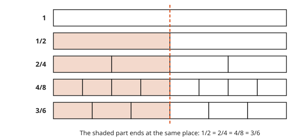
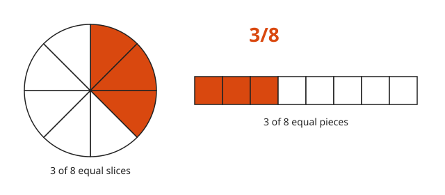
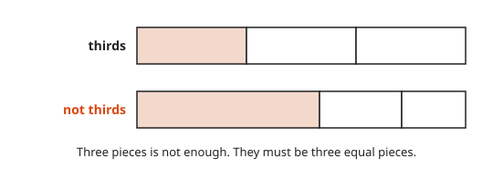
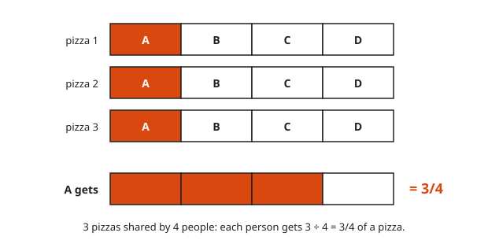
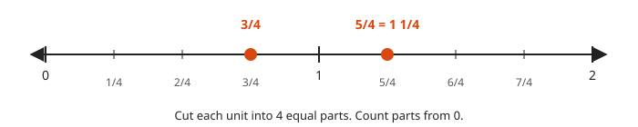
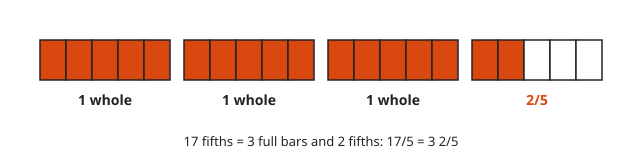
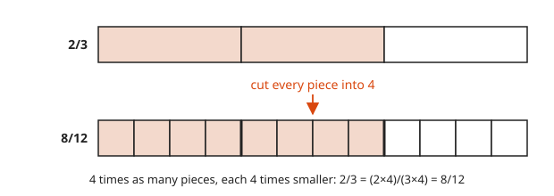
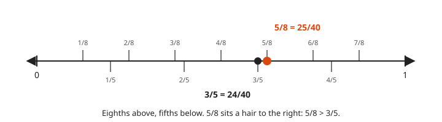

# Fractions: Meaning and Equivalence

**Level:** 101 · **Unit:** 5 · **Time:** 45 minutes
**Prerequisites:** [Factors, Multiples and Primes](../04-factors-multiples-and-primes/README.md)

## The Big Idea

The fraction $\frac{a}{b}$ means: cut one whole into `b` equal pieces and take `a` of them. The bottom number, the **denominator**, names the size of the piece. The top number, the **numerator**, counts the pieces. Different fractions can name the same amount, the same way `2 × 500 ms` and `1 s` name the same wait.

## Picture It

<!-- diagram: type=fraction-bars rows=1/1,1/2,2/4,4/8,3/6 caption="1/2 = 2/4 = 4/8 = 3/6" -->


Every bar is the same whole. Cut it into more pieces and each piece shrinks. Shade proportionally more pieces and the shaded length stays put. `1/2`, `2/4`, `4/8` and `3/6` are **equivalent fractions**: different names for the same amount.

## Step by Step

### 1. A Fraction Is Pieces

<!-- diagram: type=pie+bar n=8 shaded=3 caption="3/8 two ways" -->


`3/8` means: cut into `8` equal pieces, take `3`. A pie and a bar show the same thing. Use whichever your eye prefers.

### 2. The Pieces Must Be Equal

<!-- diagram: type=fraction-bars rows=3equal,3unequal caption="Equal pieces or it is not a fraction" -->


Three pieces is not enough. They must be three equal pieces. The large slice of an unevenly cut pie is not `1/3`. Siblings know this.

### 3. A Fraction Is a Division

<!-- diagram: type=fraction-bars share=3/4 caption="3 ÷ 4 = 3/4" -->


$\frac{3}{4} = 3 \div 4$. Share `3` pizzas among `4` people. Cut each pizza in quarters. Each person gets one quarter from each pizza: `3` quarters, which is `3/4` of a pizza.

### 4. A Fraction Is a Point

<!-- diagram: type=number-line range=0..2 minor=1/4 marks=3/4,5/4 caption="Fractions are points on the number line" -->


Cut each unit of the number line into `4` equal parts. `3/4` is three parts from `0`. `5/4` is five parts from `0`, past `1`.

### 5. Improper Fractions and Mixed Numbers

<!-- diagram: type=fraction-bars den=5 count=17 caption="17/5 = 3 2/5" -->


When the top is bigger than the bottom, you have an **improper fraction**, such as `17/5`. You can write it as a **mixed number**: a whole number plus a fraction. Divide: `17 = 5 × 3 + 2`. That is `3` wholes and `2` fifths: `3 2/5`. To go back, multiply and add: `3 × 5 + 2 = 17`.

### 6. Equivalent Fractions

<!-- diagram: type=fraction-bars from=2/3 cut=4 to=8/12 caption="2/3 = 8/12" -->


Multiply the top and bottom by the same number. The value does not change:

$$\frac{a}{b} = \frac{a \times k}{b \times k}$$

In the picture, multiplying by `k` cuts every piece into `k` smaller pieces. You get `k` times as many pieces, each `k` times smaller. Same amount.

### 7. Simplest Form

Run the rule backwards. Divide the top and bottom by a common factor. Divide by the GCD from [lesson 4](../04-factors-multiples-and-primes/README.md) and you reach **simplest form** in one step: top and bottom share no factor except `1`.

### 8. Comparing Fractions

<!-- diagram: type=number-line range=0..1 ticks=1/8,1/5 marks=5/8,3/5 caption="5/8 > 3/5" -->


Give both fractions the same denominator. Then compare tops. Same-size pieces compare by count. On the number line, the larger fraction sits further right.

### Why Equivalence Works

$\frac{k}{k} = 1$ for any `k` except `0`: `k` pieces of size `1/k` make one whole. Multiplying by `1` changes nothing. $\frac{a}{b} \times \frac{k}{k} = \frac{a \times k}{b \times k}$ is multiplying by `1` in a disguise.

## Worked Examples

### Example 1: Simplify 18/24

```txt
  18/24
  gcd(18, 24) = 6               18 = 2 × 3², 24 = 2³ × 3, shared: 2 × 3
  = (18 ÷ 6) / (24 ÷ 6)         divide top and bottom by the GCD
  = 3/4                         3 and 4 share no factor: simplest form
```

### Example 2: Improper to Mixed

```txt
  17/5
  17 = 5 × 3 + 2        divide: quotient 3, remainder 2
  = 3 + 2/5             3 wholes and 2 fifths
  = 3 2/5               mixed number
```

### Example 3: Compare 5/8 and 3/5

```txt
  common denominator: 8 × 5 = 40     a multiple of both bottoms
  5/8 = 25/40                        top and bottom times 5
  3/5 = 24/40                        top and bottom times 8
  25/40 > 24/40                      same-size pieces: more wins
  answer: 5/8 > 3/5
```

## See It Step by Step


[Equivalent Fractions with Circles: open the step-by-step walkthrough](https://caseyaedwards.github.io/math_training/diagrams/equivalent-fractions-circles/)

Watch every slice split into equal smaller slices while the shaded amount stays the same.


[Equivalent Fractions on Number Lines: open the step-by-step walkthrough](https://caseyaedwards.github.io/math_training/diagrams/equivalent-fractions-number-lines/)

Watch the marks for 3/4, 6/8 and 9/12 line up at the same point on the stacked lines.

## Common Mistakes

* Adding to top and bottom: `1/2` is not `2/3`. Only multiplying or dividing both by the same number keeps the value.
* Bigger denominator, bigger fraction: no. `1/8 < 1/4`. More cuts make smaller pieces.
* Cancelling digits: `16/64 = 1/4`, but crossing out the `6`s is a coincidence. Divide by a real common factor, `16`.
* Unequal pieces: see step 2.

## Try It

1. A bar has `8` equal pieces and `3` are shaded. Write the fraction.
2. Simplify `12/16`, `45/60` and `14/49`.
3. Fill in the blank: $\frac{2}{3} = \frac{?}{12}$.
4. Write `23/4` as a mixed number.
5. Write `2 5/6` as an improper fraction.
6. Which is larger, `7/12` or `5/8`?
7. Order from least to greatest: `1/2`, `2/5`, `3/4`, `5/8`.
8. Between which two whole numbers does `7/3` sit? Where exactly?

<details>
<summary>Answers</summary>

1. `3/8`.
2. `3/4` (divide by `4`), `3/4` (divide by `15`), `2/7` (divide by `7`).
3. `8`. The bottom was multiplied by `4`. Do the same to the top.
4. `5 3/4`. `23 = 4 × 5 + 3`.
5. `17/6`. `2 × 6 + 5 = 17`.
6. `5/8`. Over `24`: `14/24` against `15/24`.
7. `2/5, 1/2, 5/8, 3/4`. Over `40`: `16, 20, 25, 30`.
8. Between `2` and `3`, one third of the way. `7/3 = 2 1/3`.

</details>

## Code Corner

The Go `math/big` package has a `Rat` type that stores exact fractions and simplifies them on the way in. The source is in [code/main.go](code/main.go). Run it with `go run .` from the `code` folder.

<!-- GO:BEGIN -->
```go
// Fractions: math/big.Rat stores exact fractions in simplest form.
package main

import (
	"fmt"
	"math/big"
)

func main() {
	fmt.Println("18/24 =", big.NewRat(18, 24))

	// NewRat simplifies on the way in: 2/4, 4/8 and 3/6 all land on 1/2.
	half := big.NewRat(1, 2)
	for _, p := range [][2]int64{{2, 4}, {4, 8}, {3, 6}} {
		r := big.NewRat(p[0], p[1])
		fmt.Printf("%d/%d is stored as %v, equal to 1/2: %v\n", p[0], p[1], r, half.Cmp(r) == 0)
	}

	// Cmp returns 1 when the first is larger.
	fmt.Println("5/8 vs 3/5:", big.NewRat(5, 8).Cmp(big.NewRat(3, 5)))

	// Improper to mixed: quotient and remainder.
	for _, p := range [][2]int{{17, 5}, {23, 4}} {
		fmt.Printf("%d/%d = %d %d/%d\n", p[0], p[1], p[0]/p[1], p[0]%p[1], p[1])
	}

	// A fraction is a division.
	f, _ := big.NewRat(3, 4).Float64()
	fmt.Println("3/4 as a decimal:", f)
}
```

Output of `go run .`:

```txt
18/24 = 3/4
2/4 is stored as 1/2, equal to 1/2: true
4/8 is stored as 1/2, equal to 1/2: true
3/6 is stored as 1/2, equal to 1/2: true
5/8 vs 3/5: 1
17/5 = 3 2/5
23/4 = 5 3/4
3/4 as a decimal: 0.75
```
<!-- GO:END -->

## Flashcards

Import [cards.tsv](cards.tsv) into Anki. The tags are `math::101::fractions`.

## Go Deeper

* [Math Is Fun: Fractions](https://www.mathsisfun.com/fractions.html): plain pictures of what a fraction is.
* [Math Is Fun: Equivalent Fractions](https://www.mathsisfun.com/equivalent_fractions.html): the cut-into-smaller-pieces picture, step by step.
* [Khan Academy: Arithmetic](https://www.khanacademy.org/math/arithmetic): the fractions units have practice sets.

**Next:** [Fraction Operations](../06-fraction-operations/README.md)
