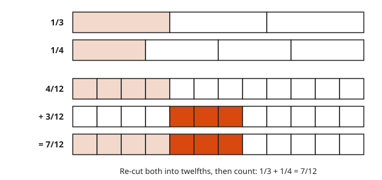
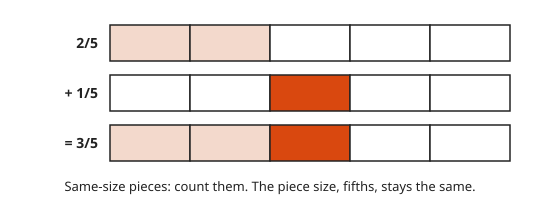
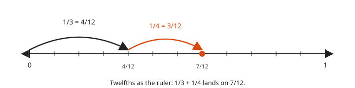
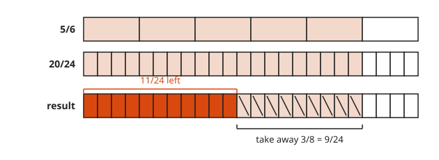
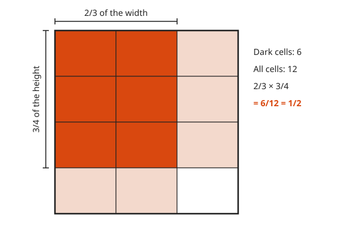
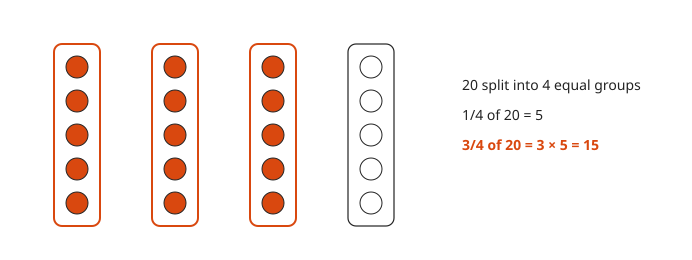
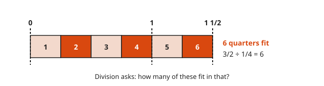
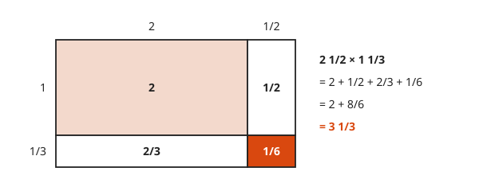

# Fraction Operations

**Level:** 101 · **Unit:** 6 · **Time:** 60 minutes
**Prerequisites:** [Fractions: Meaning and Equivalence](../05-fractions-meaning-and-equivalence/README.md)

## The Big Idea

You can only add pieces of the same size. You do not add `300 ms` to `2 s` without converting first. Adding and subtracting fractions therefore starts with a common denominator. Multiplying fractions is the area model from [lesson 2](../02-the-four-operations/README.md), inside a unit square. Dividing fractions asks how many of one piece fit in another. That question leads straight to the flip-and-multiply rule.

## Picture It

<!-- diagram: type=fraction-bars rows=1/3,1/4,4/12,3/12,7/12 caption="1/3 + 1/4 = 4/12 + 3/12 = 7/12" -->


Thirds and quarters do not line up. Cut every bar into twelfths, a size both `3` and `4` divide. Now `1/3` is `4` twelfths and `1/4` is `3` twelfths. Count: `7` twelfths.

## Step by Step

### 1. Same Denominator: Add the Tops

<!-- diagram: type=fraction-bars rows=2/5,1/5,3/5 caption="2/5 + 1/5 = 3/5" -->


Two fifths plus one fifth is three fifths. The denominator names the unit. It does not change: $\frac{2}{5} + \frac{1}{5} = \frac{3}{5}$, not $\frac{3}{10}$.

### 2. Different Denominators: Find a Common One

<!-- diagram: type=number-line range=0..1 minor=1/12 jumps=0+4/12,4/12+3/12 caption="1/3 + 1/4 = 7/12" -->


Rewrite both fractions over a shared denominator. The smallest one is the LCM of the bottoms, called the **least common denominator**. The product of the bottoms also works. It is only bigger. The bars in Picture It and the number line here show the same sum two ways. In general:

$$\frac{a}{b} + \frac{c}{d} = \frac{a d + c b}{b d}$$

### 3. Subtraction Works the Same Way

<!-- diagram: type=fraction-bars rows=5/6,20/24,11/24 remove=9/24 caption="5/6 − 3/8 = 11/24" -->


Common denominator, then subtract the tops.

### 4. Multiplication: Tops Times Tops, Bottoms Times Bottoms

<!-- diagram: type=area-model unit-square cols=3 rows=4 shade=2x3 caption="2/3 × 3/4 = 6/12 = 1/2" -->


The unit square has area `1`. Take `2/3` of the width and `3/4` of the height. The overlap has area $\frac{2}{3} \times \frac{3}{4}$. Count cells: `6` of `12`. The tops multiply to count the dark cells. The bottoms multiply to count all cells.

$$\frac{a}{b} \times \frac{c}{d} = \frac{a \times c}{b \times d}$$

### 5. The Word Of Means Multiply

<!-- diagram: type=dots n=20 groups=4 take=3 caption="3/4 of 20 = 15" -->


`3/4 of 20` is $\frac{3}{4} \times 20$. Split `20` into `4` equal groups of `5`. Take `3` groups: `15`.

### 6. Simplify Before You Multiply

Cancel a factor from any top with any bottom. In $\frac{3}{5} \times \frac{10}{9}$, the `3` cancels into the `9` and the `5` cancels into the `10`. What remains is $\frac{1}{1} \times \frac{2}{3} = \frac{2}{3}$. Smaller numbers, fewer errors.

```txt
   3     10          1     2
  --- × ----   →    --- × ---   =  2/3
   5      9          1     3
  3 cancels into 9 (leaves 1 and 3); 5 cancels into 10 (leaves 1 and 2)
```

### 7. Division: How Many Fit?

<!-- diagram: type=fraction-bars length=3/2 piece=1/4 count=6 caption="3/2 ÷ 1/4 = 6" -->


$\frac{3}{2} \div \frac{1}{4}$ asks: how many quarters fit in one and a half? Count them: `6`. Each whole holds `4` quarters. Dividing by `1/4` is multiplying by `4`.

Flip a fraction and you get its **reciprocal**: the reciprocal of $\frac{c}{d}$ is $\frac{d}{c}$. The general rule:

$$\frac{a}{b} \div \frac{c}{d} = \frac{a}{b} \times \frac{d}{c}$$

### 8. Mixed Numbers

<!-- diagram: type=area-model a=2+1/2 b=1+1/3 caption="2 1/2 × 1 1/3 = 3 1/3" -->


Convert mixed numbers to improper fractions first. The area model shows why you cannot multiply the whole parts and the fraction parts separately. There are four pieces, not two.

### Why Flip and Multiply Works

Division undoes multiplication. The answer to $\frac{a}{b} \div \frac{c}{d}$ is the number that, times $\frac{c}{d}$, gives back $\frac{a}{b}$. Test the candidate $\frac{a}{b} \times \frac{d}{c}$:

$$\left(\frac{a}{b} \times \frac{d}{c}\right) \times \frac{c}{d} = \frac{a}{b} \times \left(\frac{d}{c} \times \frac{c}{d}\right) = \frac{a}{b} \times 1 = \frac{a}{b}$$

It passes. That candidate is the answer.

## Worked Examples

### Example 1: Add 1/3 + 1/4

```txt
  1/3 + 1/4
  lcm(3, 4) = 12              least common denominator
  = 4/12 + 3/12               1/3 = (1×4)/(3×4), 1/4 = (1×3)/(4×3)
  = 7/12                      same-size pieces: add the tops
```

### Example 2: Subtract 5/6 − 3/8

```txt
  5/6 - 3/8
  lcm(6, 8) = 24              6 = 2 × 3, 8 = 2³, lcm = 2³ × 3
  = 20/24 - 9/24              5/6 = 20/24, 3/8 = 9/24
  = 11/24                     subtract the tops; 11 and 24 share no factor
```

### Example 3: Divide 3/2 ÷ 1/4

```txt
  3/2 ÷ 1/4                   how many quarters fit in one and a half?
  = 3/2 × 4/1                 multiply by the reciprocal
  = 12/2                      tops times tops, bottoms times bottoms
  = 6                         simplify; check: 6 quarters = 6/4 = 3/2
```

### Example 4: Mixed Numbers

```txt
  2 1/2 × 1 1/3
  = 5/2 × 4/3                 convert: 2×2+1 = 5, 1×3+1 = 4
  = 20/6                      multiply straight across
  = 10/3                      divide top and bottom by 2
  = 3 1/3                     10 = 3 × 3 + 1
```

## See It Step by Step


[Adding Fractions with Strips: open the step-by-step walkthrough](https://caseyaedwards.github.io/math_training/diagrams/fraction-strips-addition/)

Watch halves and thirds both cut into sixths, the common size that lets them be counted together.


[Adding Fractions on a Number Line: open the step-by-step walkthrough](https://caseyaedwards.github.io/math_training/diagrams/fraction-addition-number-line/)

Watch the two hops land between familiar marks until sixths name the landing spot exactly.


[Multiplying Fractions with Area: open the step-by-step walkthrough](https://caseyaedwards.github.io/math_training/diagrams/fraction-multiplication-area/)

Watch the two shadings overlap, since the overlap cells count the tops and all the cells count the bottoms.


[Dividing by a Fraction: open the step-by-step walkthrough](https://caseyaedwards.github.io/math_training/diagrams/fraction-division/)

Watch the thirds fit into each whole, which explains why dividing by 1/3 multiplies by 3.

## Common Mistakes

* Adding straight across: $\frac{1}{3} + \frac{1}{4}$ is not $\frac{2}{7}$. The sum must be bigger than each part, and `2/7` is smaller than `1/3`.
* Hunting for a common denominator to multiply: not needed. Multiply straight across.
* Flipping the wrong fraction: flip the one after the `÷` sign.
* Multiplying mixed numbers part by part: see step 8. Four pieces, not two.

## Try It

1. $\frac{2}{5} + \frac{1}{5}$
2. $\frac{1}{2} + \frac{1}{3}$
3. $\frac{3}{4} - \frac{1}{6}$
4. $2\frac{1}{3} + 1\frac{3}{4}$
5. $\frac{3}{5} \times \frac{10}{9}$
6. $4 \times \frac{3}{8}$
7. $\frac{3}{4} \div \frac{3}{8}$
8. $5 \div \frac{2}{3}$
9. A maintenance window lasts $2\frac{1}{2}$ hours. Each canary step takes $\frac{1}{3}$ of an hour. How many complete steps fit?

<details>
<summary>Answers</summary>

1. `3/5`.
2. `5/6`. `3/6 + 2/6`.
3. `7/12`. `9/12 - 2/12`.
4. `4 1/12`. `7/3 + 7/4 = 28/12 + 21/12 = 49/12`.
5. `2/3`.
6. `3/2`, which is `1 1/2`.
7. `2`. Three eighths fit twice in six eighths.
8. `15/2`, which is `7 1/2`.
9. `7` steps. `5/2 ÷ 1/3 = 15/2 = 7 1/2`. Half a canary step is not a step.

</details>

## Code Corner

Exact fraction arithmetic with `math/big.Rat`, and a check of flip-and-multiply on a thousand random fractions. The source is in [code/main.go](code/main.go). Run it with `go run .` from the `code` folder.

<!-- GO:BEGIN -->
```go
// Fraction operations with exact arithmetic, plus a check of flip-and-multiply.
package main

import (
	"fmt"
	"math/big"
	"math/rand"
)

func r(a, b int64) *big.Rat { return big.NewRat(a, b) }

func main() {
	fmt.Println("1/3 + 1/4 =", new(big.Rat).Add(r(1, 3), r(1, 4)).RatString())
	fmt.Println("5/6 - 3/8 =", new(big.Rat).Sub(r(5, 6), r(3, 8)).RatString())
	fmt.Println("2/3 × 3/4 =", new(big.Rat).Mul(r(2, 3), r(3, 4)).RatString())
	fmt.Println("3/2 ÷ 1/4 =", new(big.Rat).Quo(r(3, 2), r(1, 4)).RatString())
	fmt.Println("5/2 × 4/3 =", new(big.Rat).Mul(r(5, 2), r(4, 3)).RatString())

	// Check: x ÷ y equals x × (flipped y), on 1,000 random fractions.
	rng := rand.New(rand.NewSource(1))
	ok := 0
	for i := 0; i < 1000; i++ {
		a, b, c, d := rng.Int63n(20)+1, rng.Int63n(20)+1, rng.Int63n(20)+1, rng.Int63n(20)+1
		x, y := r(a, b), r(c, d)
		quo := new(big.Rat).Quo(x, y)
		flip := new(big.Rat).Mul(x, r(d, c))
		if quo.Cmp(flip) == 0 {
			ok++
		}
	}
	fmt.Println("flip-and-multiply agreed", ok, "of 1000 times")
}
```

Output of `go run .`:

```txt
1/3 + 1/4 = 7/12
5/6 - 3/8 = 11/24
2/3 × 3/4 = 1/2
3/2 ÷ 1/4 = 6
5/2 × 4/3 = 10/3
flip-and-multiply agreed 1000 of 1000 times
```
<!-- GO:END -->

## Flashcards

Import [cards.tsv](cards.tsv) into Anki. The tags are `math::101::fraction-ops`.

## Go Deeper

* [Math Is Fun: Adding Fractions](https://www.mathsisfun.com/fractions_addition.html): common denominators with pictures.
* [Math Is Fun: Multiplying Fractions](https://www.mathsisfun.com/fractions_multiplication.html): straight across, with pizza diagrams.
* [Math Is Fun: Dividing Fractions](https://www.mathsisfun.com/fractions_division.html): the flip rule and why it works.

**Next:** [Decimals and Percents](../07-decimals-and-percents/README.md)
