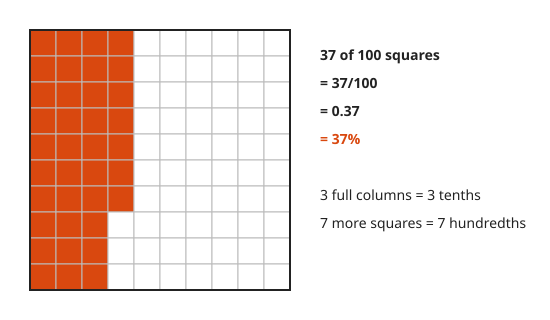
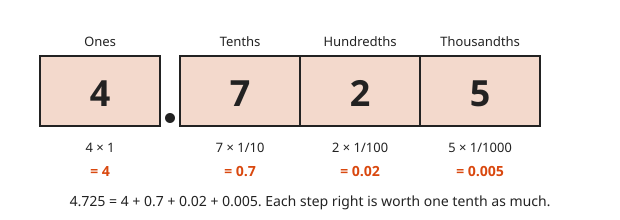
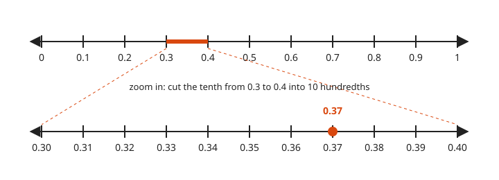
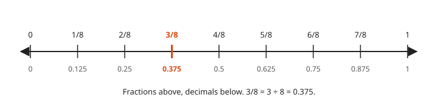
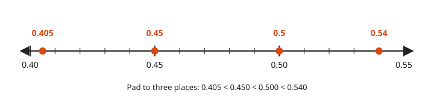
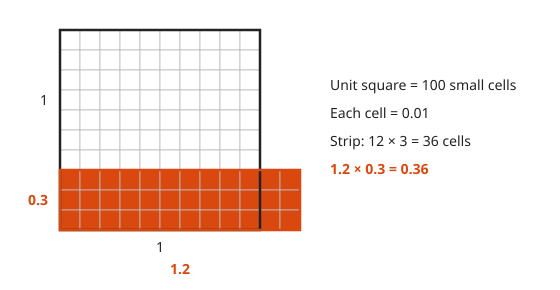
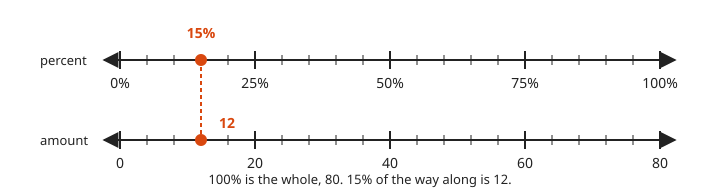
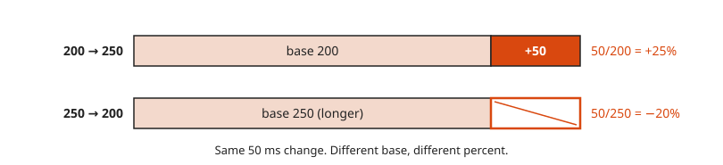
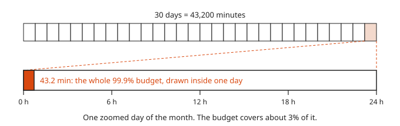

# Decimals and Percents

**Level:** 101 · **Unit:** 7 · **Time:** 45 to 60 minutes
**Prerequisites:** [Fraction Operations](../06-fraction-operations/README.md)

## The Big Idea

Decimals are place value continued to the right of the ones column: tenths, hundredths, thousandths. A decimal is a fraction whose bottom is a power of ten, written without the bar. A **percent** is a fraction out of `100`. The word means per hundred. Availability targets, error rates and latency changes are all decimals and percents.

## Picture It

<!-- diagram: type=hundred-grid filled=37 caption="0.37 = 37/100 = 37%" -->


The whole grid is `1`. Each column is one tenth. Each small square is one hundredth. Three columns and seven squares: `3` tenths and `7` hundredths, written `0.37`. Also `37` out of `100`: `37%`.

## Step by Step

### 1. Decimal Places

<!-- diagram: type=place-value-columns digits=4,7,2,5 places=1,1/10,1/100,1/1000 caption="4.725" -->


The decimal point sits right of the ones column. Each step right is worth one tenth as much:

$$4.725 = 4 + \frac{7}{10} + \frac{2}{100} + \frac{5}{1000}$$

### 2. Each Place Is a Zoom

<!-- diagram: type=number-line-zoom outer=0..1 step=0.1 inner=0.30..0.40 step=0.01 marks=0.37 caption="Zoom from tenths to hundredths" -->


On the number line, each new decimal place zooms in by ten. `0.37` sits between `0.3` and `0.4`. Cut that tenth into ten hundredths. `0.37` is the seventh mark.

### 3. Decimal to Fraction and Back

<!-- diagram: type=number-line range=0..1 ticks=1/8 labels=fraction,decimal highlight=3/8 caption="3/8 = 0.375" -->


Decimal to fraction: read the last place as the bottom, then simplify. `0.375 = 375/1000 = 3/8`. Fraction to decimal: divide the top by the bottom. `3 ÷ 8 = 0.375`. Some fractions never stop: `1/3 = 0.333...`. That is a **repeating decimal**, written $0.\overline{3}$.

### 4. Comparing Decimals

<!-- diagram: type=number-line range=0.40..0.55 marks=0.405,0.45,0.5,0.54 caption="Pad, then compare" -->


Line up the decimal points. Pad with zeros. Compare left to right, as with whole numbers. `0.5 = 0.500` beats `0.45 = 0.450`. More digits does not mean bigger.

### 5. Adding and Subtracting

Line up the decimal points. Add column by column. Pad with zeros where needed.

```txt
    3.60        pad 3.6 to two places
  + 0.48        decimal points in one column
  ------
    4.08
```

### 6. Multiplying

<!-- diagram: type=area-model unit=1 a=1.2 b=0.3 cell=0.01 caption="1.2 × 0.3 = 0.36" -->


Multiply as whole numbers, then count decimal places. The answer gets as many places as both factors together. `12 × 3 = 36`. One place plus one place is two places: `0.36`. The picture counts the same `36` hundredth-cells.

### 7. Dividing

Shift the decimal point in both numbers by the same amount until the divisor is whole. This is the equivalent-fractions rule: multiply top and bottom by `10`, `100`, and onward. `4.5 ÷ 0.09 = 450 ÷ 9 = 50`.

### 8. Percent Of

<!-- diagram: type=double-number-line top=percent:0..100 bottom=amount:0..80 match=15%:12 caption="15% of 80 = 12" -->


Move the decimal point two places: `0.37 = 37%`, `5% = 0.05`. To find a percent **of** a number, multiply. `15% of 80 = 0.15 × 80 = 12`. On the double line, `100%` matches the whole, `80`, and `15%` matches `12`.

### 9. Percent Change

<!-- diagram: type=bars a=200->250 b=250->200 caption="+25% then −20%" -->


Divide the change by the starting value:

$$\text{percent change} = \frac{\text{new} - \text{old}}{\text{old}} \times 100\%$$

The same change is a different percent from a different start. Up `25%` then down `20%` returns you home.

### 10. Error Budgets

<!-- diagram: type=zoom-bar month=30d day=24h budget=43.2min caption="99.9% leaves 43.2 minutes a month" -->


A `99.9%` target allows `0.1%` failure. Over `30` days that is `43.2` minutes. The picture puts the whole month of budget inside one day. It is a sliver. Spend it wisely.

### Why the Decimal-Places Rule Works

$1.2 \times 0.3 = \frac{12}{10} \times \frac{3}{10} = \frac{36}{100} = 0.36$. Each factor carries a power of ten in its bottom. Multiplying fractions multiplies the bottoms. One place plus one place gives two places.

## Worked Examples

### Example 1: Fraction to Decimal to Percent

```txt
  3/8
  = 3 ÷ 8                   a fraction is a division
  = 0.375                   30 ÷ 8 = 3 r 6; 60 ÷ 8 = 7 r 4; 40 ÷ 8 = 5
  = 37.5%                   move the decimal point two places right
```

### Example 2: Dividing Decimals

```txt
  4.5 ÷ 0.09
  = 450 ÷ 9                 multiply both by 100: the divisor is now whole
  = 50                      9 × 50 = 450
```

### Example 3: Latency Regression

p99 latency, the time that 99% of requests beat, goes from `200 ms` to `250 ms`, then back to `200 ms`.

```txt
  up:   (250 - 200) / 200 = 50/200 = 0.25 = +25%      change over the old value
  down: (200 - 250) / 250 = -50/250 = -0.20 = -20%    the old value is now 250
```

### Example 4: Error Budget

```txt
  30 days × 24 h × 60 min = 43,200 min      minutes in the window
  allowed failure = 100% - 99.9% = 0.1%     the error budget
  0.1% = 0.001                              percent to decimal
  0.001 × 43,200 = 43.2 min                 budget in minutes
```

## Common Mistakes

* Comparing by length: `0.45` is not bigger than `0.5`. Pad to `0.450` and `0.500`.
* Lining up right edges when adding: line up the decimal points.
* Mixing percent and percentage points: from `2%` to `3%` is up `1` **percentage point**, a plain difference of percents. It is also up `50%` relative to the start.
* Adding percent changes: `+25%` then `−20%` is `0%`, not `+5%`. Each percent uses a different base.

## Try It

1. Write `0.6` as a fraction in simplest form and as a percent.
2. Write `7/20` as a decimal and a percent.
3. Write `1/8` as a decimal and a percent.
4. Order from least to greatest: `0.5`, `0.45`, `0.405`, `0.54`.
5. `3.6 + 0.48`
6. `1.2 × 0.3`
7. `4.5 ÷ 0.09`
8. What is `20%` of `350`?
9. An error rate goes from `2%` to `3%`. Give the change in percentage points and as a relative percent.
10. How many minutes of downtime does `99.95%` allow in `30` days?

<details>
<summary>Answers</summary>

1. `3/5` and `60%`.
2. `0.35` and `35%`.
3. `0.125` and `12.5%`.
4. `0.405, 0.45, 0.5, 0.54`.
5. `4.08`.
6. `0.36`.
7. `50`.
8. `70`. `0.2 × 350`.
9. `1` percentage point. `50%` relative: `(3 - 2) / 2 = 0.5`.
10. `21.6` minutes. `0.0005 × 43,200`.

</details>

## Code Corner

Computers store most decimals in binary. `0.1` has no exact binary form, the same way `1/3` has no exact decimal form. Go adds a twist: untyped constants are exact. `0.1 + 0.2` written as constants prints `0.3`. The same sum on `float64` variables does not. Use `math/big.Rat` when exactness matters. The source is in [code/main.go](code/main.go). Run it with `go run .` from the `code` folder.

<!-- GO:BEGIN -->
```go
// Decimals and percents: floats, exact decimals, and error budgets.
package main

import (
	"fmt"
	"math/big"
)

func main() {
	// Constants in Go are exact, so 0.1 + 0.2 prints 0.3.
	fmt.Println("constants: ", 0.1+0.2)
	// float64 variables are binary and cannot hold 0.1 exactly.
	a, b := 0.1, 0.2
	fmt.Println("variables: ", a+b)

	x, _ := new(big.Rat).SetString("0.1")
	y, _ := new(big.Rat).SetString("0.2")
	fmt.Println("big.Rat:   ", new(big.Rat).Add(x, y).FloatString(1))

	fmt.Printf("3/8 = %.3f = %.1f%%\n", 3.0/8, 3.0/8*100)
	fmt.Println("15% of 80 =", 0.15*80)

	change := func(old, new float64) float64 { return (new - old) / old * 100 }
	fmt.Printf("200 -> 250 ms: %+.0f%%\n", change(200, 250))
	fmt.Printf("250 -> 200 ms: %+.0f%%\n", change(250, 200))

	minutes := 30.0 * 24 * 60
	for _, slo := range []float64{99.9, 99.95, 99.99} {
		fmt.Printf("SLO %.2f%%: budget %.1f min per 30 days\n", slo, (100-slo)/100*minutes)
	}
}
```

Output of `go run .`:

```txt
constants:  0.3
variables:  0.30000000000000004
big.Rat:    0.3
3/8 = 0.375 = 37.5%
15% of 80 = 12
200 -> 250 ms: +25%
250 -> 200 ms: -20%
SLO 99.90%: budget 43.2 min per 30 days
SLO 99.95%: budget 21.6 min per 30 days
SLO 99.99%: budget 4.3 min per 30 days
```
<!-- GO:END -->

## Flashcards

Import [cards.tsv](cards.tsv) into Anki. The tags are `math::101::decimals`.

## Go Deeper

* [Math Is Fun: Decimals](https://www.mathsisfun.com/decimals.html): place value to the right of the point.
* [Math Is Fun: Percentage](https://www.mathsisfun.com/percentage.html): percent of, percent change, with pictures.
* [Probability for On-Call Error Budgets and SLOs workshop](../../../workshops/probability-for-on-call-error-budgets-and-slos/README.md): where these percents meet production.

**Next:** [Ratios, Proportions and Rates](../08-ratios-proportions-and-rates/README.md)
