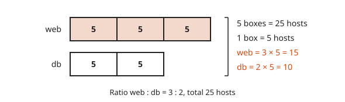
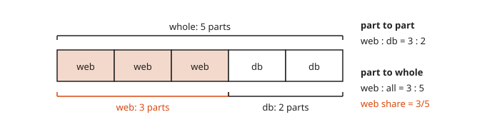
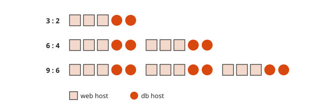
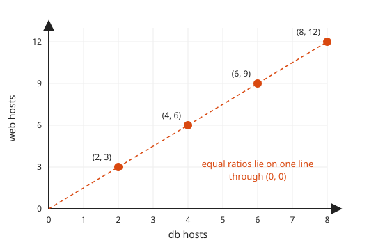
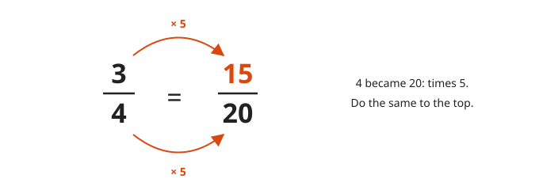
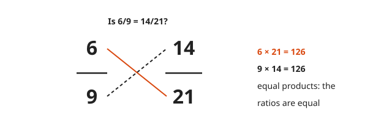
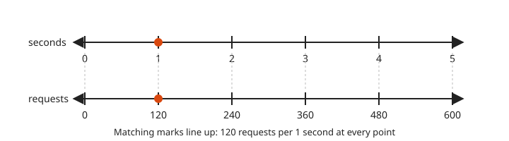
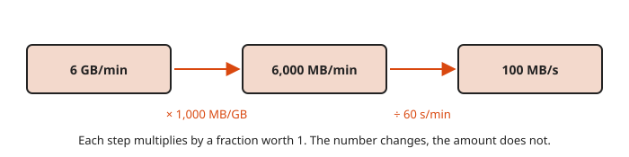
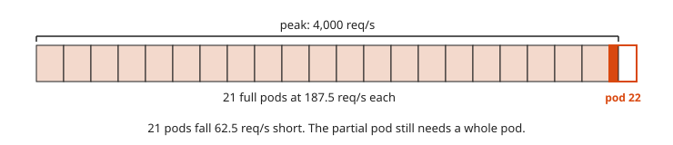

# Ratios, Proportions and Rates

**Level:** 101 · **Unit:** 8 · **Time:** 45 to 60 minutes
**Prerequisites:** [Decimals and Percents](../07-decimals-and-percents/README.md)

## The Big Idea

A **ratio** compares two amounts: `3` web hosts for every `2` database hosts. A **proportion** says two ratios are equal. It lets you scale a known case up or down. A **rate** is a ratio between different units, such as requests per second or dollars per gigabyte. Capacity planning is proportion reasoning with a pager attached.

## Picture It

<!-- diagram: type=tape-diagram parts=3,2 total=25 caption="web : db = 3 : 2 with 25 hosts" -->


A **tape diagram** draws a ratio as equal boxes. `3 : 2` gives web `3` boxes and database `2`. Five boxes hold `25` hosts. One box is `5`. Web gets `15`. Database gets `10`.

## Step by Step

### 1. Writing Ratios

`a : b`, `a to b` and $\frac{a}{b}$ name the same comparison. Order matters. `web : db = 3 : 2` is not `2 : 3`. Write the labels next to the numbers until it is a habit.

### 2. Part to Part and Part to Whole

<!-- diagram: type=tape parts=3,2 braces=part,whole caption="3 : 2 against 3 : 5" -->


Web to database is `3 : 2`, part to part. Web to all hosts is `3 : 5`, part to whole. The fraction of hosts that are web is `3/5`. Same tape, two different questions.

### 3. Equivalent Ratios

<!-- diagram: type=groups unit=3web+2db copies=1,2,3 caption="3 : 2 = 6 : 4 = 9 : 6" -->


Multiply or divide both parts by the same number. You get copies of the same group: `3 : 2 = 6 : 4 = 9 : 6`. Simplify with the GCD, exactly as with fractions.

<!-- diagram: type=scatter points=(2,3),(4,6),(6,9),(8,12) line=through-origin caption="Equal ratios lie on one line" -->


The second view: plot each pair as a point. Equal ratios fall on one straight line through `(0, 0)`. This line comes back in [level 201](../../201/README.md) as a linear function.

### 4. Proportions and the Scale Factor

<!-- diagram: type=fractions left=3/4 right=15/20 arrows=x5 caption="Same factor top and bottom" -->


A proportion states two ratios are equal: $\frac{3}{4} = \frac{x}{20}$. Find the **scale factor**, the number you multiply by. `4` became `20`: times `5`. Do the same to the top. `x = 15`.

### 5. Cross-Multiplication

<!-- diagram: type=fractions left=6/9 right=14/21 cross=true caption="6 × 21 = 9 × 14" -->


When the scale factor is messy, cross-multiply:

$$\frac{a}{b} = \frac{c}{d} \quad\text{exactly when}\quad a \times d = b \times c$$

### 6. Rates and Unit Rates

<!-- diagram: type=double-number-line top=seconds:0..5 bottom=requests:0..600 rate=120 caption="120 requests per second" -->


A **double number line** pairs two quantities that grow together. Every pair of matching marks has the same ratio. The pair at `1` is the **unit rate**: the amount per one unit. `1,800` requests in `15` seconds is `1,800 ÷ 15 = 120` requests per second.

### 7. Unit Conversion

<!-- diagram: type=chain steps="6 GB/min","6,000 MB/min","100 MB/s" caption="Multiply by fractions worth 1" -->


Multiply by a fraction equal to `1`, chosen to cancel the unit you do not want:

$$6\ \frac{\text{GB}}{\text{min}} \times \frac{1000\ \text{MB}}{1\ \text{GB}} \times \frac{1\ \text{min}}{60\ \text{s}} = 100\ \frac{\text{MB}}{\text{s}}$$

This lesson takes `1 GB = 1,000 MB`. The binary sizes, such as `1 GiB = 1,024 MiB`, appear in [lesson 9](../09-exponents-roots-and-order-of-operations/README.md).

### 8. Round Capacity Up

<!-- diagram: type=bar total=4000 chunk=187.5 caption="22 pods, not 21.33" -->


Division gives `21.33` pods. You cannot run a third of a pod. Capacity rounds up.

### Why Cross-Multiplication Works

Start with $\frac{a}{b} = \frac{c}{d}$. Multiply both sides by `b`. The left becomes `a`. Multiply both sides by `d`. The left becomes `a d` and the right becomes `c b`. Doing the same thing to both sides keeps them equal. That leaves `a d = b c`.

## Worked Examples

### Example 1: Splitting by a Ratio

Reads and writes arrive in the ratio `7 : 2`. There are `900` operations.

```txt
  7 + 2 = 9 parts              boxes in the tape diagram
  900 ÷ 9 = 100 per part       one box
  reads  = 7 × 100 = 700       seven boxes
  writes = 2 × 100 = 200       two boxes
  check: 700 + 200 = 900       parts add to the total
```

### Example 2: Solve a Proportion

```txt
  x/9 = 14/21
  14/21 = 2/3                  simplify first: divide by 7
  x/9 = 2/3                    simpler proportion
  3 → 9 is times 3             scale factor, bottom to bottom
  x = 2 × 3 = 6                same factor on the top
  check: 6 × 21 = 126 = 9 × 14 cross products match
```

### Example 3: Capacity Planning

Each pod handles `250` requests per second. Peak traffic is `4,000`. Keep each pod at no more than `75%` of its limit.

```txt
  safe rate per pod = 0.75 × 250 = 187.5 req/s     apply the headroom
  pods = 4,000 ÷ 187.5 = 21.33...                   total ÷ per-pod rate
  round up to 22 pods                               a partial pod is a whole pod
```

## Common Mistakes

* Reversing the order: with `web : db = 3 : 2` and `12` web hosts, the answer is `8` database hosts, not `18`. Write `web/db = 3/2 = 12/x`, which gives `x = 8`.
* Adding instead of multiplying: going from `3 : 2` to `5 : 4` by adding `2` to each part changes the ratio. Scale by multiplying.
* Rounding pods down: see step 8.
* Mixing units: `90 km/h` is not `90 m/s`. Convert first.

## Try It

1. Simplify the ratio `12 : 18`.
2. Reads and writes are `7 : 2` with `900` operations. How many writes?
3. Solve $\frac{5}{8} = \frac{x}{40}$.
4. Solve $\frac{x}{9} = \frac{14}{21}$.
5. A car covers `450 km` in `5` hours. What is its unit rate?
6. Which is the better price: `3` for `$4.50` or `5` for `$7.00`?
7. Convert `90 km/h` to meters per second.
8. On a map at scale `1 : 50,000`, two points are `3 cm` apart. How far apart are they on the ground?
9. A pod handles `250` requests per second. How many pods serve `4,000` per second at full load?

<details>
<summary>Answers</summary>

1. `2 : 3`. Divide both by `6`.
2. `200`. Nine parts of `100`.
3. `25`. The scale factor is `5`.
4. `6`.
5. `90 km/h`.
6. `5` for `$7.00`. `$1.40` each against `$1.50`.
7. `25 m/s`. `90 × 1,000 ÷ 3,600`.
8. `1.5 km`. `3 × 50,000 = 150,000 cm = 1,500 m`.
9. `16` pods. `4,000 ÷ 250`.

</details>

## Code Corner

A proportion solver with exact fractions, a ratio splitter, two conversions and the pod count. The source is in [code/main.go](code/main.go). Run it with `go run .` from the `code` folder.

<!-- GO:BEGIN -->
```go
// Ratios, proportions and rates.
package main

import (
	"fmt"
	"math"
	"math/big"
)

// solve returns x in a/b = x/d, exactly.
func solve(a, b, d int64) *big.Rat {
	return new(big.Rat).Mul(big.NewRat(a, b), big.NewRat(d, 1))
}

// split divides total in the ratio p : q.
func split(total, p, q int) (int, int) {
	part := total / (p + q)
	return p * part, q * part
}

func main() {
	fmt.Println("5/8 = x/40  ->  x =", solve(5, 8, 40).RatString())
	fmt.Println("14/21 = x/9 ->  x =", solve(14, 21, 9).RatString())

	web, db := split(25, 3, 2)
	fmt.Println("25 hosts at 3:2 ->", web, "web,", db, "db")

	fmt.Println("unit rate:", 1800/15, "req/s")
	fmt.Println("6 GB/min =", 6.0*1000/60, "MB/s")
	fmt.Println("90 km/h =", 90.0*1000/3600, "m/s")

	perPod := 0.75 * 250
	pods := 4000 / perPod
	fmt.Printf("pods needed: %.2f -> round up to %.0f\n", pods, math.Ceil(pods))
}
```

Output of `go run .`:

```txt
5/8 = x/40  ->  x = 25
14/21 = x/9 ->  x = 6
25 hosts at 3:2 -> 15 web, 10 db
unit rate: 120 req/s
6 GB/min = 100 MB/s
90 km/h = 25 m/s
pods needed: 21.33 -> round up to 22
```
<!-- GO:END -->

## Flashcards

Import [cards.tsv](cards.tsv) into Anki. The tags are `math::101::ratios`.

## Go Deeper

* [Math Is Fun: Ratios](https://www.mathsisfun.com/numbers/ratio.html): tape-style pictures and simple examples.
* [Khan Academy: Pre-algebra](https://www.khanacademy.org/math/pre-algebra): the ratios and rates units have practice sets.
* [Calculus of Rates in Physics and Queues workshop](../../../workshops/calculus-of-rates-in-physics-and-queues/README.md): rates that change over time.

**Next:** [Exponents, Roots and Order of Operations](../09-exponents-roots-and-order-of-operations/README.md)
