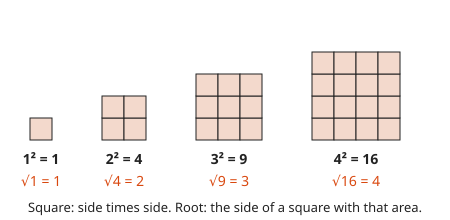
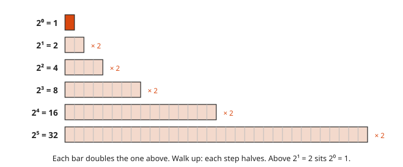
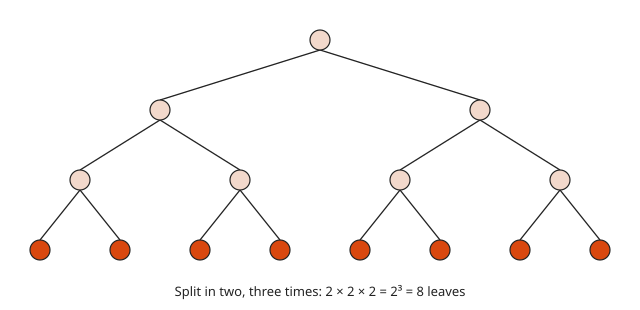
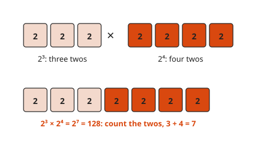
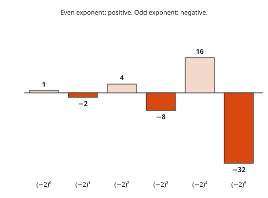
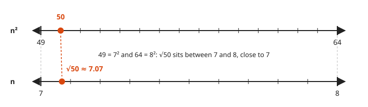
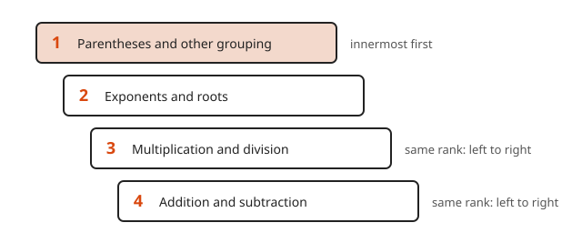
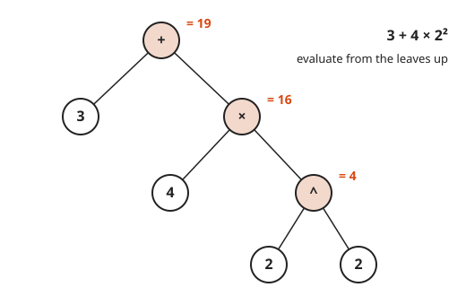
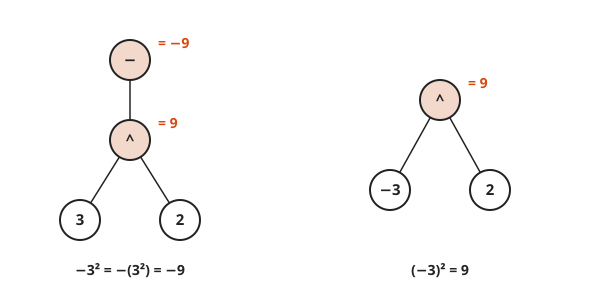

# Exponents, Roots and Order of Operations

**Level:** 101 · **Unit:** 9 · **Time:** 45 to 60 minutes
**Prerequisites:** [Negative Numbers](../03-negative-numbers/README.md), [Factors, Multiples and Primes](../04-factors-multiples-and-primes/README.md)

## The Big Idea

An **exponent** is shorthand for repeated multiplication: $2^5 = 2 \times 2 \times 2 \times 2 \times 2 = 32$. A **square root** runs squaring backwards. It finds the side of a square from its area. With exponents in play, an expression like `3 + 4 × 2²` needs an agreed order, the same way a compiler needs operator precedence. That agreement is the **order of operations**.

## Picture It

<!-- diagram: type=square-grids sides=1,2,3,4 caption="n² is the area of an n by n square; √ finds the side" -->


Squared is literal. $3^2$ is the number of tiles in a `3` by `3` square. The square root asks the reverse: $\sqrt{16}$ is the side of a square of `16` tiles. That side is `4`.

## Step by Step

### 1. Exponent Notation

<!-- diagram: type=bars values=1,2,4,8,16,32 caption="Powers of 2 double" -->


In $a^n$, `a` is the **base** and `n` is the **exponent**. It means `n` copies of `a` multiplied together. Each extra copy of `2` doubles the bar.

<!-- diagram: type=tree levels=3 branching=2 caption="2³ = 8 leaves" -->


The second view. Split in two, three times. You get $2^3 = 8$ leaves. A binary tree of depth `n` has $2^n$ leaves. That is why `30` levels of binary search cover a billion keys.

### 2. Powers of Ten and Two

$10^3 = 1{,}000$ is a `1` followed by three zeros. $2^{10} = 1{,}024$, which is why `1 KiB = 1,024 bytes`. $2^{20} = 1{,}048{,}576$ bytes is `1 MiB`.

```txt
  10¹ = 10          2¹⁰ = 1,024           ≈ one thousand  (KiB)
  10² = 100         2²⁰ = 1,048,576       ≈ one million   (MiB)
  10³ = 1,000       2³⁰ = 1,073,741,824   ≈ one billion   (GiB)
```

### 3. Product Rule

<!-- diagram: type=boxes a=2^3 b=2^4 caption="2³ × 2⁴ = 2⁷" -->


$a^m \times a^n = a^{m+n}$. Count the copies. Three twos and four more twos make seven twos. This only works when the bases match.

### 4. Power of a Power

$(a^m)^n = a^{m \times n}$. $(2^3)^2$ is two groups of three twos: six twos, $2^6 = 64$.

```txt
  (2³)² = (2 × 2 × 2) × (2 × 2 × 2)     two groups of three twos
        = 2⁶ = 64                       2 × 3 = 6 twos in all
```

### 5. The Zero Exponent

Look at the doubling bars from the bottom up. Each step up halves: `32, 16, 8, 4, 2`. One more halving gives `1`. That bar is $2^0$. For any base except `0`, $a^0 = 1$. It is not a special rule. It is the pattern refusing to break.

### 6. Negative Bases

<!-- diagram: type=bars values=1,-2,4,-8,16,-32 caption="(−2)ⁿ alternates sign" -->


$(-2)^3 = -8$ and $(-2)^4 = 16$. An odd count of negative factors is negative. An even count is positive. The sign rules from [lesson 3](../03-negative-numbers/README.md) apply to each multiplication.

### 7. Square Roots

$\sqrt{a}$ is the number, not negative, whose square is `a`. **Perfect squares**, the squares of whole numbers, have whole roots: `1, 4, 9, 16, 25, 36, 49, 64, 81, 100`.

<!-- diagram: type=paired-lines top=n²:49..64 bottom=n:7..8 mark=50 caption="√50 is between 7 and 8" -->


For other numbers, bracket them between perfect squares. $7^2 = 49$ and $8^2 = 64$. `50` is slightly above `49`. $\sqrt{50}$ is slightly above `7`: about `7.07`.

### 8. Order of Operations

<!-- diagram: type=ladder steps=P,E,MD,AS caption="Evaluate top rung first" -->


Evaluate in this order:

1. Parentheses and other grouping, innermost first.
2. Exponents and roots.
3. Multiplication and division, left to right.
4. Addition and subtraction, left to right.

Multiplication does not beat division. They share a rung and run left to right. The same goes for addition and subtraction. The memory aid PEMDAS hides this. It has caused more arguments online than most politics.

### 9. The Tree Behind the Rules

<!-- diagram: type=tree expr="3 + 4 × 2^2" values=4,16,19 caption="Evaluate from the leaves up" -->


The order of operations decides the shape of a tree. Exponents bind tightest and sit deepest. Addition sits at the root and runs last. Evaluate from the leaves up: `2² = 4`, then `4 × 4 = 16`, then `3 + 16 = 19`. A parser builds the same tree from source code.

### 10. The Sign Trap

<!-- diagram: type=trees a="-(3^2)" b="(-3)^2" caption="−3² = −9 but (−3)² = 9" -->


$-3^2$ means $-(3^2) = -9$. The exponent binds tighter than the minus sign. To square `−3`, write $(-3)^2 = 9$.

### Why Multiplication Outranks Addition

Multiplication is shorthand for repeated addition. Exponents are shorthand for repeated multiplication. Shorthand binds its pieces into one unit. `3 + 4 × 2` reads as `3` plus one bundle, `4 × 2`, which is `2 + 2 + 2 + 2`. The order unpacks shorthand first, then combines. It is a convention, and a sensible one. It lets `3x² + 2x + 1` be written without a forest of parentheses.

## Worked Examples

### Example 1: Follow the Tree

```txt
  3 + 4 × 2²
= 3 + 4 × 4          exponent first: 2² = 4
= 3 + 16             then multiplication
= 19                 addition last
```

### Example 2: Left to Right on the Same Rung

```txt
  20 - 12 ÷ 4 × 2
= 20 - 3 × 2         ÷ and × share a rung: 12 ÷ 4 first, left to right
= 20 - 6             then 3 × 2
= 14                 subtraction last
```

### Example 3: Parentheses and Powers

```txt
  (8 - 3)² - 2³ ÷ 4
= 5² - 2³ ÷ 4        parentheses first
= 25 - 8 ÷ 4         exponents next
= 25 - 2             division
= 23                 subtraction
```

### Example 4: The Sign Trap

```txt
  -3²   = -(3²) = -9        the exponent binds tighter than the minus
  (-3)² = (-3)(-3) = 9      parentheses put the minus inside the base
```

## See It Step by Step


[Order of Operations as a Tree: open the step-by-step walkthrough](https://caseyaedwards.github.io/math_training/diagrams/order-of-operations-tree/)

Watch the tree evaluate from the leaves up, so the parentheses and the power finish before the addition at the top.


[Exponent Rules as Repeated Multiplication: open the step-by-step walkthrough](https://caseyaedwards.github.io/math_training/diagrams/exponent-rules/)

Watch the rows of x's sit side by side and the counts add, then a repeated group multiply the count.


[Dividing Powers: Zero and Negative Exponents: open the step-by-step walkthrough](https://caseyaedwards.github.io/math_training/diagrams/exponent-division/)

Watch matching x's cancel in pairs, and see how the leftover cases explain zero and negative exponents.

## Common Mistakes

* Reading $2^3$ as `2 × 3`: it is `2 × 2 × 2 = 8`.
* All multiplication before any division: `12 ÷ 4 × 2` is `6`, not `1.5`. Same rung, left to right.
* Writing $-3^2 = 9$: the exponent applies to `3` only.
* Splitting a root over addition: $\sqrt{9 + 16} = \sqrt{25} = 5$, not `3 + 4 = 7`.
* Adding exponents across different bases: $2^3 \times 3^2 = 8 \times 9 = 72$. The product rule needs one base.

## Try It

1. $2^5$
2. $10^4$
3. $5^0$
4. $(-2)^3$
5. $\sqrt{81}$. Then name the two whole numbers that $\sqrt{50}$ sits between.
6. $2^3 \times 2^4$ as a single power, and its value.
7. `6 + 18 ÷ 3 × 2`
8. `(6 + 18) ÷ (3 × 2)`
9. `4 × (5 - 2)² - 10`
10. How many bytes are in `1 MiB`, which is $2^{20}$ bytes?

<details>
<summary>Answers</summary>

1. `32`.
2. `10,000`.
3. `1`.
4. `−8`.
5. `9`. Between `7` and `8`.
6. $2^7 = 128$.
7. `18`. `18 ÷ 3 = 6`, `6 × 2 = 12`, `6 + 12 = 18`.
8. `4`.
9. `26`. `3² = 9`, `4 × 9 = 36`, `36 - 10 = 26`.
10. `1,048,576`. $2^{10} \times 2^{10} = 1{,}024 \times 1{,}024$.

</details>

## Code Corner

Go has no power operator. `2 ^ 3` in Go is bitwise XOR and equals `1`, which has surprised many people at 2 AM. Write a loop, or use `math.Pow` for floats. The `go/parser` package builds the same expression tree as the diagram. The source is in [code/main.go](code/main.go). Run it with `go run .` from the `code` folder.

<!-- GO:BEGIN -->
```go
// Exponents, roots and precedence. Go has no power operator.
package main

import (
	"fmt"
	"go/ast"
	"go/parser"
	"math"
	"strings"
)

// pow multiplies base by itself exp times. exp must be 0 or more.
func pow(base, exp int) int {
	result := 1
	for i := 0; i < exp; i++ {
		result *= base
	}
	return result
}

// show prints an expression tree, one node per line, children indented.
func show(e ast.Expr, depth int) {
	pad := strings.Repeat("    ", depth)
	switch n := e.(type) {
	case *ast.BinaryExpr:
		fmt.Println(pad + n.Op.String())
		show(n.X, depth+1)
		show(n.Y, depth+1)
	case *ast.ParenExpr:
		show(n.X, depth)
	case *ast.BasicLit:
		fmt.Println(pad + n.Value)
	}
}

func main() {
	for n := 0; n <= 5; n++ {
		fmt.Printf("2^%d = %-3d (-2)^%d = %d\n", n, pow(2, n), n, pow(-2, n))
	}
	fmt.Println("2^10 =", pow(2, 10), " 2^20 =", pow(2, 20))
	fmt.Println("2 ^ 3 in Go is XOR, not a power:", 2^3)
	fmt.Printf("sqrt(50) = %.4f\n", math.Sqrt(50))
	fmt.Println("-pow(3,2) =", -pow(3, 2), "  pow(-3,2) =", pow(-3, 2))

	fmt.Println("3 + 4*2*2 =", 3+4*2*2)
	fmt.Println("20 - 12/4*2 =", 20-12/4*2)
	for _, src := range []string{"3 + 4*2*2", "20 - 12/4*2"} {
		e, err := parser.ParseExpr(src)
		if err != nil {
			panic(err)
		}
		fmt.Println("tree for", src)
		show(e, 1)
	}
}
```

Output of `go run .`:

```txt
2^0 = 1   (-2)^0 = 1
2^1 = 2   (-2)^1 = -2
2^2 = 4   (-2)^2 = 4
2^3 = 8   (-2)^3 = -8
2^4 = 16  (-2)^4 = 16
2^5 = 32  (-2)^5 = -32
2^10 = 1024  2^20 = 1048576
2 ^ 3 in Go is XOR, not a power: 1
sqrt(50) = 7.0711
-pow(3,2) = -9   pow(-3,2) = 9
3 + 4*2*2 = 19
20 - 12/4*2 = 14
tree for 3 + 4*2*2
    +
        3
        *
            *
                4
                2
            2
tree for 20 - 12/4*2
    -
        20
        *
            /
                12
                4
            2
```
<!-- GO:END -->

The tree for `20 - 12/4*2` shows the left-to-right rule: the division sits deepest and runs first.

## Flashcards

Import [cards.tsv](cards.tsv) into Anki. The tags are `math::101::exponents`.

## Go Deeper

* [Math Is Fun: Exponents](https://www.mathsisfun.com/exponent.html): repeated multiplication with pictures.
* [Math Is Fun: Square Roots](https://www.mathsisfun.com/square-root.html): roots as the reverse of squaring.
* [Math Is Fun: Order of Operations](https://www.mathsisfun.com/operation-order-pemdas.html): PEMDAS with the left-to-right detail spelled out.
* [Paul's Online Notes: Integer Exponents](https://tutorial.math.lamar.edu/Classes/Alg/IntegerExponents.aspx): the full exponent rules, for later.
* [Exponential Growth workshop](../../../workshops/exponential-growth-in-interest-epidemics-and-load/README.md): where exponents drive real growth.

**Next:** [Variables and Expressions](../10-variables-and-expressions/README.md)
