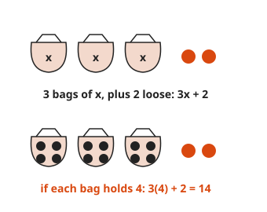
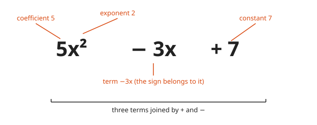
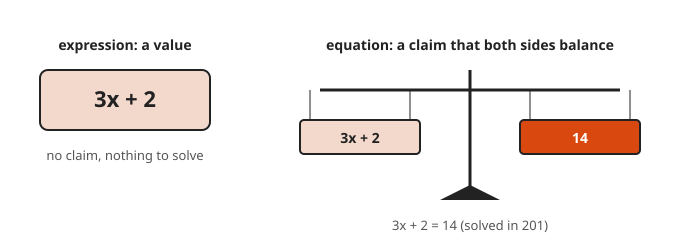
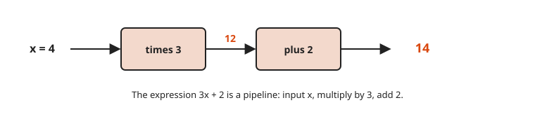
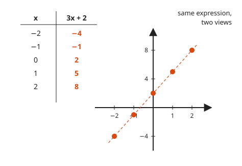
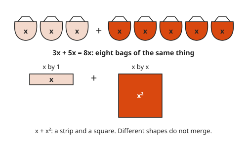
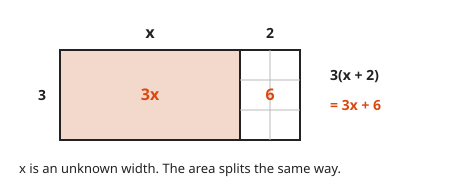
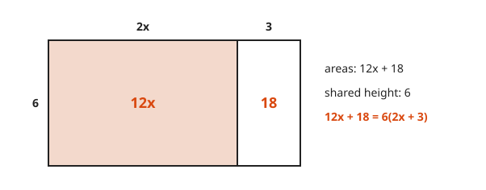

# Variables and Expressions

**Level:** 101 · **Unit:** 10 · **Time:** 45 to 60 minutes
**Prerequisites:** [Fraction Operations](../06-fraction-operations/README.md), [Exponents, Roots and Order of Operations](../09-exponents-roots-and-order-of-operations/README.md)

## The Big Idea

A **variable** is a letter that stands for a number. It lets one rule cover every case: `16n + 8` gives the memory of a cluster for any number of nodes `n`. An **expression** is a recipe built from numbers, variables and operations. This lesson is the bridge from arithmetic to algebra. Everything you know still applies. The only new thing is a name for a number you have not picked yet.

## Picture It

<!-- diagram: type=bags count=3 loose=2 value=4 caption="3x + 2 with x = 4" -->


Think of `x` as a closed bag holding some number of dots. `3x + 2` is three identical bags plus two loose dots. Open the bags. If each holds `4`, the total is `3 × 4 + 2 = 14`.

## Step by Step

### 1. Notation

* `3x` means `3 × x`. The multiplication sign is dropped next to a letter.
* `xy` means `x × y`.
* $x^2$ means `x × x`.
* $\frac{x}{4}$ means `x ÷ 4`.

### 2. Parts of an Expression

<!-- diagram: type=labels expr="5x² − 3x + 7" caption="Terms, coefficients, constants" -->


The pieces joined by `+` or `−` are **terms**. The number in front of a variable is its **coefficient**. A number alone is a **constant**. The sign belongs to the term after it: the middle term is `−3x`, not `3x`.

### 3. Variables in Math and in Code

In code, `x = x + 1` updates a box. In math, `x` names one fixed but unknown number for the whole problem. `x = x + 1` is a false statement in math. No number equals itself plus one. Same letter, different contract.

```txt
  code:  x = x + 1     an instruction: read x, add 1, store it back
  math:  x = x + 1     a claim about one number; no number makes it true
```

### 4. Expression or Equation

<!-- diagram: type=balance left="3x + 2" right=14 caption="An expression is a value; an equation is a claim" -->


An expression has no equals sign: `3x + 2`. It is a value. An **equation** claims two expressions are equal: `3x + 2 = 14`. Solving equations is the first topic of [level 201](../../201/README.md).

### 5. Evaluate by Substitution

<!-- diagram: type=pipeline input="x = 4" stages="times 3","plus 2" output=14 caption="3x + 2 is a pipeline" -->


To **evaluate** is to compute the value for a given input. Replace each variable with its value, in parentheses. Then apply the order of operations. The expression works like a pipeline: input, multiply by `3`, add `2`, output.

<!-- diagram: type=table+plot expr=3x+2 x=-2..2 caption="Same expression, two views" -->


Run several inputs and you get a table. Plot the table and the points line up. That line is the main character of level 201.

Parentheses matter for negatives. With `x = −2`, $x^2$ is $(-2)^2 = 4$.

### 6. Like Terms

<!-- diagram: type=bags a=3 b=5 unlike=x,x² caption="3x + 5x = 8x; x + x² stays" -->


Terms with the same variable part are **like terms**. They combine by adding coefficients. `3x + 5x = 8x`: three bags plus five bags is eight bags. `x` and `x²` are different shapes, a strip and a square. They do not merge. Neither do `3x` and `5y`.

### 7. The Distributive Property

<!-- diagram: type=area-model a=3 b=x+2 caption="3(x + 2) = 3x + 6" -->


$a(b + c) = ab + ac$. Multiply the outside by every term inside. The area model from [lesson 2](../02-the-four-operations/README.md) works even when one side is unknown. However wide `x` really is, the rectangle splits into `3x` and `6`.

With a negative outside, every sign inside flips: $-2(x - 4) = -2x + 8$.

### 8. Factoring Out

<!-- diagram: type=area-model a=6 b=2x+3 caption="12x + 18 = 6(2x + 3)" -->


Run the distributive property backwards. Find the shared height of the two areas. $12x + 18 = 6(2x + 3)$. Pull out the GCD of the coefficients.

### 9. Testing a Claim

To check whether two expressions are equal, plug in a few values. One mismatch proves they differ. Many matches are strong evidence. The algebra rules give the proof.

### Why Like Terms Combine

$3x + 5x = (3 + 5)x = 8x$ is the distributive property read backwards. A rectangle `x` tall and `3` wide sits next to one `x` tall and `5` wide. Together: `x` tall, `8` wide.

## Worked Examples

### Example 1: Evaluate 3x + 2

```txt
  x = 4:    3(4) + 2  = 12 + 2  = 14      substitute, multiply, add
  x = −2:   3(−2) + 2 = −6 + 2  = −4      lesson 3 sign rules
```

### Example 2: Simplify 4(x + 3) − 2x

```txt
  4(x + 3) - 2x
= 4x + 12 - 2x         distribute the 4 to both terms
= 4x - 2x + 12         reorder: addition is commutative
= 2x + 12              combine like terms
  check x = 1: 4(4) - 2 = 14 and 2 + 12 = 14     both forms agree
```

### Example 3: Two Variables

Evaluate $2a^2 - 3b$ with `a = 3` and `b = −1`.

```txt
  2(3)² - 3(−1)
= 2(9) - 3(−1)         exponent first
= 18 - (−3)            multiply
= 18 + 3               subtracting a negative adds
= 21
```

### Example 4: Words to an Expression

A cluster has `n` worker nodes with `16 GB` each, plus `8 GB` for the control plane.

```txt
  memory per worker × workers      16 × n = 16n
  plus control plane               16n + 8
  n = 5:   16(5) + 8 = 88 GB       evaluate for five workers
```

## See It Step by Step


[Function Machine: open the step-by-step walkthrough](https://caseyaedwards.github.io/math_training/diagrams/function-machine/)

Watch each input run through the rule and come out as exactly one output, which then lands on the graph.


[Area Model for Multiplication: open the step-by-step walkthrough](https://caseyaedwards.github.io/math_training/diagrams/area-model-multiplication/)

Watch each side split by place value, so one hard product becomes four easy areas that add to the answer.

## Common Mistakes

* `3(x + 2) = 3x + 2`: the `3` multiplies every term inside. Test `x = 0`: `6` against `2`.
* Combining unlike terms: `2x + 3y` is not `5xy`. `x + x²` is not `2x³`.
* Losing the sign in substitution: with `x = −3`, $x^2$ is `9`. Wrap substituted values in parentheses.
* Dropping a sign when distributing a negative: $-(x - 5) = -x + 5$.

## Try It

1. Evaluate `5x − 7` at `x = 3`.
2. Evaluate $x^2 + 2x$ at `x = −3`.
3. Simplify `7y − 2y + 4`.
4. Expand `3(2a − 5)`.
5. Simplify `2(x + 4) + 3(x − 1)`.
6. Write an expression for: twice a number `n`, decreased by `9`.
7. Storage costs `$0.10` per GB per month plus a fixed `$20`. Write the monthly cost for `g` gigabytes. Evaluate it at `g = 500`.
8. Are `3(x + 1)` and `3x + 1` equal for every `x`? Test one value.
9. Factor `12x + 18`.

<details>
<summary>Answers</summary>

1. `8`.
2. `3`. `9 + (−6)`.
3. `5y + 4`.
4. `6a − 15`.
5. `5x + 5`.
6. `2n − 9`.
7. `0.10g + 20`. At `g = 500`: `$70`.
8. No. At `x = 0`: `3` against `1`.
9. `6(2x + 3)`.

</details>

## Code Corner

A Go function is an expression with a named input. Testing two forms over many inputs is a cheap sanity check before you trust an algebra step. The source is in [code/main.go](code/main.go). Run it with `go run .` from the `code` folder.

<!-- GO:BEGIN -->
```go
// Variables and expressions: a function is an expression with a named input.
package main

import "fmt"

func main() {
	f := func(x int) int { return 4*(x+3) - 2*x } // before simplifying
	g := func(x int) int { return 2*x + 12 }      // after simplifying

	same := true
	for x := -100; x <= 100; x++ {
		if f(x) != g(x) {
			same = false
		}
	}
	fmt.Println("4(x+3) - 2x == 2x + 12 for x in -100..100:", same)

	h := func(x int) int { return 3 * (x + 1) }
	k := func(x int) int { return 3*x + 1 }
	fmt.Println("3(x+1) vs 3x+1 at x=0:", h(0), "vs", k(0))

	expr := func(x int) int { return 3*x + 2 }
	for x := -2; x <= 2; x++ {
		fmt.Printf("x = %2d  ->  3x + 2 = %2d\n", x, expr(x))
	}

	memory := func(n int) int { return 16*n + 8 }
	fmt.Println("cluster memory, 5 workers:", memory(5), "GB")
	cost := func(g float64) float64 { return 0.10*g + 20 }
	fmt.Printf("storage cost, 500 GB: $%.2f\n", cost(500))
}
```

Output of `go run .`:

```txt
4(x+3) - 2x == 2x + 12 for x in -100..100: true
3(x+1) vs 3x+1 at x=0: 3 vs 1
x = -2  ->  3x + 2 = -4
x = -1  ->  3x + 2 = -1
x =  0  ->  3x + 2 =  2
x =  1  ->  3x + 2 =  5
x =  2  ->  3x + 2 =  8
cluster memory, 5 workers: 88 GB
storage cost, 500 GB: $70.00
```
<!-- GO:END -->

## Flashcards

Import [cards.tsv](cards.tsv) into Anki. The tags are `math::101::variables`.

## Go Deeper

* [Math Is Fun: Introduction to Algebra](https://www.mathsisfun.com/algebra/introduction.html): variables as the empty box, gently.
* [Math Is Fun: Algebra Definitions](https://www.mathsisfun.com/algebra/definitions.html): term, coefficient, constant and expression on one picture.
* [Paul's Online Notes: Algebra](https://tutorial.math.lamar.edu/Classes/Alg/Alg.aspx): the next step once this feels easy.
* [Algebra track](../../../tracks/algebra/README.md): a longer path through algebra.

**Next:** [Level 101 Checkpoint](../checkpoint.md)
