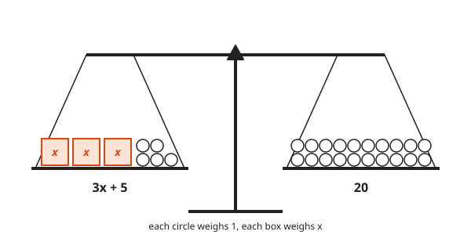
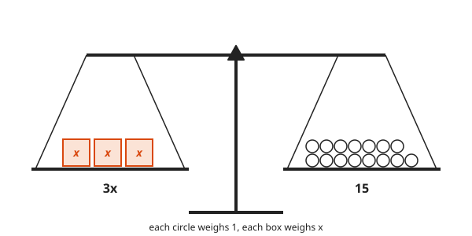
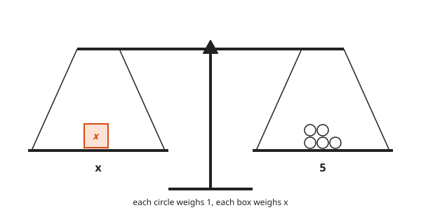
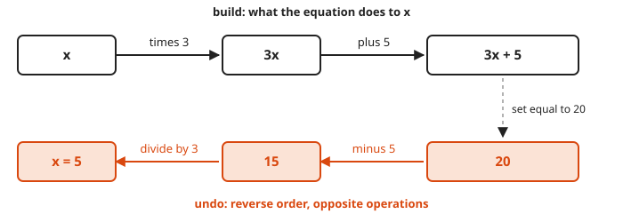
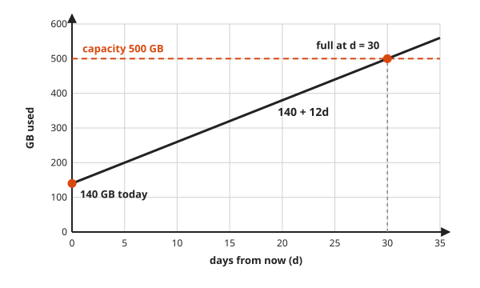

# Solving Linear Equations

**Level:** 201 · **Unit:** 1 · **Time:** 45 to 60 minutes
**Prerequisites:** [Course 101 Foundations](../../101/README.md), especially negatives, fractions, and the intro to variables

## The Big Idea

An equation is a balance scale. The left side weighs exactly what the right side weighs.
To find the unknown, change both sides in the same way until the unknown sits alone.
Every fair move keeps the scale level. The answer you end with is the answer you started with.

## Words You Need

* **Variable**: a letter that stands for a number you do not know yet, for example $x$.
* **Expression**: a recipe made of numbers, variables, and operations, for example $3x + 5$. It has no equals sign.
* **Equation**: two expressions joined by an equals sign, for example $3x + 5 = 20$. It is a claim that both sides are the same number.
* **Solution**: a value of the variable that makes the claim true.
* **Linear**: the variable appears only to the first power. No $x^2$, no $\sqrt{x}$, no $x$ in a denominator.

## Picture It

<!-- diagram: type=balance-scale left="3x+5" right="20" caption="3x + 5 balances 20" -->


The left pan holds three mystery boxes, each weighing $x$, plus five unit weights.
The right pan holds twenty unit weights.
The beam is level. That is all $3x + 5 = 20$ says.

## Step by Step

### Idea 1: Do the Same Thing to Both Sides

Take five unit weights off **both** pans. The beam stays level.

<!-- diagram: type=balance-scale left="3x" right="15" caption="after removing 5 from each pan" -->


Now three boxes balance fifteen units. Split each pan into three equal groups and keep one group from each side.

<!-- diagram: type=balance-scale left="x" right="5" caption="x balances 5" -->


One box balances five units. $x = 5$.

The four fair moves. Do the same thing to both sides:

* add the same number
* subtract the same number
* multiply by the same number, as long as it is not zero
* divide by the same number, as long as it is not zero

Why the moves are fair: if $A = B$, then $A$ and $B$ are one number with two names.
Do the same thing to one number and you get one result. Therefore $A + c = B + c$ and $A \cdot c = B \cdot c$.
Zero is excluded. Division by zero has no meaning. Multiplying by zero makes every equation $0 = 0$, which is true and useless, like a monitoring check that always returns OK.

### Idea 2: Undo in Reverse Order

The expression $3x + 5$ is a recipe: start with $x$, multiply by 3, then add 5.
To get back to $x$, undo the steps in reverse order with the opposite operation.

<!-- diagram: type=operation-chain forward="x,*3,3x,+5,3x+5" backward="20,-5,15,/3,5" -->


It is a stack. The last thing pushed is the first thing popped.
Putting on socks, then shoes. Taking off shoes, then socks. Nobody argues with that order.

| Operation in the recipe | Undo with |
|---|---|
| add 5 | subtract 5 |
| subtract 5 | add 5 |
| multiply by 3 | divide by 3 |
| divide by 3 | multiply by 3 |

### Idea 3: Collect Like Terms

When $x$ appears on both sides, move all $x$ terms to one side and all plain numbers to the other.
**Like terms** are terms with the same variable part: $5x$ and $2x$ are like terms. $5x$ and $5$ are not.

### Idea 4: Always Check

Put your answer back into the **original** equation. Both sides must give the same number.
The check takes ten seconds. A wrong answer costs more.

### Idea 5: Equations Answer Real Questions

A volume holds 500 GB. It already stores 140 GB and grows 12 GB per day.
After $d$ days it holds $140 + 12d$ GB. The disk is full when $140 + 12d = 500$.

<!-- diagram: type=line-chart f="140+12d" x=0..35 y=0..600 hline=500 point="(30,500)" -->


Solving the equation finds the exact day the line hits the ceiling. [Lesson 04](../04-slope-and-lines/README.md) studies these lines in detail.

## Worked Examples

### Example 1: Two Steps

```txt
  3x + 5 = 20
  3x     = 15        subtract 5 from both sides
   x     = 5         divide both sides by 3

  check: 3(5) + 5 = 15 + 5 = 20   true
```

### Example 2: Variable on Both Sides

```txt
  5x - 7 = 2x + 8
  3x - 7 = 8         subtract 2x from both sides
  3x     = 15        add 7 to both sides
   x     = 5         divide both sides by 3

  check: 5(5) - 7 = 18 and 2(5) + 8 = 18   true
```

### Example 3: Parentheses and a Negative Answer

```txt
  3(x + 2) = 2x - 4
  3x + 6   = 2x - 4  distribute: 3 times x, and 3 times 2
   x + 6   = -4      subtract 2x from both sides
   x       = -10     subtract 6 from both sides

  check: 3(-10 + 2) = 3(-8) = -24 and 2(-10) - 4 = -24   true
```

Negative answers are fine. The scale does not care about signs.

### Example 4: Fractions

Clear fractions first. Multiply both sides by a number that every denominator divides into.

```txt
  (x + 1)/2 = (x - 3)/3
  3(x + 1)  = 2(x - 3)   multiply both sides by 6
  3x + 3    = 2x - 6     distribute
   x + 3    = -6         subtract 2x from both sides
   x        = -9         subtract 3 from both sides

  check: (-9 + 1)/2 = -4 and (-9 - 3)/3 = -4   true
```

### Example 5: The Disk

```txt
  140 + 12d = 500
        12d = 360      subtract 140 from both sides
          d = 30       divide both sides by 12

  check: 140 + 12(30) = 140 + 360 = 500   true
```

### Example 6: Solve a Formula for One Letter

The perimeter of a rectangle is $P = 2l + 2w$. Solve for $w$. The other letters act like plain numbers.

```txt
  P          = 2l + 2w
  P - 2l     = 2w        subtract 2l from both sides
  (P - 2l)/2 = w         divide both sides by 2
```

### Example 7: Two Special Outcomes

Sometimes the variable disappears.

```txt
  x + 1 = x + 2
      1 = 2          subtract x from both sides: false: no solution

  2(x + 3) = 2x + 6
   2x + 6  = 2x + 6  distribute
        6  = 6       subtract 2x: always true: every x is a solution
```

## Common Mistakes

* Doing a move to one side only: the scale tips. Write the move next to both sides every time.
* Distributing to the first term only: $3(x + 2)$ is $3x + 6$, not $3x + 2$.
* Losing a sign when moving a term across the equals sign: write the subtraction on both sides in full instead of moving terms in your head.
* Dividing by the variable: $x^2 = 4x$ is not linear, and dividing by $x$ throws away the solution $x = 0$. That case belongs to [Lesson 07](../07-factoring-and-quadratics/README.md).
* Skipping the check.

## Try It

1. $x + 7 = 12$
2. $4x = 28$
3. $3x - 4 = 11$
4. $5x + 2 = 3x + 10$
5. $2(x - 3) = 10$
6. $\dfrac{x}{4} + 1 = 6$
7. $7 - 2x = 1$
8. $0.5x + 3 = 0.25x + 4$
9. A queue holds 2,000 messages. It has 560 now and gains 90 per minute with no consumer. How many minutes until it is full?
10. Solve $A = \tfrac{1}{2} b h$ for $h$.

<details>
<summary>Answers</summary>

1. $x = 5$: subtract 7.
2. $x = 7$: divide by 4.
3. $x = 5$: add 4 to get $3x = 15$, divide by 3.
4. $x = 4$: subtract $3x$ to get $2x + 2 = 10$, subtract 2, divide by 2.
5. $x = 8$: distribute to get $2x - 6 = 10$, add 6, divide by 2. Or divide by 2 first: $x - 3 = 5$.
6. $x = 20$: subtract 1 to get $x/4 = 5$, multiply by 4.
7. $x = 3$: subtract 7 to get $-2x = -6$, divide by $-2$.
8. $x = 4$: subtract $0.25x$ to get $0.25x + 3 = 4$, subtract 3, divide by 0.25.
9. 16 minutes: $560 + 90m = 2000$ gives $90m = 1440$, and $m = 16$.
10. $h = \dfrac{2A}{b}$: multiply by 2 to get $2A = bh$, divide by $b$.

</details>

## Code Corner

[code/main.go](code/main.go) solves $ax + b = cx + d$ with exact fractions from `math/big`, then runs the check for you. Run it with `go run main.go` inside the `code` folder.

```go
// (a - c) x = d - b
left := new(big.Rat).Sub(a, c)
right := new(big.Rat).Sub(d, b)
x := new(big.Rat).Quo(right, left)
```

Output:

```txt
3x + 5 = 20        -> x = 5
5x - 7 = 2x + 8    -> x = 5
3x + 6 = 2x - 4    -> x = -10
x/2 + 3 = x/4 + 4  -> x = 4
x + 1 = x + 2      -> no solution
2x + 6 = 2x + 6    -> every x works
140 + 12d = 500    -> x = 30
```

## Flashcards

[cards.tsv](cards.tsv) holds Anki cards for this lesson.

## Go Deeper

* [Paul's Online Notes: Solving Linear Equations](https://tutorial.math.lamar.edu/Classes/Alg/SolveLinearEqns.aspx): plain worked examples with fractions and special cases.
* [Math Is Fun: Linear Equations](https://www.mathsisfun.com/algebra/linear-equations.html): short, friendly, picture-driven.
* [MacTutor: al-Khwarizmi](https://mathshistory.st-andrews.ac.uk/Biographies/Al-Khwarizmi/): the word algebra comes from al-jabr, his name for the restore-and-balance move.
* Next: [Lesson 02, Inequalities](../02-inequalities/README.md).
