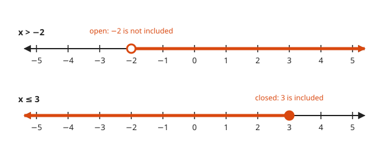
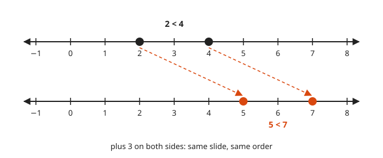
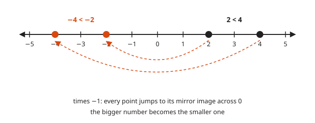
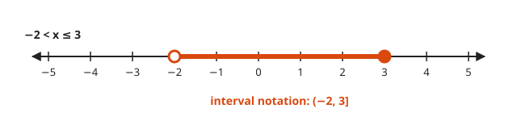
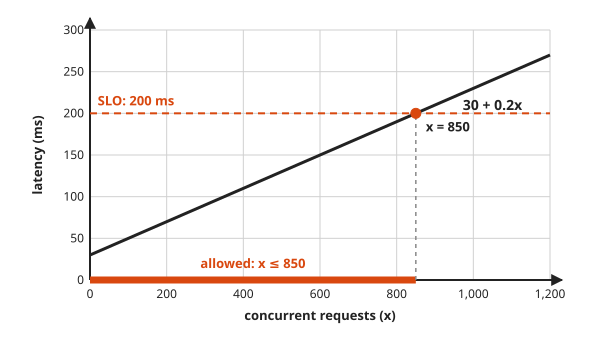

# Inequalities

**Level:** 201 · **Unit:** 2 · **Time:** 45 minutes
**Prerequisites:** [Lesson 01, Solving Linear Equations](../01-solving-linear-equations/README.md)

## The Big Idea

An equation asks "which value?". An inequality asks "which values?".
You solve it with the same fair moves as an equation, with one twist.
Multiplying or dividing by a negative number flips the direction of the sign.

## Words You Need

* **Inequality**: a statement that one side is less than, or greater than, the other.
* **Solution set**: every value that makes the inequality true. Usually a whole stretch of the number line, not one point.
* **Endpoint**: where that stretch stops.

## Picture It

<!-- diagram: type=number-line range=-5..5 rays="open:-2:right,closed:3:left" caption="x > -2 and x <= 3" -->


The answer is a ray, not a dot.
An **open circle** means the endpoint is not included. A **closed circle** means it is.

## Step by Step

### Idea 1: The Four Symbols

| Symbol | Read as | Endpoint |
|---|---|---|
| $x < a$ | x is less than a | open |
| $x > a$ | x is greater than a | open |
| $x \le a$ | x is at most a | closed |
| $x \ge a$ | x is at least a | closed |

The narrow end of $<$ points at the smaller number. The line under $\le$ is half an equals sign: "or equal".

### Idea 2: Adding and Subtracting Keep the Order

Add 3 to both sides of $2 < 4$. Both points slide 3 to the right. The one that was on the right stays on the right.

<!-- diagram: type=number-line range=-1..8 slide=+3 points=2,4 caption="adding 3 keeps the order" -->


Multiplying or dividing by a **positive** number also keeps the order. It stretches the line without turning it around.

### Idea 3: Negatives Flip the Order

Multiplying by $-1$ reflects every point across 0, like a mirror.

<!-- diagram: type=number-line range=-5..5 mirror=2,4 caption="multiplying by -1 mirrors the line" -->


The point that was further right ends up further left.
$2 < 4$, yet $-2 > -4$. The order flips, and the sign has to flip with it.
That is the whole twist. Everything else is Lesson 01 again.

### Idea 4: Compound Inequalities and Interval Notation

A **compound inequality** squeezes $x$ between two bounds, for example $-2 < x \le 3$.
Apply every move to all three parts at once.

<!-- diagram: type=number-line range=-5..5 segment="open:-2,closed:3" caption="(-2, 3]" -->


**Interval notation** writes the same set in a few characters.
A round bracket means the endpoint is excluded. A square bracket means it is included.
Infinity, $\infty$, always gets a round bracket. Nobody reaches it, not even the backlog.

| Inequality | Interval |
|---|---|
| $x > -2$ | $(-2, \infty)$ |
| $x \le 3$ | $(-\infty, 3]$ |
| $-2 < x \le 3$ | $(-2, 3]$ |

### Idea 5: Budgets Are Inequalities

A service has a 30 ms baseline latency plus 0.2 ms for every concurrent request $x$.
The SLO, a promise about service quality, says latency must stay at or below 200 ms.

<!-- diagram: type=line-chart f="30+0.2x" x=0..1200 y=0..300 hline=200 shade-x="0..850" -->


Every $x$ under the crossing point keeps the line under the ceiling. The inequality finds that crossing exactly.

## Worked Examples

### Example 1: The Flip

```txt
  -2x + 1 < 5
  -2x     < 4        subtract 1 from both sides
    x     > -2       divide by -2 and FLIP the sign

  spot check: x = 0  gives -2(0) + 1 = 1 < 5     true, and 0 > -2
              x = -3 gives -2(-3) + 1 = 7 < 5    false, and -3 is not > -2
```

### Example 2: No Flip Needed

```txt
  3x - 4 <= 5
  3x     <= 9        add 4 to both sides
   x     <= 3        divide by 3, a positive number, keep the sign
```

### Example 3: Variable on Both Sides

```txt
  2x + 1 > 4x - 7
  -2x + 1 > -7       subtract 4x from both sides
  -2x     > -8       subtract 1 from both sides
    x     < 4        divide by -2 and flip
```

Moving the $x$ terms to the right side avoids the flip: $8 > 2x$, which is $4 > x$. Same answer, fewer chances to slip.

### Example 4: Compound Inequality

```txt
  -1 <  2x + 3 <= 9
  -4 <  2x     <= 6     subtract 3 from all three parts
  -2 <   x     <= 3     divide all three parts by 2

  interval: (-2, 3]
```

### Example 5: The Latency Budget

```txt
  30 + 0.2x <= 200
       0.2x <= 170      subtract 30 from both sides
          x <= 850      divide by 0.2, a positive number, keep the sign
```

At most 850 concurrent requests keep the service inside its SLO.

## Common Mistakes

* Forgetting the flip after dividing by a negative: spot-check one number from your answer in the original inequality.
* Flipping when subtracting a negative number: subtraction never flips. Only multiplying or dividing by a negative flips.
* Using a closed circle for $<$: strict inequalities exclude the endpoint.
* Writing $[3, \infty]$: infinity always takes a round bracket.

## Try It

1. $x + 4 > 9$
2. $3x \le 12$
3. $-4x < 20$
4. $5 - x \ge 2$
5. $2x + 1 > 4x - 7$, solved by moving the $x$ terms to the right.
6. $-3 \le 2x - 1 < 5$
7. $\dfrac{x}{-2} \ge 3$
8. Write in interval notation: $x \ge -4$, and $0 < x \le 7$.
9. A disk holds 500 GB with 140 GB used, growing 12 GB per day. An alert fires at 400 GB. For which whole numbers of days $d$ does the alert stay quiet, that is, $140 + 12d < 400$?

<details>
<summary>Answers</summary>

1. $x > 5$: subtract 4.
2. $x \le 4$: divide by 3, no flip.
3. $x > -5$: divide by $-4$ and flip.
4. $x \le 3$: subtract 5 to get $-x \ge -3$, multiply by $-1$ and flip.
5. $x < 4$: subtract $2x$ and add 7 to get $8 > 2x$, divide by 2 to get $4 > x$.
6. $-1 \le x < 3$: add 1 to all parts to get $-2 \le 2x < 6$, divide by 2.
7. $x \le -6$: multiply by $-2$ and flip.
8. $[-4, \infty)$ and $(0, 7]$.
9. $d \le 21$: $12d < 260$ gives $d < 21.67$, and the largest whole number below that is 21.

</details>

## Code Corner

Trust, but verify. [code/main.go](code/main.go) sweeps 101 inputs and compares the original inequality with the solved form, then finds the latency budget by brute force.

```go
original := func(x float64) bool { return -2*x+1 < 5 }
solved := func(x float64) bool { return x > -2 }
```

Output:

```txt
checked 101 points from -5 to 5, mismatches: 0
largest concurrency inside the SLO: 850
```

## Flashcards

[cards.tsv](cards.tsv) holds Anki cards for this lesson.

## Go Deeper

* [Paul's Online Notes: Linear Inequalities](https://tutorial.math.lamar.edu/Classes/Alg/SolveLinearInequalities.aspx): interval notation and double inequalities, clearly laid out.
* [Math Is Fun: Solving Inequalities](https://www.mathsisfun.com/algebra/inequality-solving.html): the flip rule with small pictures.
* Next: [Lesson 03, The Coordinate Plane and Functions](../03-coordinate-plane-and-functions/README.md).
