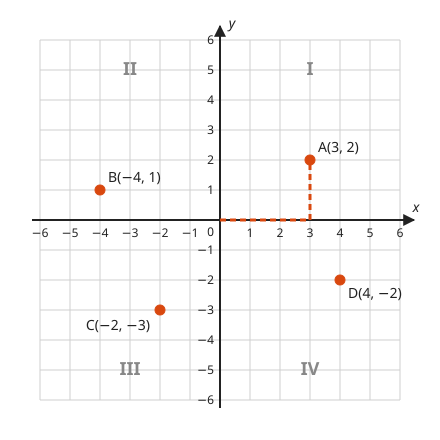
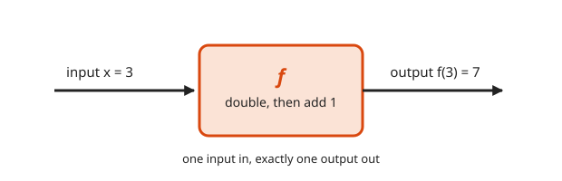
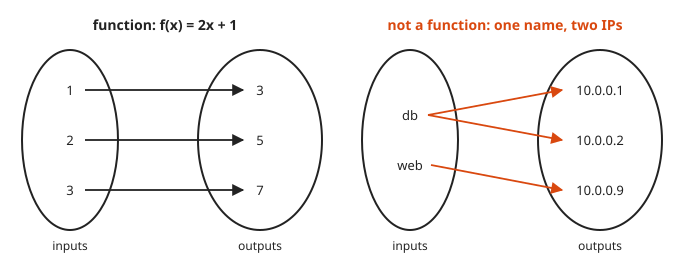
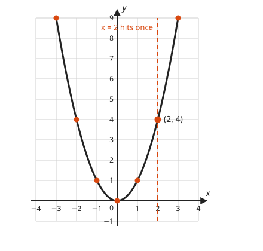
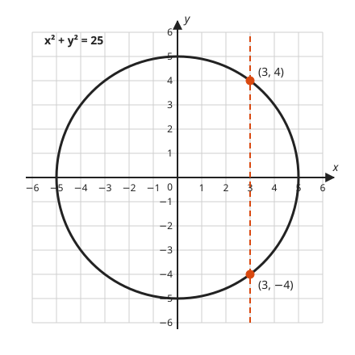

# The Coordinate Plane and Functions

**Level:** 201 · **Unit:** 3 · **Time:** 60 minutes
**Prerequisites:** [Lesson 01, Solving Linear Equations](../01-solving-linear-equations/README.md), negative numbers from [Course 101](../../101/README.md)

## The Big Idea

Two number lines at right angles turn every pair of numbers into a dot on a page.
That one trick, from René Descartes, lets you see algebra: an equation becomes a curve.
A **function** is a rule that takes each input to exactly one output. Its graph is the picture of that rule.

## Words You Need

* **Axis**: one of the two number lines. The plural is axes.
* **Origin**: the point where the axes cross, $(0, 0)$.
* **Ordered pair**: two numbers in a fixed order, $(x, y)$, that name one point.
* **Input** and **output**: what goes into a rule and what comes out.

## Picture It

<!-- diagram: type=coordinate-plane range=-6..6 points="A(3,2),B(-4,1),C(-2,-3),D(4,-2)" quadrants=true caption="four points, four quadrants" -->


The horizontal number line is the **x-axis**. The vertical one is the **y-axis**.
To plot $A(3, 2)$, start at the origin, walk 3 right, then 2 up. The dashed path shows the walk.
The axes cut the plane into four **quadrants**, numbered I to IV counterclockwise from the top right.

## Step by Step

### Idea 1: A Point Is an Address

1. In $(x, y)$, the first number is the horizontal step and the second is the vertical step. Order matters: $(3, 2)$ and $(2, 3)$ are different points. Along the corridor, then up the stairs.
2. Signs tell you the quadrant:

   | Quadrant | x | y | Example |
   |---|---|---|---|
   | I | + | + | $(3, 2)$ |
   | II | − | + | $(-4, 1)$ |
   | III | − | − | $(-2, -3)$ |
   | IV | + | − | $(4, -2)$ |

3. A point with a zero coordinate sits on an axis, not in a quadrant. For example, $(0, 3)$ is on the y-axis.

### Idea 2: A Function Is a Machine

<!-- diagram: type=function-machine rule="double, then add 1" input=3 output=7 -->


1. Put in an input, get out exactly one output. Same input, same output, every time.
   A pure function in Go behaves this way. A hash function does too: the key `web-01` always lands in the same bucket.
2. **Function notation**: $f(x) = 2x + 1$ names the rule $f$. The expression $f(3)$ means "feed 3 into $f$": $f(3) = 2(3) + 1 = 7$.
   The parentheses here do not mean multiplication. Mathematicians reused the symbol. Nobody asked us.
3. The **domain** is the set of allowed inputs. The **range** is the set of outputs that actually come out.
   For $f(x) = 1/x$, the domain is every real number except 0, since division by zero has no meaning.

### Idea 3: The Same Rule as Arrows

A **mapping diagram** draws inputs on the left, outputs on the right, and one arrow per pairing.

<!-- diagram: type=mapping left="1,2,3->3,5,7" right="db->10.0.0.1,10.0.0.2; web->10.0.0.9" -->


The rule for a function in arrow form: every input has **exactly one** arrow leaving it.
DNS round robin breaks the rule. One name, `db`, maps to two addresses. It is a fine **relation**, a general pairing, but not a function of the name.
Two inputs pointing at one output is allowed. Many roads lead to one town.

### Idea 4: The Graph Is Every Pair

The **graph** of $f$ is every point $(x, f(x))$. Build a table, plot the rows, and connect the dots.

<!-- diagram: type=function-graph f="x^2" range=-3..3 vline=2 caption="y = x^2 passes the vertical line test" -->


### Idea 5: The Vertical Line Test

A curve is the graph of a function exactly when no vertical line hits it twice.
A vertical line is one input. Two hits mean two outputs for that one input.

<!-- diagram: type=relation-graph eq="x^2+y^2=25" vline=3 hits="(3,4),(3,-4)" -->


The circle $x^2 + y^2 = 25$ fails: the input $x = 3$ has two outputs, $4$ and $-4$.

## Worked Examples

### Example 1: Evaluate a Function

$f(x) = 2x + 1$.

```txt
  f(3)  = 2(3) + 1  = 7        replace x with 3
  f(0)  = 2(0) + 1  = 1        replace x with 0
  f(-2) = 2(-2) + 1 = -3       replace x with -2, keep the parentheses
```

### Example 2: Table to Graph

$g(x) = x^2$.

```txt
  x    | -3  -2  -1   0   1   2   3
  g(x) |  9   4   1   0   1   4   9      square each input
```

Plot the seven points and join them with a smooth U-shaped curve. That curve is a **parabola**, the subject of [Lesson 07](../07-factoring-and-quadratics/README.md).
Notice $g(2) = g(-2) = 4$. Two inputs can share an output.

### Example 3: Work Backward

$f(x) = 2x + 1$ and $f(a) = 11$. Find $a$.

```txt
  2a + 1 = 11       f(a) means replace x with a
  2a     = 10       subtract 1
   a     = 5        divide by 2
```

### Example 4: Function or Not

```txt
  {(1, 2), (2, 3), (1, 5)}    NOT a function: input 1 gives 2 and 5
  {(1, 4), (2, 4), (3, 4)}    a function: each input has one output, all happen to be 4
  x^2 + y^2 = 25              NOT a function of x: x = 3 gives y = 4 and y = -4
```

## Common Mistakes

* Swapping the coordinates: x first, then y.
* Reading $f(3)$ as $f \times 3$: it means "the output of $f$ at input 3".
* Thinking two inputs with the same output break the rule: they do not. Only one input with two outputs breaks it.
* Forgetting parentheses on a negative input: $(-2)^2 = 4$, but $-2^2 = -4$.

## Try It

1. Name the quadrant or axis for $(-3, 5)$, $(4, -1)$, $(-2, -2)$, and $(0, 3)$.
2. $f(x) = 3x - 2$. Find $f(0)$, $f(4)$, and $f(-1)$.
3. $g(x) = x^2 + 1$. Find $g(3)$ and $g(-3)$.
4. Is $\{(1, 2), (2, 3), (1, 5)\}$ a function? Why?
5. Is $\{(1, 4), (2, 4), (3, 4)\}$ a function? Why?
6. State the domain of $h(x) = \dfrac{1}{x - 2}$.
7. Start at $(3, 2)$. Move 5 left and 4 down. Where are you?
8. $f(x) = 2x + 1$ and $f(a) = 11$. Find $a$ without looking at Example 3.
9. Does the circle $x^2 + y^2 = 25$ pass the vertical line test? Name a vertical line that proves your answer.

<details>
<summary>Answers</summary>

1. $(-3, 5)$ is in II, $(4, -1)$ is in IV, $(-2, -2)$ is in III, and $(0, 3)$ is on the y-axis.
2. $f(0) = -2$, $f(4) = 10$, $f(-1) = -5$.
3. $g(3) = 10$ and $g(-3) = 10$.
4. No: the input 1 has two outputs, 2 and 5.
5. Yes: each input has exactly one output.
6. Every real number except 2, because $x = 2$ makes the denominator zero.
7. $(-2, -2)$: $3 - 5 = -2$ and $2 - 4 = -2$.
8. $a = 5$.
9. No: the line $x = 3$ hits the circle at $(3, 4)$ and $(3, -4)$.

</details>

## Code Corner

A Go `map` is a function with a finite domain: each key holds exactly one value.
[code/main.go](code/main.go) evaluates $f(x) = 2x + 1$, tests two relations, and names quadrants.

```go
// isFunction reports whether no input appears with two different outputs.
func isFunction(pairs []pair) bool {
	seen := map[int]int{}
	for _, p := range pairs {
		if y, ok := seen[p.x]; ok && y != p.y {
			return false
		}
		seen[p.x] = p.y
	}
	return true
}
```

Output:

```txt
f(-3) = -5
f(-2) = -3
f(-1) = -1
f(0) = 1
f(1) = 3
f(2) = 5
f(3) = 7
{(1,2),(2,3),(1,5)} is a function: false
{(1,4),(2,4),(3,4)} is a function: true
(3, 2) -> I
(-4, 1) -> II
(-2, -3) -> III
(4, -2) -> IV
(0, 3) -> on an axis
```

## Flashcards

[cards.tsv](cards.tsv) holds Anki cards for this lesson.

## Go Deeper

* [Math Is Fun: Cartesian Coordinates](https://www.mathsisfun.com/data/cartesian-coordinates.html): interactive plotting basics.
* [Paul's Online Notes: The Definition of a Function](https://tutorial.math.lamar.edu/Classes/Alg/FunctionDefn.aspx): domain, range, and notation done carefully.
* [MacTutor: René Descartes](https://mathshistory.st-andrews.ac.uk/Biographies/Descartes/): the man who joined algebra to geometry.
* Next: [Lesson 04, Slope and Lines](../04-slope-and-lines/README.md).
