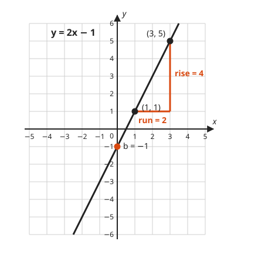
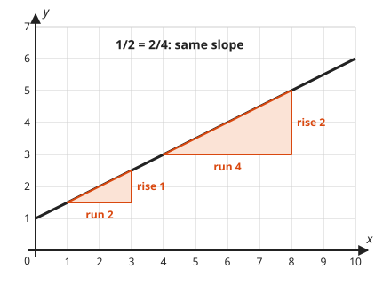
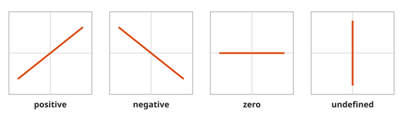
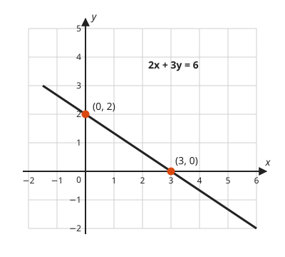
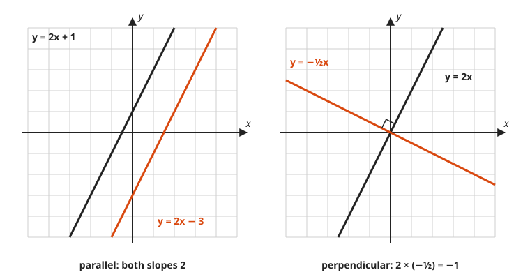
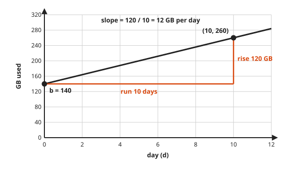

# Slope and Lines

**Level:** 201 · **Unit:** 4 · **Time:** 60 minutes
**Prerequisites:** [Lesson 03, The Coordinate Plane and Functions](../03-coordinate-plane-and-functions/README.md)

## The Big Idea

A straight line has one number that describes its steepness everywhere: the **slope**, rise over run.
Add a starting height, the **y-intercept**, and you have the whole line: $y = mx + b$.
Every story that says "grows at a constant rate" is a line in disguise.

## Words You Need

* **Rise**: how far you move up (or down, if negative) between two points.
* **Run**: how far you move right between the same two points.
* **Slope** $m$: rise divided by run. Change in output per one step of input.
* **y-intercept** $b$: where the line crosses the y-axis, which is the output when $x = 0$.

## Picture It

<!-- diagram: type=line-graph f="2x-1" range=-5..5 slope-triangle="(1,1)->(3,5)" intercept=-1 caption="slope 2, intercept -1" -->


Walk along the line from $(1, 1)$ to $(3, 5)$.
You move 2 to the right (the run) and 4 up (the rise).
The slope is $\dfrac{4}{2} = 2$: every step right lifts you 2.
The line crosses the y-axis at $-1$. That is the intercept $b$.

## Step by Step

### Idea 1: Slope From Two Points

$$m = \frac{\text{rise}}{\text{run}} = \frac{y_2 - y_1}{x_2 - x_1}$$

The order of the points does not matter, as long as the same point comes first on top and bottom.

### Idea 2: One Line, One Slope

Why is one number enough for the whole line? Draw two slope triangles anywhere on it.

<!-- diagram: type=line-graph f="0.5x+1" range=0..10 triangles="(1,1.5)->(3,2.5),(4,3)->(8,5)" -->


The triangles have the same angles. Therefore they are **similar**: one is a scaled copy of the other.
Scaling multiplies rise and run by the same factor, and the ratio does not change: $\tfrac{1}{2} = \tfrac{2}{4}$.
[Lesson 09](../09-triangles-congruence-and-similarity/README.md) proves the similar-triangle fact.

### Idea 3: Four Kinds of Slope

<!-- diagram: type=slope-panels kinds="positive,negative,zero,undefined" -->


* Positive: rises left to right.
* Negative: falls left to right.
* Zero: horizontal, the rise is 0. Equation $y = b$.
* Undefined: vertical, the run is 0, and division by 0 has no meaning. Equation $x = a$.

### Idea 4: The Three Forms of a Line

| Form | Equation | Use it when you know |
|---|---|---|
| Slope-intercept | $y = mx + b$ | the slope and the intercept |
| Point-slope | $y - y_1 = m(x - x_1)$ | the slope and any one point |
| Standard | $Ax + By = C$ | the two intercepts, or the equation came that way |

Standard form shows the intercepts quickly: set $x = 0$ to find one, set $y = 0$ to find the other.

<!-- diagram: type=line-graph eq="2x+3y=6" range=-2..6 points="(3,0),(0,2)" -->


### Idea 5: Parallel and Perpendicular

<!-- diagram: type=line-graph-pair left="2x+1,2x-3" right="2x,-0.5x" -->


* **Parallel** lines never meet. They have equal slopes.
* **Perpendicular** lines meet at a right angle. Their slopes multiply to $-1$: $2 \times (-\tfrac{1}{2}) = -1$. Flip the fraction and change the sign.

### Idea 6: Slope Is a Rate

Slope carries units: output units per input unit.

<!-- diagram: type=line-chart f="140+12d" x=0..12 y=0..320 slope-triangle="(0,140)->(10,260)" -->


On a dashboard, a straight trend line has a slope, and that slope is the growth rate.

## Worked Examples

### Example 1: Slope From Two Points

```txt
  points (2, 3) and (6, 1)
  m = (1 - 3) / (6 - 2)       rise over run, same point first in both
    = -2 / 4
    = -1/2                    falls 1 for every 2 to the right
```

### Example 2: Equation From Two Points

Find the line through $(2, 3)$ and $(6, 1)$.

```txt
  m = -1/2                    from Example 1
  y = -1/2 x + b              slope-intercept form with b unknown
  3 = -1/2 (2) + b            the point (2, 3) is on the line
  3 = -1 + b                  multiply
  4 = b                       add 1

  y = -1/2 x + 4
  check (6, 1): -1/2 (6) + 4 = -3 + 4 = 1   true
```

### Example 3: Graph From the Equation

$y = 3x - 2$.

```txt
  b = -2                      plot (0, -2)
  m = 3 = 3/1                 from there go right 1, up 3: plot (1, 1)
                              draw the line through both points
```

### Example 4: Standard Form to Slope-Intercept

```txt
  2x + 3y = 6
       3y = -2x + 6           subtract 2x from both sides
        y = -2/3 x + 2        divide every term by 3

  intercepts: x = 0 gives y = 2, and y = 0 gives x = 3
```

### Example 5: Disk Usage as a Line

A volume holds 140 GB on day 0 and 260 GB on day 10.

```txt
  m = (260 - 140) / (10 - 0)  rise over run
    = 120 / 10
    = 12                      GB per day
  b = 140                     value at day 0
  usage(d) = 12d + 140
```

## Common Mistakes

* Mixing the order: $\dfrac{y_2 - y_1}{x_1 - x_2}$ gives the wrong sign. Keep the same point first on top and bottom.
* Putting x on top: slope is change in y over change in x. Rise first. You climb before you walk, at least in this formula.
* Calling a vertical line slope 0: horizontal is 0, vertical is undefined.
* Forgetting to divide every term when converting from standard form.

## Try It

1. Slope through $(0, 0)$ and $(4, 2)$.
2. Slope through $(-1, 3)$ and $(2, -3)$.
3. Slope through $(2, 5)$ and $(7, 5)$.
4. Slope through $(3, 1)$ and $(3, 6)$.
5. Name the slope and y-intercept of $y = -3x + 4$.
6. Write the line with slope 2 through $(1, 5)$.
7. Write the line through $(0, -2)$ and $(4, 6)$.
8. Convert $4x - 2y = 8$ to slope-intercept form.
9. Write the line parallel to $y = 3x + 1$ through $(0, 5)$, and the line perpendicular to $y = 2x$ through the origin.
10. Request rate grows from 1,200 per second at 09:00 to 1,800 per second at 12:00. On a straight line, what is the slope in requests per second per hour?

<details>
<summary>Answers</summary>

1. $\tfrac{1}{2}$: rise 2, run 4.
2. $-2$: rise $-6$, run 3.
3. $0$: horizontal line.
4. Undefined: vertical line, run 0.
5. $m = -3$, $b = 4$.
6. $y = 2x + 3$: $5 = 2(1) + b$ gives $b = 3$.
7. $y = 2x - 2$: slope $\tfrac{8}{4} = 2$, and $(0, -2)$ gives $b = -2$.
8. $y = 2x - 4$: $-2y = -4x + 8$, divide by $-2$.
9. $y = 3x + 5$ and $y = -\tfrac{1}{2}x$.
10. 200 requests per second per hour: $\dfrac{1800 - 1200}{3}$.

</details>

## Code Corner

[code/main.go](code/main.go) finds the line through two points with exact fractions.

```go
m := big.NewRat(y2-y1, x2-x1) // rise over run
// b = y1 - m*x1
b := new(big.Rat).Sub(big.NewRat(y1, 1), new(big.Rat).Mul(m, big.NewRat(x1, 1)))
```

Output:

```txt
(1, 1) and (3, 5):     y = 2x - 1
(2, 3) and (6, 1):     y = -1/2x + 4
(0, 140) and (10, 260): y = 12x + 140
(2, 5) and (7, 5):     y = 0x + 5
(3, 1) and (3, 6):     x = 3 (vertical, slope undefined)
```

## Flashcards

[cards.tsv](cards.tsv) holds Anki cards for this lesson.

## Go Deeper

* [Paul's Online Notes: Lines](https://tutorial.math.lamar.edu/Classes/Alg/Lines.aspx): slope, the three forms, parallel and perpendicular lines.
* [Math Is Fun: Equation of a Straight Line](https://www.mathsisfun.com/equation_of_line.html): $y = mx + b$ explained plainly.
* Track: [Algebra](../../../tracks/algebra/README.md).
* Next: [Lesson 05, Systems of Linear Equations](../05-systems-of-equations/README.md).
