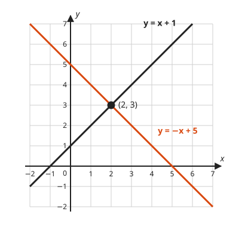
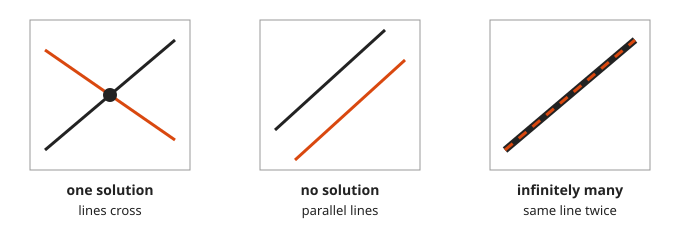
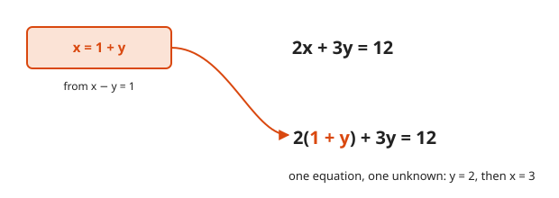
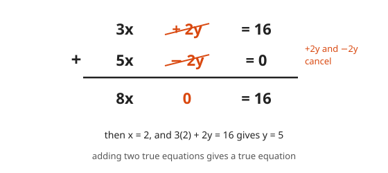
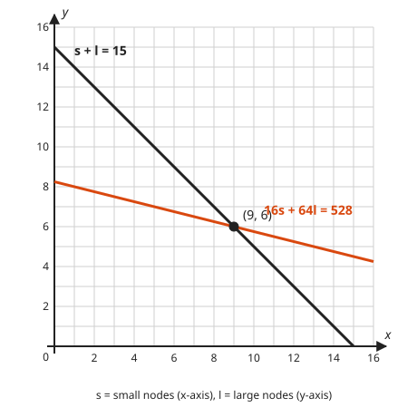

# Systems of Linear Equations

**Level:** 201 · **Unit:** 5 · **Time:** 60 minutes
**Prerequisites:** [Lesson 04, Slope and Lines](../04-slope-and-lines/README.md)

## The Big Idea

One equation in two unknowns has infinitely many solutions: a whole line of them.
A second equation narrows the field to the points that satisfy both at once, which is where the two lines cross.
Solving a system means finding that crossing, by picture or by algebra.

## Words You Need

* **System**: a set of equations that share unknowns.
* **Solution of a system**: values that make every equation in the set true at the same time. With two unknowns, it is a pair $(x, y)$.
* **Coefficient**: the number in front of a variable. In $3x$, the coefficient is 3.

## Picture It

<!-- diagram: type=line-graph lines="x+1,-x+5" range=-2..7 point="(2,3)" caption="two lines meet at the solution" -->


Every point on the black line makes $y = x + 1$ true.
Every point on the orange line makes $y = -x + 5$ true.
Only one point lies on both: $(2, 3)$. Check it: $3 = 2 + 1$ and $3 = -2 + 5$.

## Step by Step

### Idea 1: Three Possible Outcomes

Two lines in a plane meet in exactly one of three ways.

<!-- diagram: type=line-panels kinds="cross,parallel,same" -->


* Different slopes: the lines cross once. One solution.
* Same slope, different intercepts: parallel lines. No solution.
* Same slope, same intercept: the same line drawn twice. Infinitely many solutions.

### Idea 2: The Graphing Method

Draw both lines and read the crossing. Good for seeing. Weak for exact answers like $(\tfrac{7}{3}, -\tfrac{1}{5})$, which no ruler reads.

### Idea 3: The Substitution Method

Solve one equation for one variable. Put that expression into the other equation in place of the variable.
You trade two equations with two unknowns for one equation with one unknown, which Lesson 01 already handles.

<!-- diagram: type=substitution from="x=1+y" into="2x+3y=12" result="2(1+y)+3y=12" -->


Best when a variable already stands alone or has coefficient 1.

### Idea 4: The Elimination Method

Add or subtract the equations to cancel one variable.
Adding two true equations gives a true equation: equal amounts added to equal amounts, the same balance logic as [Lesson 01](../01-solving-linear-equations/README.md).

<!-- diagram: type=column-addition rows="3x+2y=16,5x-2y=0" sum="8x=16" cancel=y -->


If the coefficients do not match, scale an equation first: multiply every term of it by the same number.

### Idea 5: Finish the Job

After finding one variable, put it back into either equation to find the other. Then check both original equations.
Half an answer is a pair with a missing element. The compiler rejects it, and so does the grader.

### Idea 6: Systems Answer Two-Condition Questions

A cluster has 15 nodes. Small nodes have 16 GB of RAM, large nodes have 64 GB. Total RAM is 528 GB.
Two facts, two unknowns, two lines:

<!-- diagram: type=line-graph lines="15-s,(528-16s)/64" range=0..16 point="(9,6)" -->


## Worked Examples

### Example 1: Substitution

$$\begin{cases} 2x + 3y = 12 \\ x - y = 1 \end{cases}$$

```txt
  x = 1 + y                 solve the second equation for x
  2(1 + y) + 3y = 12        substitute into the first
  2 + 2y + 3y   = 12        distribute
  2 + 5y        = 12        combine like terms
       5y       = 10        subtract 2
        y       = 2         divide by 5
  x = 1 + 2 = 3             put y back

  check: 2(3) + 3(2) = 12 and 3 - 2 = 1   both true
  solution (3, 2)
```

### Example 2: Elimination by Adding

$$\begin{cases} 3x + 2y = 16 \\ 5x - 2y = 0 \end{cases}$$

```txt
  8x = 16                   add the equations: +2y and -2y cancel
   x = 2                    divide by 8
  3(2) + 2y = 16            put x into the first equation
       2y   = 10            subtract 6
        y   = 5             divide by 2

  check: 5(2) - 2(5) = 0    true
  solution (2, 5)
```

### Example 3: Elimination After Scaling

$$\begin{cases} 2x + 3y = 13 \\ 5x - 2y = 4 \end{cases}$$

```txt
   4x + 6y = 26             multiply the first equation by 2
  15x - 6y = 12             multiply the second equation by 3
  19x      = 38             add: the y terms cancel
    x      = 2              divide by 19
  2(2) + 3y = 13            put x back
       3y   = 9             subtract 4
        y   = 3             divide by 3

  check: 5(2) - 2(3) = 4    true
  solution (2, 3)
```

### Example 4: The Special Cases

```txt
  y = 3x + 1  and  y = 3x - 4
  3x + 1 = 3x - 4           set the two expressions for y equal
       1 = -4               false: parallel lines, no solution

  x + 2y = 4  and  2x + 4y = 8
  2x + 4y = 8               double the first equation
  0 = 0                     subtract from the second: always true, same line
```

### Example 5: Sizing the Cluster

```txt
  s + l = 15                count of nodes
  16s + 64l = 528           total RAM in GB
  s = 15 - l                solve the first for s
  16(15 - l) + 64l = 528    substitute
  240 - 16l + 64l  = 528    distribute
  240 + 48l        = 528    combine like terms
        48l        = 288    subtract 240
          l        = 6      divide by 48
  s = 15 - 6 = 9

  check: 16(9) + 64(6) = 144 + 384 = 528   true
```

Nine small nodes and six large nodes.

## See It Step by Step


[Solving a System by Graphing: open the step-by-step walkthrough](https://caseyaedwards.github.io/math_training/diagrams/system-of-equations/)

Watch the two lines cross at the one point that satisfies both equations.


[Elimination in the Row Picture: open the step-by-step walkthrough](https://caseyaedwards.github.io/math_training/diagrams/elimination-row-picture/)

Watch each row operation swap a line for a new one through the same crossing point.

## Common Mistakes

* Stopping after one variable: the answer is a pair.
* Scaling only part of an equation: multiply every term, on both sides.
* Subtracting equations with sign errors: multiply one equation by $-1$ and add instead.
* Checking in only one equation: the answer has to satisfy both.

## Try It

1. $y = 2x$ and $x + y = 9$.
2. $x + y = 10$ and $x - y = 2$.
3. $2x + y = 7$ and $x - y = 2$.
4. $3x + 4y = 10$ and $3x - 2y = 4$.
5. $2x + 5y = 1$ and $3x - 2y = 11$.
6. $y = 3x + 1$ and $y = 3x - 4$.
7. $x + 2y = 4$ and $2x + 4y = 8$.
8. A team runs 20 load-test jobs. Short jobs take 7 minutes and long jobs take 12 minutes. All 20 jobs take 190 minutes in total. How many of each?

<details>
<summary>Answers</summary>

1. $(3, 6)$: substitute $y = 2x$ to get $3x = 9$.
2. $(6, 4)$: add to get $2x = 12$.
3. $(3, 1)$: add to get $3x = 9$, then $y = 7 - 6$.
4. $(2, 1)$: subtract to get $6y = 6$, then $3x = 10 - 4$.
5. $(3, -1)$: multiply the first by 2 and the second by 5 to get $4x + 10y = 2$ and $15x - 10y = 55$. Add: $19x = 57$ and $x = 3$. Then $5y = 1 - 6$, so $y = -1$.
6. No solution: same slope, different intercepts.
7. Infinitely many: the second equation is the first doubled.
8. 10 short and 10 long: $s + l = 20$ and $7s + 12l = 190$. Substitute $s = 20 - l$ to get $140 + 5l = 190$ and $l = 10$.

</details>

## Code Corner

Elimination done once, in general, gives a formula. [code/main.go](code/main.go) applies it with exact fractions.
[Course 501](../../501/README.md) grows this into matrices and determinants.

```go
func solve2(a, b, e, c, d, f int64) string {
	det := a*d - b*c
	if det == 0 {
		return "no single solution (parallel lines or the same line)"
	}
	x := big.NewRat(e*d-b*f, det)
	y := big.NewRat(a*f-e*c, det)
	return fmt.Sprintf("x = %s, y = %s", x.RatString(), y.RatString())
}
```

Output:

```txt
2x + 3y = 12, x - y = 1     : x = 3, y = 2
3x + 2y = 16, 5x - 2y = 0   : x = 2, y = 5
2x + 3y = 13, 5x - 2y = 4   : x = 2, y = 3
s + l = 15, 16s + 64l = 528 : x = 9, y = 6
x + 2y = 4, 2x + 4y = 8     : no single solution (parallel lines or the same line)
```

## Flashcards

[cards.tsv](cards.tsv) holds Anki cards for this lesson.

## Go Deeper

* [Paul's Online Notes: Linear Systems with Two Variables](https://tutorial.math.lamar.edu/Classes/Alg/SystemsTwoVrble.aspx): substitution and elimination side by side.
* [Math Is Fun: Systems of Linear Equations](https://www.mathsisfun.com/algebra/systems-linear-equations.html): pictures of the three cases.
* Workshop: [Linear Algebra for Graphics and ML](../../../workshops/linear-algebra-for-graphics-and-ml/README.md), for systems with many unknowns.
* Next: [Lesson 06, Exponents and Scientific Notation](../06-exponents-and-scientific-notation/README.md).
