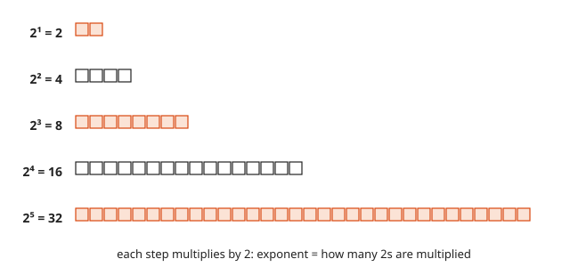
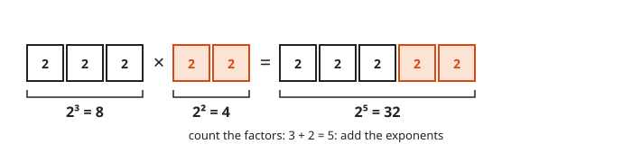
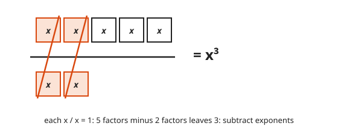
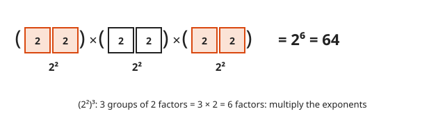
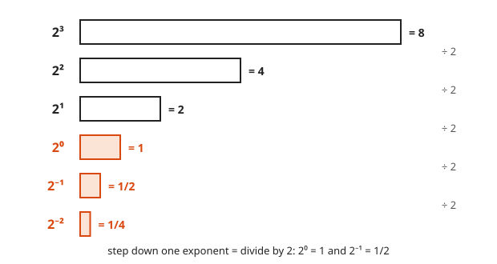
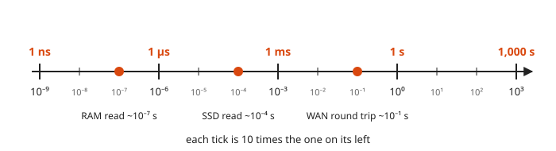

# Exponents and Scientific Notation

**Level:** 201 · **Unit:** 6 · **Time:** 60 minutes
**Prerequisites:** [Lesson 01, Solving Linear Equations](../01-solving-linear-equations/README.md), multiplication and fractions from [Course 101](../../101/README.md)

## The Big Idea

An exponent is a counter: $2^5$ means "multiply five 2s together".
Every exponent rule follows from counting factors. You never need to memorize one blindly.
Scientific notation uses powers of ten to write huge and tiny numbers, from nanoseconds to petabytes, in a few characters.

## Words You Need

* **Base**: the number being multiplied, the 2 in $2^5$.
* **Exponent** or **power**: how many copies of the base are multiplied, the 5 in $2^5$.
* **Factor**: one of the things being multiplied together.

## Picture It

<!-- diagram: type=doubling-rows base=2 n=1..5 -->


Each step up in the exponent multiplies by the base one more time. With base 2, every row doubles.
Five doublings turn 1 into 32. Forty doublings turn 1 into about a trillion. Exponents grow fast, which is why on-call engineers fear the word "exponential".

## Step by Step

### Idea 1: The Product Rule, $a^m \cdot a^n = a^{m+n}$

<!-- diagram: type=factor-boxes left="2,2,2" right="2,2" result="2^5" -->


Three 2s times two 2s is five 2s. Count the boxes: add the exponents. The base must be the same.

### Idea 2: The Quotient Rule, $\dfrac{a^m}{a^n} = a^{m-n}$

<!-- diagram: type=factor-cancel top=5 bottom=2 base=x -->


Each $x$ on the bottom cancels one $x$ on top, because $x / x = 1$. Five minus two leaves three: subtract the exponents.

### Idea 3: The Power Rule, $(a^m)^n = a^{mn}$

<!-- diagram: type=factor-groups group="2,2" groups=3 result="2^6" -->


$(2^2)^3$ is three groups of two 2s. That is $3 \times 2 = 6$ factors: multiply the exponents.
A related rule: $(ab)^n = a^n b^n$. Each copy of $ab$ supplies one $a$ and one $b$.

### Idea 4: Zero and Negative Exponents

Walk down the ladder. Each step down divides by 2.

<!-- diagram: type=bar-ladder base=2 exponents=3..-2 -->


Keep the pattern going past 1 and you reach:

$$a^0 = 1 \qquad a^{-n} = \frac{1}{a^n} \qquad (a \ne 0)$$

These are not new laws. They are the only values that keep the quotient rule working: $\dfrac{2^3}{2^3} = 1$, and the rule says it equals $2^{3-3} = 2^0$.

### Idea 5: Scientific Notation

A number in **scientific notation** looks like $m \times 10^e$ with $1 \le m < 10$ and $e$ a whole number.
Count how many places the decimal point hops to land right after the first nonzero digit.

<!-- diagram: type=decimal-hops numbers="4290000000,0.00025" -->


* Big number: the point hops left, the exponent is positive.
* Small number: the point hops right, the exponent is negative.

### Idea 6: Powers of Ten Are a Ruler for Scale

<!-- diagram: type=log-scale range=-9..3 marks="ns,us,ms,s,ks" -->


Each tick is ten times the one before. A WAN round trip is about a million times slower than a RAM read: $10^{-1} / 10^{-7} = 10^{6}$. These latency figures are rough orders of magnitude. The point is the ratio, not the decimal.

## Worked Examples

### Example 1: Rules on Letters

```txt
  x^3 * x^4 = x^(3+4) = x^7        product rule
  x^5 / x^2 = x^(5-2) = x^3        quotient rule
  (x^2)^3   = x^(2*3) = x^6        power rule
  (2x^3)^2  = 2^2 * x^6 = 4x^6     power of a product: square the 2 AND the x^3
```

### Example 2: Negative Exponents

```txt
  2^-3      = 1 / 2^3 = 1/8        negative exponent means reciprocal
  10^-2     = 1 / 100 = 0.01
  x^2 / x^5 = x^(2-5) = x^-3 = 1/x^3
```

### Example 3: Writing Scientific Notation

```txt
  4,294,967,296 = 4.29 x 10^9      point hops 9 left (rounded)
  0.00025       = 2.5 x 10^-4      point hops 4 right
```

$4{,}294{,}967{,}296$ is $2^{32}$, the number of IPv4 addresses. Fewer than people, as it turned out.

### Example 4: Multiplying and Dividing

```txt
  (3 x 10^4)(5 x 10^6)
  = (3 * 5) x 10^(4+6)             group the mantissas and the powers
  = 15 x 10^10
  = 1.5 x 10^11                    15 is not below 10: shift one place

  how many 100 ns RAM reads fit in one second?
  1 / (1 x 10^-7) = 10^7           ten million
```

## Common Mistakes

* Multiplying the exponents when you multiply powers: $x^3 \cdot x^4 = x^7$, not $x^{12}$.
* Adding exponents with different bases: $2^3 \cdot 3^2$ does not combine. Compute it: $8 \cdot 9 = 72$.
* Thinking a negative exponent makes a negative number: $2^{-3} = \tfrac{1}{8}$, which is positive.
* Forgetting the coefficient: $(2x)^3 = 8x^3$, not $2x^3$.
* Leaving $15 \times 10^{10}$ as final: the mantissa must sit between 1 and 10.

## Try It

1. $3^2 \cdot 3^3$
2. $(2^3)^2$
3. $\dfrac{x^8}{x^3}$
4. $5^0$
5. $10^{-2}$ as a decimal
6. $(2x^3)^2$
7. Write 93,000,000 in scientific notation.
8. Write 0.0000042 in scientific notation.
9. $(6 \times 10^5)(4 \times 10^3)$ in scientific notation.
10. A TiB is $2^{40}$ bytes. Is that closer to $10^{12}$ or $10^{13}$?

<details>
<summary>Answers</summary>

1. $3^5 = 243$.
2. $2^6 = 64$.
3. $x^5$.
4. $1$.
5. $0.01$.
6. $4x^6$.
7. $9.3 \times 10^7$.
8. $4.2 \times 10^{-6}$.
9. $2.4 \times 10^9$: $24 \times 10^8$, then shift one place.
10. $10^{12}$: $2^{40} = 1{,}099{,}511{,}627{,}776 \approx 1.1 \times 10^{12}$.

</details>

## Code Corner

[code/main.go](code/main.go) builds powers by repeated multiplication, checks the product and power rules for every pair of exponents from 0 to 6, and formats numbers in scientific notation.

```go
// sci splits x into a mantissa m with 1 <= |m| < 10 and an exponent e.
func sci(x float64) (float64, int) {
	e := int(math.Floor(math.Log10(math.Abs(x))))
	m := x / math.Pow(10, float64(e))
	return m, e
}
```

Output:

```txt
powers of two an SRE meets daily:
  2^10 = 1024
  2^20 = 1048576
  2^30 = 1073741824
  2^32 = 4294967296
  2^40 = 1099511627776
product rule and power rule hold for 0..6: true
  4.294967296e+09 = 4.295 x 10^9
  9.3e+07        = 9.3 x 10^7
  0.00025        = 2.5 x 10^-4
  4.2e-06        = 4.2 x 10^-6
  2.4e+09        = 2.4 x 10^9
```

Go prints `9.3e+07` for $9.3 \times 10^7$. The `e` is short for "times ten to the".

## Flashcards

[cards.tsv](cards.tsv) holds Anki cards for this lesson.

## Go Deeper

* [Math Is Fun: Laws of Exponents](https://www.mathsisfun.com/algebra/exponent-laws.html): each law with a counting picture.
* [Math Is Fun: Scientific Notation](https://www.mathsisfun.com/numbers/scientific-notation.html): plain examples in both directions.
* [Paul's Online Notes: Integer Exponents](https://tutorial.math.lamar.edu/Classes/Alg/IntegerExponents.aspx): the rules with many worked simplifications.
* Workshop: [Exponential Growth in Interest, Epidemics, and Load](../../../workshops/exponential-growth-in-interest-epidemics-and-load/README.md).
* Next: [Lesson 07, Factoring and Quadratics](../07-factoring-and-quadratics/README.md).
