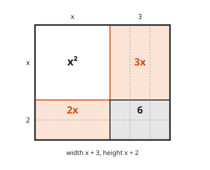
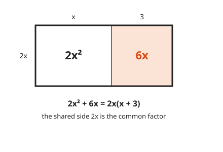
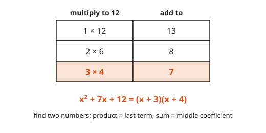
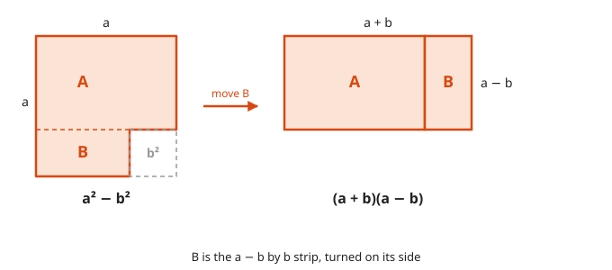
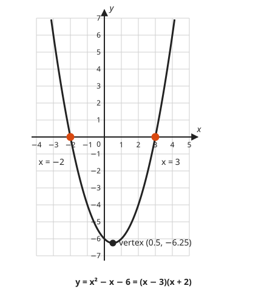
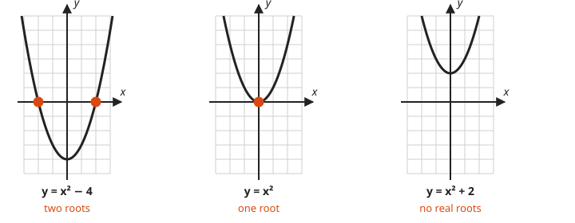

# Factoring and Quadratics

**Level:** 201 · **Unit:** 7 · **Time:** 75 minutes
**Prerequisites:** [Lesson 06, Exponents](../06-exponents-and-scientific-notation/README.md), [Lesson 03, Functions and Graphs](../03-coordinate-plane-and-functions/README.md)

## The Big Idea

Multiplying two brackets is drawing a rectangle and adding up its pieces.
**Factoring** runs that backward: given the pieces, find the rectangle.
It matters because a product is zero only when one of its factors is zero, and that turns a hard equation into two easy ones.

## Words You Need

* **Term**: a piece of a sum, such as $x^2$, $5x$, or $6$ in $x^2 + 5x + 6$.
* **Quadratic**: an expression whose highest power is 2, for example $ax^2 + bx + c$ with $a \ne 0$.
* **Factor** (verb): rewrite a sum as a product. **Expand**: the reverse.
* **Root**: a value of $x$ that makes the expression equal zero.

## Picture It

<!-- diagram: type=area-model width="x+3" height="x+2" -->


The rectangle is $x + 3$ wide and $x + 2$ tall. Its area is $(x + 2)(x + 3)$.
Add the four pieces instead: $x^2 + 3x + 2x + 6 = x^2 + 5x + 6$.
Two ways to count the same area. Same answer. That is the whole of expanding.

## Step by Step

### Idea 1: Expanding Is Distributing Twice

Every term in the first bracket multiplies every term in the second. Two terms times two terms makes four pieces, the four boxes in the picture.

$$(x + 2)(x + 3) = x \cdot x + x \cdot 3 + 2 \cdot x + 2 \cdot 3 = x^2 + 5x + 6$$

### Idea 2: Pull Out a Common Factor First

If every term shares a factor, pull it out. It is the shared side of a rectangle.

<!-- diagram: type=area-model width="x+3" height="2x" -->


$2x^2 + 6x = 2x(x + 3)$. Always look for this first. It is the cheapest win in the lesson.

### Idea 3: The Sum-Product Search

To factor $x^2 + bx + c$, find two numbers that **multiply to $c$** and **add to $b$**.
Look at the picture again: the 6 box is $2 \times 3$, and the two strips add up to $2x + 3x = 5x$.

<!-- diagram: type=table rows="1x12:13,2x6:8,3x4:7" highlight=3 -->


Signs matter:

| $c$ | $b$ | The two numbers |
|---|---|---|
| positive | positive | both positive |
| positive | negative | both negative |
| negative | either | one positive, one negative |

### Idea 4: Difference of Squares

$a^2 - b^2 = (a + b)(a - b)$. Cut a small square from a big one and rearrange what is left.

<!-- diagram: type=dissection from="a^2-b^2" to="(a+b)(a-b)" -->


For example, $x^2 - 9 = (x + 3)(x - 3)$. The middle terms cancel when you expand: $3x - 3x = 0$.

### Idea 5: The Zero Product Property

If $A \cdot B = 0$, then $A = 0$ or $B = 0$. Nothing else multiplies to zero. Zero is a hard stop, like a failed dependency in a pipeline.
Factor first, set each factor to zero, solve two small linear equations.

<!-- diagram: type=function-graph f="x^2-x-6" range=-4..5 roots=-2,3 vertex="(0.5,-6.25)" -->


The roots are where the graph of $y = x^2 - x - 6$ crosses the x-axis, where $y = 0$.
The lowest point of a parabola that opens upward is the **vertex**.

### Idea 6: The Quadratic Formula and the Discriminant

When factoring does not come easily, the **quadratic formula** always works for $ax^2 + bx + c = 0$:

$$x = \frac{-b \pm \sqrt{b^2 - 4ac}}{2a}$$

The symbol $\pm$ means "do it once with plus and once with minus". [Course 301](../../301/README.md) derives the formula by completing the square.
The part under the root, $b^2 - 4ac$, is the **discriminant**. It counts the roots before you compute them.

<!-- diagram: type=parabola-panels f="x^2-4,x^2,x^2+2" -->


| Discriminant | Real roots |
|---|---|
| positive | two |
| zero | one |
| negative | none, the square root of a negative number is not a real number |

## Worked Examples

### Example 1: Expand

```txt
  (x - 5)(x + 2)
  = x*x + x*2 - 5*x - 5*2        every term times every term
  = x^2 + 2x - 5x - 10
  = x^2 - 3x - 10                combine like terms
```

### Example 2: Factor With Signs

$x^2 - x - 6$: multiply to $-6$, add to $-1$.

```txt
  pairs for -6:  1,-6 (sum -5)   -1,6 (sum 5)   2,-3 (sum -1)   -2,3 (sum 1)
  winner: 2 and -3
  x^2 - x - 6 = (x + 2)(x - 3)

  check: (x + 2)(x - 3) = x^2 - 3x + 2x - 6 = x^2 - x - 6   true
```

### Example 3: Solve by Factoring

```txt
  x^2 - x - 6 = 0
  (x + 2)(x - 3) = 0             factor
  x + 2 = 0   or   x - 3 = 0     zero product property
  x = -2      or   x = 3
```

### Example 4: Do Not Divide by x

```txt
  x^2 = 4x
  x^2 - 4x = 0                   move everything to one side
  x(x - 4) = 0                   common factor x
  x = 0   or   x = 4
```

Dividing both sides by $x$ gives only $x = 4$ and silently drops $x = 0$. Silent data loss. Avoid.

### Example 5: The Formula

In $2x^2 + 3x - 2 = 0$, the coefficients are $a = 2$, $b = 3$, $c = -2$.

```txt
  b^2 - 4ac = 9 - 4(2)(-2) = 9 + 16 = 25      discriminant, positive: two roots
  x = (-3 +- 5) / 4                           sqrt(25) = 5
  x = 2/4 = 1/2   or   x = -8/4 = -2

  check by factoring: (2x - 1)(x + 2) = 2x^2 + 4x - x - 2 = 2x^2 + 3x - 2   true
```

## Common Mistakes

* Expanding $(x + 3)^2$ as $x^2 + 9$: it is $x^2 + 6x + 9$. Draw the square and you see the two missing strips.
* Solving $(x - 3)(x + 2) = 0$ as $x = -3$ or $x = 2$: set each factor to zero. $x - 3 = 0$ gives $x = 3$.
* Using the zero product property on a nonzero right side: $(x - 1)(x - 2) = 6$ does not mean $x - 1 = 6$. Move the 6 over and expand first.
* Dividing by $x$: you lose the root $x = 0$.
* Dropping the $\pm$: the formula gives two answers when the discriminant is positive.

## Try It

1. Expand $(x + 4)(x + 1)$.
2. Expand $(x - 5)(x + 2)$.
3. Factor $x^2 + 7x + 12$.
4. Factor $x^2 - 8x + 15$.
5. Factor $x^2 + 2x - 15$.
6. Factor $x^2 - 49$.
7. Factor $3x^2 - 12x$.
8. Solve $x^2 - 5x + 6 = 0$.
9. Solve $x^2 = 4x$.
10. Solve $x^2 + 2x - 1 = 0$ with the formula. Give exact and decimal answers.

<details>
<summary>Answers</summary>

1. $x^2 + 5x + 4$.
2. $x^2 - 3x - 10$.
3. $(x + 3)(x + 4)$: 3 and 4 multiply to 12 and add to 7.
4. $(x - 3)(x - 5)$: $-3$ and $-5$ multiply to 15 and add to $-8$.
5. $(x + 5)(x - 3)$: 5 and $-3$ multiply to $-15$ and add to 2.
6. $(x + 7)(x - 7)$: difference of squares.
7. $3x(x - 4)$: common factor $3x$.
8. $x = 2$ or $x = 3$: $(x - 2)(x - 3) = 0$.
9. $x = 0$ or $x = 4$: $x(x - 4) = 0$.
10. $x = -1 \pm \sqrt{2}$, about $0.414$ and $-2.414$: the discriminant is $4 + 4 = 8$, and $\dfrac{-2 \pm \sqrt{8}}{2} = -1 \pm \sqrt{2}$.

</details>

## Code Corner

[code/main.go](code/main.go) runs the sum-product search by brute force and applies the quadratic formula with a discriminant check.

```go
// factor looks for integers p and q with p*q = c and p + q = b.
func factor(b, c int) string {
	for p := -100; p <= 100; p++ {
		q := b - p
		if p*q == c && p <= q {
			return "(x " + term(p) + ")(x " + term(q) + ")"
		}
	}
	return "no integer factors"
}
```

Output:

```txt
x^2 + 5x + 6   = (x + 2)(x + 3)
x^2 - x - 6    = (x - 3)(x + 2)
x^2 + 7x + 12  = (x + 3)(x + 4)
x^2 + 0x - 49  = (x - 7)(x + 7)
x^2 + x + 1    = no integer factors

x^2 - x - 6 = 0    : discriminant 25: x = -2 or x = 3
2x^2 + 3x - 2 = 0  : discriminant 25: x = -2 or x = 0.5
x^2 + 2x - 1 = 0   : discriminant 8: x = -2.414 or x = 0.4142
x^2 - 6x + 9 = 0   : discriminant 0: one root x = 3
x^2 + 2 = 0        : discriminant -8 < 0: no real roots
```

## Flashcards

[cards.tsv](cards.tsv) holds Anki cards for this lesson.

## Go Deeper

* [Paul's Online Notes: Factoring Polynomials](https://tutorial.math.lamar.edu/Classes/Alg/Factoring.aspx): every factoring pattern with examples.
* [Math Is Fun: Factoring in Algebra](https://www.mathsisfun.com/algebra/factoring.html): short and plain.
* [Math Is Fun: Quadratic Equations](https://www.mathsisfun.com/algebra/quadratic-equation.html): the formula and the discriminant with graphs.
* Next: [Lesson 08, Points, Lines, and Angles](../08-points-lines-and-angles/README.md).
