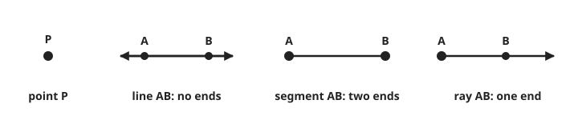
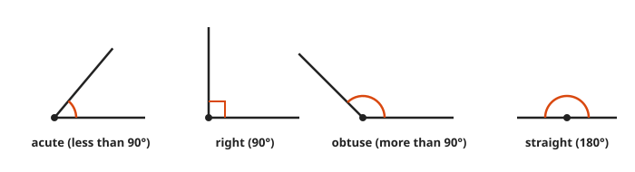
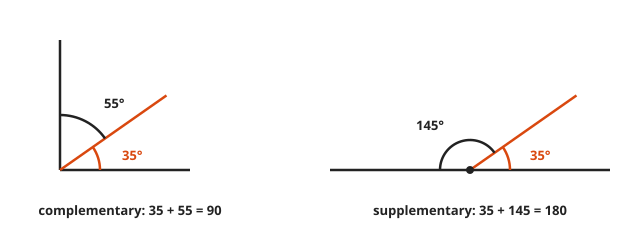
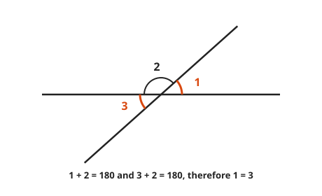

# Points, Lines, and Angles

**Level:** 201 · **Unit:** 8 · **Time:** 60 minutes
**Prerequisites:** [Course 101 Foundations](../../101/README.md). No algebra beyond Lesson 01 is needed.

## The Big Idea

Geometry starts with a few things it does not define (point, line, plane) and a few rules it accepts without proof.
Everything else is built from those by careful reasoning. Euclid did this around 300 BCE, and the build still compiles.
This lesson covers the building blocks: lines, angles, and what happens when a line crosses two parallel lines.

## Words You Need

* **Point**: a location with no size.
* **Line**: a straight path with no thickness that runs forever in both directions.
* **Plane**: a flat surface that runs forever in every direction, like an endless sheet of paper.
* **Angle**: the opening between two rays that share an endpoint, called the **vertex**.
* **Degree**: one 360th of a full turn, written $1^\circ$.

## Picture It

<!-- diagram: type=parallel-transversal angle=60 numbering="1 UL,2 UR,3 LL,4 LR,5..8 same at lower line" -->


A line that crosses two other lines is a **transversal**.
When the two lines are parallel, the eight angles come in only two sizes. Here: four of $60^\circ$ and four of $120^\circ$.
Learn one angle and you know all eight.

## Step by Step

### Idea 1: Points, Lines, Segments, Rays

<!-- diagram: type=primitives items="point,line,segment,ray" -->


| Object | Ends | Written |
|---|---|---|
| line | none | $\overleftrightarrow{AB}$ |
| segment | two | $\overline{AB}$ |
| ray | one, at the first letter | $\overrightarrow{AB}$ |

A segment has a length. A line and a ray do not, since they never stop.

### Idea 2: Measuring and Naming Angles

A full turn is $360^\circ$. A half turn, a straight line, is $180^\circ$. A quarter turn, a corner of a square, is $90^\circ$.

<!-- diagram: type=angle-types angles=50,90,135,180 -->


| Name | Size |
|---|---|
| acute | less than $90^\circ$ |
| right | exactly $90^\circ$, drawn with a small square |
| obtuse | between $90^\circ$ and $180^\circ$ |
| straight | exactly $180^\circ$ |

Lines that meet at a right angle are **perpendicular**, written $\perp$.

### Idea 3: Complementary and Supplementary

<!-- diagram: type=angle-pair-sums comp="35,55" supp="35,145" -->


* **Complementary** angles add to $90^\circ$. They fill a corner.
* **Supplementary** angles add to $180^\circ$. They fill a straight line.

Memory hook: C comes before S, and 90 comes before 180.

### Idea 4: Vertical Angles Are Equal

When two lines cross, the angles across from each other are **vertical angles**. They are equal.

<!-- diagram: type=crossing-lines labels="1,2,3" equal="1,3" -->


Why: angles 1 and 2 sit on a straight line: $\angle 1 + \angle 2 = 180^\circ$.
Angles 3 and 2 also sit on a straight line: $\angle 3 + \angle 2 = 180^\circ$.
Both equal 180 minus the same thing. Therefore $\angle 1 = \angle 3$.
That is a complete proof, three lines long. Proofs are not always scary.

### Idea 5: Parallel Lines and the Parallel Postulate

**Parallel** lines lie in the same plane and never meet, written $\parallel$.
Euclid assumed one rule about them, the **parallel postulate**: through a point not on a line, exactly one line runs parallel to it.
Two thousand years of mathematicians tried to prove it from the other rules and failed. The failure gave birth to non-Euclidean geometry, the geometry of curved surfaces. A productive failure.

### Idea 6: Angle Pairs at a Transversal

With parallel lines, three pairs carry the whole picture.

<!-- diagram: type=parallel-transversal-panels pairs="1-5,3-6,3-5" -->


| Pair | Where | Rule (parallel lines only) | In the picture |
|---|---|---|---|
| corresponding | same position at each crossing | equal | 1 and 5, 2 and 6, 3 and 7, 4 and 8 |
| alternate interior | between the lines, opposite sides | equal | 3 and 6, 4 and 5 |
| alternate exterior | outside the lines, opposite sides | equal | 1 and 8, 2 and 7 |
| same-side interior | between the lines, same side | add to $180^\circ$ | 3 and 5, 4 and 6 |

The rules also run backward. If corresponding angles are equal, the lines are parallel. Surveyors and carpenters use this every day.

## Worked Examples

### Example 1: Complement and Supplement

```txt
  complement of 35  = 90 - 35  = 55
  supplement of 35  = 180 - 35 = 145
```

### Example 2: One Angle Is Three Times the Other

Two supplementary angles. One is three times the other.

```txt
  x + 3x = 180       they fill a straight line
      4x = 180       combine like terms
       x = 45        divide by 4
  angles: 45 and 135
```

### Example 3: Vertical Angles With Algebra

Vertical angles measure $2x + 10$ and $3x - 20$.

```txt
  2x + 10 = 3x - 20  vertical angles are equal
       10 = x - 20   subtract 2x
       30 = x        add 20
  angle = 2(30) + 10 = 70 degrees
```

### Example 4: All Eight From One

In the figure, angle 2 is $60^\circ$.

```txt
  angle 1 = 180 - 60 = 120     1 and 2 form a straight line
  angle 3 = 60                 vertical to angle 2
  angle 4 = 120                vertical to angle 1
  angles 5, 6, 7, 8 = 120, 60, 60, 120     corresponding to 1, 2, 3, 4
```

## Common Mistakes

* Mixing up complementary (90) and supplementary (180).
* Applying the transversal rules to lines that are not parallel: the rules need parallel lines. Look for the arrow marks.
* Treating a line as having a length: only a segment has one.
* Assuming a drawing is to scale: trust the given marks and numbers, not the ruler.

## Try It

1. Find the complement of $35^\circ$.
2. Find the supplement of $35^\circ$.
3. Two angles are supplementary and one is three times the other. Find both.
4. Vertical angles measure $2x + 10$ and $3x - 20$. Find $x$ and the angle.
5. In the figure, angle 1 is $120^\circ$. Find angles 5, 6, and 8.
6. Name the pair formed by angles 3 and 6, and state its rule.
7. Name the pair formed by angles 3 and 5, and state its rule.
8. Same-side interior angles measure $2x$ and $x + 30$. Find both angles.
9. Through how many degrees does a minute hand turn in 20 minutes?
10. What is the angle between the hands of a clock at 3:00?

<details>
<summary>Answers</summary>

1. $55^\circ$.
2. $145^\circ$.
3. $45^\circ$ and $135^\circ$.
4. $x = 30$, angle $70^\circ$.
5. Angle 5 is $120^\circ$ (corresponding to 1), angle 6 is $60^\circ$ (supplementary to 5), angle 8 is $120^\circ$ (vertical to 5).
6. Alternate interior angles: equal.
7. Same-side interior angles: they add to $180^\circ$.
8. $100^\circ$ and $80^\circ$: $3x + 30 = 180$ gives $x = 50$.
9. $120^\circ$: 20 minutes is one third of a full turn of $360^\circ$.
10. $90^\circ$.

</details>

## Code Corner

[code/main.go](code/main.go) fills in all eight transversal angles from one, and computes clock-hand angles. The hour hand drifts half a degree per minute, which catches most people at 2:30.

```go
func clockAngle(h, m int) float64 {
	minute := 6 * float64(m)                  // 360 / 60 degrees per minute
	hour := 30*float64(h%12) + 0.5*float64(m) // 360 / 12 per hour, plus drift
	d := hour - minute
	if d < 0 {
		d = -d
	}
	if d > 180 {
		d = 360 - d
	}
	return d
}
```

Output:

```txt
complement of 35: 55
supplement of 35: 145
angle 1 = 120
angle 2 = 60
angle 3 = 60
angle 4 = 120
angle 5 = 120
angle 6 = 60
angle 7 = 60
angle 8 = 120
clock at 3:00 : 90
clock at 2:30 : 105
```

## Flashcards

[cards.tsv](cards.tsv) holds Anki cards for this lesson.

## Go Deeper

* [Euclid's Elements, Book I](https://mathcs.clarku.edu/~djoyce/elements/bookI/bookI.html): David Joyce's edition with the definitions, postulates, and diagrams. Proposition 15 is the vertical angle proof above.
* [Math Is Fun: Parallel Lines and Pairs of Angles](https://www.mathsisfun.com/geometry/parallel-lines.html): the angle pairs with pictures.
* [MacTutor: Euclid](https://mathshistory.st-andrews.ac.uk/Biographies/Euclid/): what little is known about the author.
* Track: [Geometry](../../../tracks/geometry/README.md).
* Next: [Lesson 09, Triangles, Congruence, and Similarity](../09-triangles-congruence-and-similarity/README.md).
