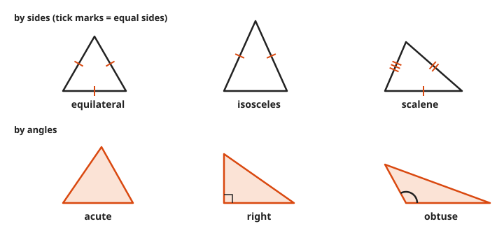
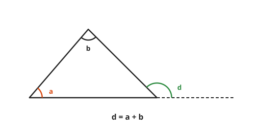
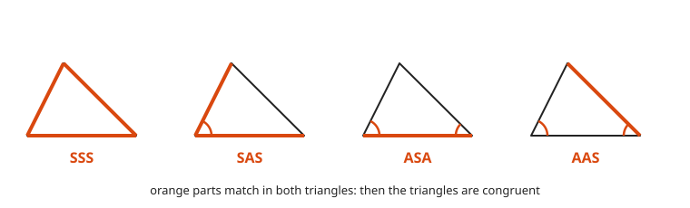
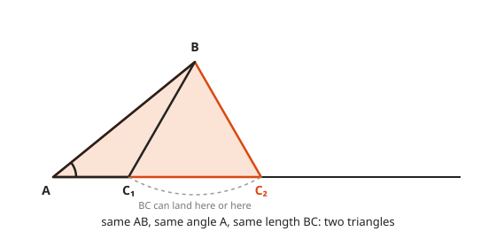
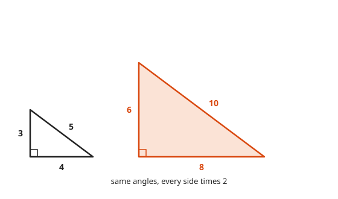
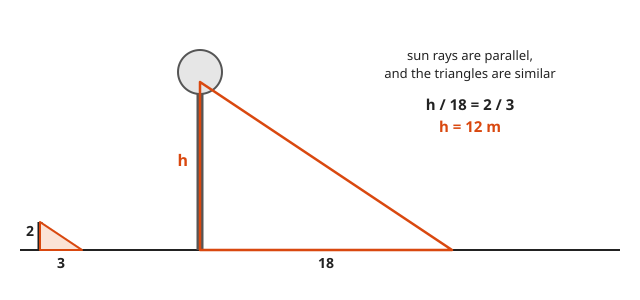

# Triangles, Congruence, and Similarity

**Level:** 201 · **Unit:** 9 · **Time:** 75 minutes
**Prerequisites:** [Lesson 08, Points, Lines, and Angles](../08-points-lines-and-angles/README.md)

## The Big Idea

The triangle is the simplest shape that holds its form. Push on a square frame and it folds. Push on a triangle and it does not, which is why bridges and radio masts are made of them.
The angles of every triangle add to $180^\circ$.
Two triangles are **congruent** when they are exact copies, and **similar** when one is a scaled copy of the other. Similarity lets you measure a tree with its shadow.

## Words You Need

* **Vertex**: a corner. Plural: vertices. Triangle $ABC$ has vertices $A$, $B$, $C$.
* **Congruent** ($\cong$): same shape and same size. One fits exactly on the other.
* **Similar** ($\sim$): same shape, possibly a different size. All angles match, and all sides share one **scale factor**.
* **Interior angle**: an angle inside the triangle at a vertex. **Exterior angle**: the angle between one side and the extension of the next.

## Picture It

<!-- diagram: type=triangle-proof A=(80,260) B=(420,260) C=(270,90) parallel-through=C -->


Draw the line through $C$ parallel to $AB$.
Angle $a$ at vertex $A$ reappears at $C$ as an alternate interior angle, from [Lesson 08](../08-points-lines-and-angles/README.md). The same happens with angle $b$.
At $C$, the three angles $a$, $c$, $b$ lie side by side along a straight line. A straight line is $180^\circ$. Therefore $a + b + c = 180^\circ$.

## Step by Step

### Idea 1: Classifying Triangles

<!-- diagram: type=triangle-grid rows="sides: equilateral,isosceles,scalene; angles: acute,right,obtuse" -->


| By sides | Meaning |
|---|---|
| equilateral | all three sides equal, all angles $60^\circ$ |
| isosceles | at least two sides equal, and the angles opposite them equal |
| scalene | no sides equal |

| By angles | Meaning |
|---|---|
| acute | all angles below $90^\circ$ |
| right | one angle exactly $90^\circ$ |
| obtuse | one angle above $90^\circ$ |

Tick marks on sides mean "these sides are equal". The same number of ticks means the same length.

### Idea 2: The Exterior Angle

<!-- diagram: type=triangle-exterior remote="a,b" exterior=d -->


An exterior angle equals the sum of the two interior angles not next to it: $d = a + b$.
Why: $d$ and the third interior angle make a straight line, $180^\circ$. The three interior angles also make $180^\circ$. Remove the shared angle from both and $d = a + b$ is left.

### Idea 3: Congruence Shortcuts

To prove two triangles congruent, you do not need all six parts (three sides, three angles). Three well-chosen parts are enough.

<!-- diagram: type=triangle-criteria items="SSS,SAS,ASA,AAS" -->


| Shortcut | What matches |
|---|---|
| SSS | three sides |
| SAS | two sides and the angle **between** them |
| ASA | two angles and the side between them |
| AAS | two angles and a side not between them |

Why SSS works: three sticks of fixed length can be joined into a triangle in only one shape. That rigidity is the reason triangles hold their form.

### Idea 4: The Shortcut That Fails, SSA

Two sides and an angle **not** between them do not pin the triangle down.

<!-- diagram: type=ssa A=(60,200) B=(220,70) BC=150 -->


Side $BC$ swings like a gate and touches the base line in two places. Two different triangles, same data. No shortcut spells SSA, which is just as well.

### Idea 5: Similar Triangles

<!-- diagram: type=similar-triangles small="3,4,5" scale=2 -->


Two triangles are similar when their angles match. Then every side scales by the same factor $k$:

$$\frac{6}{3} = \frac{8}{4} = \frac{10}{5} = 2$$

The **AA shortcut**: if two angles match, the third matches too (all three add to $180^\circ$), and the triangles are similar.
Lengths scale by $k$. Areas scale by $k^2$. [Lesson 12](../12-volume-and-surface-area/README.md) adds volumes, which scale by $k^3$.

### Idea 6: Measuring With Shadows

<!-- diagram: type=shadow pole="2,3" tree="h,18" -->


Sun rays arrive parallel. At the same moment, the pole and the tree make the same angle with their shadows. Both stand at right angles to the ground. Two matching angles: similar triangles.
Thales of Miletus is said to have measured the height of a pyramid this way, around 600 BCE.

## Worked Examples

### Example 1: The Third Angle

```txt
  angles 50 and 60
  third = 180 - 50 - 60 = 70      angles of a triangle add to 180
```

### Example 2: Isosceles Triangle

The angle at the top of an isosceles triangle is $40^\circ$. Find the two base angles.

```txt
  2x + 40 = 180       the base angles are equal
  2x      = 140       subtract 40
   x      = 70        divide by 2
```

### Example 3: Exterior Angle

```txt
  remote interior angles 50 and 60
  exterior angle = 50 + 60 = 110
  check: 180 - 70 = 110            the third angle is 70, and they form a straight line
```

### Example 4: Similar Triangles

Triangle sides 4, 6, 8. A similar triangle has shortest side 10.

```txt
  k = 10 / 4 = 2.5         scale factor from the shortest sides
  6 * 2.5 = 15             middle side
  8 * 2.5 = 20             longest side
```

### Example 5: The Tree

```txt
  h / 18 = 2 / 3           matching sides of similar triangles
  h      = 18 * 2 / 3      multiply both sides by 18
  h      = 12 m
```

## Common Mistakes

* Matching the wrong sides: in similar triangles, pair shortest with shortest, longest with longest, or match by the equal angles.
* Using SSA as proof of congruence: it is not one.
* Confusing congruent and similar: congruent is similar with $k = 1$.
* Scaling areas by $k$: lengths go by $k$, areas by $k^2$.

## Try It

1. Two angles of a triangle are $45^\circ$ and $85^\circ$. Find the third.
2. An isosceles triangle has a top angle of $40^\circ$. Find the base angles.
3. The remote interior angles are $50^\circ$ and $60^\circ$. Find the exterior angle.
4. A right triangle has one acute angle of $35^\circ$. Find the other.
5. Two triangles share sides 5 and 7 and the $40^\circ$ angle between them. Which shortcut proves them congruent?
6. A triangle has sides 4, 6, 8. A similar triangle has shortest side 10. Find its other sides.
7. A person 1.8 m tall casts a 1.2 m shadow. A building casts a 30 m shadow at the same time. How tall is the building?
8. Explain in one sentence why SSA does not prove congruence.
9. What is each angle of an equilateral triangle?
10. A triangle is scaled by 3. What happens to its area?

<details>
<summary>Answers</summary>

1. $50^\circ$.
2. $70^\circ$ each.
3. $110^\circ$.
4. $55^\circ$: the two acute angles of a right triangle add to $90^\circ$.
5. SAS: the angle sits between the two sides.
6. 15 and 20: the scale factor is 2.5.
7. 45 m: $\dfrac{h}{30} = \dfrac{1.8}{1.2}$ gives $h = 30 \times 1.5$.
8. The second side can swing to two different positions: the same data fits two different triangles.
9. $60^\circ$: three equal angles that add to $180^\circ$.
10. It is multiplied by 9.

</details>

## Code Corner

[code/main.go](code/main.go) finds third angles, classifies triangles, and tests similarity by sorting the sides and comparing ratios.

```go
func similar(p, q [3]float64) (bool, float64) {
	sort.Float64s(p[:])
	sort.Float64s(q[:])
	k := q[0] / p[0]
	for i := 1; i < 3; i++ {
		if q[i]/p[i] != k {
			return false, 0
		}
	}
	return true, k
}
```

Output:

```txt
angles 50 and 60, third angle: 70
sides 5, 5, 8: isosceles
angles 30, 60, 90: right
angles 20, 30, 130: obtuse
3-4-5 and 6-8-10 similar: true scale factor: 2
3-4-5 and 6-8-11 similar: false
tree height from shadows: 12 m
```

## Flashcards

[cards.tsv](cards.tsv) holds Anki cards for this lesson.

## Go Deeper

* [Euclid's Elements, Book I, Proposition 32](https://mathcs.clarku.edu/~djoyce/elements/bookI/propI32.html): the angle sum and the exterior angle, with the original proof.
* [Math Is Fun: Congruent Triangles](https://www.mathsisfun.com/geometry/triangles-congruent.html): the shortcuts with pictures.
* [Math Is Fun: Similar Triangles](https://www.mathsisfun.com/geometry/triangles-similar.html): finding missing sides.
* [MacTutor: Thales of Miletus](https://mathshistory.st-andrews.ac.uk/Biographies/Thales/): the shadow story and its sources.
* Next: [Lesson 10, The Pythagorean Theorem](../10-pythagorean-theorem/README.md).
