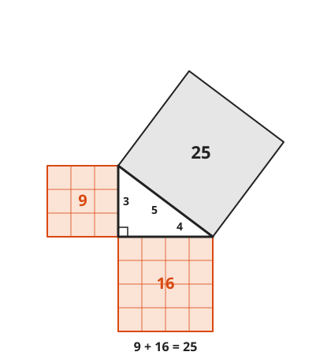
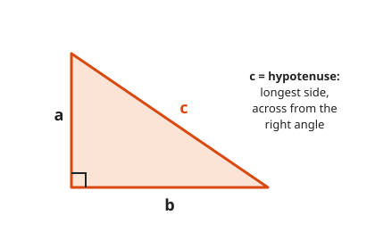
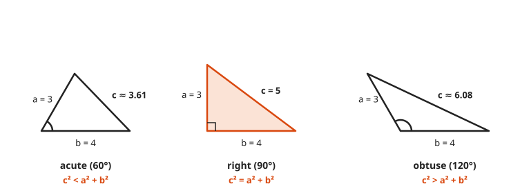
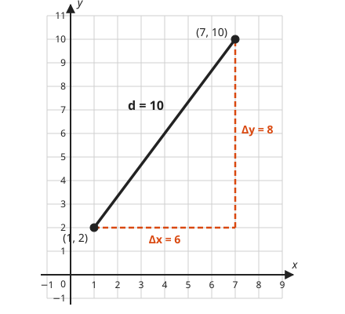
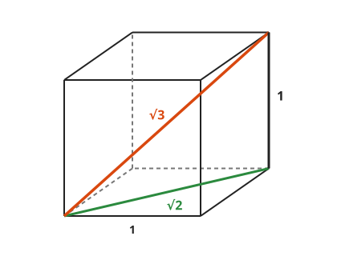
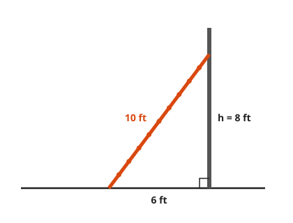

# The Pythagorean Theorem

**Level:** 201 · **Unit:** 10 · **Time:** 60 minutes
**Prerequisites:** [Lesson 09, Triangles](../09-triangles-congruence-and-similarity/README.md), squares and square roots from [Lesson 06](../06-exponents-and-scientific-notation/README.md)

## The Big Idea

In a right triangle, the square on the longest side has exactly the area of the other two squares together:

$$a^2 + b^2 = c^2$$

It turns two short sides into the long one, and it turns coordinates into distances.
GPS, screen sizes, and the Euclidean distance between two vectors in a machine learning model all run on it.

## Words You Need

* **Right triangle**: a triangle with one $90^\circ$ angle.
* **Legs** $a$ and $b$: the two sides that form the right angle.
* **Hypotenuse** $c$: the side across from the right angle. Always the longest side.
* **Square root** $\sqrt{n}$: the number that, multiplied by itself, gives $n$. For example, $\sqrt{25} = 5$.

## Picture It

<!-- diagram: type=right-triangle-squares legs=3,4 grid=true -->


Count the small squares. Nine on one leg, sixteen on the other, twenty-five on the hypotenuse.
$9 + 16 = 25$. The theorem says this happens for every right triangle, not only this one.

## Step by Step

### Idea 1: Which Side Is Which

<!-- diagram: type=right-triangle labels="a,b,c" -->


The hypotenuse is always across from the right angle. Find the square corner first, then look across from it.

### Idea 2: A Visual Proof

Build the same big square two ways.

<!-- diagram: type=pythagoras-rearrangement a=3 b=4 -->


1. Each big square has side $a + b$. Both have the same area.
2. Each big square holds four copies of the same right triangle.
3. Left: the space the triangles leave empty is one square of side $c$. Area $c^2$.
4. Right: the space they leave empty is two squares, of sides $a$ and $b$. Area $a^2 + b^2$.
5. Same big square, minus the same four triangles, leaves the same area. Therefore $c^2 = a^2 + b^2$.

No algebra needed. The same proof in algebra, using [Lesson 07](../07-factoring-and-quadratics/README.md):

```txt
  (a + b)^2           = 4 * (ab/2) + c^2      big square, left picture
  a^2 + 2ab + b^2     = 2ab + c^2             expand both sides
  a^2 + b^2           = c^2                   subtract 2ab from both sides
```

### Idea 3: The Converse Tests for a Right Angle

The theorem also runs backward: if $a^2 + b^2 = c^2$, the angle across from $c$ is a right angle.
With $c$ the longest side, comparing tells you more:

<!-- diagram: type=triangle-panels legs=3,4 angles=60,90,120 -->


| Compare | Triangle |
|---|---|
| $c^2 < a^2 + b^2$ | acute |
| $c^2 = a^2 + b^2$ | right |
| $c^2 > a^2 + b^2$ | obtuse |

Builders use the 3-4-5 rule to check a square corner: mark 3 on one wall, 4 on the other, and the diagonal must read 5.

### Idea 4: Pythagorean Triples

Whole numbers that fit $a^2 + b^2 = c^2$ are **Pythagorean triples**: 3-4-5, 5-12-13, 8-15-17, 7-24-25.
Any multiple of a triple is a triple: 6-8-10, 9-12-15.
Babylonian scribes listed triples on a clay tablet, Plimpton 322, more than a thousand years before Pythagoras.

### Idea 5: Distance on the Plane

The distance between two points is the hypotenuse of the right triangle you get by walking across, then up.

<!-- diagram: type=coordinate-plane points="(1,2),(7,10)" legs=true -->


$$d = \sqrt{(x_2 - x_1)^2 + (y_2 - y_1)^2}$$

The symbol $\Delta$, the Greek letter delta, means "change in". $\Delta x = 7 - 1 = 6$ and $\Delta y = 10 - 2 = 8$.

### Idea 6: Into Three Dimensions

Use the theorem twice: once across the floor of a box, then once up to the far corner.

<!-- diagram: type=cube-diagonals side=1 -->


Floor diagonal: $\sqrt{1^2 + 1^2} = \sqrt{2}$. Space diagonal: $\sqrt{(\sqrt{2})^2 + 1^2} = \sqrt{3}$.
In general, $d = \sqrt{x^2 + y^2 + z^2}$. Add more coordinates and you get the distance used in nearest-neighbor search.

## Worked Examples

### Example 1: Find the Hypotenuse

```txt
  a = 6, b = 8
  c^2 = 6^2 + 8^2         the theorem
      = 36 + 64
      = 100
  c   = 10                take the square root; a length is positive
```

### Example 2: Find a Leg

```txt
  c = 13, a = 5
  5^2 + b^2 = 13^2        the theorem
  25 + b^2  = 169
       b^2  = 144         subtract 25
       b    = 12          square root
```

### Example 3: The Ladder

A 10 ft ladder leans on a wall with its foot 6 ft from the wall. How high does it reach?

<!-- diagram: type=ladder length=10 base=6 -->


```txt
  6^2 + h^2 = 10^2        ground and wall meet at a right angle
  36 + h^2  = 100
       h^2  = 64          subtract 36
       h    = 8 ft
```

### Example 4: Is It a Right Triangle?

```txt
  7, 24, 25:   49 + 576 = 625 = 25^2     right
  6, 8, 11:    36 + 64  = 100 < 121      obtuse
```

### Example 5: Distance

```txt
  from (1, 2) to (7, 10)
  dx = 7 - 1 = 6
  dy = 10 - 2 = 8
  d  = sqrt(36 + 64) = sqrt(100) = 10
```

## Common Mistakes

* Adding the sides instead of the squares: $3 + 4 = 7$, not 5. The squares add: $9 + 16 = 25$.
* Putting the hypotenuse on the wrong side of the equation: $c$ stands alone, and $c$ is the longest side.
* Writing $\sqrt{a^2 + b^2} = a + b$: the square root does not split over addition. $\sqrt{9 + 16} = 5$, not 7.
* Using the theorem on a triangle with no right angle: check for the square corner first.

## Try It

1. Legs 9 and 12. Find the hypotenuse.
2. Legs 1 and 1. Find the hypotenuse, exact and to three decimals.
3. Hypotenuse 17, one leg 8. Find the other leg.
4. Hypotenuse 10, one leg 5. Find the other leg, exact and to three decimals.
5. Is a triangle with sides 6, 8, 11 a right triangle? If not, acute or obtuse?
6. Find the distance from $(-2, 1)$ to $(4, 9)$.
7. Find the distance from $(0, 0)$ to $(5, 12)$.
8. A rectangle is 20 by 21. How long is its diagonal?
9. Find the space diagonal of a box 2 by 3 by 6.

<details>
<summary>Answers</summary>

1. 15: $81 + 144 = 225$.
2. $\sqrt{2} \approx 1.414$.
3. 15: $289 - 64 = 225$.
4. $\sqrt{75} = 5\sqrt{3} \approx 8.660$.
5. No. $36 + 64 = 100 < 121$: obtuse.
6. 10: $\Delta x = 6$, $\Delta y = 8$.
7. 13: a 5-12-13 triangle.
8. 29: $400 + 441 = 841 = 29^2$.
9. 7: $\sqrt{4 + 9 + 36} = \sqrt{49}$.

</details>

## Code Corner

[code/main.go](code/main.go) computes distances, tests triangles with the converse, and searches for every whole-number right triangle with hypotenuse up to 30.

```go
for c := 1; c <= 30; c++ {
	for a := 1; a < c; a++ {
		for b := a; b < c; b++ {
			if a*a+b*b == c*c {
				fmt.Printf("  %d, %d, %d\n", a, b, c)
			}
		}
	}
}
```

Output:

```txt
legs 6 and 8, hypotenuse: 10
distance (1,2) to (7,10): 10
unit cube space diagonal: 1.7321
3, 4, 5 is right
6, 8, 11 is obtuse
7, 24, 25 is right
whole-number right triangles with c <= 30:
  3, 4, 5
  6, 8, 10
  5, 12, 13
  9, 12, 15
  8, 15, 17
  12, 16, 20
  7, 24, 25
  15, 20, 25
  10, 24, 26
  20, 21, 29
  18, 24, 30
```

Go ships `math.Hypot(a, b)` for exactly this calculation. It avoids overflow on huge inputs, which a naive `math.Sqrt(a*a + b*b)` does not.

## Flashcards

[cards.tsv](cards.tsv) holds Anki cards for this lesson.

## Go Deeper

* [Euclid's Elements, Book I, Proposition 47](https://mathcs.clarku.edu/~djoyce/elements/bookI/propI47.html): Euclid's own proof, with the famous windmill figure.
* [Math Is Fun: Pythagorean Theorem Proofs](https://www.mathsisfun.com/geometry/pythagorean-theorem-proof.html): more rearrangement proofs.
* [Better Explained: Surprising Uses of the Pythagorean Theorem](https://betterexplained.com/articles/surprising-uses-of-the-pythagorean-theorem/): distances in any number of dimensions.
* [MacTutor: Pythagoras](https://mathshistory.st-andrews.ac.uk/Biographies/Pythagoras/): the man, the school, and the legends.
* Next: [Lesson 11, Area, Perimeter, and Circles](../11-area-perimeter-and-circles/README.md).
