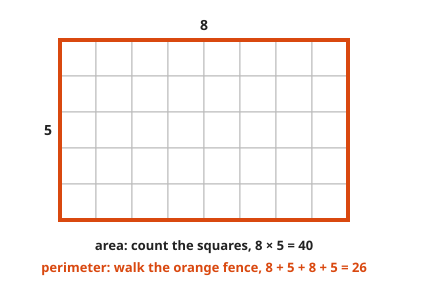
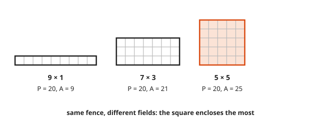
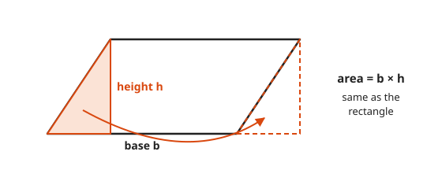
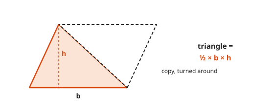
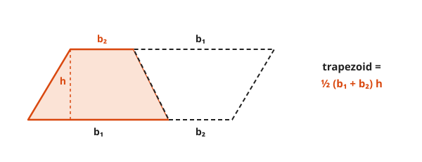
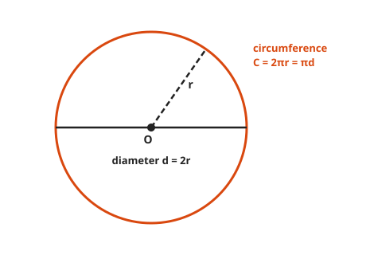
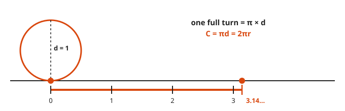
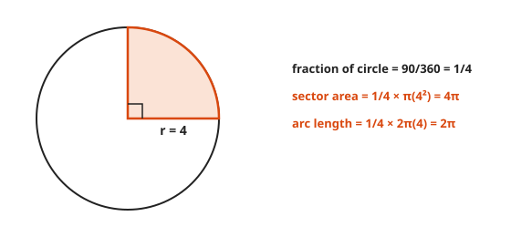
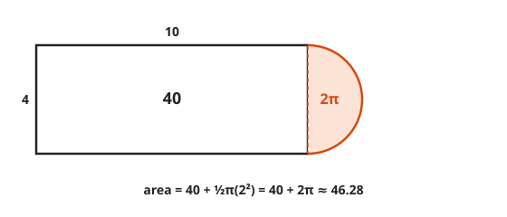

# Area, Perimeter, and Circles

**Level:** 201 · **Unit:** 11 · **Time:** 75 minutes
**Prerequisites:** [Lesson 09, Triangles](../09-triangles-congruence-and-similarity/README.md)

## The Big Idea

**Perimeter** is the length of the fence around a shape. **Area** is how many unit squares fit inside it.
Almost every area formula comes from one move: cut a shape and rearrange the pieces into a rectangle.
The circle is no exception. Cut it into thin slices, line them up, and $\pi r^2$ falls out.

## Words You Need

* **Perimeter**: total distance around the outside. Units: length, for example cm.
* **Area**: amount of flat surface inside. Units: square units, for example cm².
* **Height** of a shape: the perpendicular distance from the base to the opposite side or corner. Not the slanted side.
* **Radius** $r$: center to edge. **Diameter** $d$: edge to edge through the center, $d = 2r$.
* **Circumference** $C$: the perimeter of a circle.
* $\pi$ (pi): the ratio $C / d$, the same for every circle, about $3.14159$.

## Picture It

<!-- diagram: type=grid-rectangle w=8 h=5 -->


Area counts the squares inside. Perimeter walks the fence.
Different questions, different units: 40 square units, 26 units.

## Step by Step

### Idea 1: Same Fence, Different Fields

<!-- diagram: type=rectangles perimeter=20 sizes="9x1,7x3,5x5" -->


The same perimeter can enclose very different areas. Among rectangles, the square encloses the most.
A farmer with 20 m of fence builds a square pen. A rookie builds a corridor.

### Idea 2: The Parallelogram Is a Rectangle in Disguise

<!-- diagram: type=cut-and-slide shape=parallelogram -->


Slice the triangle off one end, slide it to the other. You get a rectangle with the same base and the same height.

$$A_{\text{parallelogram}} = b h$$

Use the height, not the slanted side.

### Idea 3: The Triangle Is Half a Parallelogram

<!-- diagram: type=double-shape shape=triangle -->


Two copies of any triangle fit together into a parallelogram.

$$A_{\text{triangle}} = \tfrac{1}{2} b h$$

### Idea 4: The Trapezoid, Same Trick

<!-- diagram: type=double-shape shape=trapezoid -->


A **trapezoid** has one pair of parallel sides, $b_1$ and $b_2$. Two copies make a parallelogram with base $b_1 + b_2$.

$$A_{\text{trapezoid}} = \tfrac{1}{2}(b_1 + b_2) h$$

### Idea 5: Circles and Pi

<!-- diagram: type=circle-parts -->


Roll a circle of diameter 1 along the floor for one full turn.

<!-- diagram: type=rolling-circle d=1 -->


It travels a bit more than three diameters: $\pi$ of them. Every circle, every size.

$$C = \pi d = 2\pi r$$

$\pi$ is not a fraction of whole numbers. Its decimals never end and never repeat. $3.14$ or $\tfrac{22}{7}$ are approximations, good enough for fences and pizza.

### Idea 6: Area of a Circle

<!-- diagram: type=circle-sectors n=8 -->


Cut the circle into slices and line them up, points alternating up and down.
The shape is close to a parallelogram. Its base is half the circumference, $\pi r$. Its height is the radius, $r$.
More slices make the edges straighter, and the match becomes exact:

$$A = \pi r \times r = \pi r^2$$

Archimedes made this argument rigorous around 250 BCE.

### Idea 7: Sectors and Arcs

A **sector** is a pizza slice. An **arc** is its crust. Both are a fraction of the whole circle, the angle over $360^\circ$.

<!-- diagram: type=sector angle=90 r=4 -->


$$A_{\text{sector}} = \frac{\theta}{360} \pi r^2 \qquad L_{\text{arc}} = \frac{\theta}{360} \cdot 2\pi r$$

### Idea 8: Composite Shapes

Split an odd shape into pieces you know, then add (or subtract) the areas.

<!-- diagram: type=composite parts="rect 10x4, semicircle d=4" -->


## Worked Examples

### Example 1: Rectangle

```txt
  8 by 5
  P = 8 + 5 + 8 + 5 = 26       walk the fence
  A = 8 * 5 = 40               count the squares
```

### Example 2: Triangle and Trapezoid

```txt
  triangle, b = 10, h = 6
  A = 1/2 * 10 * 6 = 30

  trapezoid, b1 = 6, b2 = 10, h = 4
  A = 1/2 * (6 + 10) * 4 = 1/2 * 16 * 4 = 32
```

### Example 3: Circle

```txt
  r = 3
  C = 2 * pi * 3 = 6 pi  ~ 18.85
  A = pi * 3^2   = 9 pi  ~ 28.27
```

Keep $\pi$ as a symbol until the last step. Rounding early leaks error into every later line.

### Example 4: Sector

```txt
  90 degree sector, r = 4
  fraction = 90/360 = 1/4
  area     = 1/4 * pi * 16 = 4 pi  ~ 12.57
  arc      = 1/4 * 2 * pi * 4 = 2 pi  ~ 6.28
```

### Example 5: Composite

```txt
  rectangle 10 by 4 plus a semicircle of diameter 4 (radius 2)
  rectangle  = 10 * 4 = 40
  semicircle = 1/2 * pi * 2^2 = 2 pi
  total      = 40 + 2 pi  ~ 46.28
```

## See It Step by Step


[Arc Length and Sector Area: open the step-by-step walkthrough](https://caseyaedwards.github.io/math_training/diagrams/arc-length-sector/)

Watch the arc length and the sector area both scale directly with the angle in radians.

## Common Mistakes

* Using the slanted side as the height: height is perpendicular to the base.
* Mixing up radius and diameter: if a problem gives $d = 10$, then $r = 5$.
* Squaring before multiplying by $\pi$ the wrong way: $\pi r^2$ means $\pi \times (r \times r)$, not $(\pi r)^2$.
* Writing area in plain units: area is in square units.
* Forgetting the $\tfrac{1}{2}$ in triangles: a triangle is half a parallelogram.

## Try It

1. A square has side 7. Find its perimeter and area.
2. A parallelogram has base 9 and height 4. Find its area.
3. A triangle has base 12 and height 5. Find its area.
4. A trapezoid has parallel sides 5 and 11 and height 6. Find its area.
5. A circle has diameter 10. Find its circumference and area, exact and to two decimals.
6. A circle has circumference $12\pi$. Find its area.
7. A $60^\circ$ sector has radius 6. Find its area and arc length.
8. The radius of a circle doubles. What happens to the area?
9. A running track is a 100 by 60 rectangle with a semicircle on each 60 end. The semicircles replace those ends. Find the length of one lap around the outside.
10. Which holds more pizza: one 16-inch pizza or two 10-inch pizzas? (Pizza size is the diameter.)

<details>
<summary>Answers</summary>

1. $P = 28$, $A = 49$.
2. 36.
3. 30.
4. 48: $\tfrac{1}{2}(5 + 11)(6)$.
5. $C = 10\pi \approx 31.42$, $A = 25\pi \approx 78.54$.
6. $36\pi$: $2\pi r = 12\pi$ gives $r = 6$.
7. Area $6\pi \approx 18.85$, arc $2\pi \approx 6.28$: one sixth of $36\pi$ and of $12\pi$.
8. It is multiplied by 4.
9. $200 + 60\pi \approx 388.50$: two straight sides of 100, plus two semicircles that make one full circle of diameter 60.
10. One 16-inch pizza: $64\pi \approx 201.06$ square inches against $2 \times 25\pi = 50\pi \approx 157.08$.

</details>

## Code Corner

Is the area of a circle really $\pi r^2$? [code/main.go](code/main.go) counts the unit squares whose centers fall inside a circle and divides by $r^2$.

```go
count := 0
for x := -n; x < n; x++ {
	for y := -n; y < n; y++ {
		cx, cy := float64(x)+0.5, float64(y)+0.5
		if cx*cx+cy*cy <= float64(n*n) {
			count++
		}
	}
}
```

Output:

```txt
rectangle 8 x 5: area 40 perimeter 26
triangle b=10 h=6: area 30
trapezoid 6, 10, h=4: area 32
circle r=3: C = 18.85, A = 28.27
track 100 by 60 with round ends: perimeter 388.50
radius   10:      316 squares, squares / r^2 = 3.16000
radius  100:    31428 squares, squares / r^2 = 3.14280
radius 1000:  3141676 squares, squares / r^2 = 3.14168
pi                                      = 3.14159
```

The ratio closes in on $\pi$ as the grid gets finer. Brute force, honest result.

## Flashcards

[cards.tsv](cards.tsv) holds Anki cards for this lesson.

## Go Deeper

* [Math Is Fun: Area of Plane Shapes](https://www.mathsisfun.com/area.html): every formula on one page.
* [Math Is Fun: Circle](https://www.mathsisfun.com/geometry/circle.html): radius, diameter, circumference, and area.
* [Math Is Fun: Circle Area by Sectors](https://www.mathsisfun.com/geometry/circle-area-by-sectors.html): the slicing argument, animated in your head.
* [MacTutor: Archimedes](https://mathshistory.st-andrews.ac.uk/Biographies/Archimedes/): pi, circles, and spheres.
* Next: [Lesson 12, Volume and Surface Area](../12-volume-and-surface-area/README.md).
