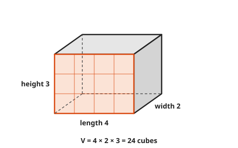
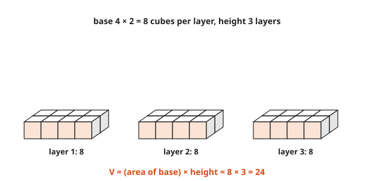
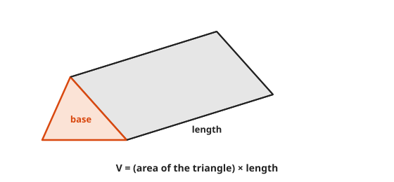
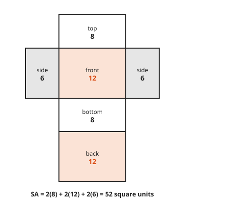
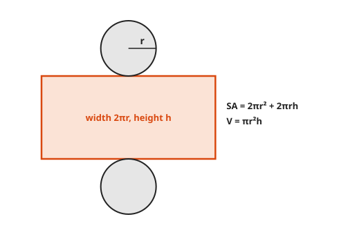
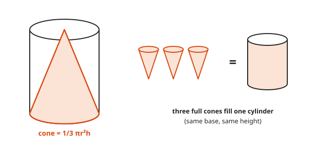
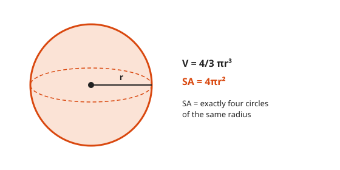
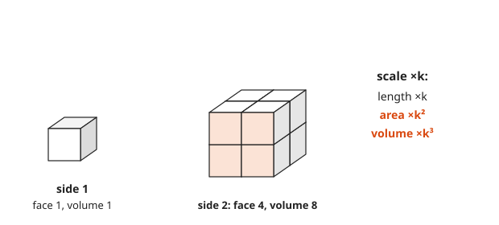

# Volume and Surface Area

**Level:** 201 · **Unit:** 12 · **Time:** 75 minutes
**Prerequisites:** [Lesson 11, Area, Perimeter, and Circles](../11-area-perimeter-and-circles/README.md)

## The Big Idea

**Volume** counts how many unit cubes fit inside a solid. **Surface area** counts how many unit squares it takes to wrap it.
For any solid with the same cross-section all the way through, volume is base area times height.
Points and tips change the rule by a clean factor: a cone holds exactly one third of its cylinder.

## Words You Need

* **Solid**: a three-dimensional shape.
* **Face**: a flat side of a solid. **Edge**: where two faces meet. **Vertex**: a corner.
* **Prism**: a solid with two matching parallel ends and the same cross-section in between. A box is a prism. A Toblerone is one too.
* **Cylinder**: a prism with circular ends.
* **Net**: a solid unfolded flat into one piece, like a cardboard box before assembly.
* Units: volume in cubic units (cm³), surface area in square units (cm²).

## Picture It

<!-- diagram: type=box l=4 w=2 h=3 -->


The front face holds $4 \times 3 = 12$ unit squares. The box is 2 deep and holds two such slabs of 12 cubes: 24 cubes.

## Step by Step

### Idea 1: Volume Is Layers

<!-- diagram: type=cube-layers l=4 w=2 layers=3 -->


One layer covers the base: $4 \times 2 = 8$ cubes. Stack 3 layers: 24 cubes.

$$V_{\text{box}} = l \times w \times h = (\text{area of base}) \times h$$

### Idea 2: Every Prism Works the Same Way

<!-- diagram: type=prism base=triangle -->


Whatever the shape of the end, the solid is that shape stacked up. Volume = area of the end times the length.
A cylinder is the circle version:

$$V_{\text{cylinder}} = \pi r^2 h$$

### Idea 3: Surface Area Is the Net

<!-- diagram: type=net solid=box l=4 w=2 h=3 -->


Unfold the box. Six rectangles in three matching pairs.

$$SA_{\text{box}} = 2(lw + lh + wh)$$

<!-- diagram: type=net solid=cylinder r=1 h=3 -->


A cylinder unrolls into two circles and a rectangle. The rectangle wraps once around the circle. Its width is the circumference, $2\pi r$.

$$SA_{\text{cylinder}} = 2\pi r^2 + 2\pi r h$$

### Idea 4: Pointed Solids Take One Third

<!-- diagram: type=cone-in-cylinder -->


A cone fills exactly one third of the cylinder with the same base and height. A pyramid fills one third of the prism around it.

$$V_{\text{cone}} = \tfrac{1}{3}\pi r^2 h \qquad V_{\text{pyramid}} = \tfrac{1}{3}(\text{area of base}) \times h$$

Fill a paper cone with rice and pour it into the matching cup. Three pours fill it. The proof in [Course 401](../../401/README.md) uses integrals, but the rice agrees.

### Idea 5: The Sphere

<!-- diagram: type=sphere -->


$$V_{\text{sphere}} = \tfrac{4}{3}\pi r^3 \qquad SA_{\text{sphere}} = 4\pi r^2$$

Archimedes found both. He was so proud of them that he asked for a sphere inside a cylinder to be carved on his tomb.

### Idea 6: Scaling Cubes the Lengths, Squares the Areas

<!-- diagram: type=scaled-cubes k=2 -->


Double every length and each face gets 4 times bigger, while the volume gets 8 times bigger.

| Scale lengths by $k$ | Lengths | Areas | Volumes |
|---|---|---|---|
| factor | $k$ | $k^2$ | $k^3$ |

This is why an elephant has thick legs: weight grows like $k^3$, leg strength like $k^2$. It is also why a disk twice the diameter holds far more than twice the data.

## Worked Examples

### Example 1: Box

```txt
  l = 4, w = 2, h = 3
  V  = 4 * 2 * 3 = 24                       cubic units
  SA = 2(4*2 + 4*3 + 2*3)
     = 2(8 + 12 + 6)
     = 2(26) = 52                           square units
```

### Example 2: Cylinder

```txt
  r = 3, h = 10
  V  = pi * 3^2 * 10 = 90 pi  ~ 282.74
  SA = 2 pi (3^2) + 2 pi (3)(10)
     = 18 pi + 60 pi = 78 pi  ~ 245.04
```

### Example 3: Cone

```txt
  r = 3, h = 4
  V = 1/3 * pi * 3^2 * 4
    = 1/3 * 36 pi
    = 12 pi  ~ 37.70
```

### Example 4: Sphere

```txt
  r = 3
  V  = 4/3 * pi * 27 = 36 pi  ~ 113.10      cubic units
  SA = 4 * pi * 9    = 36 pi  ~ 113.10      square units
```

Same number, different units. A coincidence of $r = 3$, since $\tfrac{4}{3} r^3 = 4 r^2$ exactly when $r = 3$.

### Example 5: Liters

A tank is 2 m by 1 m by 0.5 m. How many liters does it hold? One cubic meter is 1,000 liters.

```txt
  V = 2 * 1 * 0.5 = 1 cubic meter
  1 m^3 = 1,000 L
```

## Common Mistakes

* Mixing square and cubic units: area is cm², volume is cm³.
* Forgetting the $\tfrac{1}{3}$ for cones and pyramids.
* Using the diameter in $\pi r^2$: halve it first.
* Counting only three faces of a box: there are six, in three pairs.
* Scaling volume by $k$: it scales by $k^3$.

## Try It

1. A cube has side 5. Find its volume and surface area.
2. A box is 6 by 4 by 2. Find its volume and surface area.
3. A cylinder has radius 2 and height 5. Find its volume and surface area, exact and to two decimals.
4. A cone has radius 6 and height 10. Find its volume.
5. A sphere has radius 6. Find its volume and surface area.
6. A pyramid has a square base of side 6 and height 4. Find its volume.
7. Every length of a box doubles. What happens to its surface area and its volume?
8. A tank is 2 m by 1 m by 0.5 m. How many liters does it hold?
9. How many 1 cm cubes fit in a 10 cm cube?

<details>
<summary>Answers</summary>

1. $V = 125$, $SA = 150$.
2. $V = 48$, $SA = 2(24 + 12 + 8) = 88$.
3. $V = 20\pi \approx 62.83$, $SA = 8\pi + 20\pi = 28\pi \approx 87.96$.
4. $120\pi \approx 376.99$.
5. $V = 288\pi \approx 904.78$, $SA = 144\pi \approx 452.39$.
6. 48: $\tfrac{1}{3} \times 36 \times 4$.
7. Surface area times 4, volume times 8.
8. 1,000 liters.
9. 1,000: $10 \times 10 \times 10$.

</details>

## Code Corner

[code/main.go](code/main.go) evaluates every formula in this lesson and shows what scaling does to a box.

```go
for _, k := range []float64{1, 2, 3} {
	v := boxVolume(4*k, 2*k, 3*k)
	s := boxSurface(4*k, 2*k, 3*k)
	fmt.Printf("  k=%g  SA = %4g (x%g)  V = %4g (x%g)\n", k, s, s/52, v, v/24)
}
```

Output:

```txt
box 4 x 2 x 3: V = 24  SA = 52
cylinder r=3 h=10: V = 282.74  SA = 245.04
cone r=3 h=4: V = 37.70
sphere r=3: V = 113.10  SA = 113.10
scale a 4 x 2 x 3 box by k:
  k=1  SA =   52 (x1)  V =   24 (x1)
  k=2  SA =  208 (x4)  V =  192 (x8)
  k=3  SA =  468 (x9)  V =  648 (x27)
```

## Flashcards

[cards.tsv](cards.tsv) holds Anki cards for this lesson.

## Go Deeper

* [Math Is Fun: Volume](https://www.mathsisfun.com/geometry/volume.html): volumes of common solids side by side.
* [Math Is Fun: Cylinder](https://www.mathsisfun.com/geometry/cylinder.html): the net and both formulas.
* [MacTutor: Archimedes](https://mathshistory.st-andrews.ac.uk/Biographies/Archimedes/): the sphere and cylinder, and the tomb.
* Next level: [Course 301](../../301/README.md). Check yourself first with the [201 checkpoint](../checkpoint.md).
