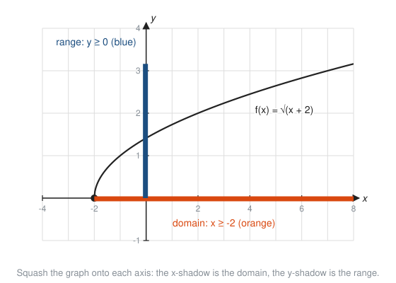
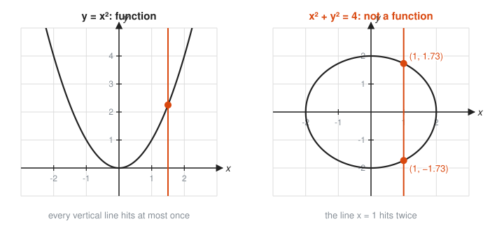
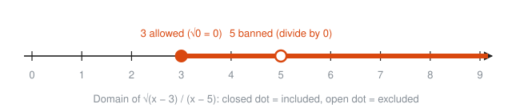
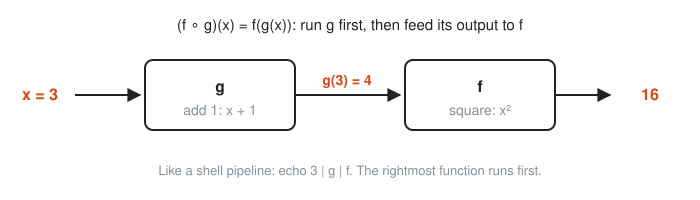
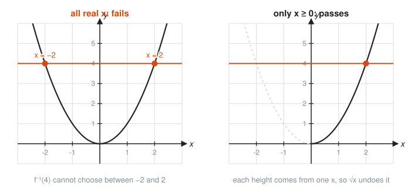

# Functions in Depth

**Level:** 301 · **Unit:** 1 · **Time:** 60 to 90 minutes
**Prerequisites:** [201 Algebra I and Geometry](../../201/README.md), especially functions and the coordinate plane

## The Big Idea

A **function** is a rule that takes each allowed input and returns exactly one output. Think of a pure function in Go: the same input always gives the same output, and some inputs fail validation. This lesson covers four tools the rest of 301 leans on: which inputs and outputs are allowed, chaining functions, undoing a function, and moving a graph without redrawing it from scratch. Learn them once. Use them for the rest of your life.

## Picture It

<!-- diagram: type=function-plot f="sqrt(x+2)" x=-4..8 y=-1..4 highlight=domain-on-x,range-on-y caption="Domain and range as the shadows of a graph" -->


Shine a light from above and from the side. The shadow the graph casts on the x-axis is the **domain**, the set of inputs the function accepts. The shadow on the y-axis is the **range**, the set of outputs the function actually produces. For $f(x) = \sqrt{x + 2}$ the curve starts at $x = -2$ and runs right forever. The domain is $x \ge -2$. The curve starts at height 0 and climbs without limit. The range is $y \ge 0$.

## Step by Step

### 1. What Makes a Rule a Function

Each input gets one output, never two. Draw it as arrows from an input bag to an output bag:

<!-- diagram: type=arrow-mapping left="-2,2,3 -> 4,9" right="4 -> -2,2; 9 -> 3" caption="Function versus not a function" -->


Two arrows can land on the same output. One input never sends out two arrows. On a graph, the same rule is the **vertical line test**: if any vertical line hits the graph twice, one input has two outputs and the graph is not a function. A circle fails the test. A parabola $y = x^2$ passes.

<!-- diagram: type=function-plot panels=2 left="x^2 with line x=1.5" right="circle r=2 with line x=1" caption="Vertical line test" -->


Many inputs can share an output. $f(2) = 4$ and $f(-2) = 4$ is fine for $f(x) = x^2$. A hash function works the same way: many keys can land in one bucket, but one key never lands in two buckets.

### 2. Finding the Domain

Start with all real numbers. Then remove the inputs that break a rule:

* Division: the denominator cannot be 0.
* Even roots: the expression under $\sqrt{\ }$ cannot be negative.
* Logarithms: the input must be strictly positive (see [Logarithms](../05-logarithms/README.md)).

Write the result in **interval notation**. A square bracket includes the endpoint, a round bracket excludes it, and $\cup$ glues pieces together. For example, $[3, 5) \cup (5, \infty)$ means 3 up to but not including 5, then everything above 5. On a number line, a filled dot is in and a hollow dot is out:

<!-- diagram: type=number-line range=0..9 closed=3 open=5 shade=3..inf caption="Domain of sqrt(x-3)/(x-5)" -->


### 3. Finding the Range

Two dependable methods:

* Read the y-shadow of the graph.
* Solve $y = f(x)$ for $x$. Any $y$ that produces a legal $x$ is in the range.

For $f(x) = x^2 + 4$: the smallest value of $x^2$ is 0, and the smallest output is 4. The range is $[4, \infty)$.

### 4. Composition: Chaining Functions

The **composition** $(f \circ g)(x) = f(g(x))$ runs $g$ first and feeds its output into $f$.

<!-- diagram: type=pipeline boxes=g,f input=3 mid=4 output=16 caption="Composition as two machines in a row" -->


Read $f \circ g$ right to left, like nested function calls `f(g(x))` in code. The inner call runs first. Order matters: in general $f(g(x)) \ne g(f(x))$.

The domain of $f \circ g$ holds every $x$ that $g$ accepts **and** whose output $g(x)$ that $f$ accepts.

### 5. Inverses: Undo Buttons

The **inverse** $f^{-1}$ reverses $f$. If $f$ sends 2 to 4, then $f^{-1}$ sends 4 back to 2:

$$f^{-1}(f(x)) = x \quad \text{and} \quad f(f^{-1}(x)) = x.$$

An inverse exists only when $f$ is **one-to-one**: no two inputs share an output. The graph test is the **horizontal line test**. If a horizontal line hits the graph twice, two inputs collide, and the undo button cannot know which one to return. This is why a hash has no inverse: collisions destroy information.

<!-- diagram: type=function-plot panels=2 left="x^2 all x, line y=4" right="x^2 x>=0, line y=4" caption="Horizontal line test before and after restricting the domain" -->


To find an inverse by algebra:

1. Write $y = f(x)$.
2. Swap $x$ and $y$.
3. Solve for $y$. That $y$ is $f^{-1}(x)$.

<!-- diagram: type=function-plot f="x^2 (x>=0)",g="sqrt(x)" mirror="y=x" points=(2,4),(4,2) caption="An inverse is the mirror image across y = x" -->


Swapping $x$ and $y$ on paper is the same as flipping the graph over the line $y = x$. The parabola $y = x^2$ fails the horizontal line test on the whole real line. Restrict it to $x \ge 0$ and it passes. Its inverse is $\sqrt{x}$.

The notation $f^{-1}$ does **not** mean $\frac{1}{f}$. It is an undo, not a reciprocal.

### 6. Transformations: Moving a Graph Without Recomputing It

Learn a few parent graphs ($x^2$, $|x|$, $\sqrt{x}$, $x^3$) and get many more by shifting and stretching:

| Change to the formula | Effect on the graph |
|---|---|
| $f(x) + k$ | up $k$ (down if $k < 0$) |
| $f(x - h)$ | right $h$ (left if $h < 0$) |
| $a \cdot f(x)$ | vertical stretch by $a$ (squash if $0 < a < 1$) |
| $-f(x)$ | flip over the x-axis |
| $f(-x)$ | flip over the y-axis |
| $f(bx)$ | horizontal squeeze by a factor of $b$ |

<!-- diagram: type=function-plot panels=2 left="x^2,(x-2)^2+1" right="x^2,2x^2,-x^2" caption="Shifts, stretches and reflections of the parabola" -->


Changes **outside** $f$ act on outputs and behave as expected: $+3$ moves up 3. Changes **inside** act on inputs and feel backwards: $f(x - 2)$ moves **right** 2. The reason: the new graph at $x = 2$ shows what the old graph showed at $x = 0$. Every feature arrives two units later.

For the full form $y = a \cdot f(x - h) + k$, the point that sat at the origin of the parent graph moves to $(h, k)$.

## Worked Examples

### Example 1: Domain With Two Restrictions

Find the domain of $f(x) = \dfrac{\sqrt{x - 3}}{x - 5}$.

```txt
  x - 3 >= 0               the square root needs a non-negative input
  x     >= 3               add 3 to both sides
  x - 5 != 0               the denominator cannot be 0
  x     != 5               add 5 to both sides
  domain: [3, 5) U (5, oo) keep x >= 3, then punch out the single point 5
```

### Example 2: Composition Both Ways

Let $f(x) = x^2$ and $g(x) = x + 1$.

```txt
  f(g(2)) = f(2 + 1)            run g first
          = f(3)                arithmetic
          = 9                   square
  g(f(2)) = g(2^2)              run f first
          = g(4)                arithmetic
          = 5                   add 1
  f(g(x)) = (x + 1)^2           substitute g(x) into f
          = x^2 + 2x + 1        expand the square
```

The two orders give 9 and 5. Composition is not commutative.

### Example 3: Inverse of Celsius to Fahrenheit

$F(C) = \frac{9}{5}C + 32$. Find the function that converts back.

```txt
  y = (9/5)x + 32             write y = f(x)
  x = (9/5)y + 32             swap x and y
  x - 32 = (9/5)y             subtract 32 from both sides
  (5/9)(x - 32) = y           multiply both sides by 5/9
  F^-1(x) = (5/9)(x - 32)     name the result
  check: F^-1(F(100)) = F^-1(212) = (5/9)(180) = 100    round trip returns the input
```

### Example 4: Reading a Transformation

Describe $y = -2(x + 1)^2 + 3$ starting from $y = x^2$.

```txt
  y = -2(x - (-1))^2 + 3     match the form a*f(x - h) + k
  h = -1                     shift left 1
  a = -2                     stretch by 2 and flip over the x-axis
  k = 3                      shift up 3
  vertex: (h, k) = (-1, 3)   the origin of the parent graph lands here
```

The result is a narrow, upside-down parabola with its peak at $(-1, 3)$. Here are the three moves, one panel at a time:

<!-- diagram: type=small-multiples f="x^2,(x+1)^2,-2(x+1)^2,-2(x+1)^2+3" caption="Three moves from x^2 to -2(x+1)^2+3" -->


## Common Mistakes

* Reading $f^{-1}(x)$ as $\frac{1}{f(x)}$: the $-1$ means undo. For $f(x) = 3x$, $f^{-1}(x) = \frac{x}{3}$, not $\frac{1}{3x}$.
* Shifting the wrong way: $f(x - 2)$ moves right, not left. Test one point: the parent vertex at $x = 0$ now appears where $x - 2 = 0$, that is, $x = 2$.
* Composing in the wrong order: $f(g(x))$ runs $g$ first. Read from the inside out.
* Simplifying away a restriction: $\frac{x^2 - 1}{x - 1}$ simplifies to $x + 1$ but still rejects $x = 1$. The domain comes from the original formula.
* Forgetting that $\sqrt{x^2} = |x|$, not $x$: try $x = -3$.

## Try It

1. Find the domain of $f(x) = \dfrac{1}{x^2 - 9}$.
2. Find the domain of $g(x) = \sqrt{6 - 2x}$.
3. Find the range of $h(x) = x^2 + 4$.
4. Let $f(x) = 2x + 3$ and $g(x) = x^2$. Compute $f(g(-2))$ and $g(f(-2))$.
5. Let $f(x) = \sqrt{x}$ and $g(x) = x - 1$. Write $(f \circ g)(x)$ and give its domain.
6. Find the inverse of $f(x) = 5x - 2$.
7. Find the inverse of $f(x) = x^3 + 1$.
8. Describe $y = (x - 3)^2 - 4$ as a transformation of $y = x^2$ and give the vertex.
9. Write the equation that shifts $y = |x|$ left 2 and flips it over the x-axis.
10. Does $f(x) = x^2 - 2x$ have an inverse on all real numbers? Use the horizontal line test with $f(0)$ and $f(2)$.

<details>
<summary>Answers</summary>

1. All reals except $x = 3$ and $x = -3$: $x^2 - 9 = 0$ at those two points.
2. $x \le 3$, that is, $(-\infty, 3]$: solve $6 - 2x \ge 0$.
3. $[4, \infty)$: $x^2 \ge 0$, and adding 4 makes the smallest output 4.
4. $f(g(-2)) = f(4) = 11$. $g(f(-2)) = g(-1) = 1$.
5. $(f \circ g)(x) = \sqrt{x - 1}$, domain $x \ge 1$.
6. $f^{-1}(x) = \dfrac{x + 2}{5}$: swap to $x = 5y - 2$, then solve.
7. $f^{-1}(x) = \sqrt[3]{x - 1}$: swap to $x = y^3 + 1$, subtract 1, take the cube root.
8. Right 3, down 4. Vertex $(3, -4)$.
9. $y = -|x + 2|$.
10. No. $f(0) = 0$ and $f(2) = 0$, so the horizontal line $y = 0$ hits the graph twice.

</details>

## Code Corner

Go treats functions as values, which makes composition one short helper. The program lives in [code/main.go](code/main.go). Run it with `go run main.go` inside the `code` folder.

```go
type fn func(float64) float64

// compose returns the function x -> f(g(x)). g runs first.
func compose(f, g fn) fn {
	return func(x float64) float64 { return f(g(x)) }
}
```

The program composes $x^2$ and $x + 1$ both ways, round-trips Celsius through Fahrenheit, and uses `NaN` and `Inf` to detect inputs outside the domain of $\frac{\sqrt{x - 3}}{x - 5}$. Output:

```txt
f(g(2)) = 9
g(f(2)) = 5
C= -40.0  F= -40.0  back= -40.0
C=   0.0  F=  32.0  back=   0.0
C=  37.0  F=  98.6  back=  37.0
C= 100.0  F= 212.0  back= 100.0
x=2  f(x)=NaN  in domain: false
x=3  f(x)=-0  in domain: true
x=4  f(x)=-1  in domain: true
x=5  f(x)=+Inf  in domain: false
x=6  f(x)=1.7320508075688772  in domain: true
```

Two dry notes. Go prints $0 / -2$ as `-0`, a signed zero from IEEE 754 floating point. It equals zero. And $-40$ is the one temperature where Celsius and Fahrenheit agree, which is useful for nothing except trivia night.

## Go Deeper

* [Math Is Fun: Function Composition](https://www.mathsisfun.com/sets/function-composition.html): short, friendly pictures of the machine model.
* [Math Is Fun: Inverse Functions](https://www.mathsisfun.com/sets/function-inverse.html): more inverse examples with the swap method.
* [Paul's Online Math Notes: Algebra](https://tutorial.math.lamar.edu/Classes/Alg/Alg.aspx): the Functions chapter has many practice problems with full solutions.
* [OpenStax Precalculus 2e](https://openstax.org/details/books/precalculus-2e): free textbook, chapter one covers this lesson in depth.
* Track link: [Algebra track](../../../tracks/algebra/README.md).

**Next:** [Polynomials and Complex Numbers](../02-polynomials-and-complex-numbers/README.md)
