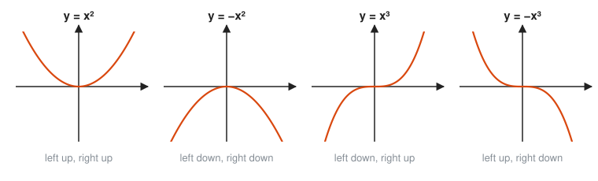
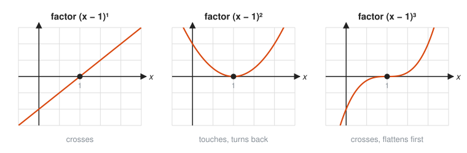
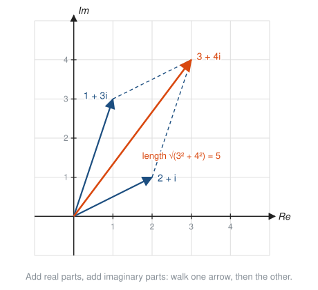

# Polynomials and Complex Numbers

**Level:** 301 · **Unit:** 2 · **Time:** 75 to 100 minutes
**Prerequisites:** [Functions in Depth](../01-functions-in-depth/README.md), factoring and the quadratic formula from [201 Algebra I and Geometry](../../201/README.md)

## The Big Idea

A **polynomial** is a sum of whole-number powers of $x$, each with a coefficient: $3x^4 - x^2 + 7$. Polynomials are the smooth, predictable workhorses of algebra. Three facts tell you most of the shape of the graph: the leading term, the zeros, and how many times each zero repeats. When a polynomial refuses to touch the x-axis, its zeros still exist. They live in the **complex numbers**, a number system built by adding one new number, $i$, with $i^2 = -1$.

## Picture It

<!-- diagram: type=function-plot f="(x+2)(x-1)^2(x-3)" x=-3..4 y=-24..16 marks=-2,1,3 caption="Zeros: crossing for odd multiplicity, touching for even" -->


The factors predict the picture. $(x + 2)$ and $(x - 3)$ appear once, and the graph slices straight through the axis at $-2$ and $3$. $(x - 1)$ appears twice, and the graph only kisses the axis at $1$ and turns back. Multiply the leading terms, $x \cdot x^2 \cdot x = x^4$, and both ends point up.

## Step by Step

### 1. Vocabulary

For $p(x) = a_n x^n + a_{n-1}x^{n-1} + \dots + a_1 x + a_0$ with $a_n \ne 0$:

* **Degree:** the highest power $n$.
* **Leading coefficient:** $a_n$, the number in front of the highest power.
* **Constant term:** $a_0$, which is also the y-intercept, $p(0) = a_0$.

### 2. End Behavior: Only the Leading Term Matters Far Out

For huge $|x|$, the leading term drowns out everything else, the way the slowest stage dominates the latency of a pipeline. Two questions settle the ends: is the degree even or odd, and is the leading coefficient positive or negative?

<!-- diagram: type=small-multiples f="x^2,-x^2,x^3,-x^3" caption="Four end-behavior patterns" -->


* Even degree: both ends point the same way, like $x^2$.
* Odd degree: the ends point opposite ways, like $x^3$.
* Negative leading coefficient: flip the picture upside down.

### 3. Zeros and Factors

The **factor theorem** links zeros and factors:

$$p(r) = 0 \iff (x - r) \text{ is a factor of } p(x).$$

Why it is true: divide $p(x)$ by $(x - r)$ to get $p(x) = (x - r)q(x) + R$, where the remainder $R$ is a constant. Plug in $x = r$: the first term vanishes, and $p(r) = R$. The remainder is zero exactly when $p(r) = 0$. This is also the **remainder theorem**: the remainder after dividing by $(x - r)$ is $p(r)$.

A factor that appears $k$ times gives a zero of **multiplicity** $k$:

* Odd multiplicity: the graph crosses the axis.
* Even multiplicity: the graph touches and turns back.

<!-- diagram: type=small-multiples f="(x-1),(x-1)^2,(x-1)^3" x=-0.5..2.5 mark=1 caption="Multiplicity 1, 2 and 3 near the zero x = 1" -->


Why: near $x = 1$, the factor $(x - 1)^2$ is never negative, so the sign of $p$ does not change there. An odd power changes sign, and the graph has to cross.

A degree $n$ polynomial has at most $n$ real zeros and at most $n - 1$ turning points.

### 4. Synthetic Division

To divide by $(x - r)$ quickly, write only the coefficients. Bring the first one down. Then repeat: multiply by $r$, write the product under the next coefficient, add. The last number is the remainder. The others are the coefficients of the quotient, one degree lower.

<!-- diagram: type=tableau rows="1 -6 11 -6 | 1 -5 6 | 1 -5 6 0" divisor=1 caption="Synthetic division tableau" -->


It is long division with the variables deleted. Less ink, same answer.

To guess a root, try small integers that divide the constant term. If $p(x)$ has integer coefficients, any integer root divides $a_0$.

### 5. Sketching Recipe

1. Read the end behavior from the leading term.
2. Plot the y-intercept $p(0)$.
3. Plot each zero and note whether it crosses or touches.
4. Connect smoothly, respecting the ends.

### 6. A Number for $x^2 + 1 = 0$

$x^2 + 1 = 0$ asks for a number whose square is $-1$. No real number works: every real square is $\ge 0$. Mathematicians did what engineers do with a missing primitive: define it. Let

$$i^2 = -1.$$

Each time an equation had no answer, people widened the number system rather than give up:

<!-- diagram: type=nested-sets sets=Natural,Integer,Rational,Real,Complex caption="Each number system sits inside the next" -->


A **complex number** is $a + bi$ with real $a$ (the **real part**) and real $b$ (the **imaginary part**). The word imaginary is a historical accident. These numbers are as concrete as negatives, and electrical engineering, signal processing and quantum physics run on them.

### 7. Complex Arithmetic

Treat $i$ like a variable, then replace every $i^2$ with $-1$:

* Add: $(a + bi) + (c + di) = (a + c) + (b + d)i$.
* Multiply: FOIL, then use $i^2 = -1$.
* **Conjugate:** $\overline{a + bi} = a - bi$. A number times its conjugate is real: $(a + bi)(a - bi) = a^2 + b^2$.
* Divide: multiply top and bottom by the conjugate of the bottom.

Powers of $i$ cycle with period 4, like a counter modulo 4:

<!-- diagram: type=complex-plane points=1,i,-1,-i arrows=quarter-turns caption="Powers of i walk around in quarter turns" -->


```txt
  i^1 = i     i^2 = -1     i^3 = -i     i^4 = 1     i^5 = i  ...
  i^n depends only on n mod 4
```

### 8. The Complex Plane

Plot $a + bi$ as the point $(a, b)$: real part across, imaginary part up. Addition is then arrow addition, the same rule as vectors:

<!-- diagram: type=complex-plane arrows=2+i,1+3i sum=3+4i parallelogram=true caption="Adding complex numbers tip to tail" -->


The length of the arrow to $a + bi$ is the **modulus** $|a + bi| = \sqrt{a^2 + b^2}$, straight from Pythagoras. Multiplication is the more interesting move:

<!-- diagram: type=complex-plane points=3+2i,3-2i,-2+3i,i arrows=from-origin arc="rotation 90" caption="Multiplying by i rotates a quarter turn" -->


The conjugate is a mirror image across the real axis. Multiplying by $i$ turns any arrow a quarter turn counterclockwise: $i(3 + 2i) = 3i + 2i^2 = -2 + 3i$. Two quarter turns make a half turn, which is exactly why $i^2 = -1$ points backwards along the real axis. This rotation picture returns in [Trig Graphs and Identities](../08-trig-graphs-and-identities/README.md) and grows into a whole subject in the [Complex Analysis track](../../../tracks/complex-analysis/README.md).

### 9. Every Polynomial Has All Its Roots

When the **discriminant** $b^2 - 4ac$ of a quadratic is negative, the quadratic formula produces the square root of a negative number. Now that has a meaning: $\sqrt{-36} = 6i$.

The **Fundamental Theorem of Algebra** says a degree $n$ polynomial has exactly $n$ complex roots, counting multiplicity. Nothing new is ever needed beyond $i$. When the coefficients are real, non-real roots come in conjugate pairs $a \pm bi$.

## Worked Examples

### Example 1: Sketch From Factors

Sketch $p(x) = (x + 2)(x - 1)^2(x - 3)$.

```txt
  leading term: x * x^2 * x = x^4     degree 4, positive: both ends up
  p(0) = (2)(1)(-3) = -6              y-intercept
  x = -2, multiplicity 1              crosses
  x =  1, multiplicity 2              touches and turns back
  x =  3, multiplicity 1              crosses
```

This matches the graph in Picture It.

### Example 2: Factor a Cubic With Synthetic Division

Factor $p(x) = x^3 - 6x^2 + 11x - 6$.

```txt
  candidates: 1, 2, 3, 6 and negatives     integer roots divide the constant -6
  p(1) = 1 - 6 + 11 - 6 = 0                1 is a root, (x - 1) is a factor

   1 |  1   -6   11   -6                   coefficients of p
     |       1   -5    6                   multiply by 1, write under the next column
     ---------------------
        1   -5    6    0                   add each column; remainder 0

  p(x) = (x - 1)(x^2 - 5x + 6)             quotient from the bottom row
       = (x - 1)(x - 2)(x - 3)             factor the quadratic
```

### Example 3: Multiply Complex Numbers

```txt
  (3 + 2i)(1 - 4i)
  = 3 - 12i + 2i - 8i^2       FOIL
  = 3 - 10i - 8(-1)           combine like terms, replace i^2 with -1
  = 11 - 10i                  simplify
```

### Example 4: Divide Complex Numbers

```txt
  (3 + 2i) / (1 - i)
  = (3 + 2i)(1 + i) / ((1 - i)(1 + i))    multiply top and bottom by the conjugate 1 + i
  = (3 + 3i + 2i + 2i^2) / (1 + 1)        FOIL on top, a^2 + b^2 on the bottom
  = (1 + 5i) / 2                          3 + 2i^2 = 3 - 2 = 1
  = 1/2 + (5/2)i                          split into real and imaginary parts
```

### Example 5: A Quadratic With Complex Roots

Solve $x^2 - 4x + 13 = 0$.

```txt
  b^2 - 4ac = 16 - 52 = -36         negative discriminant: no real roots
  sqrt(-36) = 6i                    sqrt(36) * sqrt(-1)
  x = (4 +- 6i) / 2                 quadratic formula
  x = 2 + 3i  or  x = 2 - 3i        a conjugate pair
```

## Common Mistakes

* Ignoring the sign of the leading coefficient: $-x^4$ has both ends pointing down.
* Mixing up $(x - r)$ and $r$: the factor $(x + 2)$ means the zero is $-2$.
* Writing $\sqrt{-4}\sqrt{-9} = \sqrt{36} = 6$: the rule $\sqrt{a}\sqrt{b} = \sqrt{ab}$ fails for negatives. Convert first: $2i \cdot 3i = 6i^2 = -6$.
* Forgetting $i^2 = -1$ after FOIL, which leaves an $i^2$ term in the answer.
* Dropping a zero coefficient in synthetic division: $x^3 - 2x + 1$ needs the row `1  0  -2  1`.

## Try It

1. Give the degree and end behavior of $-2x^5 + x^2 - 7$.
2. List the zeros of $x^3(x - 4)^2(x + 1)$ with their multiplicities, and say whether the graph crosses or touches at each.
3. Show that $(x - 2)$ is a factor of $x^3 - 3x^2 + 4$, then factor completely.
4. Find the remainder when $x^4 - 1$ is divided by $x - 3$.
5. Simplify $i^7$ and $i^{42}$.
6. Compute $(2 - 3i) + (-5 + i)$ and $(2 - 3i)(2 + 3i)$.
7. Compute $\dfrac{4 + 2i}{1 + i}$.
8. Solve $x^2 + 2x + 5 = 0$.
9. A cubic with real coefficients has roots $2$ and $1 + i$. Find the third root and write the cubic with leading coefficient 1.
10. Multiply $2 + i$ by $i$. Describe what happened to the point in the complex plane.

<details>
<summary>Answers</summary>

1. Degree 5, leading coefficient negative: left end up, right end down.
2. $0$ with multiplicity 3 (crosses), $4$ with multiplicity 2 (touches), $-1$ with multiplicity 1 (crosses).
3. $p(2) = 8 - 12 + 4 = 0$. Synthetic division gives $x^2 - x - 2 = (x - 2)(x + 1)$. Result: $(x - 2)^2(x + 1)$.
4. $80$: by the remainder theorem, $3^4 - 1 = 80$.
5. $i^7 = -i$ because $7 \bmod 4 = 3$. $i^{42} = -1$ because $42 \bmod 4 = 2$.
6. $-3 - 2i$, and $4 + 9 = 13$.
7. $3 - i$: multiply by $\frac{1 - i}{1 - i}$ to get $\frac{6 - 2i}{2}$.
8. $x = -1 \pm 2i$: the discriminant is $4 - 20 = -16$.
9. $1 - i$ (conjugate pair). $(x - 2)(x^2 - 2x + 2) = x^3 - 4x^2 + 6x - 4$.
10. $i(2 + i) = -1 + 2i$. The point $(2, 1)$ moved to $(-1, 2)$: a quarter turn counterclockwise around the origin.

</details>

## Code Corner

Go has complex numbers built in: the type `complex128`, the literal `1i`, and the package `math/cmplx`. The program in [code/main.go](code/main.go) does synthetic division, complex arithmetic, the powers of $i$, and a quadratic with complex roots. Run it with `go run main.go` inside the `code` folder.

```go
// synthetic divides by (x - r). Coefficients run highest power first.
func synthetic(coeffs []float64, r float64) ([]float64, float64) {
	out := []float64{coeffs[0]}
	for _, c := range coeffs[1:] {
		out = append(out, c+out[len(out)-1]*r)
	}
	return out[:len(out)-1], out[len(out)-1]
}
```

Output:

```txt
x^3-6x^2+11x-6 divided by (x-1): [1 -5 6] remainder 0
(3+2i)(1-4i) = (11-10i)
(3+2i)/(1-i)  = (0.5+2.5i)
i*(3+2i)      = (-2+3i)  (a quarter turn)
|3+4i|        = 5
i^1 = (0+1i)
i^2 = (-1+0i)
i^3 = (-0-1i)
i^4 = (1-0i)
i^5 = (0+1i)
i^6 = (-1+0i)
i^7 = (-0-1i)
i^8 = (1-0i)
roots of x^2-4x+13: (2-3i) (2+3i)
```

The `-0` entries are signed zeros from floating point. They equal 0. The cycle of period 4 is plain to see.

## Go Deeper

* [Better Explained: A Visual, Intuitive Guide to Imaginary Numbers](https://betterexplained.com/articles/a-visual-intuitive-guide-to-imaginary-numbers/): the rotation view of $i$, told plainly.
* [Paul's Online Math Notes: Algebra](https://tutorial.math.lamar.edu/Classes/Alg/Alg.aspx): see the Polynomial Functions chapter for division, zeros and graphing practice.
* [Math Is Fun: Complex Numbers](https://www.mathsisfun.com/numbers/complex-numbers.html): gentle introduction with the complex plane.
* [MacTutor: History of Mathematics](https://mathshistory.st-andrews.ac.uk/): look up Cardano and Bombelli, who first used square roots of negatives to solve cubics.
* Track links: [Algebra track](../../../tracks/algebra/README.md), [Complex Analysis track](../../../tracks/complex-analysis/README.md).

**Next:** [Rational Functions](../03-rational-functions/README.md)
