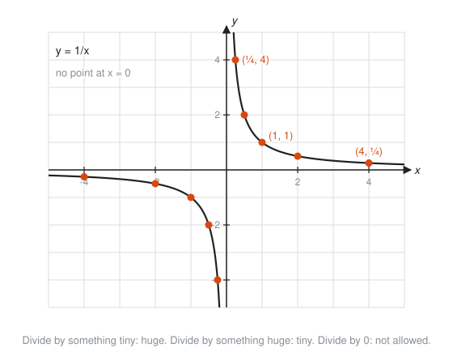
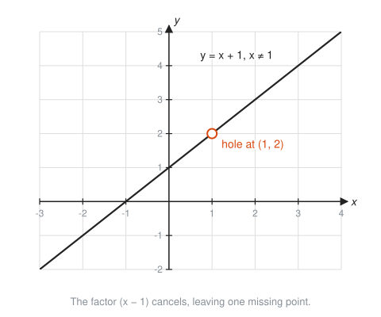
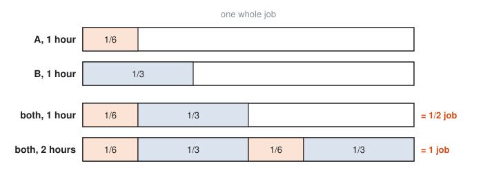

# Rational Functions

**Level:** 301 · **Unit:** 3 · **Time:** 60 to 90 minutes
**Prerequisites:** [Polynomials and Complex Numbers](../02-polynomials-and-complex-numbers/README.md), fractions from [101 Foundations](../../101/README.md)

## The Big Idea

A **rational function** is one polynomial divided by another, like $\frac{2x + 1}{x - 3}$. The name comes from ratio, not from good judgment. The new feature is division: wherever the bottom hits zero, the function breaks. Near those breaks the graph shoots off toward infinity, and far away it settles down along a line. Those lines are **asymptotes**: lines the graph gets closer and closer to without settling on. Find the asymptotes and the zeros, and the graph almost draws itself.

## Picture It

<!-- diagram: type=function-plot f="1/(x-2)+1" x=-3..7 y=-4..6 asymptotes="x=2,y=1" caption="A rational function and its two asymptotes" -->


The graph has two pieces, one on each side of $x = 2$. Close to $x = 2$, the bottom of the fraction is tiny, and dividing by a tiny number gives a huge result. Far to the left or right, the fraction part shrinks to nothing, and the graph settles toward height 1.

## Step by Step

### 1. The Parent Graph: $y = \frac{1}{x}$

Everything in this lesson is a variation on one shape.

<!-- diagram: type=function-plot f="1/x" x=-5..5 y=-5..5 points=(0.25,4),(1,1),(4,0.25) caption="The reciprocal function" -->


```txt
  x     :  0.01   0.1   1    10    100
  1/x   :  100    10    1    0.1   0.01
```

Small in, big out. Big in, small out. Zero in: error. It behaves like requests per server when you split a fixed load $L$ across $n$ servers: $\frac{L}{n}$. Two servers, half each. One hundred servers, a sliver each. Zero servers, an incident.

### 2. Domain: Never Divide by Zero

The domain of $\frac{p(x)}{q(x)}$ is every $x$ with $q(x) \ne 0$. Factor the bottom, set each factor to zero, and remove those $x$ values.

### 3. Vertical Asymptotes and Holes

Each $x$ value that makes the bottom zero is one of two things:

* **Vertical asymptote:** the factor stays in the bottom after you cancel. The graph shoots up or down beside it.
* **Hole:** the factor cancels with a matching factor on top. The graph is an ordinary curve with one point missing.

<!-- diagram: type=function-plot f="(x^2-1)/(x-1)" x=-3..4 y=-2..5 hole=(1,2) caption="A canceled factor leaves a hole" -->


$\frac{x^2 - 1}{x - 1} = \frac{(x - 1)(x + 1)}{x - 1} = x + 1$, except at $x = 1$, where the original formula divides by zero. The graph is the line $y = x + 1$ with a pinhole at $(1, 2)$.

### 4. Horizontal Asymptotes: Compare the Leading Powers

Far out, only the leading terms matter. This is the same rule as end behavior in the last lesson. Compare the degree of the top, $m$, with the degree of the bottom, $n$:

* $m < n$: the bottom wins. Horizontal asymptote $y = 0$.
* $m = n$: they tie. Horizontal asymptote $y = \frac{\text{leading coefficient of top}}{\text{leading coefficient of bottom}}$.
* $m = n + 1$: the top wins by one. No horizontal asymptote. Polynomial division gives a slanted line, the **slant asymptote**.

<!-- diagram: type=small-multiples f="x/(x^2+1),(2x+1)/(x-3),(x^2+1)/x" asymptotes="y=0 | y=2,x=3 | y=x,x=0" caption="The three horizontal asymptote cases" -->


Why the tie case gives the ratio: for huge $x$, $\frac{2x + 1}{x - 3} \approx \frac{2x}{x} = 2$. The $+1$ and $-3$ are rounding errors next to a billion.

### 5. Zeros

A rational function is zero where its top is zero, as long as the bottom is not also zero there. Zero divided by something is zero. Zero divided by zero is a hole, not a zero.

### 6. Graphing Recipe

1. Factor top and bottom. Cancel common factors and note the holes.
2. Mark vertical asymptotes from the remaining bottom zeros.
3. Find the horizontal or slant asymptote from the degrees.
4. Plot the zeros and the y-intercept $f(0)$.
5. Test one point in each region between asymptotes and zeros to see if the graph is above or below the axis.
6. Sketch, letting each branch hug its asymptotes.

### 7. Rational Equations and Work Rates

A **rate** is work per unit time. If a worker drains a queue in 6 hours, its rate is $\frac{1}{6}$ of the queue per hour. Rates add when workers share the job:

<!-- diagram: type=tape bars="1/6 | 1/3 | 1/6+1/3 | 2*(1/6+1/3)" caption="Two workers sharing one job" -->


Solve rational equations by multiplying both sides by the common denominator to clear fractions. Then check each answer against the domain. An answer that makes a denominator zero is a fake, called an **extraneous solution**. Throw it out.

## Worked Examples

### Example 1: Full Analysis

Analyze $f(x) = \dfrac{2x + 1}{x - 3}$.

```txt
  x - 3 = 0  ->  x = 3            bottom is zero; nothing cancels
  vertical asymptote: x = 3       the factor stays in the bottom
  degrees: top 1, bottom 1        a tie
  horizontal asymptote: y = 2/1   ratio of leading coefficients
  2x + 1 = 0  ->  x = -1/2        zero of the top
  f(0) = 1 / (-3) = -1/3          y-intercept
```

This is the middle panel of the asymptote cases picture.

### Example 2: A Hole and an Asymptote

Analyze $h(x) = \dfrac{x + 2}{x^2 - x - 6}$.

```txt
  x^2 - x - 6 = (x - 3)(x + 2)          factor the bottom
  h(x) = (x + 2) / ((x - 3)(x + 2))     rewrite
       = 1 / (x - 3),  x != -2          cancel (x + 2), remember the ban
  hole at x = -2: 1/(-2 - 3) = -1/5     plug -2 into the simplified form
  vertical asymptote: x = 3             (x - 3) remains on the bottom
  horizontal asymptote: y = 0           top degree 1 < bottom degree 2
  hole point: (-2, -1/5)
```

### Example 3: Rewrite to See the Shift

Show that $f(x) = \dfrac{x - 1}{x - 2}$ is the pictured graph $\dfrac{1}{x - 2} + 1$.

```txt
  x - 1 = (x - 2) + 1                   rewrite the top using the bottom
  f(x) = ((x - 2) + 1) / (x - 2)        substitute
       = (x - 2)/(x - 2) + 1/(x - 2)    split the fraction
       = 1 + 1/(x - 2)                  first part is 1 for x != 2
```

Read it as $\frac{1}{x}$ shifted right 2 and up 1, the transformations from [Functions in Depth](../01-functions-in-depth/README.md). Asymptotes $x = 2$ and $y = 1$.

### Example 4: Two Workers

Worker A drains a queue in 6 hours. Worker B drains it in 3 hours. How long together?

```txt
  1/6 + 1/3 = 1/t           rates add; together they do 1 job in t hours
  6t * (1/6 + 1/3) = 6t * (1/t)    multiply both sides by 6t
  t + 2t = 6                       simplify each term
  3t = 6                           combine like terms
  t = 2                            divide by 3
  check: t = 2 makes no denominator zero
```

Two hours. Note the answer is less than either worker alone, as it must be.

### Example 5: An Extraneous Solution

Solve $\dfrac{x}{x - 1} = \dfrac{1}{x - 1}$.

```txt
  x = 1                     multiply both sides by (x - 1)
  check x = 1: denominator 1 - 1 = 0     not allowed
  no solution               the only candidate is extraneous
```

## Common Mistakes

* Canceling terms instead of factors: $\frac{x + 2}{x + 5}$ does not simplify to $\frac{2}{5}$. Only whole factors cancel.
* Calling every bottom zero an asymptote: if the factor cancels, it is a hole.
* Thinking the graph never crosses a horizontal asymptote: it can cross it in the middle. The asymptote describes only the far ends. Vertical asymptotes, on the other hand, are never crossed.
* Forgetting to check answers of rational equations against the domain.
* Adding rates wrong: two workers with 6 hours and 3 hours do not take $6 + 3 = 9$ hours or $\frac{6 + 3}{2}$ hours. Add rates, not times.

## Try It

1. Find the domain of $\dfrac{x + 4}{x^2 - 16}$.
2. For the same function, find the vertical asymptote and the hole.
3. Find the horizontal asymptote of $\dfrac{3x^2 + 1}{x^2 - 5}$.
4. Find the horizontal asymptote of $\dfrac{5x}{x^3 + 1}$.
5. Find the zero and the y-intercept of $\dfrac{x - 3}{x + 1}$.
6. Describe $y = \dfrac{1}{x + 3} - 2$ as a shift of $y = \dfrac{1}{x}$ and give its asymptotes.
7. Solve $\dfrac{2}{x - 1} = 4$.
8. Worker A finishes a backlog in 4 hours, worker B in 12 hours. How long together?
9. Find the slant asymptote of $\dfrac{x^2 + 1}{x}$.
10. Compute $\frac{1}{x}$ at $x = 0.1$, $0.01$ and $-0.01$. Describe what happens near $x = 0$.

<details>
<summary>Answers</summary>

1. All reals except $x = 4$ and $x = -4$.
2. $\frac{x + 4}{(x - 4)(x + 4)} = \frac{1}{x - 4}$ for $x \ne -4$. Vertical asymptote $x = 4$. Hole at $\left(-4, -\frac{1}{8}\right)$.
3. $y = 3$: equal degrees, ratio $\frac{3}{1}$.
4. $y = 0$: top degree 1, bottom degree 3.
5. Zero at $x = 3$. y-intercept $\frac{-3}{1} = -3$.
6. Left 3, down 2. Asymptotes $x = -3$ and $y = -2$.
7. $2 = 4(x - 1)$, so $x - 1 = \frac{1}{2}$ and $x = \frac{3}{2}$. It does not zero the denominator.
8. $\frac{1}{4} + \frac{1}{12} = \frac{3}{12} + \frac{1}{12} = \frac{1}{3}$ of the job per hour: 3 hours.
9. $\frac{x^2 + 1}{x} = x + \frac{1}{x}$. The $\frac{1}{x}$ part fades, leaving $y = x$.
10. $10$, $100$, $-100$. The values blow up, positive from the right and negative from the left: a vertical asymptote at $x = 0$.

</details>

## Code Corner

The program in [code/main.go](code/main.go) walks toward the asymptotes of $\frac{2x + 1}{x - 3}$ and solves the work-rate example with exact fractions from `math/big`. Run it with `go run main.go` inside the `code` folder.

```go
rateA := big.NewRat(1, 6)
rateB := big.NewRat(1, 3)
together := new(big.Rat).Add(rateA, rateB)
hours := new(big.Rat).Inv(together)
```

Output:

```txt
Near the vertical asymptote x = 3:
  f(2.9   ) =      -68.0
  f(2.99  ) =     -698.0
  f(2.999 ) =    -6998.0
  f(3.001 ) =     7002.0
  f(3.01  ) =      702.0
  f(3.1   ) =       72.0
Far out, toward the horizontal asymptote y = 2:
  f(10     ) = 3.000000
  f(100    ) = 2.072165
  f(1000   ) = 2.007021
  f(1e+06  ) = 2.000007
Combined rate (jobs per hour): 1/2
Hours for one job together:   2
```

Each step closer to 3 multiplies the output by about ten and the sign flips across the asymptote. Far out, the values creep toward 2 and never quite arrive.

## Go Deeper

* [Paul's Online Math Notes: Algebra](https://tutorial.math.lamar.edu/Classes/Alg/Alg.aspx): the Rational Functions section works through many graphs step by step.
* [Math Is Fun: Rational Expressions](https://www.mathsisfun.com/algebra/rational-expression.html): plain introduction to the algebra.
* [OpenStax Precalculus 2e](https://openstax.org/details/books/precalculus-2e): the Polynomial and Rational Functions chapter.
* Workshop link: [Calculus of Rates in Physics and Queues](../../../workshops/calculus-of-rates-in-physics-and-queues/README.md), where $\frac{1}{x}$ shapes reappear in queue wait times.

**Next:** [Exponential Functions](../04-exponential-functions/README.md)
