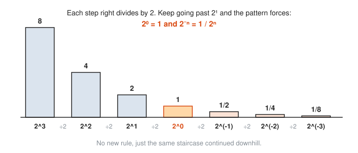
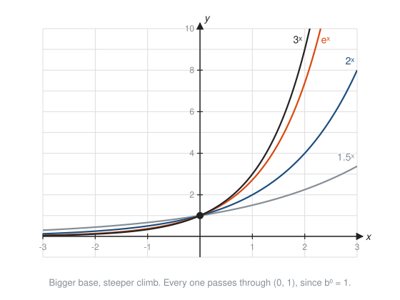
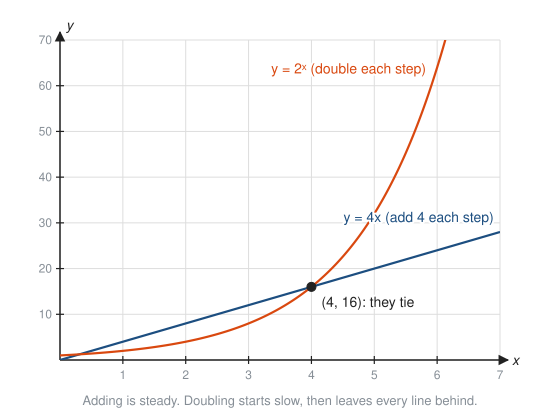
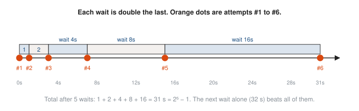
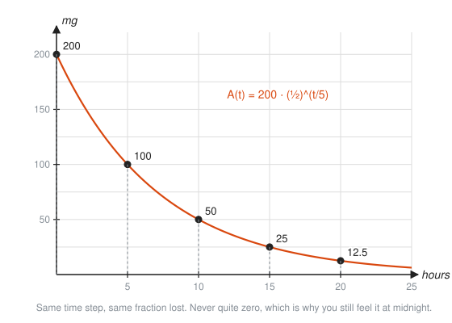
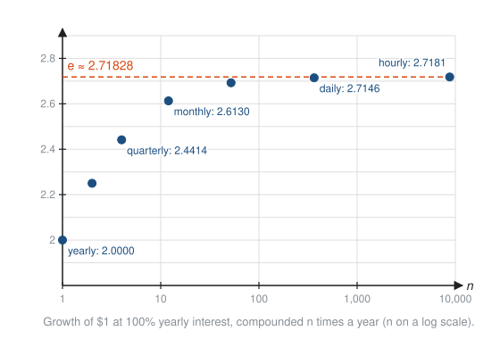

# Exponential Functions

**Level:** 301 · **Unit:** 4 · **Time:** 60 to 90 minutes
**Prerequisites:** [Functions in Depth](../01-functions-in-depth/README.md), exponents and roots from [101 Foundations](../../101/README.md)

## The Big Idea

Linear growth adds the same amount each step. **Exponential** growth multiplies by the same factor each step. That one change, from adding to multiplying, separates a slow leak from a runaway. Retry storms, compound interest, epidemics, unbounded queues and cache warm-up all follow the same curve. Exponential decay is the mirror image: a fixed fraction lost each step, like a drug leaving the bloodstream or a metric decaying in a moving average.

## Picture It

<!-- diagram: type=function-plot f="2^x,(1/2)^x" x=-4..4 y=-1..9 point=(0,1) caption="Growth and decay through the same point" -->


Each step right doubles the orange curve: 1, 2, 4, 8. Each step right halves the blue curve: 1, one half, one quarter. They are mirror images across the y-axis, since $\left(\frac{1}{2}\right)^x = 2^{-x}$. Neither curve ever touches the x-axis. Multiplying a positive number by a positive factor never produces zero.

## Step by Step

### 1. Exponents Are Repeated Multiplication

$2^3$ means $2 \cdot 2 \cdot 2$. The exponent counts the factors. Every exponent rule follows from counting:

<!-- diagram: type=tiles left="2,2,2" right="2,2" result="2^5" caption="Product rule by counting factors" -->


### 2. Zero, Negative and Fractional Exponents

Walk down the powers of 2, dividing by 2 each step, and do not stop at $2^1$:

<!-- diagram: type=bars values=8,4,2,1,1/2,1/4,1/8 labels=2^3..2^-3 caption="Dividing by 2 explains zero and negative exponents" -->


The pattern forces two facts:

* $b^0 = 1$ for any $b \ne 0$.
* $b^{-n} = \dfrac{1}{b^n}$. A negative exponent means divide, not negative.

A fractional exponent is a root: $b^{1/n} = \sqrt[n]{b}$, and $b^{m/n} = \left(\sqrt[n]{b}\right)^m$. Why: $\left(b^{1/2}\right)^2 = b^{1/2 + 1/2} = b^1$, so $b^{1/2}$ is the number whose square is $b$.

### 3. The Exponential Function

An **exponential function** has the variable in the exponent:

$$f(x) = a \cdot b^x, \quad a \ne 0,\ b > 0,\ b \ne 1.$$

* $a$ is the starting value: $f(0) = a \cdot b^0 = a$.
* $b$ is the **growth factor** per step. $b > 1$ grows. $0 < b < 1$ decays.

Compare $x^2$ (variable in the base, a polynomial) with $2^x$ (variable in the exponent, an exponential). The second one wins every long race.

<!-- diagram: type=function-plot f="1.5^x,2^x,e^x,3^x" x=-3..3 y=-1..10 caption="Bigger base, steeper curve" -->


### 4. Percent Growth

Growth of $r$ percent per step means each step multiplies by $1 + r$:

* 5% growth per year: $b = 1.05$.
* 20% growth per month: $b = 1.2$.
* 10% decay per step: $b = 0.9$.

### 5. Adding Versus Multiplying

<!-- diagram: type=function-plot f="4x,2^x" x=0..7 y=0..70 point=(4,16) caption="Linear against exponential" -->


Early on, the line looks stronger. That is the trap. The exponential overtakes every line eventually, however steep the line. Capacity plans drawn with a ruler on exponential traffic end in pages at 3 a.m.

The same doubling shows up in **exponential backoff**, where a client doubles its wait after each failed retry:

<!-- diagram: type=timeline waits=1,2,4,8,16 caption="Exponential backoff waits" -->


The total wait after $k$ waits is $1 + 2 + 4 + \dots + 2^{k-1} = 2^k - 1$. Each new wait is longer than all the previous waits combined. That is the whole point: the clients spread out fast.

### 6. Doubling Time and Half-Life

If a quantity doubles every $T$ time units, then after time $t$ it has doubled $\frac{t}{T}$ times:

$$A(t) = A_0 \cdot 2^{t/T}.$$

If it halves every $T$ (the **half-life**):

$$A(t) = A_0 \cdot \left(\tfrac{1}{2}\right)^{t/T}.$$

<!-- diagram: type=function-plot f="200*(1/2)^(t/5)" x=0..25 y=0..220 marks=0,5,10,15,20 caption="Half-life of caffeine" -->


### 7. The Number $e$

Put \$1 in an account paying 100% a year. Compounded once: \$2. Compounded twice, 50% each half year: $1.5^2 = 2.25$ dollars. Compound more often and the result climbs, but it does not run away. It levels off at a constant called $e$:

$$\left(1 + \frac{1}{n}\right)^n \to e \approx 2.71828 \text{ as } n \text{ grows.}$$

<!-- diagram: type=dot-plot n=1,2,4,12,52,365,8760 f="(1+1/n)^n" xscale=log line=e caption="Compounding more often approaches e" -->


Compounding continuously at rate $r$ for time $t$ gives

$$A = P e^{rt}.$$

$e$ is the natural base of calculus. In [401 Calculus](../../401/README.md) you see why: $e^x$ is the one function whose growth rate equals its own value.

## Worked Examples

### Example 1: Unusual Exponents

```txt
  2^(-3) = 1 / 2^3 = 1/8              negative exponent means reciprocal
  8^(2/3) = (cube root of 8)^2        fractional exponent: root, then power
          = 2^2 = 4                   cube root of 8 is 2
  (1/2)^(-2) = 2^2 = 4                flip the fraction, make the exponent positive
```

### Example 2: Traffic Growth

Traffic is 1,000 requests per second and grows 20% per month. Estimate it after 6 months.

```txt
  b = 1 + 0.20 = 1.2                  20% growth means multiply by 1.2
  R(m) = 1000 * 1.2^m                 start value times growth factor per month
  R(6) = 1000 * 1.2^6                 plug in 6 months
       = 1000 * 2.985984              1.2^6 by calculator
       = 2,986 rps (rounded)          nearly triple, not 1000 + 6 * 200 = 2,200
```

### Example 3: Half-Life

200 mg of caffeine, half-life 5 hours. How much remains after 12 hours?

```txt
  A(t) = 200 * (1/2)^(t/5)            half-life formula with A0 = 200, T = 5
  A(12) = 200 * (1/2)^(2.4)           12 / 5 = 2.4 half-lives
        = 200 * 0.18946               (1/2)^2.4 by calculator
        = 37.9 mg                     about a fifth of the dose
```

### Example 4: Compound Interest

\$1,000 at 6% a year for 10 years. Compare monthly and continuous compounding.

```txt
  monthly: 1000 * (1 + 0.06/12)^(12*10)    rate per month, number of months
         = 1000 * 1.005^120                simplify
         = 1,819.40                        calculator
  continuous: 1000 * e^(0.06 * 10)         A = P e^(rt)
            = 1000 * e^0.6                 simplify
            = 1,822.12                     calculator; only $2.72 more
```

### Example 5: Find the Formula From Two Points

An exponential passes through $(0, 3)$ and $(2, 12)$. Find it.

```txt
  y = a * b^x                  general form
  3 = a * b^0 = a              the point (0, 3) gives the start value
  12 = 3 * b^2                 the point (2, 12)
  b^2 = 4                      divide by 3
  b = 2                        b must be positive
  y = 3 * 2^x
```

## See It Step by Step


[Dividing Powers: Zero and Negative Exponents: open the step-by-step walkthrough](https://caseyaedwards.github.io/math_training/diagrams/exponent-division/)

Watch matching x's cancel in pairs, and see how the leftover cases explain zero and negative exponents.


[Linear Versus Exponential Growth: open the step-by-step walkthrough](https://caseyaedwards.github.io/math_training/diagrams/linear-vs-exponential/)

Watch the linear rule lead early and the doubling rule overtake it for good.


[Arithmetic versus Geometric Sequences: open the step-by-step walkthrough](https://caseyaedwards.github.io/math_training/diagrams/arithmetic-geometric-sequences/)

Watch the arithmetic dots line up in a straight line while the geometric jumps keep growing.


[Exponential Decay and Half-Life: open the step-by-step walkthrough](https://caseyaedwards.github.io/math_training/diagrams/exponential-decay/)

Watch the amount lose the same fraction in every equal stretch of time, which fixes the half-life.

## Common Mistakes

* Reading $2^{-3}$ as $-8$: a negative exponent means reciprocal, $\frac{1}{8}$.
* Multiplying base and exponent: $2^5 = 32$, not $10$.
* Using $r$ instead of $1 + r$ as the growth factor: 5% growth is $\times 1.05$, not $\times 0.05$.
* Treating percent growth as linear: 20% per month for 6 months is $\times 2.99$, not $\times 2.2$.
* Writing $(a + b)^2 = a^2 + b^2$ or $2^{x+y} = 2^x + 2^y$: exponents turn addition into multiplication, $2^{x+y} = 2^x \cdot 2^y$.

## Try It

1. Simplify $3^{-2}$.
2. Simplify $16^{3/4}$.
3. Simplify $\dfrac{5^0 \cdot 5^3}{5^5}$.
4. Classify each as growth or decay, and give the percent per step: $4(0.9)^x$ and $0.5(1.07)^x$.
5. A log pipeline backlog of 500 messages doubles every 3 hours. How big is it after 12 hours?
6. \$2,000 earns 5% a year, compounded yearly. What is it worth after 3 years?
7. After 20 steps, which is larger: $100 + 50n$ or $1.5^n$?
8. Find the exponential through $(0, 5)$ and $(1, 15)$.
9. A sample has a half-life of 8 days. How much of 80 g remains after 24 days?
10. \$100 grows at 5% compounded continuously for 10 years. Find the value.

<details>
<summary>Answers</summary>

1. $\frac{1}{9}$.
2. $8$: $\sqrt[4]{16} = 2$, and $2^3 = 8$.
3. $\frac{1}{25}$: $5^{0 + 3 - 5} = 5^{-2}$.
4. $4(0.9)^x$: decay, 10% per step. $0.5(1.07)^x$: growth, 7% per step.
5. $500 \cdot 2^{12/3} = 500 \cdot 16 = 8,000$ messages.
6. $2000 \cdot 1.05^3 = 2{,}315.25$ dollars.
7. $100 + 50 \cdot 20 = 1,100$. $1.5^{20} \approx 3,325$. The exponential wins.
8. $y = 5 \cdot 3^x$.
9. $24 / 8 = 3$ half-lives: $80 \to 40 \to 20 \to 10$ g.
10. $100 e^{0.5} \approx 164.87$ dollars.

</details>

## Code Corner

The program in [code/main.go](code/main.go) tabulates the traffic and caffeine examples, compounds toward $e$, and totals a backoff schedule. Run it with `go run main.go` inside the `code` folder. Note the bit shift `1 << k`: in binary, multiplying by 2 is shifting left one place, which is why powers of 2 are cheap for computers.

```go
for k := 0; k < 6; k++ {
	wait := 1 << k // 2^k using a bit shift
	total += wait
}
```

Output:

```txt
Traffic: 1,000 rps growing 20% per month
  month 0:   1000.0 rps
  month 1:   1200.0 rps
  month 2:   1440.0 rps
  month 3:   1728.0 rps
  month 4:   2073.6 rps
  month 5:   2488.3 rps
  month 6:   2986.0 rps
Caffeine: 200 mg, half-life 5 h
  t= 0.0 h: 200.00 mg
  t= 5.0 h: 100.00 mg
  t=10.0 h:  50.00 mg
  t=12.0 h:  37.89 mg
  t=24.0 h:   7.18 mg
$1 at 100% for one year, compounded n times:
  n=1        2.000000
  n=2        2.250000
  n=4        2.441406
  n=12       2.613035
  n=365      2.714567
  n=8760     2.718127
  n=1e+06    2.718280
  e      = 2.718282
Backoff waits 1, 2, 4, ... seconds:
  wait  1 s, total  1 s = 2^1 - 1
  wait  2 s, total  3 s = 2^2 - 1
  wait  4 s, total  7 s = 2^3 - 1
  wait  8 s, total 15 s = 2^4 - 1
  wait 16 s, total 31 s = 2^5 - 1
  wait 32 s, total 63 s = 2^6 - 1
```

## Go Deeper

* [Better Explained: An Intuitive Guide to Exponential Functions and e](https://betterexplained.com/articles/an-intuitive-guide-to-exponential-functions-e/): the best plain explanation of where $e$ comes from.
* [Math Is Fun: Exponential Function](https://www.mathsisfun.com/sets/function-exponential.html): short reference with graphs.
* [Paul's Online Math Notes: Algebra](https://tutorial.math.lamar.edu/Classes/Alg/Alg.aspx): the Exponential and Logarithm Functions chapter.
* Workshop link: [Exponential Growth in Interest, Epidemics and Load](../../../workshops/exponential-growth-in-interest-epidemics-and-load/README.md).

**Next:** [Logarithms](../05-logarithms/README.md)
