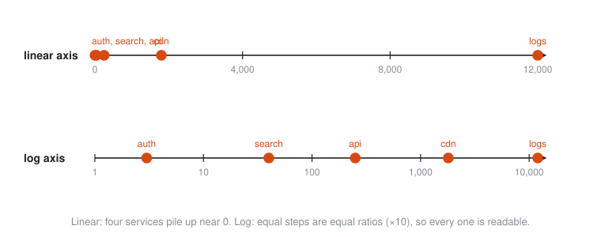
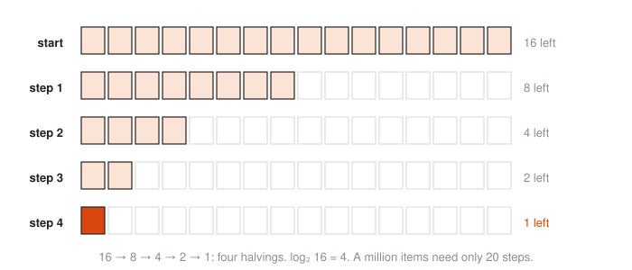
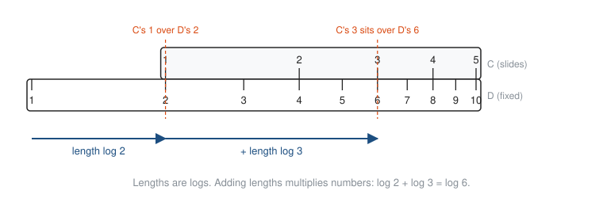

# Logarithms

**Level:** 301 · **Unit:** 5 · **Time:** 75 to 100 minutes
**Prerequisites:** [Exponential Functions](../04-exponential-functions/README.md), inverses from [Functions in Depth](../01-functions-in-depth/README.md)

## The Big Idea

A **logarithm** answers one question: what exponent? $\log_2 8$ asks how many 2s multiply to make 8. The answer is 3. Logarithms undo exponentials, the way subtraction undoes addition. They also compress huge ranges into small ones: a nanosecond and a second sit nine steps apart instead of a billion units apart. Every engineer uses them already: bits, binary search, Big-O, decibels and log-scale dashboards are all logarithms in work clothes.

## Picture It

<!-- diagram: type=tiles factors=2,2,2 result=8 caption="A logarithm counts the factors" -->


$$\log_b x = y \quad \text{means exactly} \quad b^y = x.$$

Read it aloud as: the log base $b$ of $x$ is the power you put on $b$ to get $x$. The logarithm is the exponent.

## Step by Step

### 1. Converting Between the Two Forms

```txt
  exponential form      logarithmic form
  2^5    = 32           log_2 32     = 5
  10^3   = 1000         log_10 1000  = 3
  10^-2  = 0.01         log_10 0.01  = -2
  5^0    = 1            log_5 1      = 0
```

The base stays the base. The exponent and the result trade places.

### 2. The Logarithm as an Inverse Function

$y = \log_2 x$ undoes $y = 2^x$. Its graph is the mirror image across $y = x$, as with every inverse:

<!-- diagram: type=function-plot f="2^x,log2(x)" mirror="y=x" x=-3..7 y=-3..7 points=(2,4),(4,2) caption="Exponential and logarithm are mirror images" -->


The mirror swaps everything:

* $2^x$ accepts any $x$ and outputs only positives. $\log_2 x$ accepts only positive $x$ and outputs any real number.
* $2^x$ hugs the x-axis. $\log_2 x$ hugs the y-axis: as $x$ shrinks toward 0, the log dives to $-\infty$.
* $\log_b 1 = 0$ for every base, and $\log_b b = 1$.

There is no log of 0 or of a negative number. No power of 2 is ever 0 or negative.

### 3. The Three Bases You Meet

* $\log_{10}$, the **common log**: counts powers of ten, that is, zeros and digits.
* $\ln = \log_e$, the **natural log**: the base calculus prefers. Calculators and Go's `math.Log` use it.
* $\log_2$, the **binary log**: counts doublings and bits. Computing lives here.

### 4. Orders of Magnitude and Log Scales

$\log_{10}$ of a number is roughly its count of digits minus one: $\log_{10} 1,000 = 3$, $\log_{10} 5,000 \approx 3.7$. Two numbers whose logs differ by 1 differ by a factor of ten: one **order of magnitude**.

A **log scale** places each number at the distance $\log x$. Equal spacing then means equal ratios:

<!-- diagram: type=log-axis range=1ns..1s marks="L1 cache hit 1ns, RAM 100ns, SSD read 100us, same-DC round trip 500us, cross-continent round trip 150ms" caption="Latency on a log scale" -->


On a linear axis, the same data is a crowd at zero and one lonely dot at the far end:

<!-- diagram: type=two-axes values=3,40,250,1800,12000 scales=linear,log caption="Same data, linear axis and log axis" -->


This is why latency histograms and request-rate dashboards use log axes. It is also why decibels, the Richter scale and pH are logarithmic.

### 5. Base 2 in Computing

Each extra bit doubles the number of values you can store. To give $n$ things distinct IDs you need $\lceil \log_2 n \rceil$ bits, where $\lceil \ \rceil$ means round up.

<!-- diagram: type=log2-ruler range=0..64 marks=KiB,MiB,GiB,TiB,PiB,EiB points=8,32,64 caption="Sizes on a base-2 ruler" -->


Handy fact: $2^{10} = 1,024 \approx 10^3$. Ten bits buy about three decimal digits.

Halving is the same idea run backwards. Binary search cuts the candidates in half each probe, and the number of probes is $\log_2 n$:

<!-- diagram: type=halving start=16 steps=4 caption="Binary search on 16 items" -->


This is the $O(\log n)$ in algorithm analysis. Balanced trees, binary heaps and binary search all owe their speed to it: a billion keys need only about 30 comparisons.

### 6. The Laws of Logarithms

Logs turn multiplication into addition. That is their whole trick, and the reason they were invented in the 1600s to speed up astronomy by hand.

$$\log_b(xy) = \log_b x + \log_b y$$
$$\log_b\left(\frac{x}{y}\right) = \log_b x - \log_b y$$
$$\log_b(x^k) = k \log_b x$$

Why the first law holds: write $x = b^m$ and $y = b^n$. Then $xy = b^{m + n}$, and the log of that is $m + n$. The exponent rule from the last lesson, read backwards.

A **slide rule** is this law made of wood. Lengths are logs. Slide one ruler along another to add lengths, and you multiply numbers:

<!-- diagram: type=slide-rule a=2 b=3 product=6 caption="Multiplying by adding lengths" -->


### 7. Change of Base

Calculators and most languages only offer $\ln$ and $\log_{10}$. Convert any base with

$$\log_b x = \frac{\ln x}{\ln b}.$$

Why: let $y = \log_b x$, so $b^y = x$. Take $\ln$ of both sides: $y \ln b = \ln x$. Divide by $\ln b$.

### 8. Solving Exponential Equations

When the unknown is in the exponent, take the log of both sides and use the power law to bring it down. This answers questions like "how long until traffic doubles?"

The **rule of 70** is a quick estimate: at $r$ percent growth per step, doubling takes about $\frac{70}{r}$ steps. It comes from $\ln 2 \approx 0.693$.

## Worked Examples

### Example 1: Evaluate

```txt
  log_2 32 = 5          because 2^5 = 32
  log_10 0.001 = -3     because 10^-3 = 0.001
  log_5 1 = 0           because 5^0 = 1
  ln(e^3) = 3           ln undoes e^x
```

### Example 2: Expand With the Laws

```txt
  log( x^2 y / z )
  = log(x^2) + log(y) - log(z)      product and quotient laws
  = 2 log x + log y - log z         power law
```

### Example 3: Solve an Exponential Equation

Solve $3^x = 20$.

```txt
  3^x = 20
  ln(3^x) = ln 20           take ln of both sides
  x ln 3 = ln 20            power law brings x down
  x = ln 20 / ln 3          divide by ln 3
  x = 2.9957 / 1.0986       calculator
  x = 2.7268                check: 3^2.7268 = 20.0
```

### Example 4: Doubling Time

Traffic grows 20% per month. When does it double?

```txt
  1.2^m = 2                 doubling means the factor reaches 2
  m ln 1.2 = ln 2           take ln, power law
  m = ln 2 / ln 1.2         divide
  m = 0.6931 / 0.1823       calculator
  m = 3.80 months           rule of 70 estimate: 70 / 20 = 3.5
```

### Example 5: Bits and Binary Search

How many bits to number one million objects? How many probes to binary search one billion sorted keys?

```txt
  log_2 1,000,000 = 19.93       not a whole number
  bits = 20                     round up: 19 bits hold only 524,288 values
  log_2 1,000,000,000 = 29.90   halvings to get down to one key
  probes = 30                   round up
```

### Example 6: A Log Equation With a Trap

Solve $\log_2 x + \log_2(x - 2) = 3$.

```txt
  log_2( x(x - 2) ) = 3         product law
  x(x - 2) = 2^3 = 8            rewrite in exponential form
  x^2 - 2x - 8 = 0              expand, move 8 over
  (x - 4)(x + 2) = 0            factor
  x = 4  or  x = -2             candidates
  reject x = -2                 log_2(-2) does not exist
  x = 4                         check: log_2 4 + log_2 2 = 2 + 1 = 3
```

## Common Mistakes

* Writing $\log(x + y) = \log x + \log y$: the product law is about $\log(xy)$. There is no rule for the log of a sum.
* Writing $\frac{\log x}{\log y} = \log\left(\frac{x}{y}\right)$: the left side is a change of base, the right side is a difference of logs. Different things.
* Taking the log of zero or a negative: always check answers against the domain $x > 0$.
* Forgetting which base a tool uses: `math.Log` in Go is $\ln$, not $\log_{10}$.
* Rounding bits down: 19.93 bits means you need 20.

## Try It

1. Evaluate $\log_3 81$.
2. Evaluate $\log_{10} 1,000,000$.
3. Evaluate $\log_2 \frac{1}{8}$.
4. Rewrite $2^{10} = 1,024$ in logarithmic form.
5. Simplify $\log_{10} 5 + \log_{10} 20$.
6. Simplify $\log_2 48 - \log_2 3$.
7. Solve $5^x = 200$ to four decimal places.
8. How many bits do you need to give 5,000 hosts distinct IDs?
9. Savings grow 7% a year. Find the doubling time, and compare with the rule of 70.
10. One request takes 2 ms and another takes 200 µs. How many orders of magnitude apart are they?

<details>
<summary>Answers</summary>

1. $4$: $3^4 = 81$.
2. $6$.
3. $-3$: $2^{-3} = \frac{1}{8}$.
4. $\log_2 1,024 = 10$.
5. $\log_{10} 100 = 2$.
6. $\log_2 16 = 4$.
7. $x = \frac{\ln 200}{\ln 5} \approx 3.2920$.
8. $\log_2 5,000 \approx 12.29$: 13 bits.
9. $\frac{\ln 2}{\ln 1.07} \approx 10.24$ years. The rule of 70 gives $\frac{70}{7} = 10$.
10. $\frac{2 \text{ ms}}{0.2 \text{ ms}} = 10$: one order of magnitude.

</details>

## Code Corner

The program in [code/main.go](code/main.go) uses Go's `math.Log2`, `math.Log10` and `math.Log`, the change-of-base formula, `math/bits`, and counts the probes `sort.Search` makes on a million keys. Run it with `go run main.go` inside the `code` folder.

```go
// logb computes log base b of x with the change-of-base formula.
func logb(b, x float64) float64 { return math.Log(x) / math.Log(b) }
```

Output:

```txt
log2 32      = 5
log10 0.001  = -3
log3 20      = 2.7268 (the x with 3^x = 20)
IDs 256      need  8 bits (log2 = 8.00)
IDs 5000     need 13 bits (log2 = 12.29)
IDs 1e+06    need 20 bits (log2 = 19.93)
IDs 1e+09    need 30 bits (log2 = 29.90)
bits.Len(4999) = 13 (IDs 0..4999 fit in 13 bits)
doubling at 20%/month: 3.80 months (rule of 70 says 3.5)
found 1234566 at index 617283 after 20 probes (log2 1e6 = 19.9)
```

Twenty probes to find one key among a million. The logarithm is the reason your database index works.

## Go Deeper

* [Better Explained: Using Logarithms in the Real World](https://betterexplained.com/articles/using-logs-in-the-real-world/): logs as "how many times", with plain examples.
* [Math Is Fun: Introduction to Logarithms](https://www.mathsisfun.com/algebra/logarithms.html): a gentle start with pictures.
* [Paul's Online Math Notes: Algebra](https://tutorial.math.lamar.edu/Classes/Alg/Alg.aspx): the Exponential and Logarithm Functions chapter has many solved equations.
* [MacTutor: John Napier](https://mathshistory.st-andrews.ac.uk/Biographies/Napier/): the Scottish laird who invented logarithms to save astronomers from arithmetic.
* Workshop link: [Statistics for Monitoring and Anomaly Detection](../../../workshops/statistics-for-monitoring-and-anomaly-detection/README.md), where log scales tame latency data.

**Next:** [Right-Triangle Trigonometry](../06-right-triangle-trigonometry/README.md)
