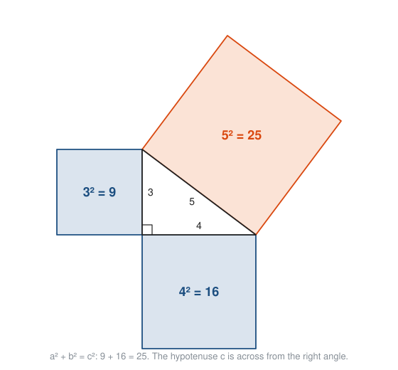
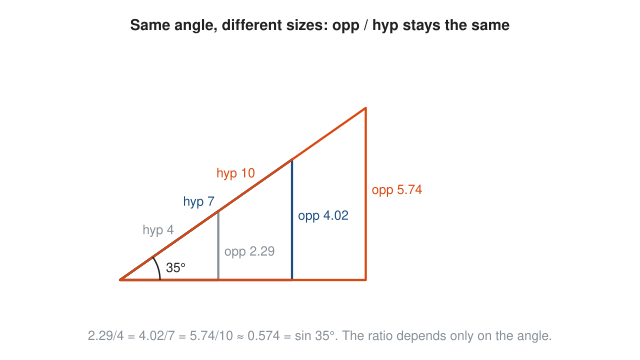
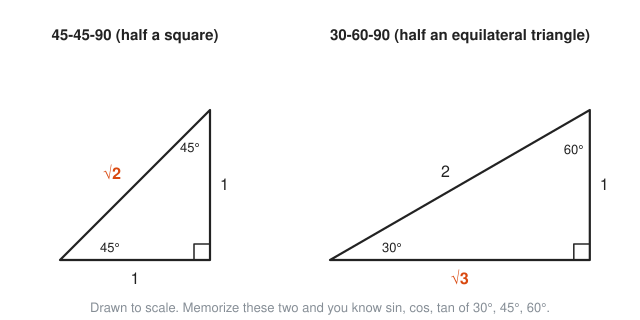
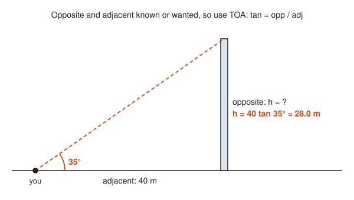
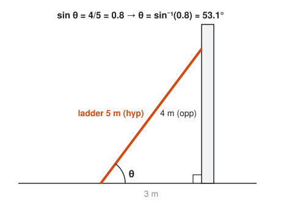

# Right-Triangle Trigonometry

**Level:** 301 · **Unit:** 6 · **Time:** 60 to 90 minutes
**Prerequisites:** angles, triangles and similar figures from [201 Algebra I and Geometry](../../201/README.md), inverses from [Functions in Depth](../01-functions-in-depth/README.md)

## The Big Idea

**Trigonometry** means triangle measurement. Its core fact is simple: in a right triangle, the angle alone fixes the ratios between the sides. Know one angle and one side, and you can compute every other length without a tape measure. Surveyors, game engines, GPS and antenna alignment all run on this. Start here, from zero, with nothing but a right triangle.

## Picture It

<!-- diagram: type=right-triangle angle=theta labels=opposite,adjacent,hypotenuse caption="Naming the sides from the angle theta" -->


Stand at the angle $\theta$ (the Greek letter theta, the usual name for an unknown angle). The side across from you is **opposite**. The side touching you that is not the long one is **adjacent**. The longest side, across from the square corner, is the **hypotenuse**.

## Step by Step

### 1. Angles and Right Triangles

An angle measures a turn. A full turn is 360 **degrees** ($360°$). A square corner is a quarter turn, $90°$, called a **right angle** and drawn as a small box. The three angles of any triangle add to $180°$. In a right triangle one angle is $90°$, and the other two share the remaining $90°$.

### 2. Pythagoras, the Foundation

For a right triangle with legs $a$ and $b$ and hypotenuse $c$:

$$a^2 + b^2 = c^2.$$

<!-- diagram: type=pythagoras a=3 b=4 c=5 squares=true caption="Squares on the sides of a 3-4-5 triangle" -->


The two small squares together have exactly the area of the big one: $9 + 16 = 25$. Every trig identity in later lessons traces back to this picture.

### 3. Same Angle, Same Ratios

Scale a triangle up and its angles do not change. The sides grow together, and the ratios between them stay fixed. Triangles like this are **similar**.

<!-- diagram: type=similar-triangles angle=35 hyps=4,7,10 caption="Ratios depend only on the angle" -->


That fixed ratio is a property of the angle, not of the triangle. It deserves a name.

### 4. Sine, Cosine and Tangent

$$\sin\theta = \frac{\text{opposite}}{\text{hypotenuse}} \qquad \cos\theta = \frac{\text{adjacent}}{\text{hypotenuse}} \qquad \tan\theta = \frac{\text{opposite}}{\text{adjacent}}$$

The memory hook is **SOH CAH TOA**: Sine is Opposite over Hypotenuse, Cosine is Adjacent over Hypotenuse, Tangent is Opposite over Adjacent. It sounds like a place name. It is not. It works anyway.

Since the hypotenuse is the longest side, $\sin\theta$ and $\cos\theta$ are always between 0 and 1 in a right triangle. Tangent can be any positive number: it is the slope of the hypotenuse.

### 5. Opposite and Adjacent Depend on Where You Stand

<!-- diagram: type=right-triangle panels=2 angles=A,B caption="The same triangle seen from each acute angle" -->


This gives a free identity. The two acute angles add to $90°$, and the opposite side of one is the adjacent side of the other:

$$\sin\theta = \cos(90° - \theta).$$

That is where the name comes from: **co**sine is the sine of the **co**mplementary angle.

### 6. Two Special Triangles

Two triangles give exact values that you meet constantly:

<!-- diagram: type=special-triangles which=45-45-90,30-60-90 scale=true caption="The two special right triangles" -->


Where they come from:

* Cut a square of side 1 along its diagonal. Pythagoras gives the diagonal $\sqrt{1^2 + 1^2} = \sqrt{2}$.
* Cut an equilateral triangle of side 2 down the middle. The base halves to 1 and the angles become $30°$ and $60°$. Pythagoras gives the height $\sqrt{2^2 - 1^2} = \sqrt{3}$.

Reading SOH CAH TOA off these two pictures:

| $\theta$ | $\sin\theta$ | $\cos\theta$ | $\tan\theta$ |
|---|---|---|---|
| $30°$ | $\frac{1}{2}$ | $\frac{\sqrt{3}}{2}$ | $\frac{1}{\sqrt{3}} = \frac{\sqrt{3}}{3}$ |
| $45°$ | $\frac{\sqrt{2}}{2}$ | $\frac{\sqrt{2}}{2}$ | $1$ |
| $60°$ | $\frac{\sqrt{3}}{2}$ | $\frac{1}{2}$ | $\sqrt{3}$ |

### 7. Going Backwards: Inverse Trig

Sine turns an angle into a ratio. The **inverse sine** $\sin^{-1}$ (also written $\arcsin$) turns a ratio back into an angle. Same for $\cos^{-1}$ and $\tan^{-1}$. As in lesson one, the $-1$ means undo, not reciprocal.

### 8. The Three Reciprocals

Some books also use **cosecant** $\csc\theta = \frac{1}{\sin\theta}$, **secant** $\sec\theta = \frac{1}{\cos\theta}$ and **cotangent** $\cot\theta = \frac{1}{\tan\theta}$. They add names, not ideas.

### 9. Solving a Right Triangle

1. Draw it and label the angle you know or want.
2. Name the sides relative to that angle: opposite, adjacent, hypotenuse.
3. Pick the ratio that uses the two sides involved: one known, one wanted.
4. Solve. Use an inverse function if the unknown is the angle.
5. Check with Pythagoras or with the angle sum of $180°$.

## Worked Examples

### Example 1: Ratios From a 3-4-5 Triangle

A right triangle has legs 3 and 4 and hypotenuse 5. Let $A$ be the angle opposite the side 3.

```txt
  opposite A = 3, adjacent A = 4, hypotenuse = 5     label from angle A
  sin A = 3/5 = 0.6                                  SOH
  cos A = 4/5 = 0.8                                  CAH
  tan A = 3/4 = 0.75                                 TOA
  A = sin^-1(0.6) = 36.87 degrees                    inverse sine
  other angle B = 90 - 36.87 = 53.13 degrees         acute angles add to 90
```

### Example 2: Height of a Tower

You stand 40 m from a tower. The top is $35°$ above level. How tall is the tower?

<!-- diagram: type=right-triangle adj=40 angle=35 scale=8px/m caption="Angle of elevation to the top of a tower" -->


```txt
  tan 35 = h / 40           opposite and adjacent involved: TOA
  h = 40 * tan 35           multiply both sides by 40
  h = 40 * 0.7002           calculator in degree mode
  h = 28.0 m                round
```

### Example 3: Angle of a Ladder

A 5 m ladder reaches 4 m up a wall. What angle does it make with the ground?

<!-- diagram: type=right-triangle hyp=5 opp=4 adj=3 unknown=theta caption="A ladder against a wall" -->


```txt
  sin theta = 4 / 5 = 0.8          opposite and hypotenuse involved: SOH
  theta = sin^-1(0.8)              undo the sine
  theta = 53.13 degrees            calculator
  check: foot is sqrt(25 - 16) = 3 m from the wall     Pythagoras
```

### Example 4: Exact Values

```txt
  sin 30 = 1/2                 30-60-90: opposite 1, hypotenuse 2
  cos 30 = sqrt(3)/2           adjacent sqrt(3), hypotenuse 2
  tan 45 = 1/1 = 1             45-45-90: both legs 1
  sin 45 = 1/sqrt(2)           opposite 1, hypotenuse sqrt(2)
         = sqrt(2)/2           multiply top and bottom by sqrt(2)
```

### Example 5: Solve a Whole Triangle

A right triangle has hypotenuse 10 and one angle $25°$. Find the other sides and angle.

```txt
  opposite = 10 sin 25 = 4.226         SOH, multiply by the hypotenuse
  adjacent = 10 cos 25 = 9.063         CAH, multiply by the hypotenuse
  other angle = 90 - 25 = 65 degrees   acute angles add to 90
  check: 4.226^2 + 9.063^2 = 100.0     Pythagoras: 10^2
```

## Common Mistakes

* Calculator in the wrong mode: $\sin 30 = 0.5$ in degrees, but $-0.988$ in radians. The next lesson explains radians. Until then, check the mode.
* Labeling from the wrong angle: opposite and adjacent belong to a specific angle. Re-label when you switch angles.
* Using SOH CAH TOA on a triangle with no right angle: these ratios need a right angle. For other triangles, see [Laws of Sines and Cosines](../09-laws-of-sines-and-cosines/README.md).
* Reading $\sin^{-1} x$ as $\frac{1}{\sin x}$: it is the inverse function. The reciprocal is $\csc x$.
* Rounding early: keep full calculator precision until the last line.

## Try It

1. A right triangle has legs 5 and 12. Find the hypotenuse.
2. In that triangle, let $A$ be opposite the side 5. Give $\sin A$, $\cos A$ and $\tan A$ as fractions.
3. Give exact values of $\cos 60°$ and $\tan 30°$.
4. A kite string is 50 m long and makes a $40°$ angle with the ground. How high is the kite? (Ignore sag.)
5. From 50 m away, the top of a building is $20°$ above level. How tall is the building?
6. A ramp rises 7 units over a horizontal run of 24. Find its angle with the ground.
7. In a right triangle, one angle is $40°$ and the side opposite it is 12. Find the hypotenuse.
8. In a right triangle, the hypotenuse is 8 and one angle is $60°$. Find the side adjacent to that angle.
9. Show that $\sin 25° = \cos 65°$ without a calculator.
10. Why can $\sin\theta$ never be 1.2 in a right triangle?

<details>
<summary>Answers</summary>

1. $\sqrt{25 + 144} = \sqrt{169} = 13$.
2. $\sin A = \frac{5}{13}$, $\cos A = \frac{12}{13}$, $\tan A = \frac{5}{12}$.
3. $\cos 60° = \frac{1}{2}$. $\tan 30° = \frac{1}{\sqrt{3}} = \frac{\sqrt{3}}{3}$.
4. $50 \sin 40° \approx 32.1$ m.
5. $50 \tan 20° \approx 18.2$ m.
6. $\tan^{-1}\left(\frac{7}{24}\right) \approx 16.26°$. (The hypotenuse is 25: a 7-24-25 triangle.)
7. $\sin 40° = \frac{12}{h}$, so $h = \frac{12}{\sin 40°} \approx 18.67$.
8. $8 \cos 60° = 8 \cdot \frac{1}{2} = 4$.
9. $25° + 65° = 90°$. The side opposite one angle is adjacent to the other, so the two ratios are the same fraction.
10. Sine is opposite over hypotenuse, and the hypotenuse is the longest side. The fraction cannot exceed 1.

</details>

## Code Corner

Go's trig functions take radians, not degrees. The program in [code/main.go](code/main.go) converts with a tiny helper, prints a small trig table, shows the classic bug, and solves the worked examples. Run it with `go run main.go` inside the `code` folder.

```go
func deg(d float64) float64   { return d * math.Pi / 180 } // degrees to radians
func toDeg(r float64) float64 { return r * 180 / math.Pi } // radians to degrees
```

Output:

```txt
angle    sin     cos     tan
   0°  0.0000  1.0000  0.0000
  15°  0.2588  0.9659  0.2679
  30°  0.5000  0.8660  0.5774
  45°  0.7071  0.7071  1.0000
  60°  0.8660  0.5000  1.7321
  75°  0.9659  0.2588  3.7321
The classic bug: math.Sin(30) treats 30 as radians: -0.9880316240928618
tower height = 40 tan 35° = 28.01 m
ladder angle = asin(4/5)   = 53.13°
hyp 10, 25°: opp = 4.226, adj = 9.063, other angle = 65°
check Pythagoras: opp² + adj² = 100.000000
```

Look at the table: the sine column read downward equals the cosine column read upward. That is $\sin\theta = \cos(90° - \theta)$ in numbers.

## Go Deeper

* [Math Is Fun: Sine, Cosine and Tangent](https://www.mathsisfun.com/sine-cosine-tangent.html): plain, picture-first introduction.
* [Paul's Online Math Notes: Trig Cheat Sheet](https://tutorial.math.lamar.edu/pdf/Trig_Cheat_Sheet.pdf): every definition and identity on a few pages.
* [Clark University: Euclid, Book I, Proposition 47](https://aleph0.clarku.edu/~djoyce/elements/bookI/propI47.html): the original proof of the Pythagorean theorem.
* Track link: [Trigonometry track](../../../tracks/trigonometry/README.md).

**Next:** [The Unit Circle and Radians](../07-unit-circle-and-radians/README.md)
