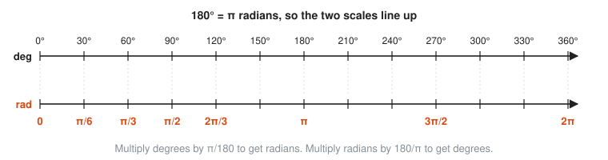
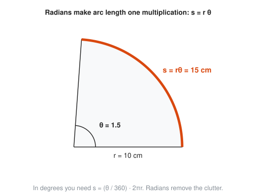
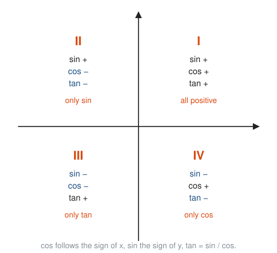
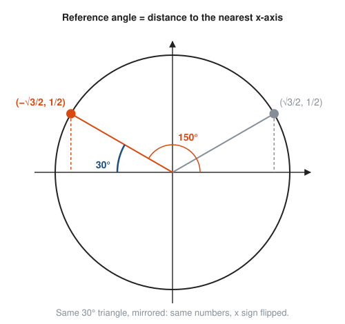

# The Unit Circle and Radians

**Level:** 301 · **Unit:** 7 · **Time:** 75 to 100 minutes
**Prerequisites:** [Right-Triangle Trigonometry](../06-right-triangle-trigonometry/README.md)

## The Big Idea

A right triangle only holds angles between $0°$ and $90°$. Rotation does not stop there: wheels, disks, waves and clock hands keep turning. The **unit circle**, a circle of radius 1 centered at the origin, extends sine and cosine to every angle, including negative ones and ones past a full turn. Along the way, a better unit for angles appears: the **radian**, which measures an angle by the length of arc it cuts. Calculus, physics and Go's `math.Sin` all use radians. Degrees are for humans and protractors.

## Picture It

<!-- diagram: type=unit-circle angles=0..330 step=30,45 coords=first-quadrant caption="The unit circle with special angles" -->
![A circle of radius 1 centered at the origin with orange points at every multiple of 30 and 45 degrees. Each point is labeled with its angle in degrees and in radians, from 0 through pi over 6, pi over 4, pi over 3, pi over 2, up to 11 pi over 6. The first-quadrant points carry their coordinates: 1, 0; root 3 over 2, one half; root 2 over 2, root 2 over 2; one half, root 3 over 2; 0, 1. The points on the axes are labeled negative 1, 0 and 0, negative 1. The other quadrants are labeled with the signs of x and y.](img/unit-circle.svg)

Every point on this circle is $(\cos\theta, \sin\theta)$. That single sentence is the definition of sine and cosine for all angles. The rest of the lesson explains why it matches the triangle version and how to read values off the circle.

## Step by Step

### 1. Angles as Rotations

Put the angle in **standard position**: start on the positive x-axis and rotate.

* Counterclockwise is positive. Clockwise is negative: $-90°$ points straight down.
* Past $360°$ you go around again: $420°$ lands where $60°$ does. Angles wrap around the way a clock does, or the way `n % 360` does in code.

The axes cut the plane into four **quadrants**, numbered I to IV counterclockwise from the upper right.

### 2. The Radian

Take the radius of a circle and lay it along the rim. The angle that bit of arc makes at the center is one **radian**.

<!-- diagram: type=circle arc-length=r angle=1rad caption="One radian" -->


The full circumference is $2\pi r$, so a full turn holds $2\pi$ radii of arc:

$$360° = 2\pi \text{ radians}, \qquad 180° = \pi \text{ radians}, \qquad 1 \text{ radian} \approx 57.3°.$$

Why bother? A radian measures the angle with the circle's own ruler. No arbitrary 360 is involved. That is what makes the formulas in calculus come out clean.

### 3. Converting Degrees and Radians

<!-- diagram: type=double-number-line top=degrees 0..360 bottom=radians 0..2pi caption="Degrees and radians side by side" -->


* Degrees to radians: multiply by $\frac{\pi}{180}$.
* Radians to degrees: multiply by $\frac{180}{\pi}$.

Think of $\pi$ as half a turn. Then $\frac{\pi}{2}$ is a quarter turn, $\frac{\pi}{6}$ is a twelfth of a turn ($30°$), and $\frac{3\pi}{2}$ is three quarters.

### 4. Arc Length

In radians, the arc cut by angle $\theta$ on a circle of radius $r$ is

$$s = r\theta.$$

<!-- diagram: type=sector r=10 theta=1.5 caption="Arc length in radians" -->


That is the radian definition run in reverse: one radian cuts one radius of arc, so $\theta$ radians cut $\theta$ radii. The same idea gives **angular speed** $\omega$ (the Greek letter omega), in radians per second. A point at radius $r$ moves at linear speed $v = r\omega$.

### 5. Sine and Cosine on the Unit Circle

Draw the radius to the point at angle $\theta$ and drop a vertical line to the x-axis. That makes a right triangle with hypotenuse 1:

<!-- diagram: type=unit-circle-triangle angle=30 caption="Why the point is (cos, sin)" -->


With hypotenuse 1, SOH CAH TOA collapses: $\sin\theta = \frac{\text{opposite}}{1}$ is the height of the point, and $\cos\theta = \frac{\text{adjacent}}{1}$ is its horizontal position. For angles past $90°$ there is no triangle in the old sense, but the point still has coordinates. Define

$$\cos\theta = x, \qquad \sin\theta = y, \qquad \tan\theta = \frac{y}{x} = \frac{\sin\theta}{\cos\theta}.$$

Tangent is the slope of the radius. It is undefined where $x = 0$, at $90°$ and $270°$, where the radius stands vertical.

### 6. Signs by Quadrant

<!-- diagram: type=quadrants labels="I all +, II sin +, III tan +, IV cos +" caption="Signs of sin, cos and tan" -->


Cosine has the sign of $x$. Sine has the sign of $y$. Tangent is positive when they agree. Some remember the pattern with All Students Take Calculus, starting in quadrant I and going counterclockwise. The diagram is more dependable than the mnemonic.

### 7. Reference Angles

Every angle is a mirror image of one first-quadrant angle, its **reference angle**: the acute angle to the nearest part of the x-axis.

<!-- diagram: type=unit-circle angles=30,150 reference=30 caption="150 degrees mirrors 30 degrees" -->


To evaluate a trig function at any angle:

1. Find the reference angle.
2. Look up the value for that acute angle.
3. Attach the sign from the quadrant.

### 8. Periodicity

Adding a full turn returns to the same point:

$$\sin(\theta + 2\pi) = \sin\theta, \qquad \cos(\theta + 2\pi) = \cos\theta.$$

Sine and cosine are **periodic** with period $2\pi$. The next lesson turns this repetition into waves.

## Worked Examples

### Example 1: Conversions

```txt
  150 deg = 150 * pi/180 rad         multiply by pi/180
          = 5pi/6 rad                simplify 150/180 = 5/6
  3pi/4 rad = (3pi/4) * 180/pi deg   multiply by 180/pi
            = 135 deg                pi cancels, 3 * 180 / 4 = 135
  1 rad = 180/pi deg = 57.30 deg     calculator
```

### Example 2: Arc Length

A circle has radius 6 cm. How long is the arc cut by a $60°$ angle?

```txt
  theta = 60 * pi/180 = pi/3        convert to radians first
  s = r * theta                     arc length formula (radians only)
    = 6 * pi/3                      substitute
    = 2pi = 6.28 cm                 simplify
```

### Example 3: Exact Values Past 90 Degrees

Find $\cos 150°$ and $\sin 150°$.

```txt
  150 is in quadrant II               between 90 and 180
  reference angle = 180 - 150 = 30    distance to the negative x-axis
  cos 30 = sqrt(3)/2, sin 30 = 1/2    first-quadrant values
  quadrant II: x < 0, y > 0           signs
  cos 150 = -sqrt(3)/2                attach the sign of x
  sin 150 = 1/2                       attach the sign of y
```

### Example 4: Negative and Large Angles

```txt
  sin(-pi/2): rotate a quarter turn clockwise    negative means clockwise
            = y-coordinate of (0, -1) = -1
  cos(7pi/3) = cos(7pi/3 - 2pi)                  remove a full turn
             = cos(pi/3) = 1/2                   7pi/3 - 6pi/3 = pi/3
  tan 225 = tan 45 = 1                           reference angle 45, quadrant III: tan > 0
```

### Example 5: A Spinning Disk

A hard disk spins at 7,200 revolutions per minute. Find its angular speed and the speed of a point 4.5 cm from the center.

```txt
  1 revolution = 2pi rad                      one full turn
  omega = 7200 * 2pi / 60 rad/s               revolutions/min to rad/s
        = 240pi = 754.0 rad/s                 simplify
  v = r * omega = 0.045 m * 754.0 rad/s       linear speed, r in meters
    = 33.9 m/s                                about 122 km/h, under the read head
```

## Common Mistakes

* Using $s = r\theta$ with $\theta$ in degrees: the formula holds only in radians.
* Forgetting the sign: the reference angle gives the size of the value, the quadrant gives the sign.
* Thinking $\pi$ means $180°$ everywhere: $\pi$ is the number 3.14159. It equals $180°$ only when the unit is radians.
* Treating $\tan 90°$ as a big number: it is undefined, because $\cos 90° = 0$.
* Measuring the reference angle to the y-axis: always measure to the x-axis.

## Try It

1. Convert $210°$ to radians.
2. Convert $\frac{5\pi}{3}$ to degrees.
3. Convert 2.5 radians to degrees.
4. Find the exact value of $\sin 240°$.
5. Find the exact value of $\cos\frac{3\pi}{4}$.
6. Find the exact value of $\tan\frac{5\pi}{6}$.
7. In which quadrant is $\sin\theta < 0$ and $\cos\theta > 0$?
8. Find the arc length cut by $135°$ on a circle of radius 4.
9. Find the exact value of $\sin\frac{13\pi}{6}$.
10. List every angle in $[0, 2\pi)$ with $\sin\theta = \frac{1}{2}$.

<details>
<summary>Answers</summary>

1. $\frac{7\pi}{6}$.
2. $300°$.
3. $2.5 \cdot \frac{180}{\pi} \approx 143.24°$.
4. $-\frac{\sqrt{3}}{2}$: reference angle $60°$, quadrant III, $y < 0$.
5. $-\frac{\sqrt{2}}{2}$: reference angle $\frac{\pi}{4}$, quadrant II, $x < 0$.
6. $-\frac{\sqrt{3}}{3}$: reference angle $\frac{\pi}{6}$, quadrant II, signs of $x$ and $y$ differ.
7. Quadrant IV.
8. $\theta = \frac{3\pi}{4}$, so $s = 4 \cdot \frac{3\pi}{4} = 3\pi \approx 9.42$.
9. $\frac{1}{2}$: subtract $2\pi$ to get $\frac{\pi}{6}$.
10. $\frac{\pi}{6}$ and $\frac{5\pi}{6}$: the two points at height one half.

</details>

## Code Corner

The program in [code/main.go](code/main.go) converts units, walks around the circle in $45°$ steps printing $(\cos\theta, \sin\theta)$, wraps angles with `math.Mod`, and computes the disk example. Run it with `go run main.go` inside the `code` folder.

```go
// wrap reduces any angle in degrees to [0, 360), like a clock or a modulo.
func wrap(d float64) float64 {
	m := math.Mod(d, 360)
	if m < 0 {
		m += 360
	}
	return m
}
```

Output:

```txt
1 radian = 57.2958 degrees
150 degrees = 2.6180 rad = 5π/6 = 2.6180
 deg   (cos, sin)
   0   ( 1.0000,  0.0000)
  45   ( 0.7071,  0.7071)
  90   ( 0.0000,  1.0000)
 135   (-0.7071,  0.7071)
 180   (-1.0000,  0.0000)
 225   (-0.7071, -0.7071)
 270   ( 0.0000, -1.0000)
 315   ( 0.7071, -0.7071)
angle   420 wraps to  60
angle   -90 wraps to 270
angle  1000 wraps to 280
arc: r = 10 cm, θ = 1.5 rad -> s = 15.0 cm
7200 rpm disk: ω = 754.0 rad/s, rim speed at 4.5 cm = 33.9 m/s
```

The `m < 0` branch exists because Go's `math.Mod` keeps the sign of its first argument: `math.Mod(-90, 360)` is $-90$, not $270$. The same trap exists for `%` on integers. Every on-call engineer who has bucketed negative timestamps has met it.

## Go Deeper

* [Better Explained: Intuitive Guide to Angles, Degrees and Radians](https://betterexplained.com/articles/intuitive-guide-to-angles-degrees-and-radians/): why radians are the natural unit.
* [Math Is Fun: Unit Circle](https://www.mathsisfun.com/geometry/unit-circle.html): an interactive look at the circle.
* [Paul's Online Math Notes: Trig Cheat Sheet](https://tutorial.math.lamar.edu/pdf/Trig_Cheat_Sheet.pdf): the unit circle with every special angle on one page.
* Track link: [Trigonometry track](../../../tracks/trigonometry/README.md).

**Next:** [Trig Graphs and Identities](../08-trig-graphs-and-identities/README.md)
