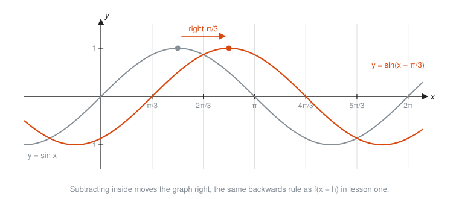
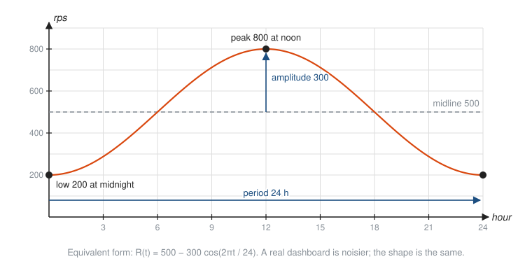
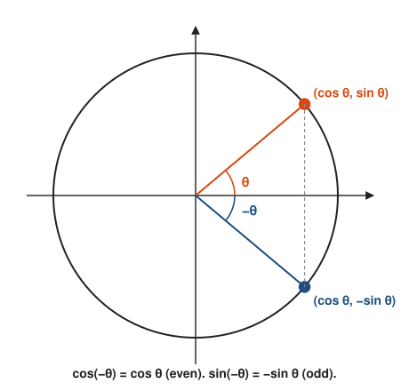

# Trig Graphs and Identities

**Level:** 301 · **Unit:** 8 · **Time:** 90 to 120 minutes
**Prerequisites:** [The Unit Circle and Radians](../07-unit-circle-and-radians/README.md), transformations from [Functions in Depth](../01-functions-in-depth/README.md)

## The Big Idea

Walk around the unit circle and record only your height. Plot that height against the angle and a wave appears: the **sine wave**. Anything that repeats on a cycle, such as daily traffic, alternating current, sound, tides or a cron-driven load spike, is described by stretched and shifted versions of this one wave. **Identities** are equations that hold for every angle. They are the refactoring rules of trigonometry: they let you rewrite an expression into a simpler one that computes the same thing.

## Picture It

<!-- diagram: type=unwrap circle=unit graph=sin angles=30,90,150,210,270,330 caption="Unwrapping the unit circle into the sine wave" -->


The height of the point is $\sin\theta$. As the angle sweeps from 0 to $2\pi$, the height rises to 1, falls through 0 to $-1$, and climbs back. Then the point is home, and the whole thing repeats.

## Step by Step

### 1. The Sine and Cosine Graphs

<!-- diagram: type=function-plot f="sin,cos" x=-2pi..2pi caption="Sine and cosine" -->


Key facts, all read off the circle:

* **Period** $2\pi$: the graph repeats every full turn.
* **Range** $[-1, 1]$: the unit circle never leaves that band.
* Sine starts at 0 and rises. Cosine starts at 1 and falls.
* Cosine is sine shifted left by a quarter turn: $\cos x = \sin\left(x + \frac{\pi}{2}\right)$.

### 2. Amplitude, Period, Midline and Phase Shift

The general wave is

$$y = A \sin\big(B(x - C)\big) + D.$$

Each letter is one of the transformations from lesson one:

| Letter | Name | Effect |
|---|---|---|
| $A$ | **amplitude** $\lvert A \rvert$ | height from the middle to a peak |
| $B$ | frequency factor | **period** becomes $\frac{2\pi}{B}$ |
| $C$ | **phase shift** | slides the wave right by $C$ |
| $D$ | **midline** | the center line $y = D$ |

<!-- diagram: type=function-plot f="sin x,2 sin 2x" x=0..2pi caption="Amplitude 2 and period pi" -->


<!-- diagram: type=function-plot f="sin x,sin(x-pi/3)" x=-pi/2..2pi caption="Phase shift right by pi/3" -->


The period rule comes from asking when the inside, $Bx$, completes one full turn: $Bx = 2\pi$ when $x = \frac{2\pi}{B}$.

### 3. Modeling a Daily Cycle

Request rates often rise in the day and fall at night. A sine model captures the shape:

<!-- diagram: type=function-plot f="500+300 sin(2pi(t-6)/24)" x=0..24 y=0..900 caption="A sinusoidal model of daily traffic" -->


To build a model, read four numbers off the data: the midline (average of max and min), the amplitude (half of max minus min), the period, and where a peak or a trough sits.

### 4. The Tangent Graph

<!-- diagram: type=function-plot f="tan x" x=-3pi/2..3pi/2 asymptotes=odd-multiples-of-pi/2 caption="Tangent" -->


$\tan x = \frac{\sin x}{\cos x}$, so it blows up wherever $\cos x = 0$ and is zero wherever $\sin x = 0$. It repeats every $\pi$, not $2\pi$: half a turn flips both signs, and the ratio stays the same. The rational-function asymptotes from lesson three return in a new costume.

### 5. The Pythagorean Identity

<!-- diagram: type=unit-circle-triangle angle=35 legs=cos,sin hyp=1 caption="Pythagoras on the unit circle" -->


$$\sin^2\theta + \cos^2\theta = 1.$$

The notation $\sin^2\theta$ means $(\sin\theta)^2$. Divide every term by $\cos^2\theta$ to get a second form, $\tan^2\theta + 1 = \sec^2\theta$.

### 6. Even, Odd and Cofunction Identities

<!-- diagram: type=unit-circle angles=theta,-theta caption="Mirror image across the x-axis" -->


Flip the angle across the x-axis. The $x$-coordinate stays, the $y$-coordinate changes sign:

$$\cos(-\theta) = \cos\theta \quad (\text{cosine is } \textbf{even}), \qquad \sin(-\theta) = -\sin\theta \quad (\text{sine is } \textbf{odd}).$$

From lesson six, $\sin\theta = \cos\left(\frac{\pi}{2} - \theta\right)$, and the other way around.

### 7. Sum and Double-Angle Formulas

These let you split an angle into pieces you know:

$$\sin(a + b) = \sin a \cos b + \cos a \sin b$$
$$\cos(a + b) = \cos a \cos b - \sin a \sin b$$

Set $b = a$ to get the **double-angle** formulas:

$$\sin 2a = 2\sin a\cos a, \qquad \cos 2a = \cos^2 a - \sin^2 a.$$

Note that $\sin(a + b)$ is not $\sin a + \sin b$. Sine is not linear. Try $a = b = 90°$: the left side is $\sin 180° = 0$, the right side is $1 + 1 = 2$.

### 8. Proving an Identity

Treat it like a refactor with a test: transform one side, step by step, until it matches the other. Useful moves:

* Rewrite everything in terms of sine and cosine.
* Replace $\sin^2$ or $\cos^2$ using the Pythagorean identity.
* Combine fractions over a common denominator.
* Never move terms across the equals sign. You are trying to show the sides are equal, not assuming it.

### 9. Solving Basic Trig Equations

$\sin x = \frac{1}{2}$ has two solutions in each turn, $\frac{\pi}{6}$ and $\frac{5\pi}{6}$, and then infinitely many more, one pair per turn. Write the full set with $k$ for any integer: $x = \frac{\pi}{6} + 2\pi k$ or $x = \frac{5\pi}{6} + 2\pi k$. A calculator's $\sin^{-1}$ returns only one of these, the one between $-\frac{\pi}{2}$ and $\frac{\pi}{2}$.

## Worked Examples

### Example 1: Read the Features

Describe $y = 3\sin(2x) + 1$.

```txt
  A = 3          amplitude 3
  B = 2          period 2pi / 2 = pi
  C = 0          no phase shift
  D = 1          midline y = 1
  max = 1 + 3 = 4, min = 1 - 3 = -2     midline plus and minus amplitude
```

### Example 2: Build a Traffic Model

Traffic bottoms out at 200 rps at midnight and peaks at 800 rps at noon, every day.

```txt
  midline D = (800 + 200) / 2 = 500       average of max and min
  amplitude A = (800 - 200) / 2 = 300     half the swing
  period 24 h, so B = 2pi / 24            one cycle per day
  sine crosses the midline going up 6 h before the peak: C = 6
  R(t) = 500 + 300 sin(2pi(t - 6)/24)
  check t = 12: 500 + 300 sin(pi/2) = 800  peak at noon
  check t = 0:  500 + 300 sin(-pi/2) = 200 low at midnight
```

### Example 3: Find the Other Values From One

$\sin\theta = \frac{3}{5}$ and $\theta$ is in quadrant II. Find $\cos\theta$ and $\tan\theta$.

```txt
  cos^2 = 1 - sin^2 = 1 - 9/25 = 16/25     Pythagorean identity
  cos = +-4/5                              square root
  cos = -4/5                               quadrant II: x < 0
  tan = sin / cos = (3/5)/(-4/5) = -3/4    definition of tangent
```

### Example 4: Prove an Identity

Show that $\dfrac{1 - \cos^2 x}{\sin x} = \sin x$ (wherever $\sin x \ne 0$).

```txt
  (1 - cos^2 x) / sin x
  = sin^2 x / sin x          Pythagorean identity: 1 - cos^2 = sin^2
  = sin x                    cancel one factor of sin x
```

### Example 5: An Exact Value From a Sum

Find $\sin 75°$ exactly.

```txt
  sin 75 = sin(45 + 30)                              split into known angles
         = sin45 cos30 + cos45 sin30                 sum formula
         = (sqrt2/2)(sqrt3/2) + (sqrt2/2)(1/2)       special values
         = (sqrt6 + sqrt2) / 4                       combine over 4
         = 0.9659                                    calculator check: sin 75 = 0.9659
```

### Example 6: Solve a Trig Equation

Solve $2\sin x = 1$ for $0 \le x < 2\pi$.

```txt
  sin x = 1/2                  divide by 2
  reference angle pi/6         sin(pi/6) = 1/2
  sine positive in I and II    quadrant signs
  x = pi/6  or  x = pi - pi/6 = 5pi/6
```

## Common Mistakes

* Period from $B$ the wrong way: $y = \sin(2x)$ has period $\pi$, not $4\pi$. A bigger $B$ means a faster wave.
* Phase shift sign: $\sin(x - C)$ moves right by $C$. And in $\sin(2x - \pi)$ the shift is $\frac{\pi}{2}$, not $\pi$: factor out the 2 first, $\sin\left(2\left(x - \frac{\pi}{2}\right)\right)$.
* Treating sine as linear: $\sin(a + b) \ne \sin a + \sin b$ and $\sin 2x \ne 2\sin x$.
* Reading $\sin^2 x$ as $\sin(x^2)$: it means $(\sin x)^2$.
* Stopping at one solution: trig equations have a solution in every period.

## Try It

1. Give the amplitude and period of $y = 5\cos(4x)$.
2. Give the midline, maximum and minimum of $y = -2\sin x + 3$.
3. Write a sine function with amplitude 4, period 6 and midline $y = 0$.
4. Describe the phase shift of $y = \sin\left(x - \frac{\pi}{4}\right)$.
5. $\cos\theta = -\frac{5}{13}$ and $\theta$ is in quadrant III. Find $\sin\theta$ and $\tan\theta$.
6. Simplify $\sin^2 x + \cos^2 x + \tan^2 x$.
7. Find $\cos 15°$ exactly, using $15° = 45° - 30°$ and $\cos(a - b) = \cos a\cos b + \sin a\sin b$.
8. Check $\sin 2x = 2\sin x\cos x$ at $x = 30°$ using exact values.
9. Solve $\cos x = 0$ for $0 \le x < 2\pi$.
10. Use the even-odd rules to find $\sin\left(-\frac{\pi}{6}\right)$ and $\cos\left(-\frac{\pi}{3}\right)$.

<details>
<summary>Answers</summary>

1. Amplitude 5, period $\frac{2\pi}{4} = \frac{\pi}{2}$.
2. Midline $y = 3$, maximum 5, minimum 1. (The minus sign flips the wave but does not change the amplitude, 2.)
3. $y = 4\sin\left(\frac{\pi}{3}x\right)$: $B = \frac{2\pi}{6} = \frac{\pi}{3}$.
4. Right by $\frac{\pi}{4}$.
5. $\sin\theta = -\frac{12}{13}$ (quadrant III, $y < 0$), $\tan\theta = \frac{-12/13}{-5/13} = \frac{12}{5}$.
6. $1 + \tan^2 x = \sec^2 x$.
7. $\frac{\sqrt{2}}{2}\cdot\frac{\sqrt{3}}{2} + \frac{\sqrt{2}}{2}\cdot\frac{1}{2} = \frac{\sqrt{6} + \sqrt{2}}{4} \approx 0.9659$. (Same as $\sin 75°$, by the cofunction rule.)
8. Left: $\sin 60° = \frac{\sqrt{3}}{2}$. Right: $2 \cdot \frac{1}{2} \cdot \frac{\sqrt{3}}{2} = \frac{\sqrt{3}}{2}$. They match.
9. $\frac{\pi}{2}$ and $\frac{3\pi}{2}$.
10. $-\frac{1}{2}$ (sine is odd) and $\frac{1}{2}$ (cosine is even).

</details>

## Code Corner

The program in [code/main.go](code/main.go) draws the traffic model as an ASCII bar chart and spot-checks four identities at several angles. Run it with `go run main.go` inside the `code` folder.

```go
// traffic models requests per second at hour t of the day.
func traffic(t float64) float64 {
	return 500 + 300*math.Sin(2*math.Pi*(t-6)/24)
}
```

Output:

```txt
hour  rps  (one # per 25 rps)
   0  200  ########
   2  240  ##########
   4  350  ##############
   6  500  ####################
   8  650  ##########################
  10  760  ##############################
  12  800  ################################
  14  760  ##############################
  16  650  ##########################
  18  500  ####################
  20  350  ##############
  22  240  ##########
  24  200  ########

angle  sin²+cos²-1   sin2x-2sinxcosx   cos(-x)-cos(x)   sin(a+b)-formula
  0.3     -1.1e-16           9.2e-17          0.0e+00            1.1e-16
  1.0      0.0e+00          -1.8e-16          0.0e+00            1.1e-16
  2.5     -1.1e-16          -9.7e-17          0.0e+00           -1.0e-16
 -4.0      0.0e+00           7.7e-17          0.0e+00           -1.1e-16

sin 75° = 0.965926, (√6+√2)/4 = 0.965926
```

Tilt your head to the right and the bars trace half a sine wave. The identity differences are all about $10^{-16}$: zero, up to floating-point rounding. A numeric check is not a proof, but it catches a wrong formula fast, the same way a unit test catches a wrong refactor.

## Go Deeper

* [Paul's Online Math Notes: Trig Cheat Sheet](https://tutorial.math.lamar.edu/pdf/Trig_Cheat_Sheet.pdf): every identity in this lesson and more.
* [Math Is Fun: Amplitude, Period, Phase Shift and Frequency](https://www.mathsisfun.com/algebra/amplitude-period-frequency-phase-shift.html): the four parameters with graphs.
* [Khan Academy: Trigonometry](https://www.khanacademy.org/math/trigonometry): videos and practice for graphs and identities.
* Track link: [Trigonometry track](../../../tracks/trigonometry/README.md).

**Next:** [Laws of Sines and Cosines](../09-laws-of-sines-and-cosines/README.md)
