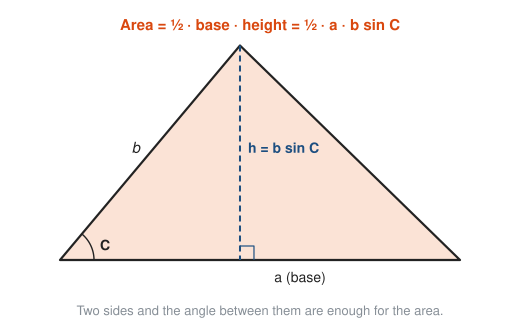
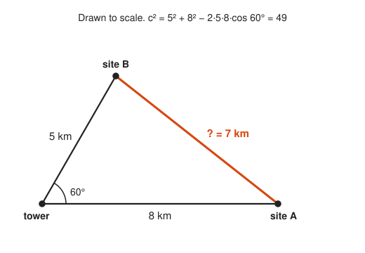

# Laws of Sines and Cosines

**Level:** 301 · **Unit:** 9 · **Time:** 60 to 90 minutes
**Prerequisites:** [Right-Triangle Trigonometry](../06-right-triangle-trigonometry/README.md), obtuse-angle values from [The Unit Circle and Radians](../07-unit-circle-and-radians/README.md)

## The Big Idea

SOH CAH TOA needs a right angle. Most triangles in the wild do not have one: two radio towers and a fire, two hikers and their camp, three cities on a map. Two laws handle every triangle. The **law of cosines** is Pythagoras with a correction term. The **law of sines** says each side is proportional to the sine of the angle across from it. Together they solve any triangle from three pieces of information, as long as one of the pieces is a side.

## Picture It

<!-- diagram: type=triangle vertices=A,B,C sides=a,b,c height=h-from-C caption="Standard labels for any triangle" -->


The labels follow one rule: lowercase side $a$ sits across from uppercase angle $A$, and so on. The dashed height splits the triangle into two right triangles, and that split is the whole proof of the law of sines.

## Step by Step

### 1. The Law of Sines

$$\frac{a}{\sin A} = \frac{b}{\sin B} = \frac{c}{\sin C}.$$

Why it is true: drop the height $h$ from $C$. In the left right triangle, $\sin A = \frac{h}{b}$, so $h = b\sin A$. In the right one, $\sin B = \frac{h}{a}$, so $h = a\sin B$. Both equal $h$:

$$b \sin A = a \sin B \quad \Longrightarrow \quad \frac{a}{\sin A} = \frac{b}{\sin B}.$$

Drop a height from another vertex to bring in $c$.

Use it when you know an angle and the side across from it, plus one more piece.

### 2. The Law of Cosines

$$c^2 = a^2 + b^2 - 2ab\cos C.$$

Why it is true: put $C$ at the origin and side $a$ along the x-axis, so $B = (a, 0)$. The unit circle puts $A$ at $(b\cos C,\ b\sin C)$. The distance formula gives

$$c^2 = (b\cos C - a)^2 + (b\sin C)^2 = b^2(\cos^2 C + \sin^2 C) - 2ab\cos C + a^2,$$

and the Pythagorean identity turns the bracket into 1.

Look at the correction term $-2ab\cos C$:

<!-- diagram: type=triangles a=4 b=4 C=60,90,120 caption="The law of cosines extends Pythagoras" -->


* $C < 90°$: $\cos C > 0$, the correction subtracts, and $c$ is shorter than Pythagoras predicts.
* $C = 90°$: $\cos C = 0$, and the law of cosines **is** Pythagoras.
* $C > 90°$: $\cos C < 0$, the correction adds, and $c$ is longer.

Use it when you know two sides and the angle between them (SAS), or all three sides (SSS).

### 3. Which Law When

Name the case by what you know, reading around the triangle: S for a side, A for an angle.

<!-- diagram: type=flowchart cases=SAS,SSS,ASA/AAS,SSA caption="Choosing a law" -->


Three angles alone (AAA) fix the shape but not the size: similar triangles of every size share them.

### 4. The Ambiguous Case (SSA)

Given two sides and an angle that is not between them, the third vertex lands in zero, one or two places:

<!-- diagram: type=construction A=30 b=10 a=6 caption="SSA can give two triangles" -->


Swing side $a$ from $C$ like a gate. If it is too short to reach the base line, there is no triangle. If it just touches, there is one right triangle. If it is long enough, it can cut the line twice, and both triangles are valid. The algebra shows it as two angles with the same sine: $\sin B = \sin(180° - B)$. Check whether the obtuse twin still leaves room in the $180°$ budget.

### 5. Area From Two Sides and an Angle

<!-- diagram: type=triangle area="1/2 ab sin C" height="b sin C" caption="Triangle area with sine" -->


$$\text{Area} = \tfrac{1}{2}ab\sin C.$$

It is the old "half base times height" with the height written as $b\sin C$.

## Worked Examples

### Example 1: SAS With the Law of Cosines

From a cell tower, site A is 8 km away and site B is 5 km away. The angle between the two directions is $60°$. How far apart are the sites?

<!-- diagram: type=triangle sides=8,5 angle=60 result=7 scale=true caption="Distance between two sites" -->


```txt
  c^2 = a^2 + b^2 - 2ab cos C        law of cosines, C is the angle at the tower
      = 5^2 + 8^2 - 2(5)(8) cos 60   substitute
      = 25 + 64 - 80(0.5)            cos 60 = 1/2
      = 49                           arithmetic
  c = 7 km                           square root
```

### Example 2: ASA With the Law of Sines

Two lookout towers 10 km apart spot a fire. From tower A the fire is $50°$ off the line between towers. From tower B it is $60°$. How far is the fire from each tower?

<!-- diagram: type=triangle base=10 angles=50,60 scale=true caption="Triangulating a fire" -->


```txt
  angle at fire = 180 - 50 - 60 = 70           angles of a triangle add to 180
  AF / sin 60 = 10 / sin 70                    side AF faces the 60 degree angle at B
  AF = 10 sin 60 / sin 70 = 9.216 km           multiply both sides by sin 60
  BF / sin 50 = 10 / sin 70                    side BF faces the 50 degree angle at A
  BF = 10 sin 50 / sin 70 = 8.152 km           multiply both sides by sin 50
```

This is how fire lookouts, surveyors and early navigation systems located things: measure two angles from a known baseline.

### Example 3: SSS, Find an Angle

A triangle has sides 7, 8 and 9. Find its largest angle.

```txt
  largest angle is across from the longest side, 9      call it C
  9^2 = 7^2 + 8^2 - 2(7)(8) cos C                       law of cosines
  81 = 113 - 112 cos C                                  arithmetic
  112 cos C = 32                                        rearrange
  cos C = 32/112 = 0.2857                               divide
  C = cos^-1(0.2857) = 73.40 degrees                    inverse cosine
```

### Example 4: The Ambiguous Case

$A = 30°$, $a = 6$, $b = 10$. Solve the triangle.

```txt
  sin B / 10 = sin 30 / 6               law of sines
  sin B = 10(0.5)/6 = 0.8333            arithmetic
  B = 56.44 or B = 180 - 56.44 = 123.56    two angles share this sine
  check 30 + 123.56 = 153.56 < 180      the obtuse one fits too: two triangles
  triangle 1: C = 93.56, c = 6 sin 93.56 / sin 30 = 11.98
  triangle 2: C = 26.44, c = 6 sin 26.44 / sin 30 = 5.34
```

### Example 5: Area

```txt
  Area = (1/2) a b sin C                 two sides and the included angle
       = (1/2)(5)(8) sin 60              the tower triangle from Example 1
       = 20 (sqrt3 / 2) = 10 sqrt3       exact
       = 17.32 square km                 decimal
```

## Common Mistakes

* Mismatching sides and angles: in the law of sines each side pairs with the angle across from it, never with an angle it touches.
* Forgetting the ambiguous case: in SSA, always test the obtuse twin $180° - B$.
* Using the law of sines to find an obtuse angle from SSS data: $\sin^{-1}$ only returns angles up to $90°$. Use the law of cosines for the largest angle, since $\cos^{-1}$ handles obtuse angles correctly.
* Calculator in radian mode when the problem is in degrees.
* Rounding intermediate angles too early, which drifts the final side lengths.

## Try It

1. $a = 7$, $b = 10$, $C = 45°$. Find $c$.
2. $A = 40°$, $B = 75°$, $c = 12$. Find $C$, $a$ and $b$.
3. A triangle has sides 5, 6 and 7. Find its largest angle.
4. Find the area of a triangle with sides 6 and 9 and an included angle of $30°$.
5. $A = 50°$, $a = 8$, $b = 6$. How many triangles are possible? Find $B$.
6. $A = 30°$, $a = 3$, $b = 10$. How many triangles are possible?
7. Two hikers leave camp on straight paths $110°$ apart. One walks 3 km, the other 4 km. How far apart are they?
8. Put $C = 90°$ in the law of cosines. What do you get?
9. Which law do you use first for SAS? For AAS?
10. Use the law of cosines to find an angle of an equilateral triangle with side 4.

<details>
<summary>Answers</summary>

1. $c^2 = 49 + 100 - 140\cos 45° \approx 50.0$, so $c \approx 7.07$.
2. $C = 65°$. $a = \frac{12\sin 40°}{\sin 65°} \approx 8.51$. $b = \frac{12\sin 75°}{\sin 65°} \approx 12.79$.
3. $\cos C = \frac{25 + 36 - 49}{60} = 0.2$, so $C \approx 78.46°$.
4. $\frac{1}{2}(6)(9)\sin 30° = 13.5$.
5. One. $\sin B = \frac{6\sin 50°}{8} \approx 0.5745$, $B \approx 35.07°$. The twin $144.93°$ plus $50°$ exceeds $180°$.
6. None. $\sin B = \frac{10 \cdot 0.5}{3} \approx 1.67 > 1$: side $a$ is too short to reach.
7. $\sqrt{9 + 16 - 24\cos 110°} \approx 5.76$ km.
8. $c^2 = a^2 + b^2$, the Pythagorean theorem, because $\cos 90° = 0$.
9. SAS: law of cosines. AAS: law of sines (find the third angle first).
10. $\cos C = \frac{16 + 16 - 16}{32} = \frac{1}{2}$, so $C = 60°$.

</details>

## Code Corner

The program in [code/main.go](code/main.go) is a small triangle solver. The SSA function returns a slice of zero, one or two answers, which is exactly how the ambiguous case behaves. Run it with `go run main.go` inside the `code` folder.

```go
// ssa returns every possible angle B given angle A, its opposite side a,
// and side b. It returns zero, one or two angles.
func ssa(A, a, b float64) []float64 {
	s := b * math.Sin(rad(A)) / a
	if s > 1 {
		return nil // side a is too short to reach the base line
	}
	B1 := deg(math.Asin(s))
	out := []float64{B1}
	if B2 := 180 - B1; A+B2 < 180 && math.Abs(B2-B1) > 1e-9 {
		out = append(out, B2) // the obtuse twin also fits
	}
	return out
}
```

Output:

```txt
SAS 5, 8, 60°: c = 7.0000
SSS 7, 8, 9: angle opposite 9 = 73.40°
ASA towers: fire is 9.216 km from A and 8.152 km from B
SSA A=30° a=6 b=10: 2 triangle(s)  [B=56.44° C=93.56° c=11.977]  [B=123.56° C=26.44° c=5.344]
SSA A=50° a=8 b=6: 1 triangle(s)  [B=35.07° C=94.93° c=10.405]
SSA A=30° a=3 b=10: 0 triangle(s)
area with sides 5, 8 and 60° between: 17.3205
```

## Go Deeper

* [Math Is Fun: The Law of Sines](https://www.mathsisfun.com/algebra/trig-sine-law.html) and [The Law of Cosines](https://www.mathsisfun.com/algebra/trig-cosine-law.html): short pages with worked pictures.
* [Clark University: Euclid, Book II, Propositions 12 and 13](https://aleph0.clarku.edu/~djoyce/elements/bookII/bookII.html): the law of cosines in geometric form, 2,300 years before the cosine had a name.
* [Paul's Online Math Notes: Trig Cheat Sheet](https://tutorial.math.lamar.edu/pdf/Trig_Cheat_Sheet.pdf): both laws with the standard labeling.
* Track link: [Trigonometry track](../../../tracks/trigonometry/README.md).

**Next:** [Conic Sections](../10-conic-sections/README.md)
