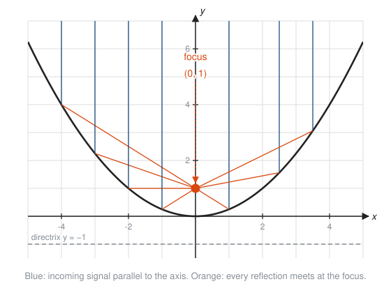

# Conic Sections

**Level:** 301 · **Unit:** 10 · **Time:** 75 to 100 minutes
**Prerequisites:** [Functions in Depth](../01-functions-in-depth/README.md), Pythagoras from [Right-Triangle Trigonometry](../06-right-triangle-trigonometry/README.md), the coordinate plane from [201 Algebra I and Geometry](../../201/README.md)

## The Big Idea

Slice a cone with a flat plane and four curves appear: the **circle**, the **ellipse**, the **parabola** and the **hyperbola**. The Greeks studied them as pure geometry around 200 BC. Two thousand years later they turned out to be the paths of planets and comets, the shape of satellite dishes and headlight mirrors, and the curves behind radio navigation. Each one has a one-line definition in terms of distance, and each definition turns into an equation through the Pythagorean theorem.

## Picture It

<!-- diagram: type=cone-slices planes=horizontal,tilted,parallel-to-side,steep caption="Four ways to slice a double cone" -->


Tilt the knife a little from flat and the circle stretches into an ellipse. Tilt it until it matches the slope of the cone and the curve never closes: a parabola. Tilt further and the plane cuts both cones, giving the two branches of a hyperbola.

## Step by Step

### 1. The Distance Formula

Every conic is defined by distances. The distance between $(x_1, y_1)$ and $(x_2, y_2)$ is Pythagoras on the horizontal and vertical gaps:

$$d = \sqrt{(x_2 - x_1)^2 + (y_2 - y_1)^2}.$$

### 2. The Circle

A **circle** is every point at distance $r$ from a center $(h, k)$.

<!-- diagram: type=circle center=(2,1) r=3 point=P triangle=true caption="A circle from the distance formula" -->


Write "distance to center equals $r$" and square both sides:

$$(x - h)^2 + (y - k)^2 = r^2.$$

The signs look backwards, the same as the shift rule from lesson one: $(x - 2)$ means the center is at $x = +2$.

### 3. Completing the Square

Equations often arrive expanded, like $x^2 + y^2 - 6x + 4y - 12 = 0$. To find the center, rebuild the perfect squares:

<!-- diagram: type=algebra-tiles expr="x^2+6x" add=9 caption="Completing the square with tiles" -->


Take half the coefficient of $x$, square it, add it, and subtract it back out. The same move gives the vertex of any parabola and the center of any conic.

### 4. The Parabola

A **parabola** is every point the same distance from a fixed point (the **focus**) and a fixed line (the **directrix**). With the vertex at the origin, the focus at $(0, p)$ and the directrix $y = -p$:

$$x^2 = 4py.$$

The parabola $y = \frac{x^2}{4}$ from the four-conics picture below has $4p = 4$, so its focus is $(0, 1)$.

Its famous property: rays coming in parallel to the axis all reflect through the focus.

<!-- diagram: type=parabola-reflector f="x^2/4" focus=(0,1) rays=7 caption="Why satellite dishes are parabolas" -->


Run it backwards and a bulb at the focus makes a parallel beam: car headlights and flashlights. Run it forwards and a weak signal from a satellite concentrates on a receiver at the focus.

### 5. The Ellipse

An **ellipse** is every point whose distances to two foci **add** to a constant $2a$. Pin two tacks in a board, loop a string around them, and trace with a pencil held taut: the string length never changes, and out comes an ellipse.

$$\frac{x^2}{a^2} + \frac{y^2}{b^2} = 1, \qquad c^2 = a^2 - b^2.$$

<!-- diagram: type=ellipse a=5 b=3 c=4 triangle=true caption="Ellipse anatomy" -->


* $a$: half the long width (**semi-major axis**). The **vertices** are at $(\pm a, 0)$.
* $b$: half the short width (**semi-minor axis**).
* $c$: distance from the center to each focus.

Why $c^2 = a^2 - b^2$: from the top point $(0, b)$, both foci are equally far, and the two distances add to $2a$. Each is $a$. Pythagoras on the triangle with legs $b$ and $c$ finishes it. Planets orbit the Sun on ellipses with the Sun at one focus (Kepler, 1609).

### 6. The Hyperbola

A **hyperbola** is every point whose distances to two foci **differ** by a constant $2a$:

$$\frac{x^2}{a^2} - \frac{y^2}{b^2} = 1, \qquad c^2 = a^2 + b^2, \qquad \text{asymptotes } y = \pm\frac{b}{a}x.$$

Far from the center, the two branches straighten out along the asymptotes. Radio navigation used this: if two transmitters send a pulse at the same moment and you hear one 0.1 ms before the other, you know the difference of your distances to them, so you are somewhere on one hyperbola. A third transmitter gives a second hyperbola, and the crossing is your position.

### 7. All Four Together

<!-- diagram: type=small-multiples conics="x^2+y^2=9 | x^2/25+y^2/9=1 | y=x^2/4 | x^2/9-y^2/16=1" caption="The four conics from their equations" -->
![Four graphs. Circle: x squared plus y squared equals 9, radius 3. Ellipse: x squared over 25 plus y squared over 9 equals 1, foci at plus and minus 4, a point P with segments to both foci and the note PF1 plus PF2 equals 10 for every P. Parabola: y equals x squared over 4 with focus 0, 1, dashed directrix y equals negative 1, and the point P 4, 4 at distance 5 from both. Hyperbola: x squared over 9 minus y squared over 16 equals 1 with foci at plus and minus 5, dashed asymptotes y equals plus and minus 4x over 3, and the note PF1 minus PF2 in absolute value equals 6.](img/four-conics.svg)

### 8. Identifying a Conic From Its Equation

For $Ax^2 + Cy^2 + Dx + Ey + F = 0$ (no $xy$ term):

| Squared terms | Conic |
|---|---|
| only one of $x^2$, $y^2$ appears | parabola |
| both, same sign, equal coefficients | circle |
| both, same sign, different coefficients | ellipse |
| both, opposite signs | hyperbola |

## Worked Examples

### Example 1: Write a Circle

Center $(2, -1)$, radius 3.

```txt
  (x - h)^2 + (y - k)^2 = r^2       circle form
  (x - 2)^2 + (y - (-1))^2 = 3^2    substitute h = 2, k = -1, r = 3
  (x - 2)^2 + (y + 1)^2 = 9         simplify
```

### Example 2: Find the Center by Completing the Square

$x^2 + y^2 - 6x + 4y - 12 = 0$.

```txt
  (x^2 - 6x) + (y^2 + 4y) = 12              group, move the constant
  (x^2 - 6x + 9) + (y^2 + 4y + 4) = 12 + 9 + 4   half of -6 is -3, squared 9; half of 4 is 2, squared 4
  (x - 3)^2 + (y + 2)^2 = 25                 factor the perfect squares
  center (3, -2), radius 5                   read off
```

### Example 3: Parabola Focus and Directrix

$x^2 = 8y$.

```txt
  4p = 8                  match x^2 = 4py
  p = 2                   divide by 4
  focus (0, 2)            focus at (0, p)
  directrix y = -2        line y = -p
  check point (4, 2): to focus sqrt(16 + 0) = 4, to directrix 2 + 2 = 4   equal
```

### Example 4: Ellipse

$\frac{x^2}{25} + \frac{y^2}{9} = 1$.

```txt
  a^2 = 25, b^2 = 9       larger denominator under x: wide ellipse
  a = 5, b = 3            square roots
  c^2 = 25 - 9 = 16       ellipse: c^2 = a^2 - b^2
  c = 4                   foci at (-4, 0) and (4, 0)
  vertices (-5, 0), (5, 0); co-vertices (0, -3), (0, 3)
```

### Example 5: Hyperbola

$\frac{x^2}{9} - \frac{y^2}{16} = 1$.

```txt
  a = 3, b = 4            square roots of 9 and 16
  c^2 = 9 + 16 = 25       hyperbola: c^2 = a^2 + b^2
  c = 5                   foci at (-5, 0) and (5, 0)
  vertices (-3, 0), (3, 0)
  asymptotes y = +-(4/3)x  slopes b/a
```

### Example 6: Identify and Rewrite

$4x^2 + 9y^2 = 36$.

```txt
  both squares, same sign, different coefficients     ellipse
  x^2/9 + y^2/4 = 1                                   divide every term by 36
  a = 3, b = 2, c = sqrt(9 - 4) = sqrt(5)             foci at (+-sqrt5, 0)
```

## See It Step by Step


[Completing the Square: open the step-by-step walkthrough](https://caseyaedwards.github.io/math_training/diagrams/completing-the-square/)

Watch the strip split in half and wrap around the square, leaving one small corner to add to both sides.


[Anatomy of a Parabola: open the step-by-step walkthrough](https://caseyaedwards.github.io/math_training/diagrams/parabola-anatomy/)

Watch the roots, the axis of symmetry and the vertex each appear from a different form of the same equation.

## Common Mistakes

* Center sign errors: $(x + 3)^2$ means $h = -3$.
* Forgetting to add the completed-square constants to both sides.
* Using the radius squared as the radius: $(x - 2)^2 + (y + 1)^2 = 9$ has radius 3, not 9.
* Mixing up the two $c$ rules: ellipse $c^2 = a^2 - b^2$ (foci inside, closer than the vertices); hyperbola $c^2 = a^2 + b^2$ (foci beyond the vertices).
* Assuming $a$ always goes with $x$: in an ellipse, $a$ is the larger denominator's root, wherever it sits.

## Try It

1. Write the circle with center $(-1, 4)$ and radius 2.
2. Find the center and radius of $x^2 + y^2 + 8x - 2y + 8 = 0$.
3. Find the focus and directrix of $y^2 = 12x$. (Same idea, opening sideways: $y^2 = 4px$.)
4. A dish has cross-section $y = \frac{x^2}{16}$. How far above the vertex does the receiver go?
5. Find the foci of $\frac{x^2}{169} + \frac{y^2}{25} = 1$.
6. An ellipse centered at the origin has vertices $(\pm 10, 0)$ and foci $(\pm 6, 0)$. Write its equation.
7. Find the foci and asymptotes of $\frac{x^2}{16} - \frac{y^2}{9} = 1$.
8. Identify each: $x^2 - y^2 = 1$; $y = 2x^2 + 3$; $2x^2 + 2y^2 = 8$; $x^2 + 4y^2 = 4$.
9. Find the distance between $(1, 2)$ and $(4, 6)$.
10. Is $(3, 4)$ on the circle $x^2 + y^2 = 25$?

<details>
<summary>Answers</summary>

1. $(x + 1)^2 + (y - 4)^2 = 4$.
2. $(x + 4)^2 + (y - 1)^2 = 16 + 1 - 8 = 9$: center $(-4, 1)$, radius 3.
3. $4p = 12$, $p = 3$: focus $(3, 0)$, directrix $x = -3$.
4. $x^2 = 16y$, $4p = 16$, $p = 4$: 4 units above the vertex.
5. $c^2 = 169 - 25 = 144$, $c = 12$: foci $(\pm 12, 0)$.
6. $b^2 = 100 - 36 = 64$: $\frac{x^2}{100} + \frac{y^2}{64} = 1$.
7. $c^2 = 16 + 9 = 25$: foci $(\pm 5, 0)$. Asymptotes $y = \pm\frac{3}{4}x$.
8. Hyperbola; parabola; circle; ellipse.
9. $\sqrt{3^2 + 4^2} = 5$.
10. Yes: $9 + 16 = 25$.

</details>

## Code Corner

The program in [code/main.go](code/main.go) completes the square for Example 2, checks the focus-directrix property of a parabola and the sum-of-distances property of an ellipse at several points, and classifies the equations from exercise 8. Run it with `go run main.go` inside the `code` folder.

```go
// classify uses the signs of A and C in Ax^2 + Cy^2 + ... = 0.
func classify(A, C float64) string {
	switch {
	case A == 0 || C == 0:
		return "parabola"
	case A == C:
		return "circle"
	case A*C > 0:
		return "ellipse"
	default:
		return "hyperbola"
	}
}
```

Output:

```txt
x²+y²-6x+4y-12=0: center (3, -2), radius 5
Parabola y = x²/4, focus (0,1), directrix y = -1:
  P(-4, 4): to focus 5.0000, to directrix 5.0000
  P(-1, 0.25): to focus 1.2500, to directrix 1.2500
  P(2, 1): to focus 2.0000, to directrix 2.0000
  P(6, 9): to focus 10.0000, to directrix 10.0000
Ellipse x²/25 + y²/9 = 1, foci (±4, 0):
  P( 5.000,  0.000): PF1 + PF2 = 10.0000
  P( 3.824,  1.933): PF1 + PF2 = 10.0000
  P(-2.081,  2.728): PF1 + PF2 = 10.0000
  P(-3.268, -2.270): PF1 + PF2 = 10.0000
x² - y² = 1    -> hyperbola
y = 2x² + 3    -> parabola
2x² + 2y² = 8  -> circle
x² + 4y² = 4   -> ellipse
```

The ellipse points come from $x = 5\cos t$, $y = 3\sin t$: the unit circle stretched by 5 sideways and 3 upward. That stretch is the whole relationship between circles and ellipses.

## Go Deeper

* [Wolfram MathWorld: Conic Section](https://mathworld.wolfram.com/ConicSection.html): definitions, pictures and the general second-degree equation.
* [Math Is Fun: Conic Sections](https://www.mathsisfun.com/geometry/conic-sections.html): a quick visual tour.
* [Paul's Online Math Notes: Algebra](https://tutorial.math.lamar.edu/Classes/Alg/Alg.aspx): the Common Graphs chapter covers circles, ellipses, parabolas and hyperbolas.
* [MacTutor: Apollonius of Perga](https://mathshistory.st-andrews.ac.uk/Biographies/Apollonius/): the Greek who named all four curves.
* Track link: [Geometry track](../../../tracks/geometry/README.md).

**Next:** [Sequences and Series](../11-sequences-and-series/README.md)
