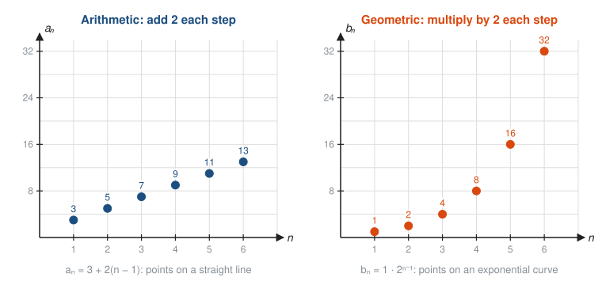
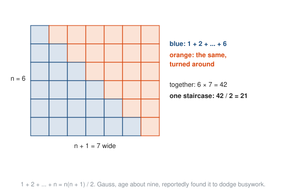
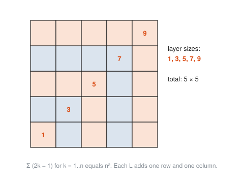

# Sequences and Series

**Level:** 301 · **Unit:** 11 · **Time:** 75 to 100 minutes
**Prerequisites:** [Exponential Functions](../04-exponential-functions/README.md), linear functions from [201 Algebra I and Geometry](../../201/README.md)

## The Big Idea

A **sequence** is a list of numbers in order: $a_1, a_2, a_3, \dots$. Think of an array indexed from 1, or the values a loop produces one iteration at a time. A **series** is what you get when you add the terms up. Two kinds of sequence cover most practical cases: **arithmetic** (add the same amount each step) and **geometric** (multiply by the same factor each step). Both have short formulas for their sums. The geometric one leads somewhere strange: adding infinitely many numbers and getting a finite answer. That is the doorway to calculus.

## Picture It

<!-- diagram: type=dot-plot panels=2 left="3+2(n-1)" right="2^(n-1)" n=1..6 caption="Arithmetic versus geometric" -->


Arithmetic sequences are linear functions sampled at whole numbers. Geometric sequences are exponential functions sampled at whole numbers. Everything from lessons four and five carries over.

## Step by Step

### 1. Two Ways to Describe a Sequence

* **Explicit:** a formula for the $n$th term, such as $a_n = 2n + 1$. Random access: jump straight to $a_{100}$.
* **Recursive:** a starting term plus a rule for the next one, such as $a_1 = 3$, $a_{n+1} = a_n + 2$. Sequential access: like a loop that updates a variable.

### 2. Arithmetic Sequences

Each term adds the **common difference** $d$:

$$a_n = a_1 + (n - 1)d.$$

The $(n - 1)$ is there because the first term has had zero steps added. Off-by-one errors are not only a programming hazard.

### 3. The Arithmetic Sum

<!-- diagram: type=staircase n=6 caption="Two staircases make a rectangle" -->


Write the sum forwards and backwards, and add. Every column pairs a small term with a large one and gives the same total, $a_1 + a_n$. There are $n$ columns, and you counted everything twice:

$$S_n = \frac{n(a_1 + a_n)}{2}.$$

In words: the number of terms times the average of the first and last.

### 4. Geometric Sequences

Each term multiplies by the **common ratio** $r$:

$$a_n = a_1 r^{n - 1}.$$

### 5. The Geometric Sum

$$S_n = a_1 \cdot \frac{1 - r^n}{1 - r} \quad (r \ne 1).$$

Why: write $S = a_1 + a_1 r + \dots + a_1 r^{n-1}$. Multiply by $r$: $rS = a_1 r + \dots + a_1 r^n$. Subtract. Everything in the middle cancels, like a telescope collapsing:

$$S - rS = a_1 - a_1 r^n \quad \Longrightarrow \quad S = \frac{a_1(1 - r^n)}{1 - r}.$$

The backoff total $1 + 2 + 4 + \dots + 2^{k-1} = 2^k - 1$ from lesson four is this formula with $a_1 = 1$, $r = 2$.

### 6. Sigma Notation

Mathematicians write long sums with the Greek capital sigma, $\Sigma$, for sum:

<!-- diagram: type=annotated-formula expr="sum_{k=1}^{5} (2k-1)" caption="Reading sigma notation" -->


$\sum_{k=1}^{5}(2k - 1)$ is the same as this Go loop:

```go
sum := 0
for k := 1; k <= 5; k++ {
	sum += 2*k - 1
}
```

The answer 25 is no accident. The first $n$ odd numbers always add to $n^2$:

<!-- diagram: type=gnomons n=5 caption="Odd numbers build squares" -->


### 7. Infinite Geometric Series

Cut a square in half, then cut the remaining half in half, and keep going:

<!-- diagram: type=halving-square terms=1/2,1/4,1/8,1/16,1/32,1/64 caption="Halves filling a whole" -->


The pieces never run out, but they never spill past the square either. The total is exactly 1. In general, when $|r| < 1$ the term $r^n$ in the sum formula shrinks to 0, and

$$\sum_{n=1}^{\infty} a_1 r^{n-1} = \frac{a_1}{1 - r}, \qquad |r| < 1.$$

When $|r| \ge 1$ the terms do not shrink and the sum grows without bound: the series **diverges**.

### 8. Shrinking Terms Are Not Enough

<!-- diagram: type=dot-plot series="sum 1/2^k, sum 1/k" n=1..20 caption="Converging and diverging partial sums" -->


The **harmonic series** $1 + \frac{1}{2} + \frac{1}{3} + \frac{1}{4} + \dots$ has terms that shrink to zero, yet its sum grows past any number you name. It just grows slowly: you need about 12,000 terms to pass 10. A series converges only if its terms shrink fast enough. Calculus makes "fast enough" precise; see the series lesson in [401 Calculus](../../401/README.md).

## Worked Examples

### Example 1: Arithmetic Term and Sum

Sequence 7, 11, 15, .... Find $a_{20}$ and the sum of the first 20 terms.

```txt
  a1 = 7, d = 11 - 7 = 4             first term and common difference
  a20 = 7 + (20 - 1)(4)              a_n = a1 + (n - 1)d
      = 7 + 76 = 83                  arithmetic
  S20 = 20(7 + 83) / 2               S_n = n(a1 + an)/2
      = 20(90) / 2 = 900             arithmetic
```

### Example 2: Geometric Term and Sum

Sequence 3, 6, 12, .... Find $a_8$ and the sum of the first 8 terms.

```txt
  a1 = 3, r = 6/3 = 2                first term and common ratio
  a8 = 3 * 2^7 = 3 * 128 = 384       a_n = a1 r^(n-1)
  S8 = 3(1 - 2^8)/(1 - 2)            geometric sum formula
     = 3(-255)/(-1) = 765            arithmetic
```

### Example 3: Evaluate a Sigma

```txt
  sum_{k=1}^{4} k^2
  = 1^2 + 2^2 + 3^2 + 4^2          plug in k = 1, 2, 3, 4
  = 1 + 4 + 9 + 16                 square
  = 30                             add
```

### Example 4: An Infinite Geometric Series

```txt
  8 + 4 + 2 + 1 + ...
  a1 = 8, r = 1/2                  each term is half the last
  |r| < 1                          the series converges
  sum = 8 / (1 - 1/2) = 16         a1 / (1 - r)
```

### Example 5: Why 0.999... Equals 1

```txt
  0.999... = 9/10 + 9/100 + 9/1000 + ...    place value as a series
  a1 = 9/10, r = 1/10                       each term is a tenth of the last
  sum = (9/10) / (1 - 1/10)                 a1 / (1 - r)
      = (9/10) / (9/10) = 1                 exactly 1, not "just under"
```

### Example 6: Growing an Array by Doubling

A dynamic array starts with room for 1 element and doubles its capacity whenever it fills, copying every element to the new space. How many copies happen while you append 1,024 elements?

```txt
  copies at each resize: 1, 2, 4, ..., 512      the old contents move each time
  total = 1 + 2 + ... + 512 = 2^10 - 1          geometric sum, a1 = 1, r = 2
        = 1,023 copies                          fewer than 1,024 appends
  average cost per append: about 1 copy          amortized O(1)
```

This geometric sum is why appending to a Go slice or a Python list is cheap on average, even though an individual append sometimes copies everything.

## Common Mistakes

* Off-by-one in the term formula: $a_n = a_1 + (n - 1)d$, not $a_1 + nd$.
* Using the infinite sum formula when $|r| \ge 1$: $1 + 2 + 4 + \dots$ does not equal $\frac{1}{1 - 2} = -1$. It diverges.
* Assuming that terms going to zero makes a series converge: the harmonic series is the counterexample.
* Confusing the ratio: for $12, 6, 3, \dots$, $r = \frac{1}{2}$, not $2$ and not $-6$.
* Miscounting terms: from $k = 3$ to $k = 10$ there are $10 - 3 + 1 = 8$ terms.

## Try It

1. Find the next three terms and an explicit formula: $5, 9, 13, \dots$
2. Find $a_{50}$ for $100, 97, 94, \dots$
3. Find $1 + 2 + 3 + \dots + 100$.
4. Find $a_6$ for the geometric sequence $2, 6, 18, \dots$
5. Find the sum of the first 10 terms of $1, 2, 4, 8, \dots$
6. Evaluate $\displaystyle\sum_{k=3}^{6} (k + 1)$. How many terms does it have?
7. Find $6 + 2 + \frac{2}{3} + \dots$
8. Does $1 + 1.1 + 1.21 + \dots$ converge? Why?
9. Write $0.333\dots$ as a fraction using a geometric series.
10. A retry policy waits 0.5 s before the first retry and doubles the wait each time, for 6 retries. What is the total waiting time?
11. List the first four terms of $a_1 = 2$, $a_{n+1} = 3a_n - 1$.

<details>
<summary>Answers</summary>

1. $17, 21, 25$; $a_n = 4n + 1$.
2. $100 + 49(-3) = -47$.
3. $\frac{100 \cdot 101}{2} = 5,050$.
4. $2 \cdot 3^5 = 486$.
5. $2^{10} - 1 = 1,023$.
6. Four terms: $4 + 5 + 6 + 7 = 22$.
7. $a_1 = 6$, $r = \frac{1}{3}$: $\frac{6}{1 - 1/3} = 9$.
8. No. $r = 1.1$, so $|r| \ge 1$ and the terms grow.
9. $\frac{3}{10} + \frac{3}{100} + \dots = \frac{3/10}{1 - 1/10} = \frac{1}{3}$.
10. $0.5(1 + 2 + 4 + 8 + 16 + 32) = 0.5 \cdot 63 = 31.5$ s.
11. $2, 5, 14, 41$.

</details>

## Code Corner

The program in [code/main.go](code/main.go) checks the sum formulas against plain loops, prints partial sums of $\frac{1}{2} + \frac{1}{4} + \dots$, and watches a real Go slice grow. Run it with `go run main.go` inside the `code` folder.

```go
var xs []int
last := -1
for i := 0; i < 2000; i++ {
	xs = append(xs, i)
	if cap(xs) != last {
		last = cap(xs)
		fmt.Print(" ", last)
	}
}
```

Output:

```txt
arithmetic: a20 = 83, loop sum = 900, formula = 900
geometric: first 8 terms sum to 765, formula = 765
  S_1  = 0.5000000000   gap to 1 = 5.00e-01
  S_2  = 0.7500000000   gap to 1 = 2.50e-01
  S_5  = 0.9687500000   gap to 1 = 3.12e-02
  S_10 = 0.9990234375   gap to 1 = 9.77e-04
  S_30 = 0.9999999991   gap to 1 = 9.31e-10
slice capacities while appending 2,000 ints: 4 8 16 32 64 128 256 512 848 1280 1792 2560
```

Each partial sum halves the gap to 1: a geometric sequence of gaps. The slice capacities double up to 512, then grow by a smaller factor, rounded to the memory allocator's size classes. The runtime trades a little more copying for less wasted memory on big slices. Either way the growth is geometric, and appends stay amortized constant time. The exact numbers depend on the Go version.

## Go Deeper

* [Math Is Fun: Sequences](https://www.mathsisfun.com/algebra/sequences-series.html): arithmetic and geometric sequences with sigma notation.
* [Paul's Online Math Notes: Calculus II](https://tutorial.math.lamar.edu/Classes/CalcII/CalcII.aspx): the Series and Sequences chapter, for when you want the next step.
* [MacTutor: Carl Friedrich Gauss](https://mathshistory.st-andrews.ac.uk/Biographies/Gauss/): the schoolboy sum, and much more.
* Track links: [Discrete Math track](../../../tracks/discrete-math/README.md), [Calculus track](../../../tracks/calculus/README.md).

**Next:** [Limits Preview](../12-limits-preview/README.md)
