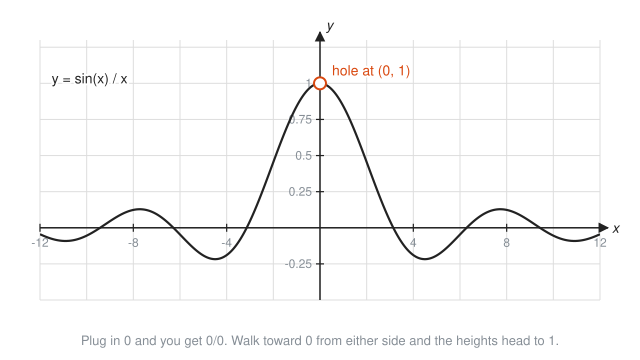
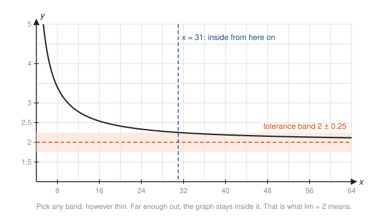
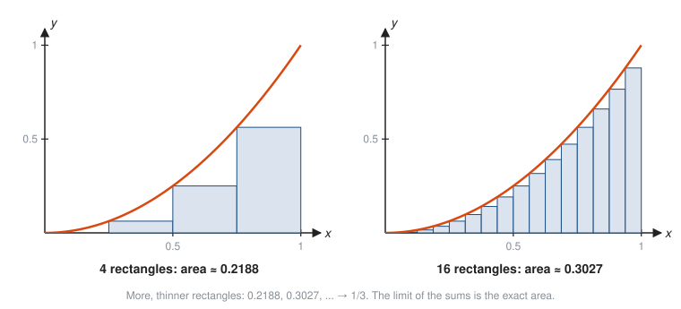

# Limits Preview

**Level:** 301 · **Unit:** 12 · **Time:** 60 to 90 minutes
**Prerequisites:** [Rational Functions](../03-rational-functions/README.md), [Exponential Functions](../04-exponential-functions/README.md), [Trig Graphs and Identities](../08-trig-graphs-and-identities/README.md), [Sequences and Series](../11-sequences-and-series/README.md)

## The Big Idea

You have already met limits several times without the name. A rational function hugs its asymptote. $\left(1 + \frac{1}{n}\right)^n$ creeps toward $e$. The halves $\frac{1}{2} + \frac{1}{4} + \dots$ fill a square. Each time, the question was the same: where is this heading, even if it never arrives? A **limit** is the precise name for that destination. This lesson gathers those examples, adds a few tools for computing limits, and shows the two problems that made limits necessary: the slope of a curve at a single point, and the area under a curve. Those two problems are calculus, and they are where [401 Calculus](../../401/README.md) starts.

## Picture It

<!-- diagram: type=function-plot f="sin(x)/x" x=-12..12 hole=(0,1) caption="A limit at a point where the function is undefined" -->


At $x = 0$ the formula gives $\frac{0}{0}$: no value at all. Yet the graph clearly heads for height 1 from both sides. We write

$$\lim_{x \to 0} \frac{\sin x}{x} = 1,$$

read as "the limit of $\frac{\sin x}{x}$ as $x$ approaches 0 is 1". The limit describes the approach, not the arrival.

## Step by Step

### 1. What a Limit Means

$\lim_{x \to a} f(x) = L$ means: you can make $f(x)$ as close to $L$ as you like by taking $x$ close enough to $a$, but not equal to $a$.

<!-- diagram: type=paired-number-lines map="x -> x^2" approach=2 target=4 caption="Inputs approach 2, outputs approach 4" -->


The value at $a$ itself is ignored. It can be missing, or it can be something else entirely:

<!-- diagram: type=small-multiples cases=continuous,hole-with-dot,jump at=2 caption="Three behaviors at a point" -->


* When the graph has no break at $a$, the limit equals $f(a)$. Such a function is **continuous** at $a$.
* A hole leaves the limit untouched, whatever the value at the point.
* A jump means the left side and right side head to different places. The **one-sided limits** disagree, and the limit does not exist.

### 2. Three Ways to Find a Limit

1. **Plug in.** If the function is continuous at $a$ (polynomials everywhere, rational functions away from zero denominators, sine, cosine, exponentials), the limit is just $f(a)$.
2. **Simplify, then plug in.** If plugging in gives $\frac{0}{0}$, there is often a hidden common factor. Cancel it, as with the holes in [Rational Functions](../03-rational-functions/README.md), then plug in.
3. **Make a table.** Evaluate at inputs closer and closer to $a$ from both sides and watch the outputs settle. Not a proof, but a good detector.

### 3. Limits at Infinity

$\lim_{x \to \infty} f(x) = L$ means $f(x)$ settles toward $L$ as $x$ grows without bound. Horizontal asymptotes are exactly these limits.

<!-- diagram: type=function-plot f="(2x+1)/(x-3)" x=4..64 band="2+-0.25" caption="A tolerance band around the limit" -->


This picture is the honest definition in disguise. Name any tolerance, however tight. There is a point past which the graph never leaves the band. It works like an SLO: set any error budget around the target, and the system eventually stays inside it for good. In 401 and [601 Proof and Higher Math](../../601/README.md) the tolerance gets the Greek letter $\varepsilon$ (epsilon).

The sequences from lesson eleven fit the same mold: $\lim_{n \to \infty} \left(\frac{1}{2}\right)^n = 0$, and an infinite series is the limit of its partial sums.

### 4. Why Calculus Needs Limits, Part 1: Slope at a Point

A slope needs two points. A curve's steepness at one point seems to need only one. The fix: take a second point $Q$ near $P$, compute the slope of the line through both (a **secant line**), and slide $Q$ toward $P$.

<!-- diagram: type=secants f="x^2" P=(1,1) Q-x=3,2,1.5 tangent-slope=2 caption="Secant lines approaching the tangent" -->


The secant slopes 4, 3, 2.5, 2.1, 2.01, ... head to 2. That limit is the slope of the **tangent line**, the instantaneous rate of change. In 401 it is called the **derivative**. It turns "average requests per second over the last minute" into "requests per second right now".

### 5. Why Calculus Needs Limits, Part 2: Area Under a Curve

Rectangles have easy areas. Curved regions do not. Fill the region with thin rectangles, add them up, and make them thinner:

<!-- diagram: type=riemann f="x^2" interval=0..1 n=4,16 caption="Rectangles approaching an area" -->


The limit of the rectangle sums is the exact area, $\frac{1}{3}$. In 401 this limit is called the **integral**. It turns "requests per second at each instant" back into "total requests served".

## Worked Examples

### Example 1: Plug In

```txt
  lim_{x->3} (2x + 1)
  2x + 1 is a polynomial: continuous everywhere
  = 2(3) + 1 = 7                          plug in
```

### Example 2: Simplify First

```txt
  lim_{x->1} (x^2 - 1)/(x - 1)
  plug in: (1 - 1)/(1 - 1) = 0/0            no information yet
  = lim_{x->1} (x - 1)(x + 1)/(x - 1)       factor the top
  = lim_{x->1} (x + 1)                      cancel; allowed since x != 1 on the way in
  = 2                                       plug in
```

The table in the Code Corner agrees: 1.9, 1.99, 1.999 from the left and 2.1, 2.01, 2.001 from the right.

### Example 3: A Table for $\frac{\sin x}{x}$

```txt
  x (radians)    sin x / x
  0.1            0.998334
  0.01           0.999983
  0.001          1.000000 (to 6 places)
  same values for -x, since sin(-x)/(-x) = sin x / x
  lim_{x->0} sin x / x = 1
```

This only works in radians. In degrees the ratio heads to $\frac{\pi}{180} \approx 0.01745$ instead. That is the deepest reason calculus uses radians: they make this limit exactly 1.

### Example 4: A Limit at Infinity

```txt
  lim_{x->oo} (2x + 1)/(x - 3)
  = lim (2 + 1/x)/(1 - 3/x)          divide top and bottom by x
  = (2 + 0)/(1 - 0)                  1/x and 3/x shrink to 0
  = 2                                the horizontal asymptote
```

### Example 5: Slope of the Tangent to $y = x^2$ at $x = 1$

```txt
  secant slope from x = 1 to x = 1 + h:
  ((1 + h)^2 - 1^2) / h              rise over run
  = (1 + 2h + h^2 - 1) / h           expand
  = (2h + h^2) / h                   simplify the top
  = 2 + h                            cancel h (h != 0)
  lim_{h->0} (2 + h) = 2             let the second point slide in
```

### Example 6: One-Sided Limits That Disagree

```txt
  f(x) = |x| / x
  x > 0: |x| = x,  f(x) = 1          right of 0
  x < 0: |x| = -x, f(x) = -1         left of 0
  lim from the right = 1, lim from the left = -1
  the two sides disagree: lim_{x->0} f(x) does not exist
```

## See It Step by Step


[Limits: The Epsilon-Delta Picture: open the step-by-step walkthrough](https://caseyaedwards.github.io/math_training/diagrams/epsilon-delta/)

Watch the window around c shrink to keep the graph inside each thinner band around L.


[Secant Lines to a Tangent Line: open the step-by-step walkthrough](https://caseyaedwards.github.io/math_training/diagrams/secant-to-tangent/)

Watch the secant slopes close in on the tangent slope as the second point slides toward the first.


[Riemann Sums: Area from Rectangles: open the step-by-step walkthrough](https://caseyaedwards.github.io/math_training/diagrams/riemann-sum/)

Watch the rectangles get thinner and their total area close in on the exact area under the curve.

## Common Mistakes

* Thinking the limit is the value at the point: the hole-with-dot picture has limit 3 and value 1.
* Stopping at $\frac{0}{0}$ and calling it 0 or 1 or undefined: $\frac{0}{0}$ means "more work needed", not an answer.
* Checking only one side: a limit exists only when both one-sided limits exist and agree.
* Trusting a table blindly: floating-point round-off ruins tables when $h$ gets tiny (try $h = 10^{-12}$ on the secant slope). Tables suggest; algebra proves.
* Treating $\infty$ as a number: $\lim_{x \to \infty}$ describes growth without bound. You cannot plug $\infty$ in.

## Try It

1. Find $\lim_{x \to 2} (x^2 + 3)$.
2. Find $\lim_{x \to -2} \dfrac{x^2 - 4}{x + 2}$.
3. Find $\lim_{x \to 5} \dfrac{x - 5}{x^2 - 25}$.
4. Find $\lim_{x \to \infty} \dfrac{3x^2 - 1}{x^2 + 4}$.
5. Find $\lim_{x \to \infty} \dfrac{5}{x}$.
6. Write the secant slope of $y = x^2$ from $x = 3$ to $x = 3 + h$, simplify, and find its limit as $h \to 0$.
7. Does $\lim_{x \to 0} \frac{1}{x}$ exist? Describe each side.
8. Find $\lim_{n \to \infty} \left(\frac{1}{2}\right)^n$.
9. Use $\frac{\sin 3x}{x} = 3 \cdot \frac{\sin 3x}{3x}$ to find $\lim_{x \to 0} \frac{\sin 3x}{x}$.
10. Estimate the area under $y = x$ from 0 to 1 using 4 left rectangles. What is the exact area?

<details>
<summary>Answers</summary>

1. $7$: plug in.
2. $-4$: factor to $\frac{(x - 2)(x + 2)}{x + 2} = x - 2$, then plug in $-2$.
3. $\frac{1}{10}$: factor to $\frac{1}{x + 5}$, then plug in 5.
4. $3$: divide top and bottom by $x^2$, or compare leading coefficients.
5. $0$.
6. $\frac{(3 + h)^2 - 9}{h} = \frac{6h + h^2}{h} = 6 + h \to 6$.
7. No. From the right, $\frac{1}{x}$ grows to $+\infty$. From the left, it falls to $-\infty$.
8. $0$.
9. As $x \to 0$, $3x \to 0$ too, so $\frac{\sin 3x}{3x} \to 1$. The limit is $3$.
10. Heights 0, 0.25, 0.5, 0.75, each width 0.25: $0.25 \cdot 1.5 = 0.375$. The exact area is a triangle, $\frac{1}{2}$.

</details>

## Code Corner

The program in [code/main.go](code/main.go) approaches each limit in this lesson numerically: a hole, $\frac{\sin x}{x}$ in radians and in degrees, secant slopes, and rectangle sums. Run it with `go run main.go` inside the `code` folder.

```go
for _, n := range []int{4, 16, 100, 10000} {
	sum := 0.0
	w := 1 / float64(n)
	for k := 0; k < n; k++ {
		x := float64(k) * w
		sum += x * x * w
	}
	fmt.Printf("  n = %-6d area ≈ %.6f\n", n, sum)
}
```

Output:

```txt
(x²-1)/(x-1) near x = 1 (undefined AT 1):
  x = 0.9    -> 1.9000
  x = 1.1    -> 2.1000
  x = 0.99   -> 1.9900
  x = 1.01   -> 2.0100
  x = 0.999  -> 1.9990
  x = 1.001  -> 2.0010
sin(x)/x near 0, x in radians, then x in degrees:
  x = 0.1    radians: 0.998334   degrees: 0.017453
  x = 0.01   radians: 0.999983   degrees: 0.017453
  x = 0.001  radians: 1.000000   degrees: 0.017453
  (π/180 = 0.017453)
secant slopes of y = x² from x = 1 to x = 1 + h:
  h = 1      slope = 3.0000
  h = 0.5    slope = 2.5000
  h = 0.1    slope = 2.1000
  h = 0.01   slope = 2.0100
  h = 0.001  slope = 2.0010
left rectangle sums for the area under y = x² on [0, 1]:
  n = 4      area ≈ 0.218750
  n = 16     area ≈ 0.302734
  n = 100    area ≈ 0.328350
  n = 10000  area ≈ 0.333283
  exact: 1/3 ≈ 0.333333
```

Every block is a sequence of approximations closing in on a number the program never computes directly. That is a limit, run as a loop. Calculus is the art of finding the destination without running the loop forever.

## Go Deeper

* [Paul's Online Math Notes: Calculus I](https://tutorial.math.lamar.edu/Classes/CalcI/CalcI.aspx): the Limits chapter is the natural next read.
* [Better Explained: An Intuitive Introduction to Limits](https://betterexplained.com/articles/an-intuitive-introduction-to-limits/): limits as a plain-language contract.
* [Math Is Fun: Limits](https://www.mathsisfun.com/calculus/limits.html): tables and pictures, gently.
* [MIT OpenCourseWare: Single Variable Calculus](https://ocw.mit.edu/courses/18-01sc-single-variable-calculus-fall-2010/): full lectures, when you are ready.
* Next level: [401 Calculus](../../401/README.md). Workshop link: [Calculus of Rates in Physics and Queues](../../../workshops/calculus-of-rates-in-physics-and-queues/README.md).

**Next:** the [301 Checkpoint](../checkpoint.md), then [401 Calculus](../../401/README.md).
