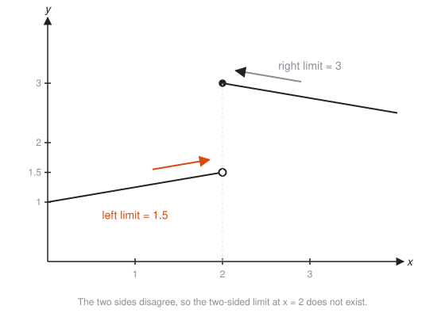
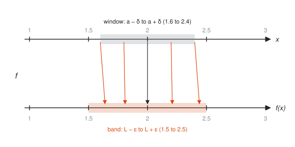
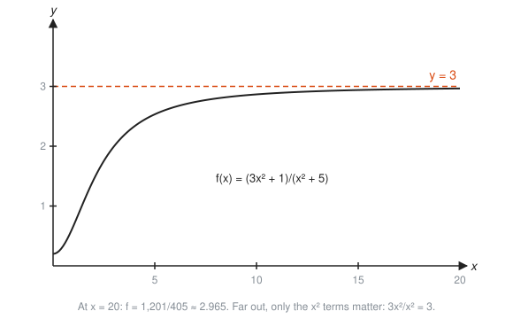
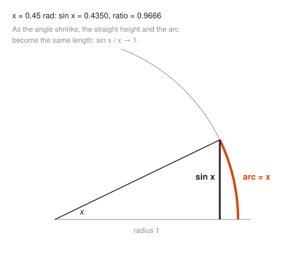
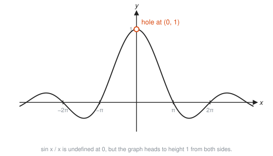

# Limits and Continuity

**Level:** 401 · **Unit:** 1 · **Time:** 60 to 75 minutes
**Prerequisites:** [301 Algebra II, Trig and Precalculus](../../301/README.md), especially functions, graphs, and factoring

## The Big Idea

A **limit** asks one question: as the input $x$ gets closer and closer to some number $a$, what value does the output $f(x)$ head toward? The answer ignores what happens exactly at $a$. Only the neighborhood counts.

A function is **continuous** at $a$ when there is no surprise: the value the graph heads toward is the value it actually has. You can draw it without lifting the pen.

Every idea in calculus, from slopes to areas to series, is a limit underneath. Learn this one well and the rest is bookkeeping.

## Picture It

<!-- diagram: type=function-plot f="(x^2-1)/(x-1)" range=0..2 hole=1,2 approach=left:0.5,0.8,0.9,0.95 right:1.5,1.2,1.1,1.05 caption="Approaching the hole from both sides" -->


The formula $f(x) = \dfrac{x^2 - 1}{x - 1}$ breaks at $x = 1$: it gives $0/0$. The graph has a hole there. Walk toward the hole from the left (orange dots) and from the right (gray dots). The heights crowd toward 2 from both sides. That shared target, 2, is the limit. The hole does not matter. Only the approach does.

## Step by Step

### 1. Approach With a Table

Plug in numbers that sneak up on 1:

```txt
x         0.9     0.99    0.999   |   1.001   1.01    1.1
f(x)      1.9     1.99    1.999   |   2.001   2.01    2.1
```

From both sides the outputs crowd toward 2. Write it as:

$$\lim_{x \to 1} \frac{x^2 - 1}{x - 1} = 2.$$

Read it aloud as "the limit, as $x$ goes to 1, of $f(x)$ is 2."

### 2. Explain the Table With Algebra

For $x \ne 1$, factor and cancel: $\dfrac{(x-1)(x+1)}{x-1} = x + 1$. The graph is the line $y = x + 1$ with one point punched out. The limit reads the height of the hole: $1 + 1 = 2$.

### 3. One-Sided Limits

$\lim_{x \to a^-}$ means "approach from the left" (inputs a bit less than $a$). $\lim_{x \to a^+}$ means "approach from the right". The ordinary two-sided limit exists only when both sides exist and agree.

<!-- diagram: type=function-plot pieces="1+x/4 on x<2; 3-(x-2)/4 on x>=2" marks=2 caption="Left and right limits that disagree" -->


Here the left side heads for 1.5 and the right side heads for 3. They disagree, and the two-sided limit at $x = 2$ does not exist. Two witnesses with different stories: no verdict.

### 4. The Precise Definition: A Challenge Game

"Gets closer and closer" is vague. Mathematicians fixed that with two Greek letters:

* $\varepsilon$ (epsilon) is a small allowed error in the **output**.
* $\delta$ (delta) is a small allowed distance in the **input**.

<!-- diagram: type=function-plot f="x^2/4+1" range=0..4 marks=2 band-y="1.5..2.5" band-x="1.6..2.4" caption="Epsilon band around L, delta window around a" -->


Treat it as a game. A skeptic draws the orange band: "Stay within $\varepsilon$ of $L$." You answer with the gray window: "Keep $x$ within $\delta$ of $a$." If every point of the curve inside the gray window also sits inside the orange band, you win the round. The limit equals $L$ when you can win **every** round, however thin the skeptic makes the band.

In symbols: $\lim_{x \to a} f(x) = L$ means for every $\varepsilon > 0$ there is a $\delta > 0$ such that

$$0 < |x - a| < \delta \implies |f(x) - L| < \varepsilon.$$

The $0 <$ part excludes the point $x = a$ itself. The same game, drawn as two number lines:

<!-- diagram: type=mapping top="x: 1..3 window 1.6..2.4" bottom="f(x): 1..3 band 1.5..2.5" arrows=1.6,1.8,2,2.2,2.4 caption="Every x in the window lands in the band" -->


Every input in the gray window maps to an output inside the orange band. That is all the definition says.

### 5. Limit Laws

When the separate limits exist, limits pass through sums, differences, products, constant multiples, and quotients (as long as the bottom limit is not 0). For polynomials and other well-behaved functions, the limit at $a$ is plain substitution: $\lim_{x\to 2}(x^3 - x) = 8 - 2 = 6$. Most limits are this boring. The interesting ones give $0/0$.

### 6. Continuity

$f$ is continuous at $a$ when three things hold:

1. $f(a)$ exists.
2. $\lim_{x\to a} f(x)$ exists.
3. They are equal.

Polynomials, $\sin$, $\cos$, $e^x$, and $\ln x$ (for $x > 0$) are continuous everywhere they are defined. There are three classic ways to fail:

<!-- diagram: type=multi-panel panels="hole,jump,asymptote" caption="Removable, jump, and infinite discontinuities" -->


* **Removable (hole):** the limit exists, but $f(a)$ is missing or wrong. Redefine one point to fix it.
* **Jump:** the left and right limits exist but differ.
* **Infinite:** the values grow without bound near $a$. The graph has a vertical **asymptote** (a line the graph hugs but never reaches).

### 7. Limits at Infinity

$\lim_{x \to \infty} f(x) = L$ asks where the graph levels off far to the right. The trick: divide top and bottom by the highest power of $x$. Terms like $1/x$ and $1/x^2$ shrink to 0.

<!-- diagram: type=function-plot f="(3x^2+1)/(x^2+5)" range=0..20 asymptote=y:3 caption="Leveling off at a horizontal asymptote" -->


### 8. The Intermediate Value Theorem

If $f$ is continuous on $[a, b]$ and $f(a)$ and $f(b)$ have opposite signs, then $f$ crosses zero somewhere between. A continuous graph cannot teleport over the axis. Halving the interval again and again (**bisection**) closes in on the crossing.

<!-- diagram: type=function-plot f="x^3+x-1" range=-0.2..1.2 root=0.6823 bisection=5 caption="A sign change forces a root, and bisection finds it" -->


### 9. A Famous Limit

$\lim_{x \to 0} \dfrac{\sin x}{x} = 1$, with $x$ in radians. You can see it two ways.

<!-- diagram: type=unit-circle angle=0.45 show=arc,sine caption="Small arc and its height are nearly equal" -->


On a circle of radius 1, an angle of $x$ radians cuts off an arc of length exactly $x$. The vertical height to that point is $\sin x$. For a small angle the arc is almost straight, and the two lengths nearly match.

<!-- diagram: type=function-plot f="sin(x)/x" range=-10..10 hole=0,1 caption="sin x / x has a hole at height 1" -->


The graph has a hole at $x = 0$ (division by zero), but both sides head to height 1. This limit powers the derivative of $\sin$ in [Lesson 03](../03-derivative-rules/README.md).

## Worked Examples

### Example 1: Factor and Cancel

Find $\lim_{x \to 3} \dfrac{x^2 - 9}{x - 3}$.

```txt
  (x^2 - 9)/(x - 3)                    substitution gives 0/0: simplify first
= (x - 3)(x + 3)/(x - 3)               difference of squares
= x + 3            for x != 3          cancel the common factor
  limit as x -> 3 of (x + 3) = 6       substitute into the simplified form
```

### Example 2: Rationalize a Square Root

Find $\lim_{x \to 0} \dfrac{\sqrt{x + 4} - 2}{x}$.

```txt
  (sqrt(x+4) - 2)/x                                 0/0 at x = 0
= (sqrt(x+4) - 2)(sqrt(x+4) + 2) / (x (sqrt(x+4) + 2))   multiply top and bottom by the conjugate
= ((x + 4) - 4) / (x (sqrt(x+4) + 2))               (A - B)(A + B) = A^2 - B^2
= x / (x (sqrt(x+4) + 2))                           simplify the top
= 1 / (sqrt(x+4) + 2)          for x != 0           cancel x
  limit = 1/(2 + 2) = 1/4                           substitute x = 0
```

A table agrees: at $x = 0.01$ the expression is about $0.24984$.

### Example 3: Win the Epsilon-Delta Game

Prove $\lim_{x \to 2} (3x + 1) = 7$.

```txt
  |f(x) - L| = |3x + 1 - 7|          the distance we must keep below epsilon
             = |3x - 6|              simplify
             = 3|x - 2|              factor out 3
  want 3|x - 2| < epsilon            the skeptic's demand
  holds when |x - 2| < epsilon/3     divide by 3
  choose delta = epsilon/3           this delta wins every round
```

If the skeptic asks for $\varepsilon = 0.03$, answer with $\delta = 0.01$.

### Example 4: Limit at Infinity

Find $\lim_{x \to \infty} \dfrac{3x^2 + 1}{x^2 + 5}$.

```txt
  (3x^2 + 1)/(x^2 + 5)
= (3 + 1/x^2)/(1 + 5/x^2)            divide top and bottom by x^2
  -> (3 + 0)/(1 + 0)                 1/x^2 and 5/x^2 shrink to 0
= 3                                  horizontal asymptote y = 3
```

### Example 5: Glue a Piecewise Function

Choose $k$ so that $f(x) = x + 1$ for $x < 2$ and $f(x) = kx$ for $x \ge 2$ is continuous.

```txt
  left limit at 2:  2 + 1 = 3        use the left piece
  value at 2:       k * 2 = 2k       use the right piece
  2k = 3                             continuity: left limit = value
  k = 3/2                            divide by 2
```

## See It Step by Step


[Limits: The Epsilon-Delta Picture: open the step-by-step walkthrough](https://caseyaedwards.github.io/math_training/diagrams/epsilon-delta/)

Watch the window around c shrink to keep the graph inside each thinner band around L.


[Piecewise Functions: open the step-by-step walkthrough](https://caseyaedwards.github.io/math_training/diagrams/piecewise-function/)

Watch the solid and hollow dots at each boundary decide which piece owns the endpoint.


[Absolute Value as a Piecewise Function: open the step-by-step walkthrough](https://caseyaedwards.github.io/math_training/diagrams/absolute-value-piecewise/)

Watch the right half of y = x and the left half of y = -x glue together at the origin into a V.

## The SRE Connection

* **Sampling interval as a limit.** A dashboard computes a rate from two scrapes: (change in counter) / (time between scrapes). Shrink the scrape interval toward zero and the number approaches the instantaneous rate. That limit is the derivative of [Lesson 02](../02-the-derivative/README.md).
* **Counter resets are jump discontinuities.** When a process restarts, a request counter drops to 0. Naive rate math sees a huge negative slope. Monitoring systems detect the jump and treat the two sides separately, exactly like one-sided limits.
* **`git bisect` is the Intermediate Value Theorem.** A test passes at one commit and fails at a later one. Somewhere between there is a first bad commit. Halving the range each time finds it in about $\log_2 n$ steps. Calculus has been helping you blame people for years.

## Common Mistakes

* Reporting $0/0$ as the answer: $0/0$ is a signal to simplify, not a value.
* Thinking the limit must equal $f(a)$: the limit ignores $f(a)$ entirely. They match only when $f$ is continuous at $a$.
* Checking only one side: a jump has two different one-sided limits, and the two-sided limit does not exist.
* Using degrees in $\sin x / x$: the limit is 1 only in radians.
* Treating $\infty$ as a number: $\lim = \infty$ means "grows without bound". The limit does not exist as a real number.

## Try It

1. Find $\lim_{x \to 2} \dfrac{x^2 - 4}{x - 2}$.
2. Find $\lim_{x \to -1} \dfrac{x^2 + 3x + 2}{x + 1}$.
3. Find $\lim_{x \to 0} \dfrac{\sqrt{x + 9} - 3}{x}$.
4. Find $\lim_{x \to \infty} \dfrac{5x^3 - x}{2x^3 + 7}$.
5. Describe $\lim_{x \to 0^+} \dfrac{1}{x}$ and $\lim_{x \to 0^-} \dfrac{1}{x}$. Does $\lim_{x \to 0} \dfrac{1}{x}$ exist?
6. For $f(x) = 5x - 2$ near $a = 1$ (so $L = 3$), the skeptic picks $\varepsilon = 0.1$. What $\delta$ wins?
7. Find $k$ so that $f(x) = x^2$ for $x < 3$ and $f(x) = kx + 3$ for $x \ge 3$ is continuous.
8. Classify the discontinuities of $f(x) = \dfrac{x - 2}{x^2 - 4}$ at $x = 2$ and $x = -2$.
9. Use the Intermediate Value Theorem to show $x^3 + x - 1 = 0$ has a solution between 0 and 1.

<details>
<summary>Answers</summary>

1. 4. Factor: $(x-2)(x+2)/(x-2) = x + 2 \to 4$.
2. 1. Factor: $(x+1)(x+2)/(x+1) = x + 2 \to 1$.
3. $1/6$. Rationalize: $1/(\sqrt{x+9} + 3) \to 1/6$.
4. $5/2$. Divide by $x^3$: $(5 - 1/x^2)/(2 + 7/x^3) \to 5/2$.
5. From the right it grows to $+\infty$. From the left it falls to $-\infty$. The two-sided limit does not exist.
6. $\delta = 0.02$. $|5x - 2 - 3| = 5|x - 1| < 0.1$ when $|x - 1| < 0.02$.
7. $k = 2$. The left limit $9$ must equal $3k + 3$.
8. At $x = 2$: removable. For $x \ne \pm 2$ the function is $1/(x+2)$, and the limit is $1/4$. At $x = -2$: infinite (vertical asymptote).
9. $f(0) = -1 < 0$ and $f(1) = 1 > 0$. The polynomial is continuous. It crosses zero in $(0, 1)$. The root is about $0.6823$.

</details>

## Code Corner

[`code/main.go`](code/main.go) sneaks up on two limits with tables, then runs bisection on Exercise 9, the same halving logic as `git bisect`. Run it with `go run main.go` inside the `code/` folder.

```go
lo, hi := 0.0, 1.0 // g(lo) < 0 < g(hi)
for step := 1; step <= 40; step++ {
	mid := (lo + hi) / 2
	if g(mid) < 0 {
		lo = mid
	} else {
		hi = mid
	}
}
```

Output:

```txt
Approach x = 1 in f(x) = (x^2 - 1)/(x - 1):
  x = 0.9    f = 1.9000     x = 1.1    f = 2.1000
  x = 0.99   f = 1.9900     x = 1.01   f = 2.0100
  x = 0.999  f = 1.9990     x = 1.001  f = 2.0010
sin(x)/x near 0 (radians):
  x = 0.1    ratio = 0.99833417
  x = 0.01   ratio = 0.99998333
  x = 0.001  ratio = 0.99999983
Bisection on x^3 + x - 1 over [0, 1]:
  step  1: [0.5000000000, 1.0000000000]
  step  2: [0.5000000000, 0.7500000000]
  step  3: [0.6250000000, 0.7500000000]
  step  4: [0.6250000000, 0.6875000000]
  step 40: [0.6823278038, 0.6823278038]
```

Forty halvings shrink the interval to about $10^{-12}$.

## Go Deeper

* [Paul's Online Math Notes, Calculus I](https://tutorial.math.lamar.edu/Classes/CalcI/CalcI.aspx): the Limits chapter has many more worked examples in the same plain style.
* [Math Is Fun: Limits](https://www.mathsisfun.com/calculus/limits.html): a gentle, picture-heavy first pass.
* [MathWorld: Limit](https://mathworld.wolfram.com/Limit.html): the formal definition and notation in one place.
* [MacTutor: Augustin-Louis Cauchy](https://mathshistory.st-andrews.ac.uk/Biographies/Cauchy/): the mathematician who made limits rigorous.
* The rigorous follow-up lives in the [Real Analysis track](../../../tracks/real-analysis/README.md).
* Flashcards for this lesson: [cards.tsv](cards.tsv).

**Next:** [02 The Derivative](../02-the-derivative/README.md)
