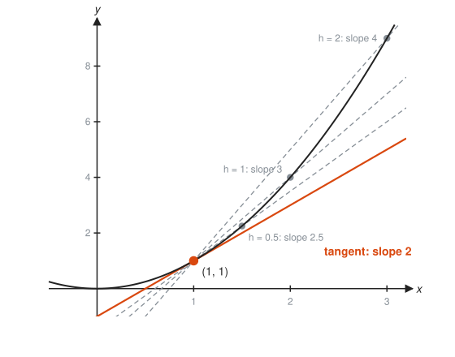
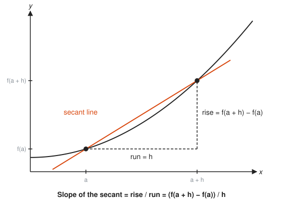
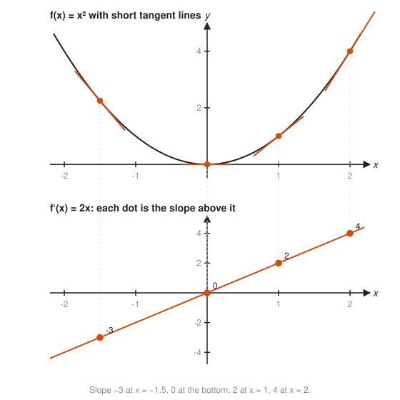
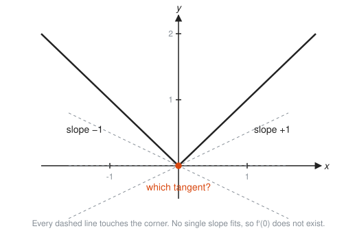
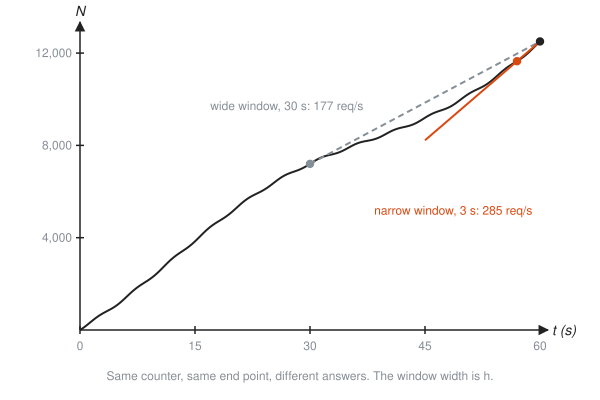

# The Derivative

**Level:** 401 · **Unit:** 2 · **Time:** 60 to 75 minutes
**Prerequisites:** [01 Limits and Continuity](../01-limits-and-continuity/README.md), slope of a line from [201 Algebra I and Geometry](../../201/README.md)

## The Big Idea

A straight line has one slope everywhere. A curve changes its steepness from point to point. The **derivative** is the slope of the curve at one exact point: the **instantaneous rate of change**.

You find it in two moves. First, measure the slope between two nearby points (easy, that is a straight line). Second, slide the second point toward the first and take the limit. Speed is the derivative of distance. Requests per second is the derivative of a request counter.

## Picture It

<!-- diagram: type=function-plot f="x^2" range=-0.5..3.2 point=1,1 secants=h:2,1,0.5 tangent-slope=2 caption="Secant lines through (1,1) approach the tangent" -->


Each dashed line is a **secant**: a line that cuts the curve at two points, here $(1, 1)$ and a second point $h$ units to the right. As $h$ shrinks from 2 to 1 to 0.5, the slopes drop from 4 to 3 to 2.5. They home in on 2, the slope of the orange **tangent** line, the line that just grazes the curve at $(1, 1)$.

## Step by Step

### 1. Average Rate of Change: Rise Over Run

<!-- diagram: type=function-plot f="0.3x^2+0.5" points=1,3 triangle=rise-run caption="Rise over run between two points" -->


Between $x = a$ and $x = a + h$ the curve rises $f(a+h) - f(a)$ over a run of $h$:

$$\text{secant slope} = \frac{f(a+h) - f(a)}{h}.$$

This is called the **difference quotient**. It is ordinary rise over run from [201](../../201/README.md), nothing more.

### 2. Shrink the Run, Take the Limit

Make $h$ smaller and smaller. The second point slides toward the first, and the secant turns into the tangent (the Picture It figure). The **derivative of $f$ at $a$** is

$$f'(a) = \lim_{h \to 0} \frac{f(a+h) - f(a)}{h}.$$

You cannot set $h = 0$ directly: that gives $0/0$. Simplify first, then let $h \to 0$, exactly as in [Lesson 01](../01-limits-and-continuity/README.md).

### 3. The Derivative Is Itself a Function

Do the computation at a general $x$ and you get a new function $f'(x)$ that reports the slope at every point.

<!-- diagram: type=stacked-plots top="x^2 with tangents at -1.5,0,1,2" bottom="2x with dots" caption="The slopes of x^2 form the line 2x" -->


Read the top graph, write down each tangent slope, and plot it below at the same $x$. The dots line up on $y = 2x$. That line is the derivative of $x^2$.

### 4. Notation

All of these mean the same thing: $f'(x)$, $\dfrac{dy}{dx}$, $\dfrac{d}{dx}f(x)$. The Leibniz form $\dfrac{dy}{dx}$ ("dee y dee x") reminds you it came from $\dfrac{\Delta y}{\Delta x}$, change in $y$ over change in $x$, with the changes made tiny.

### 5. Units

The derivative has units of (output units) per (input units). Metres over seconds gives m/s. Requests over seconds gives requests per second. If you cannot say the units, you do not yet understand the derivative you computed.

### 6. Where Derivatives Fail

A corner, a jump, or a vertical tangent has no single slope.

<!-- diagram: type=function-plot f="abs(x)" range=-2..2 candidate-tangents=-0.5,0,0.5 caption="A corner has no single tangent" -->


Differentiable implies continuous. Continuous does not imply differentiable: $|x|$ is continuous at 0 but has a corner there.

### 7. Signs Tell the Story

* $f' > 0$: the graph rises.
* $f' < 0$: the graph falls.
* $f' = 0$: a flat spot, often a peak or a valley.

The **second derivative** $f''$ is the derivative of the derivative: the rate of change of the rate. Positive $f''$ means the slope is increasing, and the graph bends upward like a cup. Negative $f''$ means it bends downward like a cap.

<!-- diagram: type=function-plot f="x^3-3x" range=-2.1..2.1 sign-rows="f',f''" caption="Rising, falling, cup and cap" -->


## Worked Examples

### Example 1: Watch the Secant Slopes Converge

For $f(x) = x^2$ at $a = 1$:

```txt
h        f(1+h)      f(1+h) - f(1)    slope = difference / h
2        9           8                4
1        4           3                3
0.5      2.25        1.25             2.5
0.1      1.21        0.21             2.1
0.01     1.0201      0.0201           2.01
```

The slopes approach 2, and $f'(1) = 2$.

### Example 2: The Derivative of x Squared Everywhere

```txt
  (f(x+h) - f(x))/h
= ((x+h)^2 - x^2)/h                  definition with f(x) = x^2
= (x^2 + 2xh + h^2 - x^2)/h          expand (x+h)^2
= (2xh + h^2)/h                      x^2 cancels
= 2x + h           for h != 0        divide each term by h
  limit as h -> 0 is 2x              h vanishes
  f'(x) = 2x                         check: f'(1) = 2, as in Example 1
```

### Example 3: The Derivative of 1/x

```txt
  (1/(x+h) - 1/x)/h                  definition
= ((x - (x+h)) / (x(x+h))) / h       common denominator on top
= (-h / (x(x+h))) / h                simplify the top
= -1 / (x(x+h))                      cancel h
  limit as h -> 0 is -1/x^2          set h = 0 in what remains
```

The slope is always negative: $1/x$ falls everywhere on its graph.

### Example 4: The Derivative of the Square Root

```txt
  (sqrt(x+h) - sqrt(x))/h                          definition
= ((x+h) - x) / (h (sqrt(x+h) + sqrt(x)))          multiply by the conjugate
= 1 / (sqrt(x+h) + sqrt(x))                        cancel h
  limit as h -> 0 is 1/(2 sqrt(x))                 set h = 0
```

### Example 5: Equation of a Tangent Line

Find the tangent line to $y = x^2$ at $x = 3$.

```txt
  point: (3, 9)                      f(3) = 9
  slope: f'(3) = 2 * 3 = 6           from Example 2
  y - 9 = 6(x - 3)                   point-slope form
  y = 6x - 9                         simplify
```

### Example 6: A Request Counter

A service has served $N(t) = 5t^2 + 100t$ requests after $t$ seconds.

```txt
  average rate on [10, 20]
  = (N(20) - N(10)) / (20 - 10)      secant slope
  = (4000 - 1500) / 10               N(20) = 2000 + 2000, N(10) = 500 + 1000
  = 250 req/s
  instantaneous rate: N'(t) = 10t + 100       derivative of 5t^2 is 10t, of 100t is 100
  N'(10) = 200 req/s, N'(20) = 300 req/s      the rate is climbing
```

## See It Step by Step


[Secant Lines to a Tangent Line: open the step-by-step walkthrough](https://caseyaedwards.github.io/math_training/diagrams/secant-to-tangent/)

Watch the secant slopes close in on the tangent slope as the second point slides toward the first.


[Zoom In: Curves Look Straight: open the step-by-step walkthrough](https://caseyaedwards.github.io/math_training/diagrams/local-linearity/)

Watch the curve straighten out as the zoom deepens until it matches its tangent line.


[Graphing the Derivative: open the step-by-step walkthrough](https://caseyaedwards.github.io/math_training/diagrams/derivative-graph/)

Watch each slope of f become a height on the new graph, tracing out the derivative.

## The SRE Connection

<!-- diagram: type=stacked-plots top="N(t)=200t+(3000/pi)(1-cos(pi t/30))" bottom="N'(t)=200+100 sin(pi t/30)" mark=t:15 caption="Counter and its rate" -->


**A counter and its rate are a function and its derivative.** The top graph is a counter that only goes up, like `http_requests_total`. The bottom graph is its slope, the request rate. At $t = 15$ the counter climbs at its steepest, and the rate graph peaks at the same moment.

<!-- diagram: type=function-plot f="counter with wiggles" secants="30..60, 57..60" caption="Wide and narrow windows give different secant slopes" -->


**`rate(x[5m])` is a secant slope.** It takes the counter change over a five-minute window and divides by 300 seconds. A wide window is a big $h$: smooth, but slow to notice change. A narrow window (like `irate`, which uses only the last two samples) is a small $h$: closer to the instantaneous rate, but jumpy. Neither is wrong. They answer different questions.

* **Gauges have derivatives too.** Disk usage in GB is a gauge. Its derivative is GB per hour, which is how "disk full in 4 hours" alerts work.
* **Second derivative as an early warning.** If the error rate is rising and its derivative is also rising, the incident is accelerating. Wake someone up.

## Common Mistakes

* Setting $h = 0$ before simplifying: that always produces $0/0$. Cancel the $h$ first.
* Confusing average and instantaneous rate: the secant over a window is an average. The derivative is the limit as the window shrinks.
* Expanding $(x + h)^2$ as $x^2 + h^2$: the middle term $2xh$ is the whole answer.
* Dropping units: a derivative is always "per" something.
* Assuming every continuous function has a derivative everywhere: $|x|$ has a corner at 0.

## Try It

1. Find the average rate of change of $f(x) = x^3$ on $[1, 3]$.
2. Use the limit definition to find the derivative of $f(x) = 3x + 5$.
3. Use the limit definition to find the derivative of $f(x) = x^2 + x$.
4. Find the tangent line to $y = x^2$ at $x = -1$.
5. A counter reads $N(t) = 4t^2 + 50t$ requests after $t$ seconds. Find the average rate over $[0, 10]$ and the instantaneous rate at $t = 10$.
6. Where is $f(x) = |x|$ not differentiable, and why?
7. Disk usage is $D(t) = 200 + 3t$ GB after $t$ hours on a 500 GB disk. Find $D'(t)$ with units. How many hours until the disk is full?
8. Suppose $f'(2) = 0$ and $f''(2) > 0$. Describe the graph near $x = 2$.
9. Latency $L(n)$ is measured in ms, where $n$ is the number of concurrent users. What are the units of $L'(n)$, and what does $L'(200) = 0.4$ mean?

<details>
<summary>Answers</summary>

1. 13. $(27 - 1)/(3 - 1) = 26/2$.
2. 3. $\big(3(x+h) + 5 - 3x - 5\big)/h = 3h/h = 3$. A line has constant slope.
3. $2x + 1$. The difference quotient simplifies to $2x + h + 1$.
4. $y = -2x - 1$. Point $(-1, 1)$, slope $2(-1) = -2$.
5. Average: $N(10) = 900$, and $900/10 = 90$ req/s. Instantaneous: $N'(t) = 8t + 50$, and $N'(10) = 130$ req/s.
6. At $x = 0$. The slope from the left is $-1$ and from the right is $+1$. A corner has no single tangent.
7. $D'(t) = 3$ GB/h. The disk has $300$ GB free, and $300/3 = 100$ hours.
8. A flat spot at the bottom of a valley: a local minimum.
9. Milliseconds per user. Near 200 users, each extra user adds about 0.4 ms of latency.

</details>

## Code Corner

[`code/main.go`](code/main.go) computes secant slopes with shrinking $h$, then shrinks the window on a request counter. Run it with `go run main.go` inside the `code/` folder.

```go
for _, h := range []float64{1, 0.1, 0.01, 1e-4, 1e-8, 1e-12, 1e-15} {
	fmt.Printf("  h = %-6g slope = %.15f\n", h, (f(1+h)-f(1))/h)
}
```

Output:

```txt
Slope of x^2 at x = 1, (f(1+h) - f(1)) / h:
  h = 1      slope = 3.000000000000000
  h = 0.1    slope = 2.100000000000002
  h = 0.01   slope = 2.010000000000002
  h = 0.0001 slope = 2.000099999999779
  h = 1e-08  slope = 1.999999997845058
  h = 1e-12  slope = 2.000177801165682
  h = 1e-15  slope = 2.220446049250314
Counter N(t) = 5t^2 + 100t, rate ending at t = 20:
  window 10     s: 250.000 req/s
  window 5      s: 275.000 req/s
  window 1      s: 295.000 req/s
  window 0.1    s: 299.500 req/s
  window 0.001  s: 299.995 req/s
  derivative N'(20) = 10*20 + 100 = 300 req/s
```

The math says a smaller $h$ is always better. The machine disagrees below about $10^{-8}$: subtracting two nearly equal floats throws away precision. A scrape interval that is too short has the same problem with noisy counters.

## Go Deeper

* [Math Is Fun: Introduction to Derivatives](https://www.mathsisfun.com/calculus/derivatives-introduction.html): the slope-of-a-curve idea with simple pictures.
* [Better Explained: A Gentle Introduction to Learning Calculus](https://betterexplained.com/articles/a-gentle-introduction-to-learning-calculus/): intuition before symbols.
* [Paul's Online Math Notes, Calculus I](https://tutorial.math.lamar.edu/Classes/CalcI/CalcI.aspx): the Derivatives chapter, including the definition and interpretations.
* [MacTutor: Isaac Newton](https://mathshistory.st-andrews.ac.uk/Biographies/Newton/) and [Gottfried Leibniz](https://mathshistory.st-andrews.ac.uk/Biographies/Leibniz/): the two inventors and their rival notations.
* For queues and physical rates, see the [Calculus of Rates in Physics and Queues workshop](../../../workshops/calculus-of-rates-in-physics-and-queues/README.md).
* Flashcards for this lesson: [cards.tsv](cards.tsv).

**Previous:** [01 Limits and Continuity](../01-limits-and-continuity/README.md) · **Next:** [03 Derivative Rules](../03-derivative-rules/README.md)
