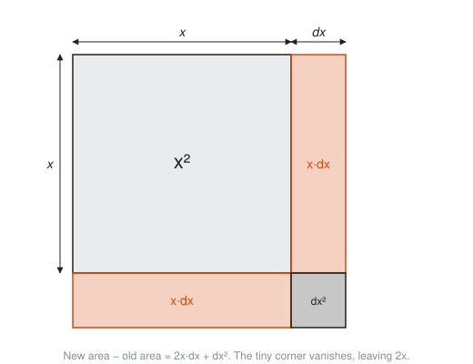
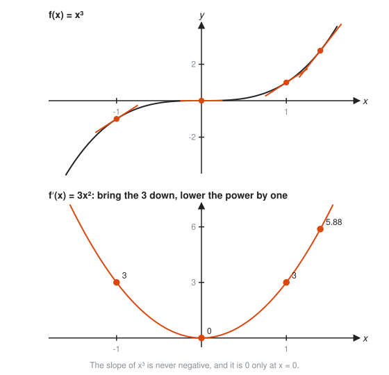
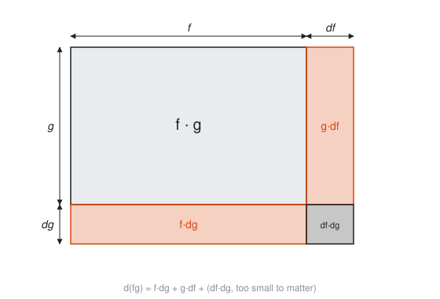
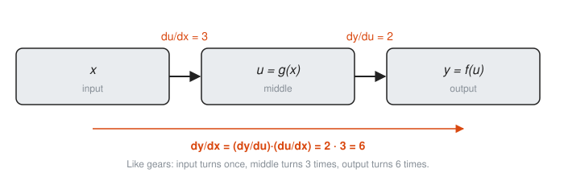
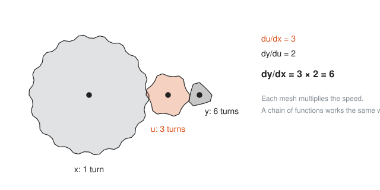
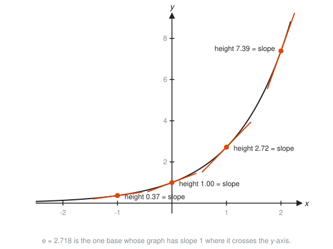
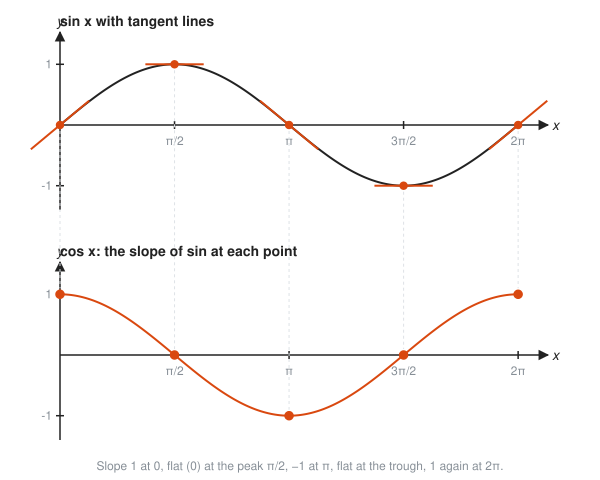

# Derivative Rules

**Level:** 401 · **Unit:** 3 · **Time:** 75 to 90 minutes
**Prerequisites:** [02 The Derivative](../02-the-derivative/README.md), exponent laws and logarithms from [301](../../301/README.md)

## The Big Idea

Computing every derivative from the limit definition is slow, like hand-assembling every binary. A handful of rules covers almost every function you meet: powers, sums, products, quotients, and functions inside functions. Each rule has a simple picture behind it, usually a square or rectangle that grows by a thin sliver.

## Picture It

<!-- diagram: type=area-model shape=square side=x grow=dx caption="Power rule: x^2 grows by 2x dx plus a tiny corner" -->


Grow the side of a square from $x$ to $x + dx$, where $dx$ means "a tiny bit of $x$". The new area is the old $x^2$ plus two orange strips of area $x \cdot dx$ each, plus a tiny corner of $dx^2$. The change in area is $2x\,dx + dx^2$. Divide by $dx$ to get a rate: $2x + dx$. As $dx \to 0$ the corner vanishes and the rate is $2x$. That is the derivative of $x^2$, read straight off the picture.

## Step by Step

### 1. Constant Rule

$\dfrac{d}{dx} c = 0$. A flat line has slope 0. Things that do not change have no rate of change.

### 2. Power Rule

$$\frac{d}{dx} x^n = n x^{n-1} \quad \text{for any real } n.$$

Bring the exponent down in front, then lower it by one. A cube of side $x$ grows by three faces of area $x^2$, which is why $\dfrac{d}{dx}x^3 = 3x^2$.

<!-- diagram: type=stacked-plots top="x^3 with tangents at -1,0,1,1.4" bottom="3x^2 with dots" caption="x^3 and its derivative 3x^2" -->


Notice the slope of $x^3$ at $x = -1$ and $x = 1$ is the same, 3. The graph climbs equally steeply on both sides.

The rule also works for negative and fractional powers: $\dfrac{1}{x} = x^{-1}$ has derivative $-x^{-2}$, and $\sqrt{x} = x^{1/2}$ has derivative $\tfrac{1}{2}x^{-1/2}$. Both match what [Lesson 02](../02-the-derivative/README.md) found the slow way.

### 3. Constant Multiple and Sum Rules

$(cf)' = c f'$ and $(f + g)' = f' + g'$. Differentiate term by term. Stretching a graph by 3 makes it 3 times as steep. Stacking two graphs adds their slopes.

### 4. Product Rule

$$(fg)' = f'g + fg'.$$

<!-- diagram: type=area-model shape=rectangle sides=f,g grow=df,dg caption="Product rule as a growing rectangle" -->


Picture a rectangle with sides $f$ and $g$. When $f$ grows by $df$ and $g$ by $dg$, the area gains $g\,df + f\,dg$ plus a negligible corner $df\,dg$. Divide by $dx$ for the product rule. Two strips, two terms.

### 5. Quotient Rule

$$\left(\frac{f}{g}\right)' = \frac{f'g - fg'}{g^2}.$$

Memory aid: "low d-high minus high d-low, over low squared." You do not need a new idea for it. It falls out of the two rules you already have:

<!-- diagram: type=flow steps="f/g, f*g^-1, product+chain, common denominator" caption="Quotient rule from the product and chain rules" -->


### 6. Chain Rule

For a function inside a function, $y = f(g(x))$, name the inside $u = g(x)$. Then

$$\frac{dy}{dx} = \frac{dy}{du} \cdot \frac{du}{dx}.$$

In words: the derivative of the outside (with the inside left alone), times the derivative of the inside.

<!-- diagram: type=pipeline stages="x,u=g(x),y=f(u)" rates=3,2 caption="Chain rule multiplies rates along a pipeline" -->


Think of a pipeline. If $u$ moves 3 times as fast as $x$, and $y$ moves 2 times as fast as $u$, then $y$ moves 6 times as fast as $x$. Rates along a chain multiply. The same picture, drawn as gears:

<!-- diagram: type=gears radii=96,32,16 caption="Meshed gears multiply speeds" -->


### 7. The Exponential: Slope Equals Height

The number $e \approx 2.718$ is chosen for one property: the graph of $e^x$ has slope equal to its own height everywhere. Hence $\dfrac{d}{dx}e^x = e^x$.

<!-- diagram: type=function-plot f="e^x" range=-2.5..2.3 tangents=-1,0,1,2 caption="Slope of e^x equals its height" -->


Its inverse, $\ln x$, has derivative $1/x$. Any other base reduces to $e$: $a^x = e^{x \ln a}$, and the chain rule gives $\dfrac{d}{dx}a^x = a^x \ln a$.

### 8. Sine and Cosine

$\dfrac{d}{dx}\sin x = \cos x$ and $\dfrac{d}{dx}\cos x = -\sin x$, with $x$ in radians. The proof uses $\lim \sin h / h = 1$ from [Lesson 01](../01-limits-and-continuity/README.md). The picture is easier:

<!-- diagram: type=stacked-plots top="sin x with tangents at 0,pi/2,pi,3pi/2,2pi" bottom="cos x with dots" caption="The slopes of sin x trace out cos x" -->


Where $\sin$ climbs fastest (at 0), $\cos$ is at its peak. Where $\sin$ is flat (at its top), $\cos$ is 0.

### 9. The Table to Memorize

| Function | Derivative | Why |
|---|---|---|
| $c$ | $0$ | flat line |
| $x^n$ | $n x^{n-1}$ | growing square or cube |
| $e^x$ | $e^x$ | slope equals height |
| $\ln x$ | $1/x$ | inverse of $e^x$ |
| $a^x$ | $a^x \ln a$ | $a^x = e^{x \ln a}$ plus chain rule |
| $\sin x$ | $\cos x$ | uses $\lim \sin h / h = 1$ |
| $\cos x$ | $-\sin x$ | same idea, a quarter turn later |

## Worked Examples

### Example 1: Polynomial, Term by Term

```txt
  d/dx (4x^5 - 3x^2 + 7)
= 4 * 5x^4 - 3 * 2x + 0              power rule on each term, constant -> 0
= 20x^4 - 6x                         simplify
```

### Example 2: Negative and Fractional Powers

```txt
  d/dx (1/x^3 + sqrt(x))
= d/dx (x^-3 + x^(1/2))              rewrite as powers
= -3x^-4 + (1/2)x^(-1/2)             power rule: bring down, subtract 1
= -3/x^4 + 1/(2 sqrt(x))             back to fraction form
```

### Example 3: Product Rule

```txt
  d/dx (x^2 sin x)                   f = x^2, g = sin x
= f'g + fg'                          product rule
= (2x)(sin x) + (x^2)(cos x)         f' = 2x, g' = cos x
= 2x sin x + x^2 cos x
```

### Example 4: Quotient Rule

```txt
  d/dx ( x / (x^2 + 1) )             top f = x, bottom g = x^2 + 1
= (f'g - fg') / g^2                  quotient rule
= (1 * (x^2 + 1) - x * 2x) / (x^2 + 1)^2      f' = 1, g' = 2x
= (1 - x^2) / (x^2 + 1)^2            combine like terms
```

### Example 5: Chain Rule on a Power

```txt
  y = (3x^2 + 1)^5                   outside: u^5, inside: u = 3x^2 + 1
  dy/du = 5u^4                       power rule on the outside
  du/dx = 6x                         derivative of the inside
  dy/dx = 5(3x^2 + 1)^4 * 6x         multiply the rates
        = 30x(3x^2 + 1)^4            tidy up
```

### Example 6: Chain Rule with Exponentials and Logs

```txt
  d/dt e^(-0.5t) = e^(-0.5t) * (-0.5)       e^u stays e^u, times du/dt
                 = -0.5 e^(-0.5t)

  d/dx ln(x^2 + 1) = (1/(x^2 + 1)) * 2x     derivative of ln u is 1/u, times du/dx
                   = 2x / (x^2 + 1)
```

## See It Step by Step


[Chain Rule: Stretch Factors Multiply: open the step-by-step walkthrough](https://caseyaedwards.github.io/math_training/diagrams/chain-rule/)

Watch a tiny interval stretch at each stage, and the two stretch factors multiply.


[Chain Rule: Belts and Pulleys: open the step-by-step walkthrough](https://caseyaedwards.github.io/math_training/diagrams/chain-rule-pulleys/)

Watch each belt multiply the turning rate, so the rates multiply down the chain of pulleys.


[Slope Fields: open the step-by-step walkthrough](https://caseyaedwards.github.io/math_training/diagrams/slope-field/)

Watch the solution curve follow the short slope dashes at every point it passes.


[Exponential Decay and Half-Life: open the step-by-step walkthrough](https://caseyaedwards.github.io/math_training/diagrams/exponential-decay/)

Watch the amount lose the same fraction in every equal stretch of time, which fixes the half-life.

## The SRE Connection

* **Unit conversion is the chain rule.** To turn 30 requests per second into requests per minute, multiply by 60 seconds per minute: $\dfrac{dN}{dm} = \dfrac{dN}{ds}\cdot\dfrac{ds}{dm}$. You have used the chain rule your whole career without filing the paperwork.
* **Pipelines of dependencies.** If latency $L$ depends on queue depth $q$, and $q$ depends on time, then $\dfrac{dL}{dt} = \dfrac{dL}{dq}\cdot\dfrac{dq}{dt}$. A queue growing by 12 jobs per second, at 2 ms per queued job, means latency grows by 24 ms every second.
* **Exponential decay.** A weight $w(t) = e^{-0.5t}$ shrinks at rate $w'(t) = -0.5\,w(t)$: always half of its current value per unit time. Exponentially weighted moving averages in monitoring tools use this shape. See the [exponential growth workshop](../../../workshops/exponential-growth-in-interest-epidemics-and-load/README.md).
* **Products of metrics.** Bytes per second equals (requests per second) times (bytes per request). If both change, the product rule splits the change into two strips: one from more requests, one from bigger requests.

## Common Mistakes

* Writing $(fg)' = f'g'$: the product rule has two terms. Look at the rectangle: two strips, not one.
* Forgetting the inside derivative: $\dfrac{d}{dx}\sin(x^2)$ is $\cos(x^2) \cdot 2x$, not $\cos(x^2)$.
* Applying the power rule to $e^x$: $x^n$ has a variable base and fixed exponent. $e^x$ has a fixed base and variable exponent. Different animals, different rules.
* Getting the quotient rule sign backwards: the top is $f'g - fg'$, with the derivative of the top first.
* Using degrees with $\sin$ and $\cos$: the clean derivatives hold only in radians.

## Try It

Differentiate each function.

1. $6x^4 - 2x + 9$
2. $x^{-2} + x^{1/3}$
3. $x^3 e^x$
4. $\dfrac{\sin x}{x}$
5. $(2x + 1)^7$
6. $\sin(x^2)$
7. $e^{3x}$
8. $\ln(5x)$
9. $\sqrt{1 + x^2}$
10. Latency is $L = 2q + 5$ ms where queue depth is $q(t) = 3t^2$ jobs after $t$ seconds. Find $dL/dt$ at $t = 2$.

<details>
<summary>Answers</summary>

1. $24x^3 - 2$.
2. $-2x^{-3} + \tfrac{1}{3}x^{-2/3}$.
3. $3x^2 e^x + x^3 e^x = x^2 e^x (3 + x)$. Product rule.
4. $\dfrac{x\cos x - \sin x}{x^2}$. Quotient rule.
5. $14(2x + 1)^6$. Chain rule: $7(2x+1)^6 \cdot 2$.
6. $2x\cos(x^2)$.
7. $3e^{3x}$.
8. $1/x$. Chain rule gives $\tfrac{1}{5x}\cdot 5$. Or note $\ln(5x) = \ln 5 + \ln x$.
9. $\dfrac{x}{\sqrt{1 + x^2}}$. Chain rule: $\tfrac{1}{2}(1+x^2)^{-1/2} \cdot 2x$.
10. 24 ms/s. $dL/dq = 2$ and $dq/dt = 6t = 12$ at $t = 2$. Multiply: $2 \cdot 12 = 24$.

</details>

## Code Corner

[`code/main.go`](code/main.go) checks every worked example against a numeric slope. It uses a **central difference**, $\dfrac{f(x+h) - f(x-h)}{2h}$, which is a secant centered on $x$ and is more accurate than the one-sided version. Run it with `go run main.go` inside the `code/` folder.

```go
func deriv(f func(float64) float64, x float64) float64 {
	h := 1e-5
	return (f(x+h) - f(x-h)) / (2 * h)
}
```

Output:

```txt
at x = 1.3
  power    4x^5 - 3x^2 + 7   numeric      49.322000   rule      49.322000
  product  x^2 sin x         numeric       2.957324   rule       2.957324
  quotient x/(x^2+1)         numeric      -0.095355   rule      -0.095355
  chain    (3x^2+1)^5        numeric   52944.319613   rule   52944.319584
  chain    ln(x^2+1)         numeric       0.966543   rule       0.966543
  exp      e^x               numeric       3.669297   rule       3.669297
```

Rules and numbers agree. The tiny gap on the big chain-rule value is floating point, not a broken rule.

## Go Deeper

* [Math Is Fun: Derivative Rules](https://www.mathsisfun.com/calculus/derivatives-rules.html): a compact table with short examples.
* [Paul's Online Math Notes, Calculus I](https://tutorial.math.lamar.edu/Classes/CalcI/CalcI.aspx): sections on the product, quotient, and chain rules with dozens of drills.
* [MathWorld: Chain Rule](https://mathworld.wolfram.com/ChainRule.html): the formal statement.
* [OpenStax Calculus Volume 1](https://openstax.org/details/books/calculus-volume-1): Chapter 3 proves each rule and has graded exercises.
* Flashcards for this lesson: [cards.tsv](cards.tsv).

**Previous:** [02 The Derivative](../02-the-derivative/README.md) · **Next:** [04 Optimization and Linear Approximation](../04-optimization-and-linear-approximation/README.md)
