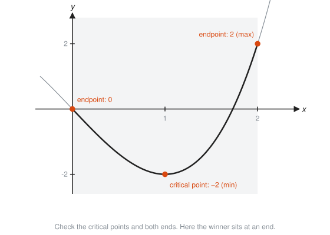
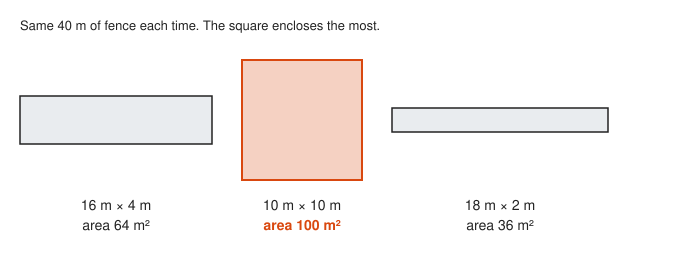
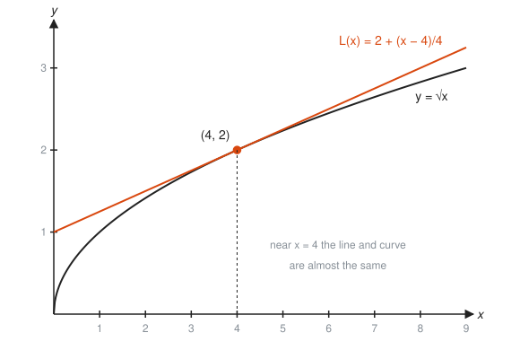
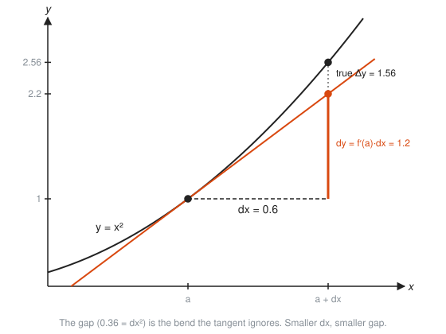
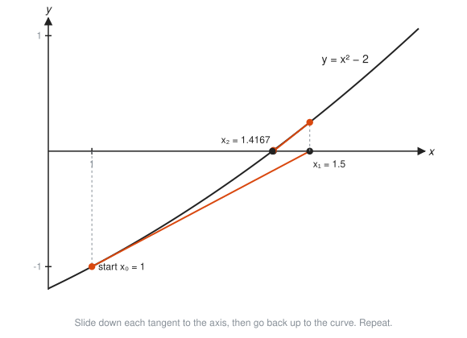
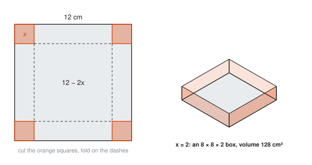
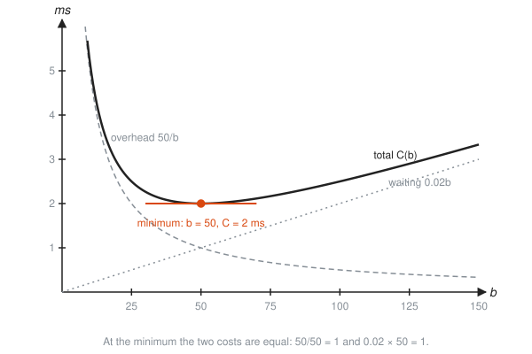

# Optimization and Linear Approximation

**Level:** 401 · **Unit:** 4 · **Time:** 75 to 90 minutes
**Prerequisites:** [03 Derivative Rules](../03-derivative-rules/README.md)

## The Big Idea

Two practical payoffs of the derivative:

* **Optimization:** at the top of a hill or the bottom of a valley, the slope is zero. To find the best value of anything (largest area, lowest cost, shortest wait), set the derivative to zero and solve.
* **Linear approximation:** zoom in far enough on a smooth curve and it looks like a straight line, its tangent. Use that line to estimate values that are hard to compute.

## Picture It

<!-- diagram: type=function-plot f="x(20-x)" range=0..20 tangent-at=10,4,16 caption="Area of a fenced rectangle peaks where the slope is zero" -->


On the way up the hill, the tangent tilts upward ($A' > 0$). On the way down, it tilts downward ($A' < 0$). At the very top it is flat ($A' = 0$). The best value lives at the flat spot.

## Step by Step

### Part A: Finding Maximums and Minimums

#### 1. Critical Points

A **critical point** is an input where $f'(x) = 0$ or where $f'(x)$ does not exist. Peaks and valleys of a smooth function can happen only there. Critical points are the suspects. You still have to question them.

#### 2. First Derivative Test

Look at the sign of $f'$ on each side of the critical point $c$:

* $+$ then $-$: the graph rises then falls. Local maximum.
* $-$ then $+$: falls then rises. Local minimum.
* No sign change: neither.

<!-- diagram: type=function-plot f="x^3-6x^2+9x+1" range=-0.3..4.3 critical=1,3 sign-row="f'" caption="Critical points and the sign of f'" -->


#### 3. Second Derivative Test

If $f'(c) = 0$, look at $f''(c)$, the bend:

<!-- diagram: type=multi-panel panels="-x^2,x^2,x^3" caption="Cap, cup, and the silent case" -->


* $f''(c) < 0$: a cap. Maximum.
* $f''(c) > 0$: a cup. Minimum.
* $f''(c) = 0$: the test is silent. Fall back to the first derivative test.

#### 4. Closed Intervals: Check the Ends

On an interval with endpoints included, $[a, b]$, a continuous function always has a largest and a smallest value. Check every critical point inside **and both endpoints**. The biggest value wins, the smallest loses.

<!-- diagram: type=function-plot f="x^3-3x" range=-0.4..2.4 interval=0..2 marks=0,1,2 caption="On a closed interval the winner can sit at an end" -->


#### 5. Word Problem Recipe

1. Draw it and name the variables.
2. Write the quantity to optimize (the **objective**) in words, then in symbols.
3. Use the **constraint** (the fixed condition, like "40 m of fence") to reduce the objective to one variable.
4. Differentiate, set to zero, solve.
5. Confirm it is a max or a min, and answer the question asked, with units.

<!-- diagram: type=rectangles perimeter=40 sizes=16x4,10x10,18x2 caption="Same fence, different areas" -->


### Part B: Tangent Lines as Estimates

#### 6. Linear Approximation

Near $x = a$,

$$f(x) \approx L(x) = f(a) + f'(a)(x - a).$$

This is the tangent line. Pick an anchor $a$ where $f(a)$ and $f'(a)$ are easy to compute.

<!-- diagram: type=function-plot f="sqrt(x)" range=0..9 tangent-at=4 caption="Tangent to the square root curve at x = 4" -->


#### 7. Differentials

Write $dx$ for a small change in input and $dy = f'(x)\,dx$ for the change the tangent line predicts. The true change in the curve is written $\Delta y$ ("delta y").

<!-- diagram: type=function-plot f="x^2" anchor=1 dx=0.6 show=dy,delta-y caption="dy from the tangent versus the true change" -->


The gap between $dy$ and $\Delta y$ is the bend the tangent ignores. Halve $dx$ and the gap shrinks to a quarter.

#### 8. Newton's Method

To solve $f(x) = 0$, follow the tangent line down to where it hits zero, then repeat:

$$x_{n+1} = x_n - \frac{f(x_n)}{f'(x_n)}.$$

<!-- diagram: type=function-plot f="x^2-2" range=0.9..1.75 newton-start=1 steps=3 caption="Newton's method on x^2 - 2" -->


Each step roughly doubles the number of correct digits. Few algorithms are this generous.

## Worked Examples

### Example 1: The Fence

You have 40 m of fence for a rectangle. What dimensions give the most area?

```txt
  sides x and y; perimeter 2x + 2y = 40      constraint
  y = 20 - x                                 solve the constraint for y
  A(x) = x(20 - x) = 20x - x^2               objective in one variable
  A'(x) = 20 - 2x                            differentiate
  20 - 2x = 0  ->  x = 10                    critical point
  A''(x) = -2 < 0                            cap shape: maximum
  y = 20 - 10 = 10, A = 100 m^2              a 10 m by 10 m square
```

### Example 2: Closed Interval

Find the largest and smallest values of $f(x) = x^3 - 3x$ on $[0, 2]$.

```txt
  f'(x) = 3x^2 - 3 = 3(x - 1)(x + 1)       differentiate and factor
  critical points: x = 1 (x = -1 is outside [0, 2])
  f(0) = 0                                 left endpoint
  f(1) = 1 - 3 = -2                        critical point
  f(2) = 8 - 6 = 2                         right endpoint
  maximum 2 at x = 2, minimum -2 at x = 1  compare all three
```

### Example 3: The Open Box

Cut equal squares of side $x$ from the corners of a 12 cm by 12 cm sheet and fold up the sides. Maximize the volume.

<!-- diagram: type=net sheet=12 cut=2 fold=box caption="Cut corners, fold up, get a box" -->


```txt
  V(x) = x(12 - 2x)^2,  0 < x < 6                 base (12 - 2x) square, height x
  V'(x) = (12 - 2x)^2 + x * 2(12 - 2x)(-2)        product rule and chain rule
        = (12 - 2x)[(12 - 2x) - 4x]               factor out (12 - 2x)
        = (12 - 2x)(12 - 6x)                      simplify
  V' = 0 at x = 6 or x = 2                        x = 6 gives zero volume
  V(2) = 2 * 8^2 = 128 cm^3                       the maximum
```

### Example 4: Best Batch Size

A log shipper flushes in batches of $b$ records. Each flush has a fixed 50 ms overhead shared by the batch. Waiting in a larger buffer adds about $0.02b$ ms per record. Cost per record:

<!-- diagram: type=function-plot f="50/b+0.02b" range=0..150 parts="50/b,0.02b" min=50 caption="Two costs pulling in opposite directions" -->


```txt
  C(b) = 50/b + 0.02b                      overhead share + waiting cost
  C'(b) = -50/b^2 + 0.02                   power rule: d/db (50 b^-1) = -50 b^-2
  -50/b^2 + 0.02 = 0                       set to zero
  b^2 = 50/0.02 = 2500                     rearrange
  b = 50 records                           positive root
  C''(b) = 100/b^3 > 0                     cup shape: minimum
  C(50) = 1 + 1 = 2 ms per record          the two costs balance exactly
```

This "square root of fixed cost over holding cost" shape appears everywhere: inventory, checkpoint intervals, cache refresh timing.

### Example 5: Estimate a Square Root

Estimate $\sqrt{4.1}$ with the tangent at $a = 4$.

```txt
  f(x) = sqrt(x), f(4) = 2                 easy anchor point
  f'(x) = 1/(2 sqrt(x)), f'(4) = 1/4       slope at the anchor
  L(x) = 2 + (1/4)(x - 4)                  tangent line
  L(4.1) = 2 + 0.1/4 = 2.025               estimate
  true value 2.02485...                    error about 0.00015
```

### Example 6: Compound Growth, Quickly

Estimate $1.01^{10}$ (1% growth for ten periods).

```txt
  f(x) = x^10, a = 1                       anchor at 1
  f(1) = 1, f'(x) = 10x^9, f'(1) = 10
  L(1.01) = 1 + 10(0.01) = 1.10            linear estimate: 10% total
  true value 1.10462...                    compounding adds about half a percent
```

### Example 7: Newton's Method for the Square Root of 2

Solve $x^2 - 2 = 0$, starting at $x_0 = 1$.

```txt
  x1 = 1 - (1 - 2)/2              = 1.5                 one tangent step
  x2 = 1.5 - (2.25 - 2)/3         = 1.41667             second step
  x3 = 1.41667 - (0.00694)/2.8333 = 1.4142157           third step
  true value                        1.4142136           six digits after three steps
```

## The SRE Connection

* **Every trade-off knob has a sweet spot.** Batch size, connection pool size, retry interval, and cache TTL each have one cost that falls and one that rises as you turn the knob. The optimum sits where the two marginal costs cancel, that is, where the derivative of the total is zero.
* **Back-of-the-envelope capacity math is linear approximation.** "Each extra 1,000 users adds about 3% CPU" is a tangent line. It works near today's load and fails far away, when queues saturate and the curve bends sharply. The tangent line is honest about where it stands, not about where you are going.
* **Newton's method is in your tools.** Square roots in hardware, solvers in autoscalers, and many optimizers in ML libraries are tangent-line iterations.

## Common Mistakes

* Forgetting the endpoints on a closed interval: in Example 2 the maximum is at an endpoint, not at the critical point.
* Assuming every critical point is a max or a min: $f(x) = x^3$ has $f'(0) = 0$ and is neither.
* Optimizing the wrong quantity: write the objective first, in words, before any algebra.
* Trusting a linear estimate far from the anchor: $L(9) = 3.25$ for $\sqrt{9} = 3$ is already off by 8%.
* Forgetting units in the final answer: "x = 10" is not an answer. "A 10 m by 10 m square" is.

## Try It

1. Find and classify the critical points of $f(x) = x^3 - 6x^2 + 9x + 1$.
2. Find the maximum and minimum of $f(x) = x^2 - 4x$ on $[0, 5]$.
3. Two positive numbers add to 30. What is the largest possible product?
4. A rectangle has area 100 m². What dimensions minimize the perimeter?
5. Batch cost per item is $C(b) = 200/b + 0.5b$. Find the best batch size and its cost.
6. Use a linear approximation to estimate $\sqrt{9.2}$.
7. Use a linear approximation to estimate $1.02^5$.
8. Use a linear approximation of $\ln x$ at $a = 1$ to estimate $\ln 1.05$.
9. Do two steps of Newton's method on $x^3 - 2 = 0$ from $x_0 = 1$.

<details>
<summary>Answers</summary>

1. $f'(x) = 3(x - 1)(x - 3)$. At $x = 1$: $f'' = -6 < 0$, local max $f(1) = 5$. At $x = 3$: $f'' = 6 > 0$, local min $f(3) = 1$.
2. Critical point $x = 2$ with $f(2) = -4$. Endpoints: $f(0) = 0$ and $f(5) = 5$. Maximum 5 at $x = 5$, minimum $-4$ at $x = 2$.
3. 225. Maximize $x(30 - x)$: the derivative $30 - 2x = 0$ gives $x = 15$.
4. A 10 m by 10 m square, perimeter 40 m. $P(x) = 2x + 200/x$ and $P' = 0$ gives $x = 10$.
5. $b = 20$ and $C = 10 + 10 = 20$. From $-200/b^2 + 0.5 = 0$, $b^2 = 400$.
6. About $3.0333$. $3 + 0.2/6$. The true value is $3.03315$.
7. About $1.10$. $1 + 5(0.02)$. The true value is $1.10408$.
8. About $0.05$. $L(x) = x - 1$. The true value is $0.04879$.
9. $x_1 = 4/3 \approx 1.3333$, $x_2 \approx 1.2639$. The true cube root of 2 is $1.25992$.

</details>

## Code Corner

[`code/main.go`](code/main.go) runs Newton's method, scans batch sizes to confirm the calculus answer, and compares tangent-line estimates with the truth. Run it with `go run main.go` inside the `code/` folder.

```go
func newton(f func(float64) float64, x float64, steps int) float64 {
	h := 1e-7
	for i := 1; i <= steps; i++ {
		slope := (f(x+h) - f(x-h)) / (2 * h)
		x = x - f(x)/slope
	}
	return x
}
```

Output:

```txt
Newton on x^2 - 2 from x = 1:
    step 1: x = 1.5000000000
    step 2: x = 1.4166666667
    step 3: x = 1.4142156863
    step 4: x = 1.4142135624
Batch cost C(b) = 50/b + 0.02b, scan b = 10..100:
    b =  10  C = 5.200 ms
    b =  20  C = 2.900 ms
    b =  30  C = 2.267 ms
    b =  40  C = 2.050 ms
    b =  50  C = 2.000 ms
    b =  60  C = 2.033 ms
    b =  70  C = 2.114 ms
    b =  80  C = 2.225 ms
    b =  90  C = 2.356 ms
    b = 100  C = 2.500 ms
  best of the scan: b = 50, C = 2.000 ms (calculus says b = 50)
Linear approximation versus the truth:
    sqrt(4.1): tangent 2.025000, true 2.024846
    1.01^10:   tangent 1.100000, true 1.104622
    sqrt(9):   tangent 3.250000, true 3.000000  (too far from the anchor)
```

Notice how flat the cost curve is near $b = 50$: anything from 40 to 60 costs within 3% of the best. Near an optimum the slope is zero, which means small errors in the knob barely matter. That is a comforting fact during an incident.

## Go Deeper

* [Paul's Online Math Notes, Calculus I](https://tutorial.math.lamar.edu/Classes/CalcI/CalcI.aspx): the Applications of Derivatives chapter covers optimization, linear approximation, and Newton's method.
* [OpenStax Calculus Volume 1](https://openstax.org/details/books/calculus-volume-1): Chapter 4 has many applied optimization problems.
* [MathWorld: Newton's Method](https://mathworld.wolfram.com/NewtonsMethod.html): history and convergence facts.
* Flashcards for this lesson: [cards.tsv](cards.tsv).

**Previous:** [03 Derivative Rules](../03-derivative-rules/README.md) · **Next:** [05 Related Rates](../05-related-rates/README.md)
