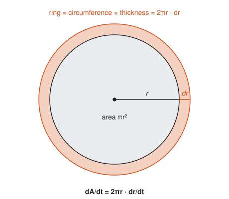
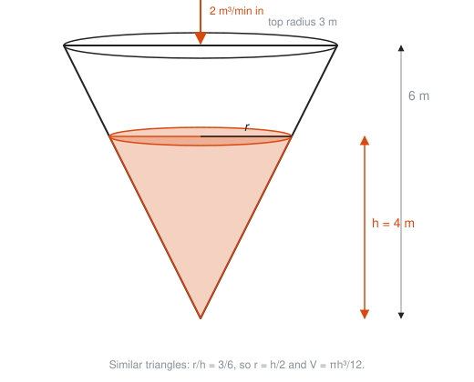
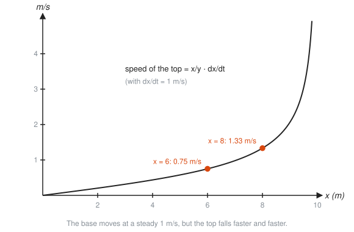
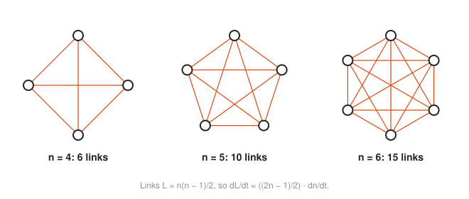

# Related Rates

**Level:** 401 · **Unit:** 5 · **Time:** 60 to 75 minutes
**Prerequisites:** [03 Derivative Rules](../03-derivative-rules/README.md) (especially the chain rule), the Pythagorean theorem and similar triangles from [201](../../201/README.md)

## The Big Idea

When two quantities are tied together by an equation, their rates of change are tied together too. Know how fast one changes, and you can work out how fast the other changes, without ever knowing either as a function of time.

The method is always the same: write the equation that links the quantities, then take $\dfrac{d}{dt}$ of both sides. The chain rule does the rest.

## Picture It

<!-- diagram: type=scene object=ladder length=10 base=6 height=8 rates="dx/dt=1,dy/dt=?" caption="A 10 m ladder sliding down a wall" -->


The base slides out at 1 m/s. How fast does the top slide down? The two ends are linked by Pythagoras: $x^2 + y^2 = 100$ at every moment. Move one end and the other must move to keep the ladder 10 m long.

## Step by Step

### 1. Quantities That Change With Time

Treat every changing quantity as a function of time $t$, even if you never write the formula: $x = x(t)$, $y = y(t)$. Their rates are $\dfrac{dx}{dt}$ and $\dfrac{dy}{dt}$.

### 2. Differentiate the Link

Take $\dfrac{d}{dt}$ of both sides of the linking equation. Each variable that depends on $t$ picks up its own rate by the chain rule:

$$\frac{d}{dt}\left(x^2\right) = 2x\,\frac{dx}{dt}.$$

For the ladder, $x^2 + y^2 = 100$ becomes $2x\,\dfrac{dx}{dt} + 2y\,\dfrac{dy}{dt} = 0$.

### 3. Plug In Numbers Last

Differentiate first, substitute the snapshot values second. If you plug in $x = 6$ before differentiating, $x$ becomes a constant and its rate vanishes. A photograph of a moving car has no speed.

### 4. The Recipe

1. Draw a picture. Label every changing quantity with a letter.
2. Write down the given rate and the wanted rate, with units.
3. Find an equation linking the quantities (Pythagoras, area, volume, similar triangles).
4. Differentiate both sides with respect to $t$.
5. Substitute the snapshot values and solve for the wanted rate.

### 5. Growing Shapes

<!-- diagram: type=ring r=130 dr=22 caption="The ring added when a circle grows" -->


A ripple spreads on a pond. When the radius grows by a thin $dr$, the area gains a ring. Unroll the ring and it is nearly a rectangle: length $2\pi r$, thickness $dr$. Hence $dA = 2\pi r\,dr$, and dividing by $dt$:

$$\frac{dA}{dt} = 2\pi r\,\frac{dr}{dt}.$$

The same answer comes from the chain rule on $A = \pi r^2$. The picture tells you why it is the circumference.

### 6. Similar Triangles Remove a Variable

<!-- diagram: type=scene object=cone top-radius=3 height=6 water-height=4 inflow=2 caption="Water filling an upside-down cone" -->


The cone volume $V = \tfrac{1}{3}\pi r^2 h$ has two changing quantities. The cone shape links them: the water is a smaller copy of the whole cone. Hence $r/h = 3/6$, and $r = h/2$. Substitute before differentiating to get one variable: $V = \dfrac{\pi h^3}{12}$.

### 7. Rates Are Not Constant

<!-- diagram: type=function-plot f="x/sqrt(100-x^2)" range=0..9.8 marks=6,8 caption="The ladder top falls faster and faster" -->


The base moves at a steady 1 m/s, yet the top speeds up as it nears the ground. A related rate is a snapshot answer. Ask again a second later and you get a different number.

## Worked Examples

### Example 1: The Ladder

At the moment $x = 6$ m, how fast does the top fall?

```txt
  x^2 + y^2 = 100                         Pythagoras links the two ends
  2x dx/dt + 2y dy/dt = 0                 d/dt of both sides, chain rule
  y = sqrt(100 - 36) = 8                  snapshot: find y when x = 6
  2(6)(1) + 2(8) dy/dt = 0                substitute x = 6, y = 8, dx/dt = 1
  12 + 16 dy/dt = 0                       simplify
  dy/dt = -12/16 = -0.75 m/s              solve; negative means falling
```

### Example 2: The Ripple

The radius of a ripple grows at 2 cm/s. How fast does the area grow when $r = 5$ cm?

```txt
  A = pi r^2                              area of a circle
  dA/dt = 2 pi r dr/dt                    d/dt, chain rule
        = 2 pi (5)(2)                     substitute r = 5, dr/dt = 2
        = 20 pi = 62.83 cm^2/s            evaluate
```

### Example 3: The Cone

Water pours into the cone at 2 m³/min. How fast does the level rise when $h = 4$ m?

```txt
  V = (1/3) pi r^2 h                      volume of a cone
  r = h/2                                 similar triangles: 3/6 = r/h
  V = (1/3) pi (h/2)^2 h = pi h^3 / 12    substitute, one variable left
  dV/dt = (pi h^2 / 4) dh/dt              d/dt: 3h^2/12 = h^2/4
  2 = (pi * 16 / 4) dh/dt                 substitute dV/dt = 2, h = 4
  dh/dt = 2/(4 pi) = 0.159 m/min          solve
```

The narrow bottom fills fast. Near the wide top the same inflow raises the level slowly.

### Example 4: Two Cars

Car A drives east at 30 m/s and car B drives north at 40 m/s, both from the same corner at the same time. How fast does the distance between them grow?

```txt
  d^2 = x^2 + y^2                         right triangle
  2d dd/dt = 2x dx/dt + 2y dy/dt          d/dt of both sides
  after t s: x = 30t, y = 40t, d = 50t    a 3-4-5 triangle scaled by 10t
  50t dd/dt = 30t(30) + 40t(40)           substitute and cancel the 2s
  50t dd/dt = 2500t                       900 + 1600 = 2500
  dd/dt = 50 m/s                          constant, the same at every moment
```

## See It Step by Step


[Chain Rule: Belts and Pulleys: open the step-by-step walkthrough](https://caseyaedwards.github.io/math_training/diagrams/chain-rule-pulleys/)

Watch each belt multiply the turning rate, so the rates multiply down the chain of pulleys.

## The SRE Connection

<!-- diagram: type=tank inflow=120 outflow=100 caption="A queue as a tank" -->


**A queue is a tank.** The backlog $Q$ changes at (arrival rate) minus (service rate): $\dfrac{dQ}{dt} = \lambda - \mu$. With 120 req/s arriving and 100 req/s served, the backlog grows by 20 every second. No amount of hope changes the sign of that number. Only capacity does. The [queues workshop](../../../workshops/calculus-of-rates-in-physics-and-queues/README.md) builds on this.

<!-- diagram: type=graphs complete=4,5,6 caption="Full mesh links grow faster than nodes" -->


**Full meshes outrun their nodes.** A service mesh where every node talks to every other has $L = \dfrac{n(n-1)}{2}$ links. Differentiate: $\dfrac{dL}{dt} = \dfrac{2n - 1}{2}\cdot\dfrac{dn}{dt}$. Adding 3 nodes per hour at $n = 20$ adds $58.5$ links per hour, and the rate keeps climbing as $n$ grows. This is why large fleets stop doing full meshes. See the [graph theory workshop](../../../workshops/graph-theory-for-networks-and-dependencies/README.md).

* **Little's law in motion.** The average number of requests in flight is $L = \lambda W$ (arrival rate times time in system). If $W$ holds at 0.2 s while traffic climbs by 10 req/s each minute, then in-flight work climbs by $0.2 \times 10 = 2$ requests per minute.

## Common Mistakes

* Substituting numbers before differentiating: constants have zero rate. Differentiate the general equation first.
* Forgetting the chain rule factor: $\dfrac{d}{dt}(y^2)$ is $2y\,\dfrac{dy}{dt}$, not $2y$.
* Sign confusion: a quantity that shrinks has a negative rate. Write "the top falls at 0.75 m/s" or "dy/dt = −0.75 m/s", never both together.
* Treating the answer as constant: most related rates change from moment to moment (the ladder top speeds up).
* Mixing units: minutes and seconds, cm and m. Convert before you start.

## Try It

1. A circle's radius grows at 3 cm/s. How fast does its area grow when $r = 10$ cm?
2. A square's side grows at 0.5 m/s. How fast does its area grow when the side is 4 m?
3. A balloon (a sphere, $V = \tfrac{4}{3}\pi r^3$) is inflated at 100 cm³/s. How fast does the radius grow when $r = 5$ cm?
4. A 13 m ladder's base is pulled away at 2 m/s. How fast does the top fall when the base is 5 m from the wall?
5. In the cone from Example 3, how fast does the level rise when $h = 2$ m?
6. A queue holds 900 requests. Arrivals are 150 req/s and service is 180 req/s. Find $dQ/dt$ and how long the queue takes to drain.
7. A full mesh has 50 nodes and grows by 2 nodes per hour. How fast does the link count grow?
8. In Example 4, how far apart are the cars after 10 s, and how fast is that distance growing then?

<details>
<summary>Answers</summary>

1. $60\pi \approx 188.5$ cm²/s. $2\pi(10)(3)$.
2. 4 m²/s. $dA/dt = 2s\,ds/dt = 2(4)(0.5)$.
3. $1/\pi \approx 0.318$ cm/s. $100 = 4\pi(25)\,dr/dt$.
4. $5/6 \approx 0.833$ m/s downward. The top is at $y = 12$, and $dy/dt = -(5/12)(2)$.
5. $2/\pi \approx 0.637$ m/min. $2 = (\pi \cdot 4/4)\,dh/dt$.
6. $dQ/dt = -30$ req/s. The queue drains in $900/30 = 30$ s.
7. 99 links per hour. $\tfrac{2(50) - 1}{2} \times 2$.
8. 500 m apart, and the distance grows at 50 m/s (the same at every moment).

</details>

## Code Corner

[`code/main.go`](code/main.go) checks every worked example by brute force: it nudges time forward by a microsecond, measures how much each quantity moved, and divides. Run it with `go run main.go` inside the `code/` folder.

```go
// Ladder: 10 m long, base x(t) = 6 + t metres, top y = sqrt(100 - x^2).
y := func(t float64) float64 { x := 6 + t; return math.Sqrt(100 - x*x) }
measured := (y(dt) - y(0)) / dt
```

Output:

```txt
ladder top speed at x = 6: measured -0.7500 m/s, formula -(x/y)(dx/dt) = -0.7500 m/s
cone level speed at h = 4:  measured 0.1592 m/min, formula 2/(4 pi) = 0.1592 m/min
ripple area rate at r = 5:  measured 62.8319 cm^2/s, formula 2 pi r dr/dt = 62.8319
mesh link rate at n = 20:   measured 58.5000 links/h, formula ((2n-1)/2)(dn/dt) = 58.5000
```

The simulation and the calculus agree. The calculus just gets there without a loop.

## Go Deeper

* [Paul's Online Math Notes, Calculus I](https://tutorial.math.lamar.edu/Classes/CalcI/CalcI.aspx): the Related Rates section has a long list of classic problems with full solutions.
* [OpenStax Calculus Volume 1](https://openstax.org/details/books/calculus-volume-1): Section 4.1 covers related rates with a step-by-step strategy box.
* [Khan Academy: Calculus 1](https://www.khanacademy.org/math/calculus-1): short videos on related rates with practice sets.
* Flashcards for this lesson: [cards.tsv](cards.tsv).

**Previous:** [04 Optimization and Linear Approximation](../04-optimization-and-linear-approximation/README.md) · **Next:** [06 Riemann Sums and Area](../06-riemann-sums-and-area/README.md)
