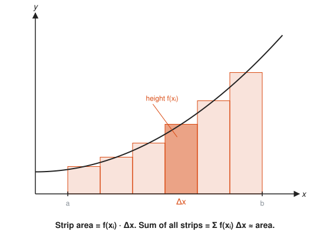
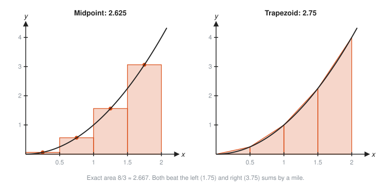
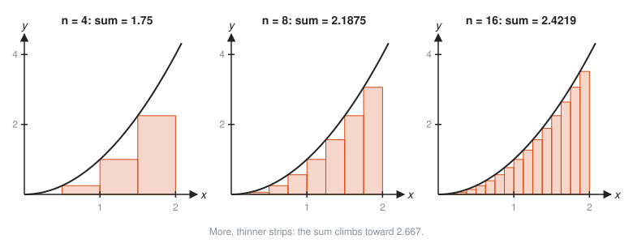
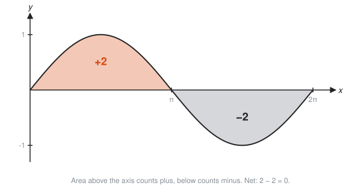
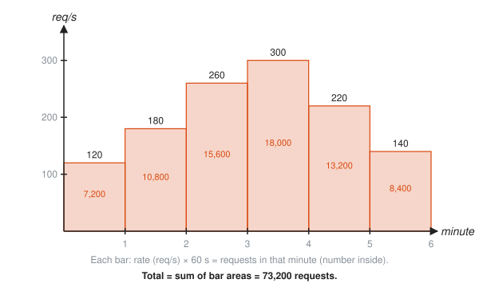

# Riemann Sums and Area

**Level:** 401 · **Unit:** 6 · **Time:** 60 to 75 minutes
**Prerequisites:** [01 Limits and Continuity](../01-limits-and-continuity/README.md), area of a rectangle from [201](../../201/README.md), summation from [301](../../301/README.md)

## The Big Idea

Derivatives cut a quantity into rates. Integrals do the reverse: they add rates back up into totals.

The area under a curved graph has no simple formula. Rectangles do. Chop the region into thin vertical strips, treat each strip as a rectangle, and add their areas. Thinner strips give a better answer. The limit, as the strips get infinitely thin, is the exact area: the **definite integral**.

## Picture It

<!-- diagram: type=riemann f="x^2" range=0..2 n=4 methods=left,right caption="Left and right Riemann sums with four strips" -->


The true area under $y = x^2$ from 0 to 2 sits somewhere between the two sums. The left rectangles leave gaps under the rising curve. The right rectangles overshoot. Both are honest estimates of a dishonest shape.

## Step by Step

### 1. One Strip

<!-- diagram: type=riemann f="0.4x^2+0.6" range=a..b n=6 highlight=4 caption="One strip: height times width" -->


Split $[a, b]$ into $n$ strips of equal width

$$\Delta x = \frac{b - a}{n}.$$

In strip number $i$, pick a sample point $x_i$. The strip is approximated by a rectangle of height $f(x_i)$ and width $\Delta x$. Its area is $f(x_i)\,\Delta x$.

### 2. Add the Strips: Sigma Notation

The Greek capital sigma, $\Sigma$, means "add up". The **Riemann sum** is

$$\sum_{i=1}^{n} f(x_i)\,\Delta x = f(x_1)\Delta x + f(x_2)\Delta x + \dots + f(x_n)\Delta x.$$

Read $\sum_{i=1}^{n}$ as a `for i := 1; i <= n; i++` loop that accumulates a total.

### 3. Where to Sample

* **Left sum:** the left edge of each strip.
* **Right sum:** the right edge.
* **Midpoint sum:** the middle.
* **Trapezoid sum:** join the two edges with a slanted top, which equals the average of the left and right sums.

<!-- diagram: type=riemann f="x^2" range=0..2 n=4 methods=midpoint,trapezoid caption="Midpoint and trapezoid sums" -->


With the same four strips, the midpoint and trapezoid sums land much closer to the truth (2.667) than the left and right sums.

### 4. Make the Strips Thinner

<!-- diagram: type=riemann f="x^2" range=0..2 n=4,8,16 method=left caption="More strips, better estimate" -->


Double the strips and the gaps shrink. Every method closes in on the same number as $n$ grows.

### 5. The Definite Integral

The exact area is the limit:

$$\int_a^b f(x)\,dx = \lim_{n \to \infty} \sum_{i=1}^{n} f(x_i)\,\Delta x.$$

The tall S, $\int$, is a stretched "S" for "sum". The $dx$ is the leftover of $\Delta x$, the width of an infinitely thin strip. The numbers $a$ and $b$ are the **limits of integration** (here "limit" means "boundary", an unlucky reuse of the word).

### 6. Signed Area

When the curve dips below the axis, $f(x_i)$ is negative and so is the strip. The integral counts area above the axis as plus and below as minus.

<!-- diagram: type=function-plot f="sin(x)" range=0..2pi shade=above:orange,below:gray caption="Signed area of sin x" -->


This is a feature, not a bug: if $f$ is a velocity, the integral is net displacement. Driving 2 km forward and 2 km back nets 0, even though the odometer reads 4.

## Worked Examples

### Example 1: Left and Right Sums by Hand

Estimate $\int_0^2 x^2\,dx$ with $n = 4$.

```txt
  dx = (2 - 0)/4 = 0.5                     strip width
  left points:  0, 0.5, 1, 1.5             left edge of each strip
  heights:      0, 0.25, 1, 2.25           square each point
  left sum  = 0.5 (0 + 0.25 + 1 + 2.25)    width times sum of heights
            = 0.5 * 3.5 = 1.75
  right points: 0.5, 1, 1.5, 2             right edges
  heights:      0.25, 1, 2.25, 4
  right sum = 0.5 * 7.5 = 3.75
```

### Example 2: Midpoint and Trapezoid

```txt
  midpoints: 0.25, 0.75, 1.25, 1.75        centre of each strip
  heights:   0.0625, 0.5625, 1.5625, 3.0625
  midpoint sum = 0.5 * 5.25 = 2.625
  trapezoid    = (left + right)/2          average of the two sums
               = (1.75 + 3.75)/2 = 2.75
```

### Example 3: The Exact Area as a Limit

Use the right sum with $n$ strips and the formula $1^2 + 2^2 + \dots + n^2 = \dfrac{n(n+1)(2n+1)}{6}$.

```txt
  dx = 2/n,  x_i = 2i/n                        right edge of strip i
  f(x_i) dx = (2i/n)^2 * (2/n) = 8 i^2 / n^3   height times width
  sum = (8/n^3)(1^2 + 2^2 + ... + n^2)         pull out the constant
      = (8/n^3) * n(n+1)(2n+1)/6               sum-of-squares formula
      = (8/6) * (n+1)(2n+1)/n^2                cancel one n
      = (4/3) * (1 + 1/n)(2 + 1/n)             divide each factor by n
  as n -> infinity: (4/3) * 1 * 2 = 8/3        1/n -> 0
```

The exact area is $8/3 \approx 2.667$. The next lesson shows a much shorter route.

### Example 4: Shapes You Already Know

Some integrals are plain geometry:

```txt
  integral from 0 to 3 of 4 dx    = rectangle 3 wide, 4 tall      = 12
  integral from 0 to 4 of x dx    = triangle base 4, height 4     = 8
  integral from -2 to 2 of x dx   = +2 above, -2 below            = 0
```

## The SRE Connection

<!-- diagram: type=bars values=120,180,260,300,220,140 width=60s caption="Rate buckets times width give request totals" -->


**A rate graph is a Riemann sum waiting to happen.** Your dashboard shows requests per second, sampled once a minute. To get the total number of requests, multiply each rate by its bucket width (60 s) and add. That is a left or right Riemann sum, depending on how the tool aligns samples. Total requests: 73,200.

* **Coarse buckets hide spikes.** A one-minute average of 300 req/s might be 30 seconds at 600 and 30 seconds at 0. Thin strips (finer resolution) see the shape. Thick strips see only the area.
* **Trapezoids in tools.** Many time-series tools interpolate linearly between samples. Integrating that is the trapezoid rule.
* **Energy and cost.** Watts over time give energy. Dollars per hour over a month give a bill. Every "per" metric integrates to a total.

## Common Mistakes

* Forgetting to multiply by $\Delta x$: the sum of heights alone is not an area.
* Using $n + 1$ points for $n$ strips in a left or right sum: a left sum on 4 strips uses 4 heights, not 5.
* Assuming left sums always underestimate: that holds only for increasing functions. For a decreasing function the left sum overshoots.
* Treating negative area as an error: below-axis strips subtract, by design.
* Confusing the $dx$ with multiplication by a variable called $d$: $dx$ marks the strip width and names the variable you integrate over.

## Try It

1. Compute the left and right sums for $f(x) = x$ on $[0, 4]$ with $n = 4$. What is the exact area?
2. Compute the right sum for $f(x) = x^2 + 1$ on $[0, 2]$ with $n = 2$.
3. Compute the midpoint sum for $f(x) = x^3$ on $[0, 2]$ with $n = 2$. (The exact value is 4.)
4. Evaluate $\sum_{i=1}^{5} i^2$.
5. Evaluate $\int_0^3 4\,dx$ with geometry.
6. Evaluate $\int_{-2}^{2} x\,dx$ with geometry.
7. Evaluate $\int_0^2 \sqrt{4 - x^2}\,dx$ with geometry. (Hint: what shape is the graph?)
8. A service runs at 50, 80, and 110 req/s over three 10-second buckets. Estimate the total requests.
9. For an increasing function, does the left sum overestimate or underestimate?
10. Compute the trapezoid sum for $x^2$ on $[0, 2]$ with $n = 2$.

<details>
<summary>Answers</summary>

1. Left: $0 + 1 + 2 + 3 = 6$. Right: $1 + 2 + 3 + 4 = 10$. Exact: a triangle with area $\tfrac{1}{2}(4)(4) = 8$.
2. 7. $\Delta x = 1$, and $f(1) + f(2) = 2 + 5$.
3. 3.5. Midpoints 0.5 and 1.5: $(0.125 + 3.375) \times 1$.
4. 55. $1 + 4 + 9 + 16 + 25$.
5. 12. A 3 by 4 rectangle.
6. 0. The triangle below the axis cancels the one above.
7. $\pi \approx 3.1416$. The graph is a quarter of a circle of radius 2: $\tfrac{1}{4}\pi(2)^2$.
8. 2,400 requests. $(50 + 80 + 110) \times 10$.
9. Underestimate. Each left edge is the lowest point of its strip.
10. 3. With $\Delta x = 1$: $\tfrac{1}{2}(0) + 1 + \tfrac{1}{2}(4)$.

</details>

## Code Corner

[`code/main.go`](code/main.go) computes all four sums for $\int_0^2 x^2\,dx$ with more and more strips, then totals the request buckets. Run it with `go run main.go` inside the `code/` folder.

```go
func riemann(a, b float64, n int, pick float64) float64 {
	dx := (b - a) / float64(n)
	sum := 0.0
	for i := 0; i < n; i++ {
		x := a + (float64(i)+pick)*dx // pick 0 = left, 0.5 = middle, 1 = right
		sum += f(x) * dx
	}
	return sum
}
```

Output:

```txt
     n        left       right    midpoint   trapezoid   (exact 2.666667)
     4    1.750000    3.750000    2.625000    2.750000
     8    2.187500    3.187500    2.656250    2.687500
    16    2.421875    2.921875    2.664062    2.671875
   100    2.626800    2.706800    2.666600    2.666800
  1000    2.662668    2.670668    2.666666    2.666668
requests over 6 minutes: 73200
```

The midpoint sum with 16 strips beats the left sum with 1,000. Where you sample matters as much as how often.

## Go Deeper

* [Paul's Online Math Notes, Calculus I](https://tutorial.math.lamar.edu/Classes/CalcI/CalcI.aspx): the Integrals chapter covers area problems and the definition of the definite integral.
* [MathWorld: Riemann Sum](https://mathworld.wolfram.com/RiemannSum.html): the formal definition.
* [MacTutor: Bernhard Riemann](https://mathshistory.st-andrews.ac.uk/Biographies/Riemann/): the mathematician behind the sums.
* [Math Is Fun: Introduction to Integration](https://www.mathsisfun.com/calculus/integration-introduction.html): slices and areas with gentle pictures.
* Flashcards for this lesson: [cards.tsv](cards.tsv).

**Previous:** [05 Related Rates](../05-related-rates/README.md) · **Next:** [07 The Fundamental Theorem of Calculus](../07-fundamental-theorem/README.md)
