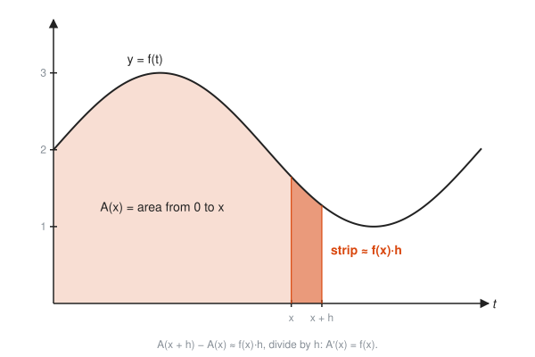
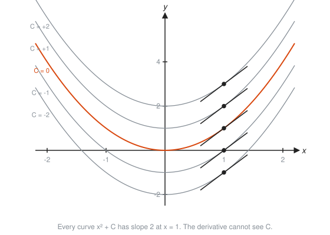
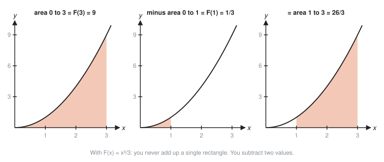

# The Fundamental Theorem of Calculus

**Level:** 401 · **Unit:** 7 · **Time:** 75 to 90 minutes
**Prerequisites:** [03 Derivative Rules](../03-derivative-rules/README.md), [06 Riemann Sums and Area](../06-riemann-sums-and-area/README.md)

## The Big Idea

Derivatives and integrals look like two unrelated tools: one measures slopes, the other measures areas. The **Fundamental Theorem of Calculus** says they undo each other.

* Accumulate a rate into a total, then take the slope of that total: you get the rate back.
* To find the area under $f$ from $a$ to $b$, find any function $F$ whose derivative is $f$. The area is $F(b) - F(a)$. No rectangles needed.

In SRE terms: the counter is the integral of the rate, and the rate is the derivative of the counter. You already believe this theorem. This lesson proves you are right.

## Picture It

<!-- diagram: type=stacked-plots top="f(t)=2+sin t shaded 0..x" bottom="A(x)=2x+1-cos x with tangent at x" x=3.5 caption="Area on top equals height on bottom; height on top equals slope on bottom" -->


The top graph is a rate. Shade the area under it from 0 up to $x$ and call that area $A(x)$. The bottom graph plots $A(x)$. Two facts jump out:

* The **shaded area** on top equals the **height** of the bottom curve (8.94).
* The **height** of the top curve equals the **slope** of the bottom curve (1.65).

## Step by Step

### 1. The Accumulation Function

Fix a starting point $a$ and define

$$A(x) = \int_a^x f(t)\,dt,$$

the area under $f$ from $a$ up to a moving right edge $x$. The letter $t$ inside is a dummy variable: it runs along the axis while $x$ marks where to stop. Think of $A$ as an odometer and $f$ as a speedometer.

### 2. Part 1: The Slope of the Area Is the Height

<!-- diagram: type=function-plot f="2+sin t" shade=0..x strip=x..x+h caption="The new strip added when x moves to x + h" -->


Move the right edge from $x$ to $x + h$. The area grows by one thin strip, which is almost a rectangle of height $f(x)$ and width $h$:

$$A(x + h) - A(x) \approx f(x)\cdot h.$$

Divide by $h$ and let $h \to 0$:

$$A'(x) = f(x).$$

That is **Part 1** of the theorem. The rate at which area piles up equals the height of the curve at the edge. A tall curve adds area fast. A short one adds it slowly.

### 3. Antiderivatives

An **antiderivative** of $f$ is any function $F$ with $F' = f$. Part 1 says $A(x)$ is one. Every antiderivative differs from another by a constant:

<!-- diagram: type=function-plot family="x^2+C for C=-2..2" tangents-at=1 caption="Antiderivatives of 2x form a family" -->


The derivative cannot see a vertical shift. That is why the **indefinite integral** carries a $+ C$:

$$\int 2x\,dx = x^2 + C.$$

### 4. The Antiderivative Table

Read the derivative table from [Lesson 03](../03-derivative-rules/README.md) backwards:

| $f(x)$ | $\int f(x)\,dx$ | Check by differentiating |
|---|---|---|
| $x^n$ ($n \ne -1$) | $\dfrac{x^{n+1}}{n+1} + C$ | raise the power, divide by the new power |
| $\dfrac{1}{x}$ | $\ln\lvert x\rvert + C$ | the missing case $n = -1$ |
| $e^x$ | $e^x + C$ | slope equals height |
| $\sin x$ | $-\cos x + C$ | $(-\cos x)' = \sin x$ |
| $\cos x$ | $\sin x + C$ | $(\sin x)' = \cos x$ |
| $e^{kx}$ | $\dfrac{1}{k}e^{kx} + C$ | chain rule in reverse |

### 5. Part 2: Evaluate With Two Numbers

If $F$ is any antiderivative of $f$, then

$$\int_a^b f(x)\,dx = F(b) - F(a).$$

Write it with the bracket shorthand $\big[F(x)\big]_a^b = F(b) - F(a)$.

<!-- diagram: type=multi-panel f="x^2" shade="0..3, 0..1, 1..3" caption="Area from 1 to 3 equals F(3) minus F(1)" -->


Why it works: $A(x)$ is an antiderivative with $A(a) = 0$. Any other antiderivative is $F = A + C$. Then $F(b) - F(a) = A(b) + C - A(a) - C = A(b)$. The constant cancels, which is why you can drop it here.

### 6. Net Change

Part 2 has a plain-language version, the **net change theorem**: integrate a rate, get the change in the total.

$$\int_a^b N'(t)\,dt = N(b) - N(a).$$

## Worked Examples

### Example 1: The Area From Lesson 06, in Three Lines

```txt
  integral from 0 to 2 of x^2 dx
  F(x) = x^3/3                             raise the power, divide by 3
  F(2) - F(0) = 8/3 - 0 = 8/3              Part 2
```

Compare that with the page of sums in [Lesson 06](../06-riemann-sums-and-area/README.md), Example 3.

### Example 2: A Shifted Interval

```txt
  integral from 1 to 3 of x^2 dx
  = [x^3/3] from 1 to 3                    antiderivative
  = 27/3 - 1/3                             F(3) - F(1)
  = 26/3 = 8.667
```

### Example 3: A Hump of Sine

```txt
  integral from 0 to pi of sin x dx
  = [-cos x] from 0 to pi                  antiderivative of sin
  = (-cos pi) - (-cos 0)                   F(pi) - F(0)
  = (-(-1)) - (-1) = 1 + 1 = 2             cos pi = -1, cos 0 = 1
```

### Example 4: Logs and Exponentials

```txt
  integral from 1 to e of (1/x) dx = [ln x] from 1 to e = 1 - 0 = 1
  integral from 0 to 1 of e^x dx  = [e^x] from 0 to 1  = e - 1 = 1.718
```

### Example 5: Part 1 in Action

Find $\dfrac{d}{dx}\displaystyle\int_0^x \cos(t^2)\,dt$.

```txt
  A(x) = integral from 0 to x of cos(t^2) dt     an accumulation function
  A'(x) = cos(x^2)                               Part 1: slope = height at the edge
```

No antiderivative of $\cos(t^2)$ exists in elementary terms, yet the derivative takes one line.

### Example 6: Requests Between Two Times

The rate is $r(t) = 200 + 100\sin(\pi t/30)$ req/s. How many requests arrive between $t = 10$ and $t = 40$?

```txt
  N(t) = 200t - (3000/pi) cos(pi t/30)                 antiderivative: chain rule backwards
  N(40) - N(10)
  = 200(30) - (3000/pi)(cos(4pi/3) - cos(pi/3))        subtract; the 200t terms give 200 * 30
  = 6000 - (3000/pi)(-0.5 - 0.5)                       cos(4pi/3) = -0.5, cos(pi/3) = 0.5
  = 6000 + 3000/pi = 6954.9 requests
```

## See It Step by Step


[Riemann Sums: Area from Rectangles: open the step-by-step walkthrough](https://caseyaedwards.github.io/math_training/diagrams/riemann-sum/)

Watch the rectangles get thinner and their total area close in on the exact area under the curve.


[Fundamental Theorem of Calculus: open the step-by-step walkthrough](https://caseyaedwards.github.io/math_training/diagrams/fundamental-theorem/)

Watch the area grow at a rate equal to the current height f(x) as x moves right.


[Slope Fields: open the step-by-step walkthrough](https://caseyaedwards.github.io/math_training/diagrams/slope-field/)

Watch the solution curve follow the short slope dashes at every point it passes.

## The SRE Connection

<!-- diagram: type=function-plot f="200+100 sin(pi t/30)" shade=10..40 caption="increase() is an integral of the rate" -->


* **Counters store the integral so you do not have to.** A Prometheus counter is $N(t)$. `rate()` estimates $N'$. `increase(x[30s])` is $N(b) - N(a)$, which by Part 2 equals the area under the rate. Storing the running total is the cheap direction. Rebuilding a total from sampled rates is the lossy direction.
* **Gauges versus counters.** If you only store a gauge of "requests in the last second", any missed scrape loses that second forever. A counter keeps the integral, and a missed scrape just makes one secant wider.
* **Error budgets are integrals.** Errors per second integrated over 30 days is the number of failed requests your SLO permits. See the [error budgets workshop](../../../workshops/probability-for-on-call-error-budgets-and-slos/README.md).

## Common Mistakes

* Forgetting $+ C$ on an indefinite integral: $\int 2x\,dx = x^2 + C$, not just $x^2$.
* Adding a $+ C$ on a definite integral: it cancels. A definite integral is a number.
* Subtracting in the wrong order: it is $F(b) - F(a)$, top minus bottom.
* Using the power rule on $1/x$: $\dfrac{x^0}{0}$ is nonsense. The answer is $\ln|x|$.
* Mixing up Part 1 and Part 2: Part 1 differentiates an area function. Part 2 evaluates an area with an antiderivative.

## Try It

1. $\displaystyle\int_0^3 x^2\,dx$
2. $\displaystyle\int_1^4 (2x + 1)\,dx$
3. $\displaystyle\int_0^{\pi/2} \cos x\,dx$
4. $\displaystyle\int_1^4 \sqrt{x}\,dx$
5. $\displaystyle\int_0^{\ln 2} e^x\,dx$
6. $\displaystyle\int_1^{e^2} \frac{1}{x}\,dx$
7. $\dfrac{d}{dx}\displaystyle\int_2^x \sqrt{1 + t^3}\,dt$
8. $\displaystyle\int (3x^2 - 4x + 5)\,dx$
9. Requests arrive at $r(t) = 100 + 6t$ req/s for $0 \le t \le 10$. How many requests arrive in those 10 seconds?
10. A car has velocity $v(t) = 3t^2$ m/s. How far does it travel from $t = 1$ to $t = 2$?

<details>
<summary>Answers</summary>

1. 9. $[x^3/3]_0^3 = 27/3$.
2. 18. $[x^2 + x]_1^4 = 20 - 2$.
3. 1. $[\sin x]_0^{\pi/2} = 1 - 0$.
4. $14/3$. $[\tfrac{2}{3}x^{3/2}]_1^4 = \tfrac{2}{3}(8 - 1)$.
5. 1. $e^{\ln 2} - e^0 = 2 - 1$.
6. 2. $\ln(e^2) - \ln 1 = 2 - 0$.
7. $\sqrt{1 + x^3}$. Part 1.
8. $x^3 - 2x^2 + 5x + C$.
9. 1,300 requests. $[100t + 3t^2]_0^{10} = 1000 + 300$.
10. 7 m. $[t^3]_1^2 = 8 - 1$.

</details>

## Code Corner

[`code/main.go`](code/main.go) checks both parts numerically. It adds up rate times $dt$ with more and more strips, compares with the antiderivative, then measures the slope of the accumulated area. Run it with `go run main.go` inside the `code/` folder.

```go
func accumulate(a, b float64, n int) float64 {
	dt := (b - a) / float64(n)
	sum := 0.0
	for i := 0; i < n; i++ {
		sum += rate(a+(float64(i)+0.5)*dt) * dt
	}
	return sum
}
```

Output:

```txt
Part 2: area under the rate = change in the counter
  strips     3: sum of rate*dt from 10 to 40 = 7000.0000
  strips    30: sum of rate*dt from 10 to 40 = 6955.3661
  strips  3000: sum of rate*dt from 10 to 40 = 6954.9297
  counter(40) - counter(10)              = 6954.9297
Part 1: slope of the accumulated area = the rate
  x =  5: slope of A(x) = 250.0000   rate(x) = 250.0000
  x = 15: slope of A(x) = 300.0000   rate(x) = 300.0000
  x = 45: slope of A(x) = 100.0000   rate(x) = 100.0000
```

Three thousand strips match the two-number subtraction to four decimals. The theorem is the shortcut, and the loop is the proof that the shortcut is honest.

## Go Deeper

* [Math Is Fun: Fundamental Theorem of Calculus](https://www.mathsisfun.com/calculus/fundamental-theorem-calculus.html): a short visual explanation.
* [MathWorld: Fundamental Theorems of Calculus](https://mathworld.wolfram.com/FundamentalTheoremsofCalculus.html): both parts stated precisely.
* [Paul's Online Math Notes, Calculus I](https://tutorial.math.lamar.edu/Classes/CalcI/CalcI.aspx): sections on computing definite integrals and the theorem.
* [MIT OCW 18.01SC Single Variable Calculus](https://ocw.mit.edu/courses/18-01sc-single-variable-calculus-fall-2010/): lectures and problem sets on the theorem.
* Flashcards for this lesson: [cards.tsv](cards.tsv).

**Previous:** [06 Riemann Sums and Area](../06-riemann-sums-and-area/README.md) · **Next:** [08 Integration Techniques](../08-integration-techniques/README.md)
