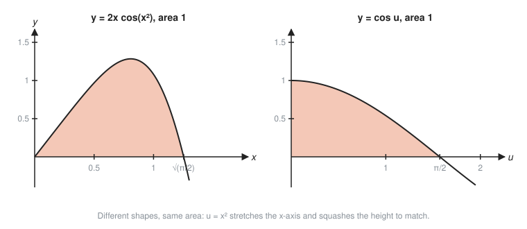
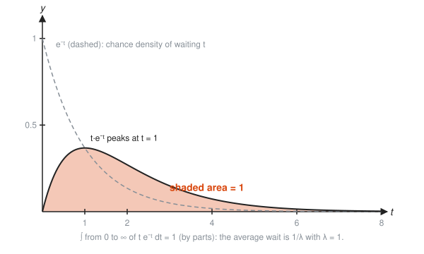

# Integration Techniques

**Level:** 401 · **Unit:** 8 · **Time:** 75 to 90 minutes
**Prerequisites:** [07 The Fundamental Theorem of Calculus](../07-fundamental-theorem/README.md)

## The Big Idea

Differentiation is mechanical: apply the rules and turn the crank. Integration is a search: you need a function whose derivative matches what you have. Two techniques handle most of the searches you meet:

* **Substitution** undoes the chain rule. Spot a function and its derivative sitting together, and rename the inside.
* **Integration by parts** undoes the product rule. Trade a hard integral for an easier one.

Every answer can be checked by differentiating it. Integration is guessing with a guaranteed referee.

## Picture It

<!-- diagram: type=area-model curve="v=1.5 sqrt(u)" u=1..4 regions="int v du (orange), int u dv (gray)" caption="Integration by parts as two areas filling an L shape" -->


The two shaded areas together fill the big rectangle $u_2 v_2$ minus the small corner rectangle $u_1 v_1$:

$$\int v\,du + \int u\,dv = u_2 v_2 - u_1 v_1.$$

If one of the two areas is hard to compute and the other is easy, rearrange and get the hard one for free. That is integration by parts, drawn.

## Step by Step

### Part A: Substitution

#### 1. Spot the Pattern

The chain rule says $\dfrac{d}{dx}F(g(x)) = F'(g(x))\,g'(x)$. Reading it backwards:

$$\int f(g(x))\,g'(x)\,dx = F(g(x)) + C.$$

Look for an inside function $g(x)$ whose derivative $g'(x)$ also appears as a factor.

#### 2. Rename the Inside

Set $u = g(x)$. Then $\dfrac{du}{dx} = g'(x)$, which you write as $du = g'(x)\,dx$. Swap every $x$ piece for a $u$ piece. If the swap leaves no stray $x$, you chose well.

#### 3. Change the Ruler

<!-- diagram: type=two-number-lines map="u=x^2" ticks=0,0.25,0.5,0.75,1,sqrt(pi/2) caption="Substitution re-marks the ruler" -->


Substitution swaps one ruler for another. Equal steps in $x$ become uneven steps in $u = x^2$, because $du = 2x\,dx$: near 0 the $u$ steps are tiny, further out they stretch. The factor $2x$ in the integral is exactly the stretch factor. For a definite integral, move the limits to the new ruler too: $x = \sqrt{\pi/2}$ becomes $u = \pi/2$.

<!-- diagram: type=multi-panel left="2x cos(x^2) on 0..sqrt(pi/2)" right="cos u on 0..pi/2" caption="Different shapes, same area" -->


The two shaded regions look nothing alike, yet both have area 1. Substitution stretched one into the other.

### Part B: Integration by Parts

#### 4. The Formula

The product rule says $(uv)' = u'v + uv'$. Integrate both sides and rearrange:

$$\int u\,dv = uv - \int v\,du.$$

This is the L-shape picture with the corner bookkeeping folded into $uv$.

#### 5. Choosing u

Pick $u$ to be the factor that gets simpler when differentiated, and $dv$ the factor you can integrate. A rough priority list for $u$, called LIATE: **L**ogs, **I**nverse trig, **A**lgebraic (powers of $x$), **T**rig, **E**xponentials. Pick the earliest one present.

#### 6. Repeat if Needed

If the new integral still has a power of $x$, apply parts again. Each round lowers the power by one.

## Worked Examples

### Example 1: Basic Substitution

$\displaystyle\int 2x\cos(x^2)\,dx$

```txt
  u = x^2                                  the inside function
  du = 2x dx                               its derivative is sitting right there
  integral of cos(u) du                    swap: cos(x^2) -> cos u, 2x dx -> du
  = sin u + C                              antiderivative of cos
  = sin(x^2) + C                           put x back
  check: d/dx sin(x^2) = cos(x^2) * 2x     chain rule confirms it
```

### Example 2: Substitution With Limits

$\displaystyle\int_0^{\sqrt{\pi/2}} 2x\cos(x^2)\,dx$

```txt
  u = x^2: x = 0 -> u = 0,  x = sqrt(pi/2) -> u = pi/2      move the limits
  integral from 0 to pi/2 of cos u du                        the new ruler
  = [sin u] from 0 to pi/2 = 1 - 0 = 1                       evaluate
```

### Example 3: Fixing a Constant

$\displaystyle\int \frac{x}{x^2 + 1}\,dx$

```txt
  u = x^2 + 1, du = 2x dx                  derivative is 2x, but only x is present
  x dx = du/2                              divide by 2 to match
  integral of (1/u)(du/2) = (1/2) ln|u| + C
  = (1/2) ln(x^2 + 1) + C                  x^2 + 1 > 0: drop the bars
```

Constant factors can be fixed. A missing $x$ cannot: $\int \cos(x^2)\,dx$ has no $2x$ to pair with, and substitution fails.

### Example 4: Linear Inside

$\displaystyle\int_0^1 (2x + 3)^4\,dx$

```txt
  u = 2x + 3, du = 2 dx, dx = du/2         linear inside: derivative is a constant
  limits: x = 0 -> u = 3, x = 1 -> u = 5
  (1/2) integral from 3 to 5 of u^4 du
  = (1/2)[u^5/5] from 3 to 5 = (3125 - 243)/10
  = 288.2
```

### Example 5: Parts, Once

$\displaystyle\int x e^x\,dx$

```txt
  u = x,      dv = e^x dx                  x simplifies when differentiated
  du = dx,    v = e^x                      differentiate u, integrate dv
  = x e^x - integral of e^x dx             uv - integral of v du
  = x e^x - e^x + C = e^x (x - 1) + C
  check: d/dx [e^x (x - 1)] = e^x (x - 1) + e^x = x e^x
```

### Example 6: Parts on a Lonely Log

$\displaystyle\int \ln x\,dx$

```txt
  u = ln x,   dv = dx                      ln x is easy to differentiate, hard to integrate
  du = (1/x) dx,  v = x
  = x ln x - integral of x * (1/x) dx      uv - integral of v du
  = x ln x - x + C
```

### Example 7: Parts, Twice

$\displaystyle\int x^2 e^x\,dx$

```txt
  u = x^2, dv = e^x dx, du = 2x dx, v = e^x
  = x^2 e^x - integral of 2x e^x dx        first round
  = x^2 e^x - 2(x e^x - e^x) + C           Example 5 for the leftover
  = e^x (x^2 - 2x + 2) + C
```

## The SRE Connection

<!-- diagram: type=function-plot f="t e^-t" range=0..8 compare="e^-t" caption="The mean of an exponential wait is an area" -->


**Average wait times come from integration by parts.** If requests arrive randomly at an average rate $\lambda$, the gap between arrivals follows the exponential distribution with density $\lambda e^{-\lambda t}$. The average gap is

$$\int_0^\infty t \cdot \lambda e^{-\lambda t}\,dt = \frac{1}{\lambda}.$$

Parts with $u = t$ and $dv = \lambda e^{-\lambda t}\,dt$ gives it in three lines. At 4 req/s the average gap is $1/4$ s. This integral is the seed of queueing theory, picked up in [501](../../501/README.md) and the [queues workshop](../../../workshops/calculus-of-rates-in-physics-and-queues/README.md).

* **Substitution is a unit change.** Integrating a rate measured per minute over a time axis in seconds needs $u = t/60$, $du = dt/60$. The stretch factor is the conversion factor.
* **When no formula exists, integrate numerically.** $\int \cos(x^2)\,dx$ and the bell curve $\int e^{-x^2}\,dx$ have no elementary antiderivative. Tools use Simpson's rule (see the Code Corner) or similar. Knowing when to stop searching for a formula is a skill too.

## Common Mistakes

* Forgetting to convert $dx$: after $u = x^2$, every $dx$ must become $du/(2x)$, and every $x$ must disappear.
* Keeping the old limits after substituting: either change the limits to $u$ values, or switch back to $x$ before evaluating. Never mix.
* Choosing $u$ backwards in parts: with $u = e^x$ and $dv = x\,dx$, the new integral $\int \tfrac{x^2}{2} e^x\,dx$ is worse than the original.
* Dropping the minus sign in $uv - \int v\,du$.
* Skipping the check: differentiate your answer. It takes thirty seconds and catches nearly everything.

## Try It

1. $\displaystyle\int 2x(x^2 + 1)^3\,dx$
2. $\displaystyle\int \cos(3x)\,dx$
3. $\displaystyle\int e^{5x}\,dx$
4. $\displaystyle\int_0^1 x e^{x^2}\,dx$
5. $\displaystyle\int x\sin x\,dx$
6. $\displaystyle\int_0^{\pi/2} x\cos x\,dx$
7. $\displaystyle\int \frac{\ln x}{x}\,dx$
8. $\displaystyle\int x^2 \ln x\,dx$
9. Requests arrive at random at 4 per second. Use $\int_0^\infty \lambda t e^{-\lambda t}\,dt = 1/\lambda$ to find the average gap between arrivals.

<details>
<summary>Answers</summary>

1. $\tfrac{1}{4}(x^2 + 1)^4 + C$. Substitute $u = x^2 + 1$.
2. $\tfrac{1}{3}\sin(3x) + C$. Substitute $u = 3x$.
3. $\tfrac{1}{5}e^{5x} + C$.
4. $\tfrac{1}{2}(e - 1) \approx 0.859$. With $u = x^2$: $\tfrac{1}{2}\int_0^1 e^u\,du$.
5. $-x\cos x + \sin x + C$. Parts with $u = x$, $dv = \sin x\,dx$.
6. $\tfrac{\pi}{2} - 1 \approx 0.571$. Antiderivative $x\sin x + \cos x$, evaluated: $(\tfrac{\pi}{2} + 0) - (0 + 1)$.
7. $\tfrac{1}{2}(\ln x)^2 + C$. Substitute $u = \ln x$, $du = dx/x$.
8. $\tfrac{x^3}{3}\ln x - \tfrac{x^3}{9} + C$. Parts with $u = \ln x$, $dv = x^2\,dx$.
9. $1/4$ s, that is, 250 ms.

</details>

## Code Corner

[`code/main.go`](code/main.go) checks the worked examples with **Simpson's rule**, which fits a little parabola through every three neighbouring points instead of a flat rectangle top. Run it with `go run main.go` inside the `code/` folder.

```go
func simpson(f func(float64) float64, a, b float64, n int) float64 {
	h := (b - a) / float64(n)
	sum := f(a) + f(b)
	for i := 1; i < n; i++ {
		w := 2.0
		if i%2 == 1 {
			w = 4
		}
		sum += w * f(a+float64(i)*h)
	}
	return sum * h / 3
}
```

Output:

```txt
sub:   2x cos(x^2), 0..sqrt(pi/2)    simpson 1.00000000   formula 1.00000000
sub:   x/(x^2+1), 0..1               simpson 0.34657359   formula 0.34657359
sub:   (2x+3)^4, 0..1                simpson 288.20000000   formula 288.20000000
parts: x e^x, 0..1                   simpson 1.00000000   formula 1.00000000
parts: x cos x, 0..pi/2              simpson 0.57079633   formula 0.57079633
parts: ln x, 1..e                    simpson 1.00000000   formula 1.00000000
parts: t e^-t, 0..50 (mean wait)     simpson 0.99999990   formula 1.00000000
```

The last line integrates to 50 instead of infinity. The tail beyond 50 is about $51e^{-50}$, a number with 20 zeros after the decimal point. Infinity is mostly empty. The small gap in the seventh decimal comes from stretching 1,000 strips over a long range, not from the cutoff.

## Go Deeper

* [Math Is Fun: Integration by Substitution](https://www.mathsisfun.com/calculus/integration-by-substitution.html) and [Integration by Parts](https://www.mathsisfun.com/calculus/integration-by-parts.html): short, friendly walk-throughs.
* [Paul's Online Math Notes, Calculus II](https://tutorial.math.lamar.edu/Classes/CalcII/CalcII.aspx): the Integration Techniques chapter, with many more methods and drills.
* [MathWorld: Integration by Parts](https://mathworld.wolfram.com/IntegrationbyParts.html): the formula and the area picture.
* [OpenStax Calculus Volume 2](https://openstax.org/details/books/calculus-volume-2): Chapter 3 on techniques of integration.
* Flashcards for this lesson: [cards.tsv](cards.tsv).

**Previous:** [07 The Fundamental Theorem of Calculus](../07-fundamental-theorem/README.md) · **Next:** [09 Applications of Integrals](../09-applications-of-integrals/README.md)
