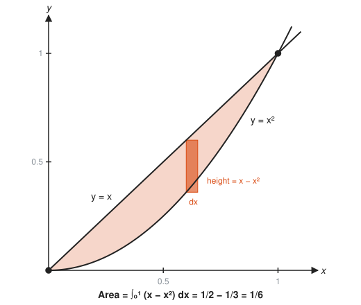
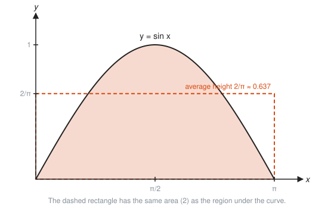
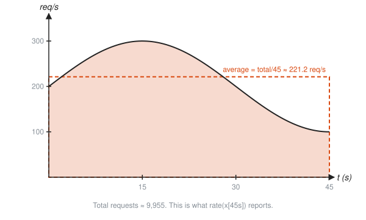
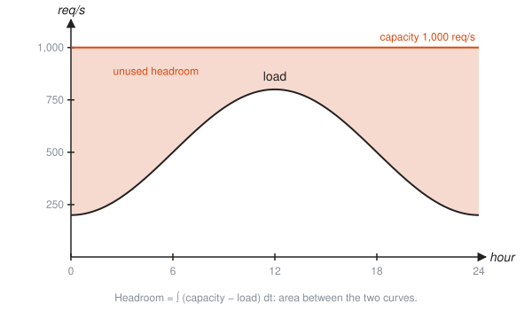

# Applications of Integrals

**Level:** 401 · **Unit:** 9 · **Time:** 60 to 75 minutes
**Prerequisites:** [07 The Fundamental Theorem of Calculus](../07-fundamental-theorem/README.md), [08 Integration Techniques](../08-integration-techniques/README.md)

## The Big Idea

Every application of integration follows one pattern, worth more than any formula:

1. Slice the thing into thin pieces.
2. Write the size of one piece. It is almost always (something) times $dx$.
3. Add the pieces with an integral.

Area between two curves, volumes of round solids, and averages are all this pattern with a different slice.

## Picture It

<!-- diagram: type=function-plot f="x" g="x^2" range=0..1 strip=0.6 caption="Area between y = x and y = x^2" -->


One slice is a thin vertical strip. Its height is (top curve) minus (bottom curve), $x - x^2$. Its width is $dx$. Add every strip from the left crossing to the right crossing.

## Step by Step

### 1. Area Between Two Curves

If $f(x) \ge g(x)$ on $[a, b]$:

$$\text{Area} = \int_a^b \big(f(x) - g(x)\big)\,dx.$$

To find $a$ and $b$ when they are not given, set $f(x) = g(x)$ and solve: the curves cross at the ends of the region. Top minus bottom keeps every strip positive, even when the region dips below the $x$-axis.

### 2. Volume by Disks

Spin a curve $y = f(x)$ around the $x$-axis and it sweeps out a solid. Slice the solid like a salami: each slice is a thin disk of radius $f(x)$ and thickness $dx$.

<!-- diagram: type=solid-of-revolution f="sqrt(x)" range=0..4 disks=1,2,3,4 slice=2.5 caption="Spinning y = sqrt(x) around the x-axis" -->


One disk has volume $\pi r^2 \cdot dx = \pi f(x)^2\,dx$. Add them:

$$V = \int_a^b \pi f(x)^2\,dx.$$

### 3. Washers: Disks With Holes

If the region between two curves spins, each slice is a washer: a big disk of radius $R(x)$ minus a hole of radius $r(x)$. Its volume is $\pi\big(R^2 - r^2\big)\,dx$. Subtract the squares, not the radii.

### 4. Average Value

The average of a list is (total) divided by (count). The average of a function on $[a, b]$ is (total area) divided by (width):

$$f_{\text{avg}} = \frac{1}{b - a}\int_a^b f(x)\,dx.$$

<!-- diagram: type=function-plot f="sin x" range=0..pi average=2/pi caption="Average value as an equal-area rectangle" -->


Picture it as pouring the region flat. The hump of $\sin x$ levels out into a rectangle of the same area, and its height is the average.

## Worked Examples

### Example 1: Area Between Two Curves

Find the area between $y = x$ and $y = x^2$.

```txt
  x = x^2  ->  x^2 - x = 0  ->  x(x - 1) = 0     where the curves cross
  crossings: x = 0 and x = 1                      the limits
  on (0, 1), x > x^2 (try x = 0.5: 0.5 > 0.25)    which curve is on top
  Area = integral from 0 to 1 of (x - x^2) dx     top minus bottom
       = [x^2/2 - x^3/3] from 0 to 1              antiderivative
       = 1/2 - 1/3 = 1/6                          evaluate
```

### Example 2: A Parabola and a Line

Find the area between $y = 2x$ and $y = x^2$.

```txt
  2x = x^2  ->  x(x - 2) = 0  ->  x = 0, 2        crossings
  at x = 1: 2x = 2, x^2 = 1                       the line is on top
  Area = integral from 0 to 2 of (2x - x^2) dx
       = [x^2 - x^3/3] from 0 to 2 = 4 - 8/3 = 4/3
```

### Example 3: Volume by Disks

Spin $y = \sqrt{x}$ on $[0, 4]$ around the $x$-axis.

```txt
  radius of one disk: sqrt(x)
  disk volume: pi (sqrt(x))^2 dx = pi x dx        square the radius
  V = integral from 0 to 4 of pi x dx
    = pi [x^2/2] from 0 to 4 = pi * 8 = 8 pi      about 25.13
```

### Example 4: The Volume of a Sphere

Spin the half-circle $y = \sqrt{r^2 - x^2}$ around the $x$-axis.

```txt
  disk volume: pi (r^2 - x^2) dx                  radius squared, root gone
  V = integral from -r to r of pi (r^2 - x^2) dx
    = pi [r^2 x - x^3/3] from -r to r
    = pi [(r^3 - r^3/3) - (-r^3 + r^3/3)]         evaluate both ends
    = pi (4r^3/3) = (4/3) pi r^3                  the formula from school, derived
```

### Example 5: Average Value

Find the average of $\sin x$ on $[0, \pi]$.

```txt
  integral from 0 to pi of sin x dx = 2           from Lesson 07
  width = pi - 0 = pi
  average = 2/pi = 0.637                          area divided by width
```

## The SRE Connection

<!-- diagram: type=function-plot f="200+100 sin(pi t/30)" range=0..45 average=221.2 caption="Average rate is total over time" -->


**`rate()` is an average value.** `rate(x[45s])` takes the counter increase over the window (the area under the true rate) and divides by 45 seconds (the width). That is exactly $\dfrac{1}{b - a}\int_a^b r(t)\,dt$. A spike and a calm stretch that share the same area give the same `rate()`. The window flattens the hump into a rectangle.

<!-- diagram: type=function-plot f="500+300 sin(pi(t-6)/12)" capacity=1000 range=0..24 caption="Headroom is the area between capacity and load" -->


**Headroom is area between curves.** Capacity is the top curve, load is the bottom curve. The area between them over a day is the work the fleet had room for and never did: $\int_0^{24} (1000 - \text{load})\,dt = 12{,}000$ req/s-hours, about 43 million spare requests. That is the number to bring to a capacity review, and the shape of the gap tells you whether autoscaling recovers it.

* **Total cost from a price curve.** Dollars per hour integrated over a month is a bill. Average cost per hour is that bill divided by 720 hours.

## Common Mistakes

* Bottom minus top: the area comes out negative. Check which curve is higher at a test point.
* Forgetting to find the crossings: the limits of integration come from $f(x) = g(x)$.
* Washer error: $\pi(R - r)^2$ is wrong. Use $\pi(R^2 - r^2)$.
* Forgetting to divide by the width for an average: the integral is a total, not an average.
* Leaving out $\pi$ in volume problems: each slice is a circle.

## Try It

1. Find the area between $y = 2x$ and $y = x^2$. (Check Example 2 without looking.)
2. Find the area between $y = 4 - x^2$ and the $x$-axis.
3. Find the area between $y = \sqrt{x}$ and $y = x$ on $[0, 1]$.
4. Spin $y = x$ on $[0, 2]$ around the $x$-axis. Find the volume. What shape is it?
5. Spin $y = x^2$ on $[0, 1]$ around the $x$-axis. Find the volume.
6. Use Example 4 to find the volume of a sphere of radius 3.
7. Find the average value of $x^2$ on $[0, 3]$.
8. Requests arrive at $r(t) = 100 + 6t$ req/s over $[0, 10]$. What average rate does a 10-second `rate()` window report?
9. Spin the region between $y = x$ and $y = x^2$ (on $[0, 1]$) around the $x$-axis. Find the volume with washers.

<details>
<summary>Answers</summary>

1. $4/3$.
2. $32/3$. Crossings at $\pm 2$: $[4x - x^3/3]_{-2}^{2} = 16/3 - (-16/3)$.
3. $1/6$. $\sqrt{x}$ is on top: $\tfrac{2}{3} - \tfrac{1}{2}$.
4. $8\pi/3$. A cone of radius 2 and height 2: $\pi\int_0^2 x^2\,dx$.
5. $\pi/5$. $\pi\int_0^1 x^4\,dx$.
6. $36\pi \approx 113.1$. $\tfrac{4}{3}\pi(27)$.
7. 3. $\tfrac{1}{3}\int_0^3 x^2\,dx = \tfrac{1}{3}\cdot 9$.
8. 130 req/s. The total is 1,300 requests over 10 s.
9. $2\pi/15$. $\pi\int_0^1 (x^2 - x^4)\,dx = \pi(\tfrac{1}{3} - \tfrac{1}{5})$.

</details>

## Code Corner

[`code/main.go`](code/main.go) computes every application with the same slicing loop, only changing what one slice is worth. Run it with `go run main.go` inside the `code/` folder.

```go
func sum(f func(float64) float64, a, b float64, n int) float64 {
	dx := (b - a) / float64(n)
	s := 0.0
	for i := 0; i < n; i++ {
		s += f(a+(float64(i)+0.5)*dx) * dx
	}
	return s
}

disks := sum(func(x float64) float64 { r := math.Sqrt(x); return math.Pi * r * r }, 0, 4, n)
```

Output:

```txt
area between y = x and y = x^2:   0.166667 (exact 1/6 = 0.166667)
volume, sqrt(x) spun on [0, 4]:   25.132741 (exact 8 pi = 25.132741)
average of sin x on [0, pi]:      0.636620 (exact 2/pi = 0.636620)
requests in 45 s: 9954.9, average rate 221.22 req/s
headroom over a day: 12000 req/s-hours = 43 million spare requests
```

One function, five problems. The physics changes, the loop does not.

## Go Deeper

* [Paul's Online Math Notes, Calculus I](https://tutorial.math.lamar.edu/Classes/CalcI/CalcI.aspx): the Applications of Integrals chapter covers average value, area between curves, and volumes.
* [OpenStax Calculus Volume 1](https://openstax.org/details/books/calculus-volume-1): Chapter 6 on applications of integration, with many solids drawn in 3D.
* [Khan Academy: Calculus 2](https://www.khanacademy.org/math/calculus-2): videos on disks, washers, and average value.
* Flashcards for this lesson: [cards.tsv](cards.tsv).

**Previous:** [08 Integration Techniques](../08-integration-techniques/README.md) · **Next:** [10 Sequences and Series](../10-sequences-and-series/README.md)
