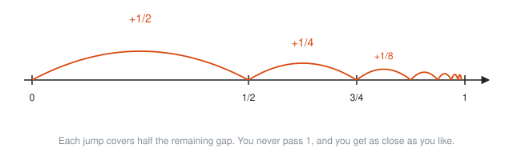
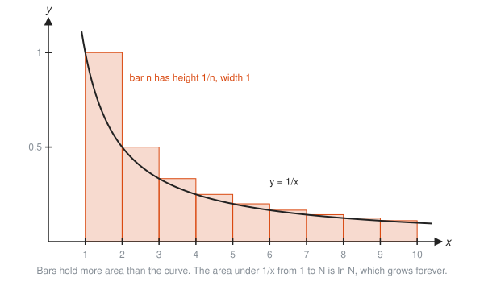
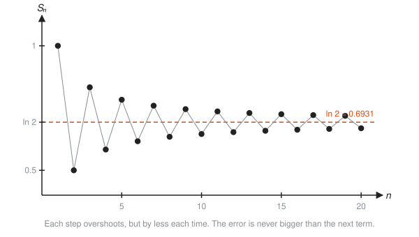
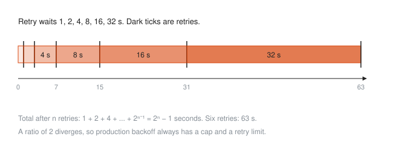

# Sequences and Series

**Level:** 401 · **Unit:** 10 · **Time:** 75 to 90 minutes
**Prerequisites:** [01 Limits and Continuity](../01-limits-and-continuity/README.md), arithmetic and geometric sequences from [301](../../301/README.md)

## The Big Idea

A **sequence** is an endless list of numbers: $a_1, a_2, a_3, \dots$. A **series** is what you get when you try to add the whole list.

Adding infinitely many numbers sounds like it must give infinity. Sometimes it does. Sometimes it does not: $\tfrac{1}{2} + \tfrac{1}{4} + \tfrac{1}{8} + \dots$ adds up to exactly 1. The whole subject is learning to tell the two cases apart, and the tool is the same limit from [Lesson 01](../01-limits-and-continuity/README.md).

## Picture It

<!-- diagram: type=area-model shape=unit-square halving=9 caption="1/2 + 1/4 + 1/8 + ... fills the unit square" -->


Take a square of area 1. Shade half. Shade half of what is left. Repeat forever. Every piece you add is half the remaining gap. The shaded total creeps toward 1 and never passes it. The infinite sum is exactly 1.

## Step by Step

### 1. Sequences and Their Limits

A sequence **converges** to $L$ if its terms eventually stay as close to $L$ as you like. This is the epsilon band game again, with $n$ in place of $x$.

<!-- diagram: type=dot-plot f="1+(-1)^n/n" n=1..15 band=0.8..1.2 caption="A sequence settling inside a band around 1" -->


With $\varepsilon = 0.2$, every term after $n = 5$ stays inside the band. Shrink $\varepsilon$ and you need a later cutoff, but one always exists. The term $a_5 = 0.8$ sits exactly on the edge, which does not count as inside: the definition uses strict inequality.

### 2. Series and Partial Sums

A series $\sum_{n=1}^{\infty} a_n$ is defined through its **partial sums**, the running totals:

$$S_N = a_1 + a_2 + \dots + a_N.$$

The series converges to $S$ if the sequence of running totals $S_1, S_2, S_3, \dots$ converges to $S$. Otherwise it **diverges**. An infinite sum is a limit of finite sums. Nothing more mysterious than that.

### 3. Geometric Series

Each term is the previous one times a fixed ratio $r$:

$$a + ar + ar^2 + ar^3 + \dots = \frac{a}{1 - r} \quad \text{when } |r| < 1.$$

If $|r| \ge 1$, the terms do not shrink and the series diverges. The same halving idea drawn on a number line:

<!-- diagram: type=number-line range=0..1 jumps=1/2,1/4,1/8,... caption="Halving jumps toward 1" -->


Why the formula works: let $S = a + ar + ar^2 + \dots$. Then $rS = ar + ar^2 + \dots$ is the same list shifted by one. Subtract: $S - rS = a$, which gives $S = a/(1 - r)$.

### 4. The Divergence Test

If the terms do not shrink to 0, the series diverges. Adding numbers near $\tfrac{1}{2}$ forever gives infinity. Warning: the reverse is false. Terms shrinking to 0 is **necessary** but not **enough**.

### 5. The Harmonic Series: Shrinking Is Not Enough

$1 + \tfrac{1}{2} + \tfrac{1}{3} + \tfrac{1}{4} + \dots$ diverges, even though the terms go to 0.

<!-- diagram: type=dot-plot series="1/n, 1/n^2" n=1..30 caption="Harmonic sums climb; squares sums level off" -->


The harmonic sum grows like $\ln N$: slowly, but without limit. After a million terms it has only reached about 14.4, and it keeps going. The sum of $1/n^2$ looks similar for the first few terms, then stalls at $\pi^2/6 \approx 1.645$.

Why the harmonic series diverges, with the integral as a witness:

<!-- diagram: type=bars-over-curve f="1/x" bars="1/n" n=1..9 caption="Bars of height 1/n hold more area than 1/x" -->


Each bar $1/n$ sits above the curve $1/x$ on $[n, n+1]$. The bars' total area beats $\int_1^{N} \frac{dx}{x} = \ln N$, and $\ln N$ grows forever. This is the **integral test**: a series of positive decreasing terms converges exactly when the matching integral does.

### 6. p-Series

$$\sum \frac{1}{n^p} \text{ converges when } p > 1 \text{ and diverges when } p \le 1.$$

The harmonic series is $p = 1$, right on the losing side of the line.

### 7. Comparison Test

If $0 \le a_n \le b_n$ and $\sum b_n$ converges, then $\sum a_n$ converges too. A pile smaller than a finite pile is finite. If $a_n \ge b_n \ge 0$ and $\sum b_n$ diverges, $\sum a_n$ diverges.

### 8. Ratio Test

Look at $\lim \left|\dfrac{a_{n+1}}{a_n}\right| = L$. If $L < 1$, the series converges, because it eventually behaves like a geometric series with ratio below 1. If $L > 1$, it diverges. If $L = 1$, the test says nothing. Use it on series with powers and factorials.

### 9. Alternating Series

If the signs alternate and the sizes shrink steadily to 0, the series converges.

<!-- diagram: type=dot-plot series="sum (-1)^(n+1)/n" n=1..20 target=ln2 caption="Alternating partial sums zigzag toward ln 2" -->


Each step overshoots, then the next step pulls back by a smaller amount. The alternating harmonic series converges to $\ln 2 \approx 0.693$, although the plain harmonic series diverges. Signs matter. And a bonus: the error after stopping is never larger than the first term you left out.

## Worked Examples

### Example 1: Limit of a Sequence

```txt
  a_n = (3n + 1)/(n + 2)
      = (3 + 1/n)/(1 + 2/n)          divide top and bottom by n
  -> (3 + 0)/(1 + 0) = 3             1/n -> 0
```

### Example 2: A Geometric Series

$3 + 1 + \tfrac{1}{3} + \tfrac{1}{9} + \dots$

```txt
  a = 3, r = 1/3                     first term and ratio
  |r| < 1                            converges
  S = 3/(1 - 1/3) = 3/(2/3) = 4.5
```

### Example 3: 0.999... Equals 1

```txt
  0.999... = 0.9 + 0.09 + 0.009 + ...    a geometric series
  a = 0.9, r = 0.1
  S = 0.9/(1 - 0.1) = 0.9/0.9 = 1        not "almost 1": exactly 1
```

### Example 4: The Divergence Test

$\displaystyle\sum_{n=1}^{\infty} \frac{n}{n + 1}$

```txt
  n/(n + 1) -> 1                         terms approach 1, not 0
  diverges                               adding numbers near 1 forever
```

### Example 5: The Ratio Test

$\displaystyle\sum_{n=1}^{\infty} \frac{n}{2^n}$

```txt
  a_(n+1)/a_n = ((n+1)/2^(n+1)) * (2^n/n)    flip and multiply
              = (n + 1)/(2n)                 2^n / 2^(n+1) = 1/2
  -> 1/2 < 1                                 converges (the sum is 2)
```

### Example 6: Comparison

$\displaystyle\sum_{n=1}^{\infty} \frac{1}{n^2 + 1}$

```txt
  1/(n^2 + 1) < 1/n^2                    bigger bottom, smaller fraction
  sum 1/n^2 converges (p = 2 > 1)
  so sum 1/(n^2 + 1) converges           smaller than a finite pile
```

## The SRE Connection

<!-- diagram: type=timeline waits=1,2,4,8,16,32 caption="Exponential backoff on a timeline" -->


* **Exponential backoff is a geometric series with $r = 2$.** The waits $1 + 2 + 4 + \dots$ total $2^n - 1$ after $n$ retries. Ratio above 1 means divergence, which is why real backoff has a cap (for example 30 s) and a retry limit. Without them, the client retries until the heat death of the universe, slightly delayed.
* **Retry amplification is a geometric series with $r = p$.** If each attempt fails with chance $p$ and failures are retried, the expected number of attempts per request is $1 + p + p^2 + \dots = \dfrac{1}{1 - p}$. At $p = 0.2$ that is 1.25 times the load. As $p$ approaches 1 during an outage, the multiplier explodes: a retry storm is a series diverging in production.
* **The harmonic series counts shards.** If requests land on $n$ shards at random, the expected number of requests until every shard has seen at least one is $n\left(1 + \tfrac{1}{2} + \dots + \tfrac{1}{n}\right) \approx n \ln n$. This is the "coupon collector" problem from [501](../../501/README.md) probability.

## Common Mistakes

* Thinking terms going to 0 guarantees convergence: the harmonic series is the permanent counterexample.
* Using $a/(1 - r)$ when $|r| \ge 1$: the formula gives a finite number for a divergent series. $1 + 2 + 4 + \dots$ is not $-1$.
* Starting the geometric sum at the wrong term: $a$ is the first term actually in the sum.
* Concluding anything from a ratio test limit of exactly 1: the test is silent there.
* Mixing up sequence convergence with series convergence: $a_n = 1/n$ converges (to 0), while $\sum 1/n$ diverges.

## Try It

1. Find $\lim_{n \to \infty} \dfrac{2n^2 + 1}{5n^2 - n}$.
2. Sum $\displaystyle\sum_{n=0}^{\infty} \left(\tfrac{2}{3}\right)^n$.
3. Sum $5 - \tfrac{5}{2} + \tfrac{5}{4} - \tfrac{5}{8} + \dots$
4. Write $0.272727\dots$ as a fraction.
5. Does $\displaystyle\sum \frac{n + 1}{2n}$ converge?
6. Which converge: $\sum \dfrac{1}{n^3}$, $\sum \dfrac{1}{n^{0.9}}$, $\sum \dfrac{1}{\sqrt{n}}$?
7. Use the ratio test on $\displaystyle\sum_{n=1}^{\infty} \frac{3^n}{n!}$.
8. $\sum \dfrac{(-1)^{n+1}}{n^2}$ converges. If you stop after three terms, how large can the error be?
9. Each attempt fails with chance 0.1 and is retried until it succeeds. What is the expected number of attempts?
10. Backoff starts at 1 s and doubles with no cap. How long does a client wait in total before its 10th attempt?

<details>
<summary>Answers</summary>

1. $2/5$. Divide by $n^2$.
2. 3. $a = 1$, $r = 2/3$: $1/(1/3)$.
3. $10/3$. $a = 5$, $r = -1/2$: $5/(3/2)$.
4. $3/11$. $0.27 + 0.0027 + \dots = 0.27/(1 - 0.01) = 27/99$.
5. No. The terms approach $1/2$, not 0.
6. $\sum 1/n^3$ converges ($p = 3$). The other two diverge ($p = 0.9$ and $p = 0.5$).
7. Converges. The ratio is $3/(n + 1) \to 0 < 1$. (The sum is $e^3 - 1$.)
8. At most $1/16$, the first omitted term.
9. $1/(1 - 0.1) = 10/9 \approx 1.11$ attempts.
10. 511 s. Nine waits: $1 + 2 + \dots + 256 = 2^9 - 1$.

</details>

## Code Corner

[`code/main.go`](code/main.go) runs four series out to a million terms and simulates capped backoff. Run it with `go run main.go` inside the `code/` folder.

```go
for k := 1; k <= 1000000; k++ {
	fk := float64(k)
	geo += math.Pow(0.5, fk)
	harm += 1 / fk
	sq += 1 / (fk * fk)
	// ... alternating series, then print at n = 1, 10, 100, ...
}
```

Output:

```txt
        n    sum 1/2^k    sum 1/k    sum 1/k^2   sum (-1)^(k+1)/k
        1     0.500000     1.0000     1.000000     1.000000
       10     0.999023     2.9290     1.549768     0.645635
      100     1.000000     5.1874     1.634984     0.688172
     1000     1.000000     7.4855     1.643935     0.692647
    10000     1.000000     9.7876     1.644834     0.693097
   100000     1.000000    12.0901     1.644924     0.693142
  1000000     1.000000    14.3927     1.644933     0.693147
  targets:     1.000000       none     1.644934     0.693147
Exponential backoff, base 1 s, doubling, capped at 30 s:
  retry 1 after waiting    1 s, total     1 s
  retry 2 after waiting    2 s, total     3 s
  retry 3 after waiting    4 s, total     7 s
  retry 4 after waiting    8 s, total    15 s
  retry 5 after waiting   16 s, total    31 s
  retry 6 after waiting   30 s, total    61 s
  retry 7 after waiting   30 s, total    91 s
  retry 8 after waiting   30 s, total   121 s
```

Every factor of 10 in $n$ adds about $\ln 10 \approx 2.3$ to the harmonic column. It never stops. It just gets bored slowly.

## Go Deeper

* [Paul's Online Math Notes, Calculus II](https://tutorial.math.lamar.edu/Classes/CalcII/CalcII.aspx): the Series and Sequences chapter covers every test with examples.
* [MathWorld: Harmonic Series](https://mathworld.wolfram.com/HarmonicSeries.html): proofs of divergence and growth facts.
* [Better Explained](https://betterexplained.com/calculus/): intuition-first articles, including on infinite sums.
* [OpenStax Calculus Volume 2](https://openstax.org/details/books/calculus-volume-2): Chapter 5 on sequences and series.
* The [Exponential Growth workshop](../../../workshops/exponential-growth-in-interest-epidemics-and-load/README.md) applies geometric series to load and interest.
* Flashcards for this lesson: [cards.tsv](cards.tsv).

**Previous:** [09 Applications of Integrals](../09-applications-of-integrals/README.md) · **Next:** [11 Taylor Series](../11-taylor-series/README.md)
