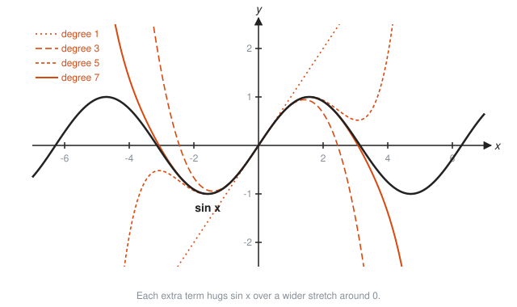
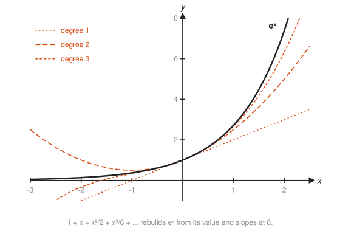
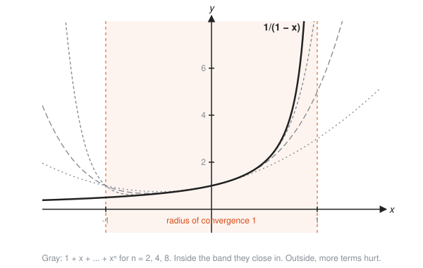

# Taylor Series

**Level:** 401 · **Unit:** 11 · **Time:** 75 to 90 minutes
**Prerequisites:** [03 Derivative Rules](../03-derivative-rules/README.md), [04 Optimization and Linear Approximation](../04-optimization-and-linear-approximation/README.md), [10 Sequences and Series](../10-sequences-and-series/README.md)

## The Big Idea

Polynomials are the easiest functions there are: a computer evaluates them with nothing but multiply and add. A **Taylor series** rewrites a hard function, such as $e^x$ or $\sin x$, as an infinitely long polynomial.

The recipe: at one point, match the function's value, then its slope, then its bend, then the rate of change of its bend, and so on. Each matched derivative adds one term, and each term makes the polynomial hug the curve over a wider stretch. The tangent line from [Lesson 04](../04-optimization-and-linear-approximation/README.md) was the first step of this staircase.

## Picture It

<!-- diagram: type=function-plot f="sin x" range=-7..7 taylor-degrees=1,3,5,7 caption="Taylor polynomials of sin x" -->


The straight line (degree 1) matches $\sin x$ only near 0. Degree 3 follows the first hump. Degree 5 reaches past $\pm\pi$. Degree 7 hugs nearly two full humps. Keep adding terms and the polynomial follows the wave as far as you like.

## Step by Step

### 1. Why Polynomials

$\sin(0.3)$ has no button inside the CPU. $0.3 - \dfrac{0.3^3}{6} + \dfrac{0.3^5}{120}$ needs only multiplication, division, and addition. Your math library computes $\sin$, $\exp$, and $\log$ by tricks built on this idea.

### 2. Match Derivatives One at a Time

Look for $p(x) = c_0 + c_1 x + c_2 x^2 + c_3 x^3 + \dots$ that agrees with $f$ at $x = 0$:

* Match the value: $p(0) = c_0$. Set $c_0 = f(0)$.
* Match the slope: $p'(0) = c_1$. Set $c_1 = f'(0)$.
* Match the bend: $p''(0) = 2c_2$. Set $c_2 = f''(0)/2$.
* Match the third derivative: $p'''(0) = 6c_3 = 3!\,c_3$. Set $c_3 = f'''(0)/3!$.

The pattern is $c_k = \dfrac{f^{(k)}(0)}{k!}$, where $f^{(k)}$ means the $k$-th derivative and $k! = 1 \cdot 2 \cdots k$ (**factorial**). Differentiating $x^k$ exactly $k$ times leaves $k!$, which is why the factorial appears.

### 3. The Taylor Series Formula

Around a general point $a$:

$$f(x) = f(a) + f'(a)(x - a) + \frac{f''(a)}{2!}(x - a)^2 + \frac{f'''(a)}{3!}(x - a)^3 + \dots$$

Around $a = 0$ it is called a **Maclaurin series**. Cut it off after the $(x - a)^n$ term and you have the **degree-$n$ Taylor polynomial**.

<!-- diagram: type=function-plot f="e^x" range=-3..2.5 taylor-degrees=1,2,3 caption="Taylor polynomials of e^x" -->


### 4. Five Series Worth Memorizing

| Function | Series | Works for |
|---|---|---|
| $e^x$ | $1 + x + \dfrac{x^2}{2!} + \dfrac{x^3}{3!} + \dots$ | all $x$ |
| $\sin x$ | $x - \dfrac{x^3}{3!} + \dfrac{x^5}{5!} - \dots$ | all $x$ |
| $\cos x$ | $1 - \dfrac{x^2}{2!} + \dfrac{x^4}{4!} - \dots$ | all $x$ |
| $\dfrac{1}{1 - x}$ | $1 + x + x^2 + x^3 + \dots$ | $-1 < x < 1$ |
| $\ln(1 + x)$ | $x - \dfrac{x^2}{2} + \dfrac{x^3}{3} - \dots$ | $-1 < x \le 1$ |

Notice $\sin$ is odd (only odd powers) and $\cos$ is even (only even powers), matching their symmetric graphs.

### 5. Radius of Convergence

Some series work everywhere. Others work only within a distance $R$ of the center, the **radius of convergence**.

<!-- diagram: type=function-plot f="1/(1-x)" range=-1.6..1.6 partial-sums=2,4,8 band=-1..1 caption="Geometric series only work for |x| < 1" -->


$\dfrac{1}{1 - x} = 1 + x + x^2 + \dots$ is the geometric series from [Lesson 10](../10-sequences-and-series/README.md). It converges only when $|x| < 1$. At $x = 2$ the left side is $-1$ and the right side is $1 + 2 + 4 + \dots$, which is not $-1$ by any honest accounting.

### 6. How Big Is the Error

For an alternating series like $\sin x$ at small $x$, the error after stopping is at most the first term left out. In general, the error of a degree-$n$ Taylor polynomial behaves like (next derivative) times $\dfrac{(x - a)^{n+1}}{(n + 1)!}$. Near the center $(x - a)^{n+1}$ is tiny. Far away it is not. The factorial in the bottom eventually wins for $e^x$, $\sin$, and $\cos$, which is why their series work everywhere.

### 7. Small-x Shortcuts

Keep only the first one or two terms when $x$ is small:

$$e^x \approx 1 + x, \quad \ln(1 + x) \approx x, \quad (1 + x)^n \approx 1 + nx, \quad \sqrt{1 + x} \approx 1 + \tfrac{x}{2}, \quad \sin x \approx x.$$

Engineers use these every day without calling them Taylor series.

## Worked Examples

### Example 1: Build the Series for e^x

```txt
  f(x) = e^x, every derivative is e^x            slope equals height, forever
  f(0) = f'(0) = f''(0) = ... = 1                e^0 = 1
  c_k = 1/k!                                     formula c_k = f^(k)(0)/k!
  e^x = 1 + x + x^2/2! + x^3/3! + ...
```

### Example 2: Build the Series for sin x

```txt
  derivatives: sin, cos, -sin, -cos, sin, ...    cycle of four
  at 0:        0,   1,   0,   -1,   0, ...       sin 0 = 0, cos 0 = 1
  c_k:         0,   1,   0,   -1/3!, 0, 1/5!, ...
  sin x = x - x^3/3! + x^5/5! - x^7/7! + ...     only odd powers survive
```

### Example 3: Compute e^0.1 by Hand

```txt
  e^0.1 ~ 1 + 0.1 + 0.01/2                three terms
        = 1 + 0.1 + 0.005 = 1.105
  true value 1.105171                     error 0.000171, about the next term 0.001/6
```

### Example 4: Compute cos 0.2

```txt
  cos 0.2 ~ 1 - (0.2)^2/2 = 1 - 0.02 = 0.98      two terms
  next term (0.2)^4/24 = 0.0000667               bound on the error
  true value 0.980067
```

### Example 5: A Series From a Series

Integrate the geometric series to get $\ln(1 + x)$.

```txt
  1/(1 + t) = 1 - t + t^2 - t^3 + ...            geometric with r = -t
  ln(1 + x) = integral from 0 to x of dt/(1 + t)  Lesson 07
            = x - x^2/2 + x^3/3 - ...             integrate term by term
```

### Example 6: Centered Away From Zero

Degree 2 Taylor polynomial of $\sqrt{x}$ about $a = 4$, then estimate $\sqrt{4.41}$.

```txt
  f(4) = 2                                    sqrt(4)
  f'(x) = (1/2) x^(-1/2),   f'(4) = 1/4
  f''(x) = -(1/4) x^(-3/2), f''(4) = -1/32    4^(3/2) = 8
  p(x) = 2 + (x - 4)/4 - (x - 4)^2/64         divide f''(4) by 2!
  p(4.41) = 2 + 0.1025 - 0.0026 = 2.09987     x - 4 = 0.41
  true value 2.1                              error about 0.00013
```

## See It Step by Step


[Zoom In: Curves Look Straight: open the step-by-step walkthrough](https://caseyaedwards.github.io/math_training/diagrams/local-linearity/)

Watch the curve straighten out as the zoom deepens until it matches its tangent line.


[Taylor Polynomials of sin x: open the step-by-step walkthrough](https://caseyaedwards.github.io/math_training/diagrams/taylor-polynomials/)

Watch each extra term make the polynomial hug the sine curve over a wider stretch.

## The SRE Connection

<!-- diagram: type=function-plot f="1-(1-p)^100" estimate="100p" range=0..0.02 caption="At least one failure in 100 components" -->


* **"Add the failure rates" is a Taylor shortcut.** If 100 independent components each fail with chance $p$, the chance that at least one fails is $1 - (1 - p)^{100}$. The shortcut $(1 - p)^{100} \approx 1 - 100p$ gives "about $100p$". At $p = 0.001$ that is 0.1 versus the exact 0.0952: fine. At $p = 0.01$ it says 1.0 (certain failure) versus 0.634: nonsense. The shortcut holds while $np$ is small. The [error budgets workshop](../../../workshops/probability-for-on-call-error-budgets-and-slos/README.md) uses this constantly.
* **Availability in series.** Fifty dependencies at 99.9% each give about $1 - 50(0.001) = 95\%$ overall. The exact value is $0.999^{50} = 95.12\%$.
* **The rule of 70.** Growth of $r$ percent per period doubles in about $70/r$ periods, because $\ln(1 + x) \approx x$ and $\ln 2 \approx 0.693$. At 5% traffic growth per month, capacity doubles in about 14 months (exact: 14.2).
* **Your math library.** Go's `math.Exp`, `math.Sin`, and `math.Log` reduce the input to a small range, then evaluate a carefully tuned polynomial. Taylor series, with production hardening.

## Common Mistakes

* Forgetting the factorials: the $x^3$ term of $e^x$ is $x^3/6$, not $x^3/3$.
* Using a series outside its radius: $\ln(1 + x) = x - x^2/2 + \dots$ fails for $x = 2$.
* Trusting a low-degree polynomial far from the center: the tangent line is a local promise.
* Centering at the wrong point: around $a$, the powers are of $(x - a)$, not $x$.
* Using degrees with $\sin$ and $\cos$ series: radians only.

## Try It

1. Write the degree 2 Maclaurin polynomial of $e^{2x}$.
2. Derive the first three nonzero terms of the series for $\cos x$.
3. Estimate $e^{0.2}$ with three terms.
4. Estimate $\sin(0.1)$ with two terms.
5. Write the series for $\dfrac{1}{1 + x}$. For which $x$ does it work?
6. Substitute $-x^2$ into the $e^x$ series to get the first four terms for $e^{-x^2}$.
7. Fifty dependencies each have 99.9% availability. Estimate the combined availability with the shortcut.
8. Traffic grows 5% per month. Estimate the doubling time with the rule of 70.
9. Use the $e^x$ series to find $\lim_{x \to 0} \dfrac{e^x - 1 - x}{x^2}$.

<details>
<summary>Answers</summary>

1. $1 + 2x + 2x^2$. Substitute $2x$: $1 + 2x + (2x)^2/2$.
2. $1 - \dfrac{x^2}{2} + \dfrac{x^4}{24}$. Derivatives at 0 cycle $1, 0, -1, 0, 1$.
3. $1 + 0.2 + 0.02 = 1.22$. The true value is $1.22140$.
4. $0.1 - 0.001/6 \approx 0.099833$. The true value is $0.0998334$.
5. $1 - x + x^2 - x^3 + \dots$ for $-1 < x < 1$.
6. $1 - x^2 + \dfrac{x^4}{2} - \dfrac{x^6}{6}$.
7. About 95%. The exact value is 95.12%.
8. About 14 months. The exact value is $\ln 2 / \ln 1.05 \approx 14.2$.
9. $1/2$. The top is $x^2/2 + x^3/6 + \dots$. Divide by $x^2$ and let $x \to 0$.

</details>

## Code Corner

[`code/main.go`](code/main.go) builds Taylor polynomials term by term (each term from the previous one, never computing a factorial directly) and tests the failure-rate shortcut. Run it with `go run main.go` inside the `code/` folder.

```go
func sinTaylor(x float64, degree int) float64 {
	term, sum := x, 0.0
	for k := 1; k <= degree; k += 2 {
		sum += term
		term *= -x * x / float64((k+1)*(k+2)) // next odd term from the previous one
	}
	return sum
}
```

Output:

```txt
degree   sin(1) approx   sin(3) approx   e^1 approx
     1     1.000000000     3.000000000   2.000000000
     3     0.833333333    -1.500000000   2.666666667
     5     0.841666667     0.525000000   2.716666667
     7     0.841468254     0.091071429   2.718253968
     9     0.841471010     0.145312500   2.718281526
  true     0.841470985     0.141120008   2.718281828
At least one of 100 parts fails, each with chance p:
  p = 0.0001 exact 0.0100   estimate 100p = 0.0100
  p = 0.001  exact 0.0952   estimate 100p = 0.1000
  p = 0.01   exact 0.6340   estimate 100p = 1.0000
  p = 0.05   exact 0.9941   estimate 100p = 5.0000
ln(1.03) = 0.02956 vs 0.03;  sqrt(1.02) = 1.00995 vs 1.01
```

At $x = 1$, degree 9 nails $\sin$ to seven digits. At $x = 3$, far from the center, it is still off in the third digit. Distance from the center costs terms. And a "probability" of 5.0 is the shortcut telling you, loudly, that you have left its territory.

## Go Deeper

* [Paul's Online Math Notes, Calculus II](https://tutorial.math.lamar.edu/Classes/CalcII/CalcII.aspx): sections on power series and Taylor series.
* [MathWorld: Taylor Series](https://mathworld.wolfram.com/TaylorSeries.html): the general formula and remainder terms.
* [MacTutor: Brook Taylor](https://mathshistory.st-andrews.ac.uk/Biographies/Taylor/): the man behind the name.
* [MIT OCW 18.01SC Single Variable Calculus](https://ocw.mit.edu/courses/18-01sc-single-variable-calculus-fall-2010/): the final unit covers Taylor series.
* Flashcards for this lesson: [cards.tsv](cards.tsv).

**Previous:** [10 Sequences and Series](../10-sequences-and-series/README.md) · **Next:** [12 Multivariable Calculus Intro](../12-multivariable-intro/README.md)
