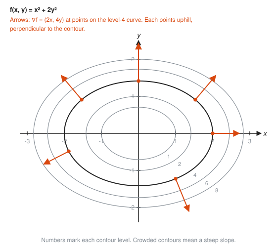
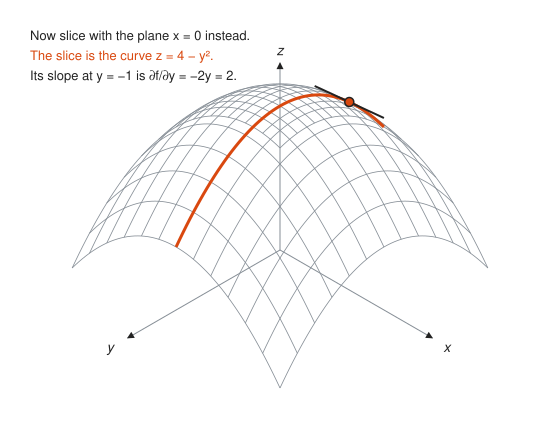
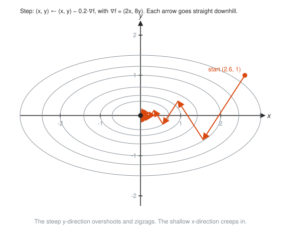

# Multivariable Calculus Intro

**Level:** 401 · **Unit:** 12 · **Time:** 75 to 90 minutes
**Prerequisites:** [03 Derivative Rules](../03-derivative-rules/README.md), [07 The Fundamental Theorem of Calculus](../07-fundamental-theorem/README.md), the coordinate plane from [201](../../201/README.md)

## The Big Idea

Real quantities depend on more than one input. Latency depends on load **and** replica count. Altitude on a map depends on east **and** north. A function of two variables, $z = f(x, y)$, is a landscape: every point $(x, y)$ on the floor has a height $z$.

Calculus extends to landscapes with three ideas:

* **Partial derivatives:** the slope when you walk in just one direction.
* **The gradient:** the arrow pointing straight uphill.
* **Double integrals:** volume under the landscape, found by adding thin columns.

Nothing here is new. It is the same calculus, applied one direction at a time.

## Picture It

<!-- diagram: type=surface f="4-x^2-y^2" domain=-1.5..1.5 slice=y:0 tangent-at=0.75 caption="A surface sliced by the plane y = 0" -->


Freeze $y = 0$ and the dome becomes an ordinary curve, $z = 4 - x^2$. Its slope is a plain one-variable derivative: $-2x$, which is $-1.5$ at $x = 0.75$. That slope is the **partial derivative** $\dfrac{\partial f}{\partial x}$. Slicing a surface turns a new problem into an old one.

## Step by Step

### 1. Functions of Two Variables

$f(x, y)$ takes a pair of inputs and returns one number. Examples: $f(x, y) = x^2 + 2y^2$, or latency $L(\lambda, n) = 10 + 0.5\lambda/n$ ms for load $\lambda$ and $n$ replicas. Graph it as a surface over the $xy$-floor.

### 2. Contour Maps

A surface is hard to draw. A **contour map** (or level-curve map) is easy: draw the curves where $f$ has the same value, like the height lines on a hiking map.

<!-- diagram: type=contour f="x^2+2y^2" levels=1,2,4,6,8 gradient-points=6 caption="Contours of x^2 + 2y^2 with gradient arrows" -->


Where contours crowd together the surface is steep. Where they spread apart it is gentle. A latency heatmap over (load, replicas) is a contour map with colors instead of lines.

### 3. Partial Derivatives

To find $\dfrac{\partial f}{\partial x}$ (read "partial f partial x"), treat $y$ as a constant and differentiate in $x$. To find $\dfrac{\partial f}{\partial y}$, treat $x$ as a constant. The curly $\partial$ is a reminder that other variables are being held still.

<!-- diagram: type=surface f="4-x^2-y^2" domain=-1.5..1.5 slice=x:0 tangent-at=y:-1 caption="Slicing the other way gives the other partial" -->


Slicing the dome along $x = 0$ gives the curve $z = 4 - y^2$. Its slope is $\dfrac{\partial f}{\partial y} = -2y$, which is $+2$ at $y = -1$: walking in the $+y$ direction there, you climb.

### 4. The Gradient

Bundle the partials into one arrow:

$$\nabla f = \left(\frac{\partial f}{\partial x}, \frac{\partial f}{\partial y}\right).$$

The symbol $\nabla$ is called "nabla" or "del". The gradient has three properties, all visible in the contour map above:

* It points in the direction of steepest ascent, straight uphill.
* Its length is the steepness in that direction.
* It is perpendicular to the contour line through the point. Walking along a contour keeps your height constant, and the gradient is the direction that changes it fastest.

### 5. Gradient Descent

To find the bottom of a valley, step against the gradient over and over:

$$(x, y) \leftarrow (x, y) - \eta\,\nabla f(x, y),$$

where $\eta$ (eta) is the step size.

<!-- diagram: type=contour f="x^2+4y^2" path="gradient descent from (2.6,1), step 0.2" caption="Gradient descent zigzags downhill" -->


The steep direction overshoots and zigzags. The gentle direction creeps. Too big a step and you bounce out of the valley. Too small and you wait forever. Every machine learning model you have ever deployed was trained by some version of this loop, and the [linear algebra for ML workshop](../../../workshops/linear-algebra-for-graphics-and-ml/README.md) picks it up.

### 6. Double Integrals: Volume as a Sum of Columns

To find the volume under $z = f(x, y)$ over a rectangle, chop the floor into small cells of area $\Delta A$. Over each cell stands a thin column of height $f$ at the cell's center. Add the columns:

$$\iint_R f(x, y)\,dA = \lim \sum f(x_i, y_j)\,\Delta A.$$

<!-- diagram: type=grid f="x+y" region=0..3,0..2 cells=6x4 caption="Double Riemann sum on a 6 by 4 grid" -->


It is the Riemann sum from [Lesson 06](../06-riemann-sums-and-area/README.md), with a grid of cells instead of a row of strips.

### 7. Iterated Integrals: One Direction at a Time

You never need a new antiderivative technique. Integrate in $y$ first (with $x$ held still), then integrate the result in $x$:

<!-- diagram: type=grid f="x+y" region=0..3,0..2 slice=x:1.85 caption="Double integral as stacked slices" -->


$$\int_0^3 \left( \int_0^2 (x + y)\,dy \right) dx.$$

The inner integral adds up one vertical slice. The outer integral adds up the slices.

## Worked Examples

### Example 1: Partial Derivatives

$f(x, y) = x^2 y + 3y^3$

```txt
  df/dx: treat y as a constant
         d/dx (x^2 y) = 2x y                y rides along like a coefficient
         d/dx (3y^3)  = 0                   no x at all: a constant
  df/dx = 2xy
  df/dy: treat x as a constant
         d/dy (x^2 y) = x^2                 x^2 is the coefficient now
         d/dy (3y^3)  = 9y^2
  df/dy = x^2 + 9y^2
```

### Example 2: The Gradient

$f(x, y) = x^2 + 2y^2$ at the point $(1, 1)$.

```txt
  df/dx = 2x,  df/dy = 4y                   partial derivatives
  grad f(1, 1) = (2, 4)                     substitute x = 1, y = 1
  length = sqrt(2^2 + 4^2) = sqrt(20) = 4.47     steepness uphill
  f(1, 1) = 3                                the point sits on the level-3 curve
```

The arrow $(2, 4)$ points more in $y$ than in $x$, because $2y^2$ climbs faster than $x^2$.

### Example 3: Sensitivity of Latency

Latency is $L(\lambda, n) = 10 + 0.5\,\lambda/n$ ms, with load $\lambda = 1000$ req/s and $n = 10$ replicas.

```txt
  L = 10 + 0.5 * 1000/10 = 60 ms                    current latency
  dL/d(lambda) = 0.5/n = 0.05 ms per req/s          hold n still
  dL/dn = -0.5 lambda / n^2 = -0.5 * 1000/100       hold lambda still
        = -5 ms per replica
```

One more replica buys about 5 ms. One hundred more req/s costs about 5 ms. The partials tell you the exchange rate between knobs.

### Example 4: An Iterated Integral

$\displaystyle\iint_R (x + y)\,dA$ over $0 \le x \le 3$, $0 \le y \le 2$.

```txt
  inner: integral from 0 to 2 of (x + y) dy       x is a constant here
       = [xy + y^2/2] from 0 to 2 = 2x + 2        evaluate in y
  outer: integral from 0 to 3 of (2x + 2) dx
       = [x^2 + 2x] from 0 to 3 = 9 + 6 = 15      matches the 24-cell sum
```

### Example 5: A Product Over a Square

$\displaystyle\int_0^1 \int_0^1 xy\,dy\,dx$

```txt
  inner: integral from 0 to 1 of xy dy = x [y^2/2] from 0 to 1 = x/2
  outer: integral from 0 to 1 of x/2 dx = [x^2/4] from 0 to 1 = 1/4
```

## See It Step by Step


[Least Squares Regression: open the step-by-step walkthrough](https://caseyaedwards.github.io/math_training/diagrams/linear-regression/)

Watch the line settle where the total of the squared residuals is as small as possible.

## The SRE Connection

* **Partials are sensitivities.** Capacity planning asks "what moves latency most?" The partial derivatives of a latency model answer it, knob by knob, in ms per unit. Example 3 says one replica is worth 100 req/s of load at the current operating point.
* **Heatmaps are double integrals waiting to happen.** A heatmap of request rate by (region, minute) is a grid of cells. Multiply each cell's rate by its time width and add over the whole grid: total requests. That is a double Riemann sum.
* **Gradient descent tunes systems.** Autotuners that adjust several knobs at once (pool sizes, timeouts, batch sizes) to minimize a cost often follow the gradient, measured by nudging each knob a little, exactly as the Code Corner does.
* **Next stop: vectors.** The gradient is a vector, and functions of many variables are best handled with matrices. That is [501](../../501/README.md).

## Common Mistakes

* Differentiating the "held" variable: in $\partial/\partial x$ of $x^2 y$, $y$ is a constant. The answer is $2xy$, not $2xy + x^2$.
* Thinking the gradient points along the contour: it points across, perpendicular to it.
* Stepping with the gradient instead of against it when minimizing: $+\nabla f$ climbs.
* Forgetting $\Delta A$ in a double sum: each column is height times floor area.
* Swapping the limits when the order changes: the $dy$ limits belong to $y$, the $dx$ limits to $x$.

## Try It

1. Find both partial derivatives of $f(x, y) = 3x^2 + 2xy + y^2$.
2. Find both partial derivatives of $f(x, y) = e^x \sin y$.
3. Find the gradient of $f(x, y) = x^2 + y^2$ at $(3, 4)$ and its length.
4. Describe the level curve $x^2 + y^2 = 25$.
5. Evaluate $\displaystyle\int_0^1 \int_0^2 (x + 2y)\,dy\,dx$.
6. Evaluate $\displaystyle\int_0^2 \int_0^3 6\,dx\,dy$. What shape is it?
7. With $L(\lambda, n) = 10 + 0.5\,\lambda/n$, find both partials at $\lambda = 2000$, $n = 20$.
8. Take one gradient descent step on $f(x, y) = x^2 + y^2$ from $(4, 2)$ with step size $0.25$.
9. A heatmap shows 3 regions by 4 one-minute buckets, every cell at 100 req/s. How many requests in total?

<details>
<summary>Answers</summary>

1. $f_x = 6x + 2y$, $f_y = 2x + 2y$.
2. $f_x = e^x \sin y$, $f_y = e^x \cos y$.
3. $\nabla f = (6, 8)$, length 10.
4. A circle of radius 5 centered at the origin.
5. 5. Inner: $2x + 4$. Outer: $1 + 4$.
6. 36. A box 3 by 2 by 6.
7. $\partial L/\partial\lambda = 0.025$ ms per req/s. $\partial L/\partial n = -0.5(2000)/400 = -2.5$ ms per replica.
8. $(2, 1)$. The gradient is $(8, 4)$, and $(4, 2) - 0.25(8, 4)$.
9. 72,000. $100 \times 60 \times 12$ cells.

</details>

## Code Corner

[`code/main.go`](code/main.go) measures partial derivatives by nudging one knob at a time, runs gradient descent, and adds up columns. Run it with `go run main.go` inside the `code/` folder.

```go
dLoad := (latency(load+h, reps) - latency(load-h, reps)) / (2 * h) // nudge load only
dReps := (latency(load, reps+h) - latency(load, reps-h)) / (2 * h) // nudge replicas only
```

Output:

```txt
latency 60.0 ms; d/dload = 0.0500 ms per req/s; d/dreplicas = -5.0000 ms per replica
  step  0: ( 2.60000,  1.00000)  f = 10.760000
  step  3: ( 0.56160, -0.21600)  f = 0.502019
  step  6: ( 0.12131,  0.04666)  f = 0.023422
  step  9: ( 0.02620, -0.01008)  f = 0.001093
  step 12: ( 0.00566,  0.00218)  f = 0.000051
    2 x 2   cells: volume = 15.000000
    6 x 6   cells: volume = 15.000000
  100 x 100 cells: volume = 15.000000
```

The $y$ coordinate flips sign every step: that is the zigzag in the picture. The volume is exact even with four cells, because midpoints are exact for a flat, tilted surface like $x + y$. Curved surfaces are less generous.

## Go Deeper

* [Paul's Online Math Notes, Calculus III](https://tutorial.math.lamar.edu/Classes/CalcIII/CalcIII.aspx): partial derivatives, gradients, and multiple integrals in depth.
* [MathWorld: Gradient](https://mathworld.wolfram.com/Gradient.html) and [Partial Derivative](https://mathworld.wolfram.com/PartialDerivative.html): definitions and notation.
* [Khan Academy: Multivariable Calculus](https://www.khanacademy.org/math/multivariable-calculus): visual videos of surfaces and gradients.
* [MIT OCW 18.02SC Multivariable Calculus](https://ocw.mit.edu/courses/18-02sc-multivariable-calculus-fall-2010/): the full follow-up course.
* [OpenStax Calculus Volume 3](https://openstax.org/details/books/calculus-volume-3): free textbook for multivariable calculus.
* Flashcards for this lesson: [cards.tsv](cards.tsv).

**Previous:** [11 Taylor Series](../11-taylor-series/README.md) · **Next:** [Checkpoint](../checkpoint.md)
