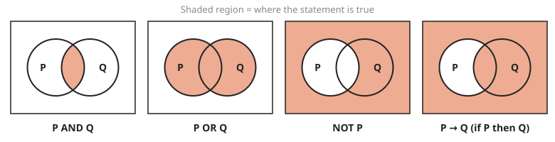
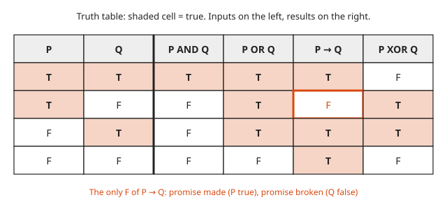
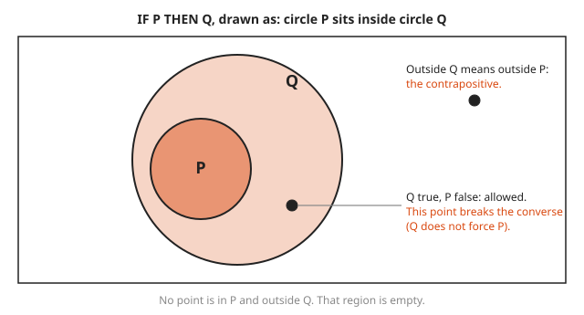
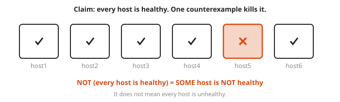
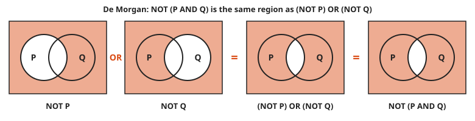

# Logic and Truth Tables

**Level:** 501 · **Unit:** 1, Discrete Math · **Time:** 45 to 60 minutes
**Prerequisites:** [Course 201: Algebra I and Geometry](../../201/README.md) · Next: [Sets and Functions](../02-sets-and-functions/README.md)

## The Big Idea

A **proposition** is a sentence that is either true or false: `the disk is full`, `7 is prime`. Logic combines propositions with a few connectives (AND, OR, NOT, IF-THEN) and asks one question: when is the combination true? A **truth table** answers that question by listing every case. You already do this every day in `if` statements and alert rules. This lesson gives the rules names and a picture.

## Picture It

<!-- diagram: type=venn-panels panels="P AND Q;P OR Q;NOT P;P->Q" shade=accent caption="Shaded region = where the statement is true" -->


Think of the box as every possible situation. Circle P holds the situations where P is true. Circle Q holds the situations where Q is true. Each connective shades a region:

* AND: only the overlap.
* OR: anything inside either circle.
* NOT P: everything outside P.
* IF P THEN Q: everything except the one sliver where P is true and Q is false. That sliver is the only way to break a promise.

## Step by Step

1. **Name the pieces.** Use letters for propositions. P = `the deploy finished`, Q = `the health check passes`.
2. **Learn the four core connectives:**

   | Symbol | Read As | Go | True When |
   |---|---|---|---|
   | $\lnot P$ | not P | `!p` | P is false |
   | $P \land Q$ | P and Q | `p && q` | both are true |
   | $P \lor Q$ | P or Q | `p \|\| q` | at least one is true |
   | $P \to Q$ | if P then Q | `!p \|\| q` | P is false, or Q is true |

3. **Build the truth table.** With two letters there are $2 \times 2 = 4$ rows. List them in binary counting order (T T, T F, F T, F F):

   | P | Q | $P \land Q$ | $P \lor Q$ | $P \to Q$ | $P \oplus Q$ (XOR) |
   |---|---|---|---|---|---|
   | T | T | T | T | T | F |
   | T | F | F | T | **F** | T |
   | F | T | F | T | T | T |
   | F | F | F | F | T | F |

   With $n$ letters there are $2^n$ rows, one for each combination. This is the same as counting the bit patterns of an $n$-bit integer.

<!-- diagram: type=truth-table vars=P,Q cols="AND,OR,IMPLIES,XOR" shade=true highlight="row2,IMPLIES" caption="truth table as a grid" -->


   Read the grid by color. AND is shaded in one row only. OR is shaded in three. IF-THEN is shaded everywhere except one cell.

4. **Understand the strange row of IF-THEN.** $P \to Q$ is a promise: `if the deploy finishes, the health check passes`. The promise is broken only when the deploy finishes and the check fails. When the deploy does not finish, the promise is not tested. Logic counts an untested promise as true. This is called **vacuous truth**. (Every alert rule for a service that does not exist passes. Vacuous truth is the reason.)

<!-- diagram: type=venn-subset inner=P outer=Q points="Q-only,outside" caption="if P then Q as circle P inside circle Q" -->


   A second way to see IF-THEN: draw P inside Q. Then being in P forces being in Q. The picture also shows the next step at a glance.
5. **Learn the equivalences that do real work.** Two formulas are **equivalent** ($\equiv$) when their truth-table columns match row for row:

   * **De Morgan:** $\lnot(P \land Q) \equiv \lnot P \lor \lnot Q$ and $\lnot(P \lor Q) \equiv \lnot P \land \lnot Q$. To negate, flip each piece and swap AND with OR.
   * **Contrapositive:** $P \to Q \equiv \lnot Q \to \lnot P$. `If full then fails` means the same as `if it did not fail then it was not full`.
   * **Converse is different:** $Q \to P$ is NOT equivalent to $P \to Q$. `If it rains the road is wet` does not give `if the road is wet it rained`.
   * **Implication as OR:** $P \to Q \equiv \lnot P \lor Q$. Compare the last two pictures above.

6. **Quantifiers.** `For all` ($\forall$) and `there exists` ($\exists$) talk about whole collections. Negation swaps them: the negation of `every host is healthy` is `some host is not healthy`, not `every host is unhealthy`.

<!-- diagram: type=row-of-boxes n=6 fail=5 caption="negating every" -->


   One failed host is enough to make `every host is healthy` false. Your pager agrees.

### Why It Is True: De Morgan

Write the columns side by side and compare:

| P | Q | $P \land Q$ | $\lnot(P \land Q)$ | $\lnot P$ | $\lnot Q$ | $\lnot P \lor \lnot Q$ |
|---|---|---|---|---|---|---|
| T | T | T | F | F | F | F |
| T | F | F | T | F | T | T |
| F | T | F | T | T | F | T |
| F | F | F | T | T | T | T |

Columns four and seven agree in every row. The two formulas are equivalent. A truth table is a complete proof for finitely many letters because it checks every case.

The same fact as regions: shade outside P, shade outside Q, and combine. The result is everything except the lens, which is exactly NOT (P AND Q).

<!-- diagram: type=venn-panels panels="NOT P;NOT Q;NOT P OR NOT Q;NOT (P AND Q)" caption="De Morgan as regions" -->


## Worked Examples

### Example 1: Evaluate a Compound Statement

Let P be true, Q be false, R be true. Evaluate $(P \lor Q) \land \lnot R$.

```txt
  (P or Q) and not R
= (T or F) and not T      substitute the values
= T and not T             T or F is T
= T and F                 not T is F
= F                       AND needs both sides true
```

### Example 2: Simplify an Alert Rule

A rule reads `not (cpu_ok and mem_ok)`. Rewrite it without the outer NOT.

```txt
  not (cpu_ok and mem_ok)
= (not cpu_ok) or (not mem_ok)     De Morgan: flip pieces, AND becomes OR
```

In words: the rule fires when CPU is not ok or memory is not ok.

### Example 3: Prove the Contrapositive With a Table

```txt
P  Q | P -> Q | not Q | not P | not Q -> not P
T  T |   T    |   F   |   F   |       T
T  F |   F    |   T   |   F   |       F        only row with T then F
F  T |   T    |   F   |   T   |       T
F  F |   T    |   T   |   T   |       T
```

The two result columns match in all four rows. The statements are equivalent.

## See It Step by Step


[Truth Tables: open the step-by-step walkthrough](https://caseyaedwards.github.io/math_training/diagrams/truth-tables/)

Watch the conditional come out false in exactly one row, where p is true and q is false.


[Logic Gates: open the step-by-step walkthrough](https://caseyaedwards.github.io/math_training/diagrams/logic-gates/)

Watch the signals flow left to right as each gate applies AND, OR or NOT.


[Set Operations with Venn Diagrams: open the step-by-step walkthrough](https://caseyaedwards.github.io/math_training/diagrams/set-operations/)

Watch the shaded regions for the complement of a union and the intersection of complements match, which is De Morgan's law.

## Common Mistakes

* Treating OR as exclusive: in logic, $P \lor Q$ is true when both are true. Use XOR ($\oplus$) for `one or the other but not both`.
* Swapping an implication with its converse: `if P then Q` does not give `if Q then P`. Check the second row of the table.
* Negating `all` as `none`: the negation of `all servers passed` is `at least one server failed`.
* Forgetting a row: with three letters there are $2^3 = 8$ rows. Count in binary to list them all.

## Try It

1. Build the truth table for $P \land \lnot Q$.
2. Evaluate $(T \lor F) \land \lnot T$.
3. How many rows does a truth table with four letters have?
4. Rewrite $\lnot(P \lor Q)$ without the outer NOT.
5. Write the negation of `every pod in the namespace is ready`.
6. State the converse and the contrapositive of `if the disk is full, then writes fail`. Which one means the same as the original?
7. Is $P \lor \lnot P$ true in every row? A formula that is always true is a **tautology**.
8. Show with a table that $P \to Q$ and $\lnot P \lor Q$ are equivalent.

<details>
<summary>Answers</summary>

1. Rows (P, Q, result): T T F, T F T, F T F, F F F. True only when P is true and Q is false.
2. F. The left part is T, `not T` is F, and T AND F is F.
3. $2^4 = 16$ rows.
4. $\lnot P \land \lnot Q$ by De Morgan.
5. `At least one pod in the namespace is not ready.`
6. Converse: `if writes fail, then the disk is full`. Contrapositive: `if writes do not fail, then the disk is not full`. The contrapositive is equivalent to the original. The converse is not.
7. Yes. In each row exactly one of $P$ and $\lnot P$ is true, and OR needs only one.
8. Rows (P, Q, $P \to Q$, $\lnot P \lor Q$): T T T T, T F F F, F T T T, F F T T. The columns match.

</details>

## Code Corner

A truth table is a brute-force loop over every row. The full program is [code/main.go](code/main.go). Run it from the `code` folder with `go run .`.

```go
func implies(p, q bool) bool { return !p || q }

for _, p := range []bool{true, false} {
	for _, q := range []bool{true, false} {
		fmt.Printf("%s %s |  %s   |  %s\n", tf(p), tf(q), tf(implies(p, q)), tf(implies(!q, !p)))
	}
}
```

Output:

```txt
P Q | P->Q | not Q -> not P
T T |  T   |  T
T F |  F   |  F
F T |  T   |  T
F F |  T   |  T
De Morgan holds on every row: true
1 letters -> 2 rows
2 letters -> 4 rows
3 letters -> 8 rows
4 letters -> 16 rows
```

The program also checks both De Morgan laws on all four rows. Computers do not get bored of truth tables. That is their advantage over people.

## Go Deeper

* [Wolfram MathWorld: Truth Table](https://mathworld.wolfram.com/TruthTable.html): short reference with the standard connectives.
* [MacTutor: George Boole](https://mathshistory.st-andrews.ac.uk/Biographies/Boole/): the man who turned logic into algebra.
* [MIT OCW 6.042J Mathematics for Computer Science](https://ocw.mit.edu/courses/6-042j-mathematics-for-computer-science-fall-2010/): free lecture notes on propositions and proofs.
* [Logic and Set Theory Track](../../../tracks/logic-and-set-theory/README.md): more practice in this repository.
