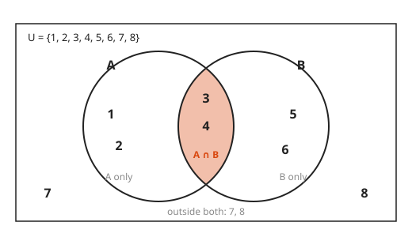
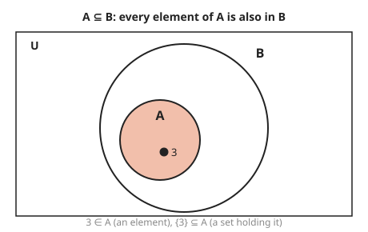
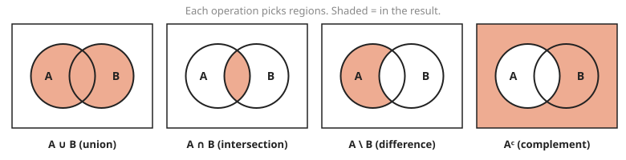
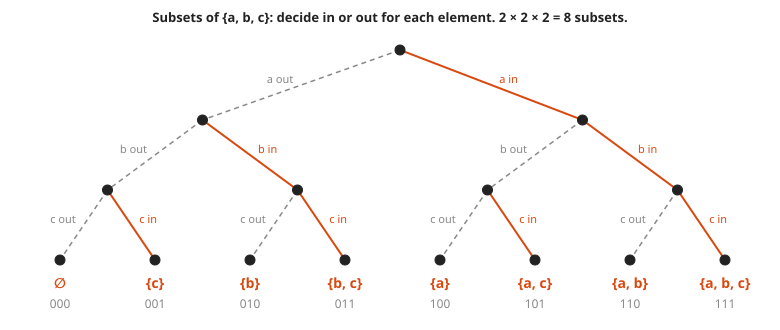
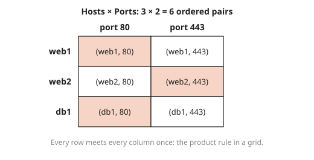
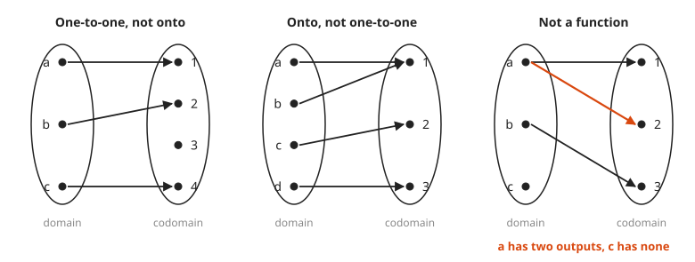
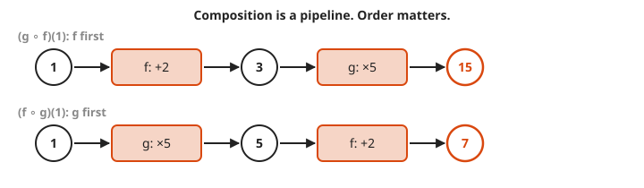

# Sets and Functions

**Level:** 501 · **Unit:** 1, Discrete Math · **Time:** 45 to 60 minutes
**Prerequisites:** [Logic and Truth Tables](../01-logic-and-truth-tables/README.md) · Next: [Counting](../03-counting/README.md)

## The Big Idea

A **set** is a collection of distinct things with no order: `{web1, web2, db1}`. A **function** is a rule that sends every input in one set to exactly one output in another set. Sets are the nouns of discrete math and functions are the verbs. Every later lesson uses both: an event in probability is a set, a graph is a set of vertices plus a set of edges, and a matrix is a function on vectors.

## Picture It

<!-- diagram: type=venn sets=A,B universe=1..8 A=1,2,3,4 B=3,4,5,6 shade=intersection caption="A and B inside U" -->


The box is the **universe** $U$, everything under discussion. Each circle is a set. Every element lands in exactly one of four regions: A only, both, B only, or neither. The set operations below just pick regions.

## Step by Step

1. **Membership.** $x \in A$ means `x is an element of A`. $x \notin A$ means it is not. Order and repeats do not matter: $\{1, 2, 2\} = \{2, 1\}$. A Go `map[T]bool` used as a set behaves the same way.
2. **Subsets.** $A \subseteq B$ means every element of A is also in B. The **empty set** $\varnothing$ is a subset of every set. (It has no elements that can break the rule. Vacuous truth again.)

<!-- diagram: type=venn-nested inner=A outer=B element=3 caption="A is a subset of B" -->


3. **The four main operations** (each one is a logic connective from the previous lesson in disguise):

   | Operation | Symbol | Elements | Logic |
   |---|---|---|---|
   | union | $A \cup B$ | in A or in B | OR |
   | intersection | $A \cap B$ | in A and in B | AND |
   | difference | $A \setminus B$ | in A and not in B | AND NOT |
   | complement | $A^c$ | in U and not in A | NOT |

<!-- diagram: type=venn-panels panels="union;intersection;difference;complement" caption="the four set operations" -->


4. **Size of a union.** Adding $|A| + |B|$ counts the overlap twice. Subtract it once:

   $$|A \cup B| = |A| + |B| - |A \cap B|$$

   This is **inclusion-exclusion**. The picture makes it obvious: the lens is inside both circles.
5. **Power set.** The set of all subsets of A. If $|A| = n$, there are $2^n$ subsets, because each element is either in or out, a yes/no choice made $n$ times.

<!-- diagram: type=decision-tree set=a,b,c branches=in,out leaves=8 caption="power set as in/out decisions" -->


   Each subset is a 3-bit mask. A permission set stored as a bitmask is a power set element in disguise.

6. **Cartesian product.** $A \times B$ is the set of ordered pairs $(a, b)$. Its size is $|A| \cdot |B|$. A grid of (host, port) pairs is a Cartesian product.

<!-- diagram: type=grid rows=web1,web2,db1 cols=80,443 cells=pairs caption="hosts times ports" -->


7. **Function.** $f : A \to B$ assigns to each $a$ in the **domain** $A$ exactly one $f(a)$ in the **codomain** $B$. The set of outputs actually hit is the **range**.

<!-- diagram: type=arrow-maps panels=3 caption="injective, surjective, not a function" -->


8. **Three special kinds of function:**

   * **One-to-one (injective):** different inputs give different outputs. No two arrows land on the same dot.
   * **Onto (surjective):** every element of the codomain is hit by at least one arrow.
   * **Bijection:** both. Every output is hit exactly once, and the function has an **inverse** $f^{-1}$ that runs the arrows backward.

9. **Composition.** $(g \circ f)(x) = g(f(x))$: run $f$ first, then $g$. It is a pipeline: `parse | filter`. Order matters.

<!-- diagram: type=pipeline rows="1>f:+2>3>g:x5>15; 1>g:x5>5>f:+2>7" caption="composition order" -->



### Why It Is True: Counting Functions

How many functions go from a 3-element set to a 2-element set? Each of the three inputs picks one of two outputs independently: $2 \times 2 \times 2 = 8$. In general there are $|B|^{|A|}$ functions from $A$ to $B$. That is why the set of all functions from $A$ to $B$ is often written $B^A$.

## Worked Examples

### Example 1: Set Operations

Let $U = \{1, \dots, 8\}$, $A = \{1, 2, 3, 4\}$, $B = \{3, 4, 5, 6\}$ (the picture above).

```txt
A ∪ B   = {1, 2, 3, 4, 5, 6}       everything in either circle
A ∩ B   = {3, 4}                   the shaded lens
A \ B   = {1, 2}                   A only
B \ A   = {5, 6}                   B only
A^c     = {5, 6, 7, 8}             everything in U outside A
|A ∪ B| = 4 + 4 - 2 = 6            inclusion-exclusion matches the count
```

### Example 2: Is It One-to-One? Is It Onto?

Let $f : \mathbb{R} \to \mathbb{R}$ with $f(x) = 2x + 1$.

```txt
f(a) = f(b)                 suppose two inputs give the same output
2a + 1 = 2b + 1             apply the rule
2a = 2b                     subtract 1
a = b                       divide by 2: the inputs were equal: one-to-one
y = 2x + 1                  pick any target y
x = (y - 1) / 2             solve for x: this input hits y: onto
f^-1(y) = (y - 1) / 2       bijection, and this is its inverse
```

### Example 3: A Hash Function Is Not One-to-One

A hash maps every string to one of $2^{32}$ buckets. There are far more than $2^{32}$ possible strings. Two different strings must share a bucket somewhere: the hash is not one-to-one. That is a **collision**. The [Counting](../03-counting/README.md) lesson names this argument: the pigeonhole principle.

## See It Step by Step


[Set Operations with Venn Diagrams: open the step-by-step walkthrough](https://caseyaedwards.github.io/math_training/diagrams/set-operations/)

Watch the shaded regions for the complement of a union and the intersection of complements match, which is De Morgan's law.


[Mapping Diagrams: open the step-by-step walkthrough](https://caseyaedwards.github.io/math_training/diagrams/mapping-diagram/)

Watch for any input with two arrows leaving it, since that one input breaks the function rule.


[Function Composition: Machines in a Row: open the step-by-step walkthrough](https://caseyaedwards.github.io/math_training/diagrams/function-composition/)

Watch the output of the first machine feed the second, and see the answer change when the order swaps.

## Common Mistakes

* Confusing $\in$ and $\subseteq$: $3 \in \{1, 3\}$, but $\{3\} \subseteq \{1, 3\}$. An element is not a set of elements.
* Forgetting the overlap: $|A \cup B| = |A| + |B|$ only when $A \cap B = \varnothing$.
* Calling something a function when an input has two outputs, or no output. Check the right panel of the arrow picture.
* Reading $g \circ f$ left to right: it means apply $f$ first.

## Try It

1. With $A = \{a, b, c, d\}$ and $B = \{c, d, e\}$, find $A \cup B$, $A \cap B$, and $A \setminus B$.
2. How many subsets does $\{x, y, z\}$ have? List them.
3. In a fleet, 40 hosts run nginx, 25 run redis, and 10 run both. How many hosts run at least one of the two?
4. Is $f(x) = x^2$ from the integers to the integers one-to-one? Onto?
5. Find the inverse of $f(x) = 3x - 6$.
6. With $f(x) = x + 2$ and $g(x) = 5x$, compute $(g \circ f)(1)$ and $(f \circ g)(1)$.
7. How many functions go from a 3-element set to a 2-element set? How many of them are one-to-one?
8. What is $|A \times B|$ when $|A| = 4$ and $|B| = 3$?

<details>
<summary>Answers</summary>

1. $A \cup B = \{a, b, c, d, e\}$, $A \cap B = \{c, d\}$, $A \setminus B = \{a, b\}$.
2. $2^3 = 8$: $\varnothing$, $\{x\}$, $\{y\}$, $\{z\}$, $\{x, y\}$, $\{x, z\}$, $\{y, z\}$, $\{x, y, z\}$.
3. $40 + 25 - 10 = 55$ hosts.
4. Not one-to-one: $f(2) = f(-2) = 4$. Not onto: no integer squares to 3 (or to any negative number).
5. $f^{-1}(y) = (y + 6)/3$. Check: $f(4) = 6$ and $(6 + 6)/3 = 4$.
6. $(g \circ f)(1) = g(3) = 15$. $(f \circ g)(1) = f(5) = 7$. Order matters.
7. $2^3 = 8$ functions. None is one-to-one: three inputs cannot land on three different outputs when only two exist.
8. $4 \times 3 = 12$ ordered pairs.

</details>

## Code Corner

Go has no built-in set type. A `map[int]bool` does the job. The full program is [code/main.go](code/main.go). Run it from the `code` folder with `go run .`.

```go
type set map[int]bool

func (a set) inter(b set) set {
	out := set{}
	for x := range a {
		if b[x] {
			out[x] = true
		}
	}
	return out
}

// oneToOne reports whether f gives different outputs for different inputs.
func oneToOne(f func(int) int, domain []int) bool {
	seen := map[int]bool{}
	for _, x := range domain {
		y := f(x)
		if seen[y] {
			return false
		}
		seen[y] = true
	}
	return true
}
```

Output:

```txt
A union B:   [1 2 3 4 5 6]
A inter B:   [3 4]
A minus B:   [1 2]
complement A: [5 6 7 8]
|A u B| = 6 = 4 + 4 - 2 = 6
x*x one-to-one on -3..3: false
2x+1 one-to-one on -3..3: true
g(f(1)) = 15  f(g(1)) = 7
```

## Go Deeper

* [Math Is Fun: Venn Diagrams](https://www.mathsisfun.com/sets/venn-diagrams.html): gentle pictures of unions and intersections.
* [Math Is Fun: Injective, Surjective and Bijective](https://www.mathsisfun.com/sets/injective-surjective-bijective.html): arrow diagrams like the ones above.
* [MacTutor: Georg Cantor](https://mathshistory.st-andrews.ac.uk/Biographies/Cantor/): the founder of set theory.
* [Logic and Set Theory Track](../../../tracks/logic-and-set-theory/README.md): more practice in this repository.
