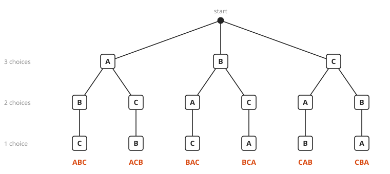
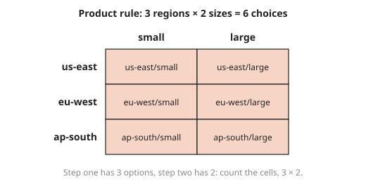
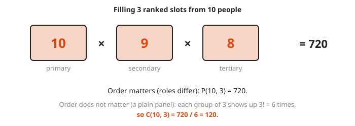
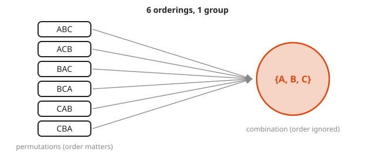
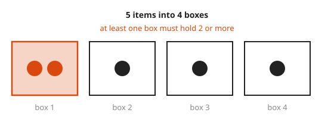
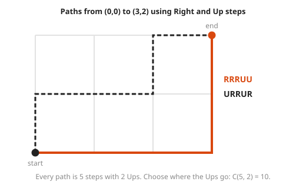

# Counting: Permutations, Combinations and the Pigeonhole Principle

**Level:** 501 · **Unit:** 1, Discrete Math · **Time:** 60 minutes
**Prerequisites:** [Sets and Functions](../02-sets-and-functions/README.md) · Next: [Probability Basics](../04-probability-basics/README.md)

## The Big Idea

Counting answers `how many ways?` without listing every way. Three tools cover most problems: the **product rule** (choices in a row multiply), **permutations** (arrangements where order matters), and **combinations** (selections where order does not matter). A fourth tool, the **pigeonhole principle**, proves that something must happen without counting at all. Probability in the next lesson is mostly counting: favorable cases divided by all cases.

## Picture It

<!-- diagram: type=tree levels=3 branching=3,2,1 leaves=ABC,ACB,BAC,BCA,CAB,CBA caption="arrangements of A, B, C" -->


To arrange three letters, pick the first (three choices), then the second (two choices left), then the last (one choice left). The tree has $3 \times 2 \times 1 = 6$ leaves. Every counting formula in this lesson is a way of counting the leaves of a tree like this without drawing it.

## Step by Step

1. **Product rule.** If a task is a sequence of steps, and step one has $a$ choices and step two has $b$ choices no matter what you picked first, the task has $a \times b$ outcomes. An 8-bit string has $2^8 = 256$ values: two choices, eight times.

<!-- diagram: type=grid rows=us-east,eu-west,ap-south cols=small,large caption="product rule as a grid" -->


   With two steps, the choices form a grid, and the count is rows times columns. With three steps, a box. With more, a tree.

2. **Factorial.** The number of ways to arrange $n$ distinct things in a row is

   $$n! = n \times (n-1) \times \dots \times 2 \times 1, \qquad 0! = 1.$$

3. **Permutations of $k$ out of $n$.** Fill only $k$ slots, order matters (a podium, a ranked list, a primary/secondary/tertiary on-call rotation):

   $$P(n, k) = n \times (n-1) \times \dots \times (n-k+1) = \frac{n!}{(n-k)!}$$

<!-- diagram: type=slots values=10,9,8 labels=primary,secondary,tertiary caption="filling ranked slots" -->


4. **Combinations of $k$ out of $n$.** Choose a group of $k$, order does not matter (a team, a hand of cards, a set of replicas). Each group was counted $k!$ times by $P(n, k)$, once for each ordering. Divide that out:

   $$\binom{n}{k} = \frac{P(n, k)}{k!} = \frac{n!}{k!\,(n-k)!}$$

   Read $\binom{n}{k}$ as `n choose k`.

<!-- diagram: type=many-to-one left=ABC,ACB,BAC,BCA,CAB,CBA right="{A,B,C}" caption="permutations collapse to one combination" -->


   Six orderings, one group. That is the division by $3! = 6$.
5. **Decide: does order matter?** Ask: if I swap two chosen items, is it a different outcome? Gold and silver swapped is a different podium (permutation). Alice and Bob swapped is the same team (combination).
6. **Pigeonhole principle.** If more than $k$ items go into $k$ boxes, some box holds at least two. More generally, $n$ items in $k$ boxes put at least $\lceil n/k \rceil$ items in some box.

<!-- diagram: type=boxes n=4 items=5 highlight=box1 caption="5 items into 4 boxes" -->


### Why It Is True: Pigeonhole

Suppose every box held at most one item. Then $k$ boxes hold at most $k$ items. But there are more than $k$ items. That is a contradiction. Some box holds two or more. For the general version, suppose every box held at most $\lceil n/k \rceil - 1$ items. Then the total is less than $k \cdot (n/k) = n$, another contradiction.

## Worked Examples

### Example 1: Product Rule

How many 3-letter codes use the letters A to Z, repeats allowed?

```txt
26 x 26 x 26     three slots, 26 choices each, repeats allowed
= 17,576         product rule
```

### Example 2: Order Matters vs Order Does Not

Ten engineers are available. Count (a) ways to fill primary, secondary and tertiary on-call, and (b) ways to pick a 3-person incident review panel.

```txt
(a) P(10, 3) = 10 x 9 x 8      three ranked slots, no repeats
             = 720             the roles differ: order matters
(b) C(10, 3) = 720 / 3!        each panel was counted once per ordering
             = 720 / 6
             = 120             a panel has no roles: order does not matter
```

### Example 3: Mixed Selection

Pick a team of three from 5 developers and 4 SREs with exactly two SREs.

```txt
C(4, 2)          = 6       choose the two SREs
C(5, 1)          = 5       choose the one developer
6 x 5            = 30      product rule: the two choices are independent steps
```

### Example 4: Pigeonhole for Hash Buckets

1,000 keys hash into 512 buckets. Show some bucket holds at least two keys.

```txt
n = 1000, k = 512          items and boxes
1000 > 512                 more items than boxes
ceil(1000 / 512) = 2       some bucket holds at least 2 keys
```

No hash function avoids this, however clever. It is a counting fact, not an engineering flaw.

### Example 5: Grid Paths

How many ways can you walk from (0, 0) to (3, 2) with steps Right (R) and Up (U)?

<!-- diagram: type=lattice-paths w=3 h=2 examples=RRRUU,URRUR caption="grid paths" -->


```txt
every path uses 3 R and 2 U       5 steps in total
a path = which 2 of the 5 are U   choosing positions, order of choosing does not matter
C(5, 2) = 10                      combinations
```

## Common Mistakes

* Using a combination when order matters (or the reverse): apply the swap test from step 5 every time.
* Forgetting that $0! = 1$: it makes $\binom{n}{0} = \binom{n}{n} = 1$, which is right: there is one way to choose nothing.
* Multiplying when the cases are alternatives: use the product rule for `this AND then that`. Add for `this OR that` when the cases do not overlap.
* Expecting pigeonhole to say which box: it proves that a crowded box exists, not where.

## Try It

1. How many arrangements does the word LOGS have?
2. How many 4-digit PINs have no repeated digit?
3. How many ways can you choose 2 of 6 cloud regions for a replica pair?
4. Eight services race in a benchmark. How many possible gold, silver, bronze results are there?
5. How many 5-card hands come from a 52-card deck?
6. 50 alerts fired over 7 days. Show that some day had at least 8 alerts.
7. On a grid, you walk from (0, 0) to (4, 3) using steps right or up. How many paths are there?
8. How many subsets of a 10-element set have exactly 3 elements? How many subsets does it have in total?
9. At least how many people must be in a room to guarantee two share a birthday (ignore leap years)?

<details>
<summary>Answers</summary>

1. $4! = 24$.
2. $10 \times 9 \times 8 \times 7 = 5{,}040$.
3. $\binom{6}{2} = 15$.
4. $P(8, 3) = 8 \times 7 \times 6 = 336$.
5. $\binom{52}{5} = 2{,}598{,}960$.
6. $\lceil 50/7 \rceil = 8$. If every day had at most 7 alerts, the total is at most $49 < 50$.
7. Every path has 7 steps, 3 of them up. Choose which steps go up: $\binom{7}{3} = 35$.
8. $\binom{10}{3} = 120$ subsets of size three, and $2^{10} = 1{,}024$ subsets in total.
9. 366 people. With 365 days as boxes, 366 people force a shared day.

</details>

## Code Corner

Compute the formulas, then list the arrangements by brute force to check them. The full program is [code/main.go](code/main.go). Run it from the `code` folder with `go run .`.

```go
func comb(n, k int) int {
	out := 1
	for i := 0; i < k; i++ {
		out = out * (n - i) / (i + 1) // stays an integer at every step
	}
	return out
}
```

Output:

```txt
3-letter codes: 17576
P(10,3) = 720  C(10,3) = 120
ABC orderings: [ABC ACB BAC BCA CAB CBA]
team with exactly 2 SREs: 30
5-card hands: 2598960
lattice paths to (3,2): 10
busiest bucket holds at least 2
```

The loop in `comb` divides at each step and still gets whole numbers: after step $i$ the running value is $\binom{n}{i+1}$, which is always an integer.

## Go Deeper

* [Math Is Fun: Combinations and Permutations](https://www.mathsisfun.com/combinatorics/combinations-permutations.html): clear, old-school walk-through with pictures.
* [Wolfram MathWorld: Pigeonhole Principle](https://mathworld.wolfram.com/PigeonholePrinciple.html): statement and variants.
* [Combinatorics Track](../../../tracks/combinatorics/README.md): more counting practice in this repository.
