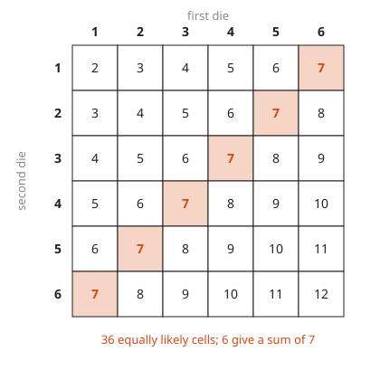
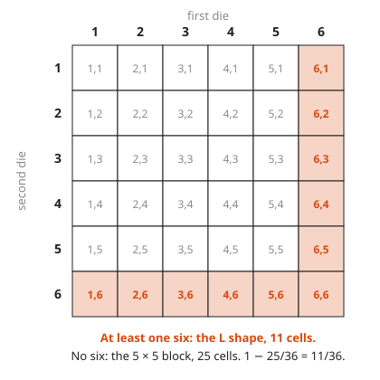
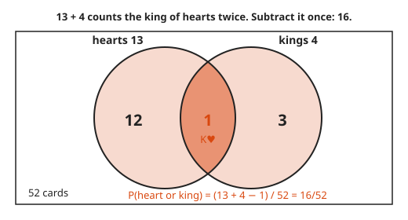
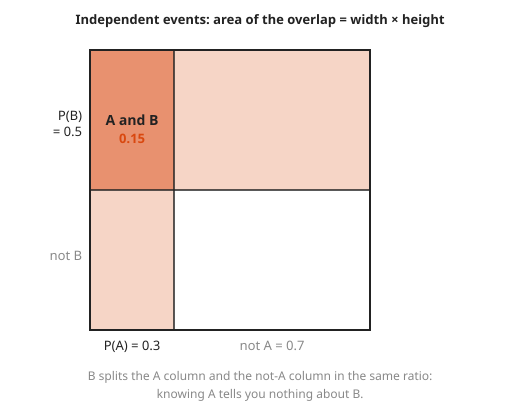
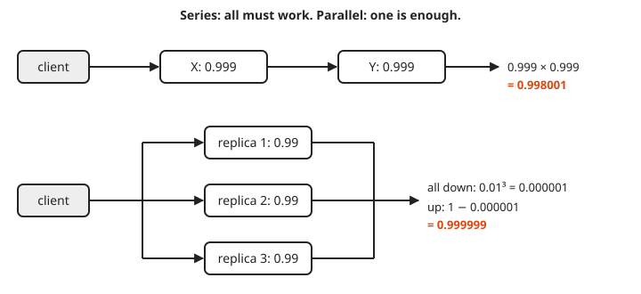

# Probability Basics

**Level:** 501 · **Unit:** 2, Probability · **Time:** 60 minutes
**Prerequisites:** [Counting](../03-counting/README.md), [Sets and Functions](../02-sets-and-functions/README.md) · Next: [Conditional Probability and Bayes](../05-conditional-probability-and-bayes/README.md)

## The Big Idea

Probability is a number from 0 to 1 that measures how much of the space of possible outcomes an event covers. 0 means impossible, 1 means certain. When every outcome is equally likely, probability is counting: favorable outcomes divided by all outcomes. A small set of rules (complement, addition, multiplication for independent events) handles most questions an on-call engineer asks, such as `what are the odds both replicas fail?`.

## Picture It

<!-- diagram: type=grid rows=6 cols=6 cell=sum highlight="sum=7" caption="two dice outcomes" -->


Roll two dice. Each cell is one outcome, and all 36 cells are equally likely. The event `the sum is 7` is the set of six highlighted cells. Its probability is the fraction of the grid it covers: $6/36 = 1/6$. Keep this picture in mind: an event is a region, and probability is the share of area.

## Step by Step

1. **Sample space.** The set $S$ of all possible outcomes. For two dice, $S$ is the 36 ordered pairs $(a, b)$.
2. **Event.** Any subset $A \subseteq S$. `Sum is 7` is $\{(1,6), (2,5), (3,4), (4,3), (5,2), (6,1)\}$.
3. **Equally likely outcomes.**

   $$P(A) = \frac{|A|}{|S|}$$

4. **The three axioms.** Every probability rule follows from these: $P(A) \ge 0$; $P(S) = 1$; for events that do not overlap, $P(A \cup B) = P(A) + P(B)$.
5. **Complement rule.** $P(\text{not } A) = 1 - P(A)$. Use it whenever the word `at least` appears. Counting the opposite is usually easier.

<!-- diagram: type=grid rows=6 cols=6 highlight="contains 6" caption="at least one six vs no six" -->


6. **Addition rule** (the inclusion-exclusion of [Sets and Functions](../02-sets-and-functions/README.md)):

   $$P(A \cup B) = P(A) + P(B) - P(A \cap B)$$

<!-- diagram: type=venn A="hearts 13" B="kings 4" overlap=1 caption="addition rule with cards" -->


7. **Independence.** Events $A$ and $B$ are **independent** when knowing one happened does not change the odds of the other. Then

   $$P(A \cap B) = P(A) \cdot P(B)$$

   Two separate dice are independent. Two replicas on the same rack, sharing one power supply, are not.

<!-- diagram: type=area-square pa=0.3 pb=0.5 caption="independence as an area" -->


   Picture probability as area in a unit square. When B cuts every column at the same height, the overlap is a rectangle, and its area is width times height.
8. **Series and parallel systems.** If a request needs service X AND service Y, multiply availabilities. If either replica alone can serve, compute the chance both fail and subtract from 1.

<!-- diagram: type=block-diagram series="X 0.999,Y 0.999" parallel="3 x 0.99" caption="series and parallel availability" -->


   Series is a chain: it is as strong as the product of its links. Parallel is a team: it fails only when everyone fails at once.

### Why It Is True: The Complement Rule

$A$ and `not A` do not overlap, and together they cover $S$. By the axioms, $P(A) + P(\text{not } A) = P(S) = 1$. Subtract $P(A)$ from both sides.

## Worked Examples

### Example 1: At Least One Six in Two Rolls

```txt
P(no six on one die)        = 5/6           five safe faces out of six
P(no six on either die)     = 5/6 x 5/6     the dice are independent
                            = 25/36
P(at least one six)         = 1 - 25/36     complement rule
                            = 11/36  ≈ 0.306
```

Check on the grid: row 6 and column 6 hold $6 + 6 - 1 = 11$ cells.

### Example 2: Heart or King

Draw one card from a standard 52-card deck.

```txt
P(heart)           = 13/52
P(king)            = 4/52
P(heart and king)  = 1/52                    the king of hearts
P(heart or king)   = 13/52 + 4/52 - 1/52     addition rule, remove the double count
                   = 16/52 = 4/13
```

### Example 3: Replicas in Parallel, Dependencies in Series

Each of three independent replicas is up 99% of the time. Any one replica can serve.

```txt
P(one replica down)   = 1 - 0.99 = 0.01      complement
P(all three down)     = 0.01^3 = 0.000001    independence: multiply
P(service up)         = 1 - 0.000001         complement again
                      = 0.999999             six nines
```

A request that needs two independent services, each 99.9% available, succeeds with probability $0.999 \times 0.999 = 0.998001$. Every hard dependency in series lowers availability.

## Common Mistakes

* Adding probabilities of events that overlap: subtract $P(A \cap B)$, or the answer can exceed 1.
* Multiplying probabilities of events that are not independent: shared racks, shared deploys and shared config break independence. This is why correlated failures hurt.
* Treating sums of two dice as equally likely: 7 has six cells, 2 has only one. Outcomes are the cells, not the sums.
* Calculating `at least one` directly: use $1 - P(\text{none})$.

## Try It

1. Two dice: what is $P(\text{sum} = 8)$?
2. Two dice: what is $P(\text{doubles})$?
3. Flip a fair coin three times. What is $P(\text{at least one head})$?
4. Two dice: what is $P(\text{sum} \ge 10)$?
5. Two independent services each have 99.9% availability. What is the availability if both are required? If either one is enough?
6. Let A = `first die shows 6` and B = `sum is 7`. Are A and B independent? Check with the product rule.
7. A batch job fails 5% of the time, independently each night. What is the chance of a full week (7 nights) with no failure?
8. One card is drawn. What is $P(\text{not a face card})$, where the face cards are J, Q, K?

<details>
<summary>Answers</summary>

1. Cells (2,6), (3,5), (4,4), (5,3), (6,2): $5/36$.
2. Six diagonal cells: $6/36 = 1/6$.
3. $1 - (1/2)^3 = 7/8$.
4. Sums 10, 11, 12 have $3 + 2 + 1 = 6$ cells: $6/36 = 1/6$.
5. Both required: $0.999^2 = 0.998001$. Either enough: $1 - 0.001^2 = 0.999999$.
6. $P(A) = 1/6$, $P(B) = 1/6$, $P(A \cap B) = P(\{(6,1)\}) = 1/36 = 1/6 \cdot 1/6$. Yes, independent. A surprise worth remembering.
7. $0.95^7 \approx 0.698$.
8. 12 face cards: $1 - 12/52 = 40/52 = 10/13$.

</details>

## Code Corner

Count the cells exactly with `math/big.Rat` (exact fractions), then compare with a simulation. The random generator has a fixed seed, which makes the output the same on every run. The full program is [code/main.go](code/main.go). Run it from the `code` folder with `go run .`.

```go
r := rand.New(rand.NewPCG(1, 2)) // fixed seed: same output every run
trials, sim := 100000, 0
for i := 0; i < trials; i++ {
	if r.IntN(6) == 5 || r.IntN(6) == 5 { // IntN(6) gives 0..5, and 5 means a six
		sim++
	}
}
```

Output:

```txt
P(sum = 7)          = 1/6
P(at least one six) = 11/36 = 0.3056
simulated           = 0.3050
series 0.999*0.999  = 0.998001
3 replicas parallel = 0.999999
```

The simulation lands close to the exact answer, not on it. More trials shrink the gap.

## Go Deeper

* [Math Is Fun: Probability](https://www.mathsisfun.com/data/probability.html): the basics with dice and coins.
* [Khan Academy: Statistics and Probability](https://www.khanacademy.org/math/statistics-probability): free videos and practice.
* [Workshop: Probability for On-Call, Error Budgets and SLOs](../../../workshops/probability-for-on-call-error-budgets-and-slos/README.md): availability math for real systems.
* [Probability Track](../../../tracks/probability/README.md): more practice in this repository.
